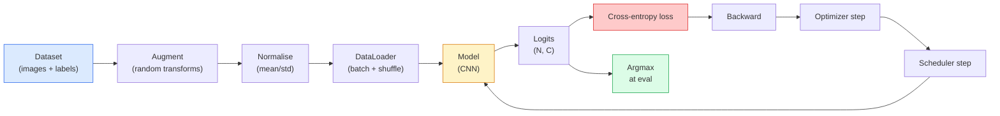

# 图像分类

> 分类器是一个从像素到类别概率分布的函数。其余都是工程细节。

**Type:** Build
**Languages:** Python
**Prerequisites:** Phase 2 Lesson 09 (Model Evaluation), Phase 3 Lesson 10 (Mini Framework), Phase 4 Lesson 03 (CNNs)
**Time:** ~75 minutes

## 学习目标

- 在 CIFAR-10 上构建端到端图像分类 pipeline：数据集、增强、模型、训练循环、评估
- 解释每个组件的作用（DataLoader、损失、优化器、调度器、增强），并预测破坏其中任何一个会怎样反映在 loss 曲线上
- 从零实现 mixup、cutout 和标签平滑，并说明每种方法何时值得加入
- 阅读混淆矩阵和逐类精确率 / 召回率表，从而在总体准确率之外诊断数据集与模型失败

## 问题

每个交付的视觉任务，在某种意义上都归结为图像分类。检测是对区域分类。分割是对像素分类。检索是按与类中心的相似度排序。把分类做对——数据集循环、增强策略、损失、评估——是向本阶段其他任务迁移的技能。

大多数分类 bug 不在模型里，而在 pipeline 中：错误的标准化、未打乱的训练集、扭曲标签的增强、被训练数据污染的验证划分、在第 30 个 epoch 后悄然发散的学习率。一个配置正确时能在 CIFAR-10 上达到 93% 的 CNN，配置 broken 时通常只得到 70-75%，而 loss 曲线看起来一直合理。

本节课手工连接整个 pipeline，让每个部分都可检查。你不会使用 `torchvision.datasets` 里任何可能隐藏 bug 的东西。

## 概念

### 分类 pipeline



这个循环里的每一行都是 bug 可能藏身之处。交叉熵接收原始 logits，而不是 softmax 输出，所以任何在 loss 前做 `model(x).softmax()` 的操作都会默默算出错误梯度。增强只作用于输入，不作用于标签——除了 mixup，它同时混合两者。`optimizer.zero_grad()` 必须每步一次；跳过它会累积梯度，看起来就像学习率极不稳定。这些 bug 都会压平学习曲线，却不会报错。

### 交叉熵、logits 与 softmax

分类器每张图像产生 `C` 个数字，称为 logits。应用 softmax 把它们变成概率分布：

```math
\mathop{\mathrm{softmax}}(z)_i = \frac{\exp(z_i)}{\sum_j \exp(z_j)}
```

交叉熵度量正确类的负对数概率：

```math
\begin{aligned}
\mathrm{CE}(z, y) &= -\log\left( \mathop{\mathrm{softmax}}(z)_y \right) \\
&= -z_y + \log\left( \sum_j \exp(z_j) \right)
\end{aligned}
```

右边是数值稳定形式（log-sum-exp）。PyTorch 的 `nn.CrossEntropyLoss` 把 softmax + NLL 融合成一个 op，直接接收原始 logits。先自己应用 softmax 几乎总是 bug——你会计算 $\log(\mathop{\mathrm{softmax}}(\mathop{\mathrm{softmax}}(z)))$，一个没有意义的量。

### 为什么增强有效

CNN 对平移有归纳偏置（来自权重共享），但对裁剪、翻转、颜色抖动、遮挡没有内置不变性。教它这些不变性的唯一方法，就是给它看能体现这些变化的像素。训练时的每次随机变换都在说：「这两张图像标签相同；学习忽略差异的特征。」

```
Original crop:  "dog facing left"
Flip:           "dog facing right"       <- same label, different pixels
Rotate(+15):    "dog, slight tilt"
Colour jitter:  "dog in warmer light"
RandomErasing:  "dog with patch missing"
```

规则：增强必须保留标签。对数字做 Cutout 和旋转可能把「6」变成「9」；对这种数据集，你要使用更小的旋转范围，并选择尊重数字特定不变性的增强。

### Mixup 与 Cutmix

普通增强变换像素但保持标签 one-hot。**Mixup** 和 **Cutmix** 通过同时插值输入和标签来打破这一点。

```
Mixup:
  lambda ~ Beta(a, a)
  x = lambda * x_i + (1 - lambda) * x_j
  y = lambda * y_i + (1 - lambda) * y_j

Cutmix:
  paste a random rectangle of x_j into x_i
  y = area-weighted mix of y_i and y_j
```

它有效的原因：模型不再记忆尖锐的 one-hot 目标，而是学习类之间的插值。训练 loss 上升，测试准确率上升。它是任何分类器最便宜的鲁棒性升级。

### 标签平滑

Mixup 的表亲。不直接训练 `[0, 0, 1, 0, 0]`，而是训练 `[eps/C, eps/C, 1-eps, eps/C, eps/C]`，其中 `eps` 很小，比如 0.1。阻止模型产生任意尖锐的 logits，并几乎零成本地改善校准。PyTorch 1.10 起内置为 `nn.CrossEntropyLoss(label_smoothing=0.1)`。

### 准确率之外的评估

总体准确率会掩盖不平衡。一个 90-10 的二分类器如果总是预测多数类，得分就是 90%。真正告诉你发生什么的工具：

- **逐类准确率** —— 每个类一个数字；立即暴露表现差的类别。
- **混淆矩阵** —— $C \times C$ 网格，行 $i$ 列 $j$ = 真实类 $i$ 被预测为类 $j$ 的次数；对角线是正确，非对角线才是模型真正生活的地方。
- **Top-1 / Top-5** —— 正确类是否在前 1 或前 5 个预测中；Top-5 对 ImageNet 重要，因为「Norwich terrier」和「Norfolk terrier」这类类别确实模糊。
- **校准（ECE）** —— 0.8 置信度的预测是否 80% 正确？现代网络系统性地过度自信；可用温度缩放或标签平滑修正。

```figure
receptive-field
```

## 构建它

### 第 1 步：确定性合成数据集

CIFAR-10 存在磁盘上。为了让本节课可复现且快速，我们构建一个看起来像 CIFAR 的合成数据集：32x32 RGB 图像，每个类有特定的结构供模型学习。完全相同的 pipeline 可以无改动地用于真实 CIFAR-10。

```python
import numpy as np
import torch
from torch.utils.data import Dataset


def synthetic_cifar(num_per_class=1000, num_classes=10, seed=0):
    rng = np.random.default_rng(seed)
    X = []
    Y = []
    for c in range(num_classes):
        centre = rng.uniform(0, 1, (3,))
        freq = 2 + c
        for _ in range(num_per_class):
            yy, xx = np.meshgrid(np.linspace(0, 1, 32), np.linspace(0, 1, 32), indexing="ij")
            r = np.sin(xx * freq) * 0.5 + centre[0]
            g = np.cos(yy * freq) * 0.5 + centre[1]
            b = (xx + yy) * 0.5 * centre[2]
            img = np.stack([r, g, b], axis=-1)
            img += rng.normal(0, 0.08, img.shape)
            img = np.clip(img, 0, 1)
            X.append(img.astype(np.float32))
            Y.append(c)
    X = np.stack(X)
    Y = np.array(Y)
    idx = rng.permutation(len(X))
    return X[idx], Y[idx]


class ArrayDataset(Dataset):
    def __init__(self, X, Y, transform=None):
        self.X = X
        self.Y = Y
        self.transform = transform

    def __len__(self):
        return len(self.X)

    def __getitem__(self, i):
        img = self.X[i]
        if self.transform is not None:
            img = self.transform(img)
        img = torch.from_numpy(img).permute(2, 0, 1)
        return img, int(self.Y[i])
```

每个类有自己的色调和频率模式，加上高斯噪声，迫使模型学习信号而非记忆像素。十个类，每类一千张图像，已打乱。

### 第 2 步：标准化与增强

每个视觉 pipeline 都有的两种变换。

```python
def standardize(mean, std):
    mean = np.array(mean, dtype=np.float32)
    std = np.array(std, dtype=np.float32)
    def _fn(img):
        return (img - mean) / std
    return _fn


def random_hflip(p=0.5):
    def _fn(img):
        if np.random.random() < p:
            return img[:, ::-1, :].copy()
        return img
    return _fn


def random_crop(pad=4):
    def _fn(img):
        h, w = img.shape[:2]
        padded = np.pad(img, ((pad, pad), (pad, pad), (0, 0)), mode="reflect")
        y = np.random.randint(0, 2 * pad)
        x = np.random.randint(0, 2 * pad)
        return padded[y:y + h, x:x + w, :]
    return _fn


def compose(*fns):
    def _fn(img):
        for fn in fns:
            img = fn(img)
        return img
    return _fn
```

在裁剪前使用镜像填充而非零填充，因为黑色边框是模型会学会以无用方式忽略的信号。

### 第 3 步：Mixup

在训练步骤中混合两张图像和两个标签。作为 batch 级变换实现，因此它位于前向传播旁边，而不是数据集内部。

```python
def mixup_batch(x, y, num_classes, alpha=0.2):
    if alpha <= 0:
        return x, torch.nn.functional.one_hot(y, num_classes).float()
    lam = float(np.random.beta(alpha, alpha))
    idx = torch.randperm(x.size(0), device=x.device)
    x_mixed = lam * x + (1 - lam) * x[idx]
    y_onehot = torch.nn.functional.one_hot(y, num_classes).float()
    y_mixed = lam * y_onehot + (1 - lam) * y_onehot[idx]
    return x_mixed, y_mixed


def soft_cross_entropy(logits, soft_targets):
    log_probs = torch.log_softmax(logits, dim=-1)
    return -(soft_targets * log_probs).sum(dim=-1).mean()
```

`soft_cross_entropy` 是针对软标签分布的交叉熵。当目标恰好是 one-hot 时，它退化为通常的 one-hot 情况。

### 第 4 步：训练循环

完整配方：遍历一次数据，每 batch 一次梯度，每 epoch 一次 scheduler。

```python
import torch
import torch.nn as nn
from torch.utils.data import DataLoader
from torch.optim import SGD
from torch.optim.lr_scheduler import CosineAnnealingLR

def train_one_epoch(model, loader, optimizer, device, num_classes, use_mixup=True):
    model.train()
    total, correct, loss_sum = 0, 0, 0.0
    for x, y in loader:
        x, y = x.to(device), y.to(device)
        if use_mixup:
            x_m, y_soft = mixup_batch(x, y, num_classes)
            logits = model(x_m)
            loss = soft_cross_entropy(logits, y_soft)
        else:
            logits = model(x)
            loss = nn.functional.cross_entropy(logits, y, label_smoothing=0.1)
        optimizer.zero_grad()
        loss.backward()
        optimizer.step()
        loss_sum += loss.item() * x.size(0)
        total += x.size(0)
        # Training accuracy vs the un-mixed labels `y` is only an approximation
        # when mixup is on (the model saw soft targets, not y). Treat it as a
        # rough progress signal; rely on val accuracy for real performance.
        with torch.no_grad():
            pred = logits.argmax(dim=-1)
            correct += (pred == y).sum().item()
    return loss_sum / total, correct / total


@torch.no_grad()
def evaluate(model, loader, device, num_classes):
    model.eval()
    total, correct = 0, 0
    loss_sum = 0.0
    cm = torch.zeros(num_classes, num_classes, dtype=torch.long)
    for x, y in loader:
        x, y = x.to(device), y.to(device)
        logits = model(x)
        loss = nn.functional.cross_entropy(logits, y)
        pred = logits.argmax(dim=-1)
        for t, p in zip(y.cpu(), pred.cpu()):
            cm[t, p] += 1
        loss_sum += loss.item() * x.size(0)
        total += x.size(0)
        correct += (pred == y).sum().item()
    return loss_sum / total, correct / total, cm
```

每次写训练循环都要检查的五个不变量：

1. 训练前 `model.train()`，评估前 `model.eval()`——这会切换 dropout 和 batchnorm 行为。
2. `.zero_grad()` 在 `.backward()` 之前。
3. 累加指标时用 `.item()`，避免任何对象继续持有计算图。
4. 评估时用 `@torch.no_grad()`——节省内存和时间，防止微妙事故。
5. 对原始 logits 做 argmax，而不是 softmax——结果相同，少一个操作。

### 第 5 步：组合起来

使用前一节课的 `TinyResNet`，训练几个 epoch，然后评估。

```python
from main import synthetic_cifar, ArrayDataset
from main import standardize, random_hflip, random_crop, compose
from main import mixup_batch, soft_cross_entropy
from main import train_one_epoch, evaluate
# TinyResNet comes from the previous lesson (03-cnns-lenet-to-resnet).
# Adjust the import path to wherever you stored the previous lesson's code.
from cnns_lenet_to_resnet import TinyResNet  # example placeholder

X, Y = synthetic_cifar(num_per_class=500)
split = int(0.9 * len(X))
X_train, Y_train = X[:split], Y[:split]
X_val, Y_val = X[split:], Y[split:]

mean = [0.5, 0.5, 0.5]
std = [0.25, 0.25, 0.25]
train_tf = compose(random_hflip(), random_crop(pad=4), standardize(mean, std))
eval_tf = standardize(mean, std)

train_ds = ArrayDataset(X_train, Y_train, transform=train_tf)
val_ds = ArrayDataset(X_val, Y_val, transform=eval_tf)

train_loader = DataLoader(train_ds, batch_size=128, shuffle=True, num_workers=0)
val_loader = DataLoader(val_ds, batch_size=256, shuffle=False, num_workers=0)

device = "cuda" if torch.cuda.is_available() else "cpu"
model = TinyResNet(num_classes=10).to(device)
optimizer = SGD(model.parameters(), lr=0.1, momentum=0.9, weight_decay=5e-4, nesterov=True)
scheduler = CosineAnnealingLR(optimizer, T_max=10)

for epoch in range(10):
    tr_loss, tr_acc = train_one_epoch(model, train_loader, optimizer, device, 10, use_mixup=True)
    va_loss, va_acc, _ = evaluate(model, val_loader, device, 10)
    scheduler.step()
    print(f"epoch {epoch:2d}  lr {scheduler.get_last_lr()[0]:.4f}  "
          f"train {tr_loss:.3f}/{tr_acc:.3f}  val {va_loss:.3f}/{va_acc:.3f}")
```

在合成数据集上，5 个 epoch 内验证准确率就接近完美，这正是关键：pipeline 正确，模型就能学会可学的东西。把数据集换成真实 CIFAR-10，同样的循环无需改动就能训练到约 90%。

### 第 6 步：阅读混淆矩阵

准确率本身永远不会告诉你模型在哪里失败。混淆矩阵会。

```python
def print_confusion(cm, labels=None):
    c = cm.shape[0]
    labels = labels or [str(i) for i in range(c)]
    print(f"{'':>6}" + "".join(f"{l:>5}" for l in labels))
    for i in range(c):
        row = cm[i].tolist()
        print(f"{labels[i]:>6}" + "".join(f"{v:>5}" for v in row))
    print()
    tp = cm.diag().float()
    fp = cm.sum(dim=0).float() - tp
    fn = cm.sum(dim=1).float() - tp
    prec = tp / (tp + fp).clamp_min(1)
    rec = tp / (tp + fn).clamp_min(1)
    f1 = 2 * prec * rec / (prec + rec).clamp_min(1e-9)
    for i in range(c):
        print(f"{labels[i]:>6}  prec {prec[i]:.3f}  rec {rec[i]:.3f}  f1 {f1[i]:.3f}")

_, _, cm = evaluate(model, val_loader, device, 10)
print_confusion(cm)
```

行是真实类，列是预测。如果类 3 和类 5 之间出现一簇非对角计数，说明模型把这两类搞混了，这为你定向收集数据或做类特定增强提供了起点。

## 使用它

`torchvision` 把上面所有内容包装成语义化的组件。对真实 CIFAR-10，完整 pipeline 是四行代码加训练循环。

```python
from torchvision.datasets import CIFAR10
from torchvision.transforms import Compose, RandomCrop, RandomHorizontalFlip, ToTensor, Normalize

mean = (0.4914, 0.4822, 0.4465)
std = (0.2470, 0.2435, 0.2616)
train_tf = Compose([
    RandomCrop(32, padding=4, padding_mode="reflect"),
    RandomHorizontalFlip(),
    ToTensor(),
    Normalize(mean, std),
])
eval_tf = Compose([ToTensor(), Normalize(mean, std)])

train_ds = CIFAR10(root="./data", train=True,  download=True, transform=train_tf)
val_ds   = CIFAR10(root="./data", train=False, download=True, transform=eval_tf)
```

注意两点：mean/std 是**数据集相关**的——在 CIFAR-10 训练集上计算，而不是 ImageNet——镜像填充是社区默认的裁剪策略。在这里复制 ImageNet 统计量是一个约 1% 的准确率泄漏，没人发现，直到有人去 profile 模型。

## 交付它

本节课产出：

- `outputs/prompt-classifier-pipeline-auditor.md` —— 一个 prompt，审查训练脚本是否满足上面五个不变量，并找出第一个违反。
- `outputs/skill-classification-diagnostics.md` —— 一个 skill，给定混淆矩阵和类别名列表，总结逐类失败并提议最具影响力的单一修复。

## 练习

1. **（简单）** 在合成数据集上分别用 mixup 和不用 mixup 训练同一模型 5 个 epoch。绘制两者的 train/val loss。解释为什么 mixup 训练 loss 更高，但 val 准确率相近或更好。
2. **（中等）** 实现 Cutout——在每张训练图像中把随机 8x8 方块置零——并运行消融：无增强、hflip+crop、hflip+crop+cutout、hflip+crop+mixup。报告每种设置的 val 准确率。
3. **（困难）** 构建一个 CIFAR-100 pipeline（100 类，相同输入尺寸），复现 ResNet-34 训练运行到公布准确率的 1% 以内。附加：扫描三个学习率和两个权重衰减，记录到本地 CSV，生成最终的混淆矩阵-top 混淆表。

## 关键术语

| Term | What people say | What it actually means |
|------|----------------|----------------------|
| Logits | "Raw outputs" | The pre-softmax vector of C numbers per image; cross-entropy expects these, not softmaxed values |
| Cross-entropy | "The loss" | Negative log-probability of the correct class; combines log-softmax and NLL in one stable op |
| DataLoader | "The batcher" | Wraps a dataset with shuffling, batching, and (optional) multi-worker loading; gets blamed for half of training bugs |
| Augmentation | "Random transforms" | Any pixel-level transform at training time that preserves the label; teaches invariances the CNN does not have natively |
| Mixup / Cutmix | "Mix two images" | Blend both inputs and labels so the classifier learns smooth interpolations instead of hard boundaries |
| Label smoothing | "Softer targets" | Replace one-hot with (1-eps, eps/(C-1), ...); improves calibration and slightly boosts accuracy |
| Top-k accuracy | "Top-5" | The correct class is in the k highest-probability predictions; used on datasets with genuinely ambiguous classes |
| Confusion matrix | "Where errors live" | C x C table where entry (i, j) counts images of true class i predicted as j; diagonal is right, off-diagonal tells you what to fix |

## 延伸阅读

- [CS231n: Training Neural Networks](https://cs231n.github.io/neural-networks-3/) —— 仍是单页上最清晰的训练 pipeline 导览
- [Bag of Tricks for Image Classification (He et al., 2019)](https://arxiv.org/abs/1812.01187) —— 每个小技巧合起来为 ImageNet 上的 ResNet 增加 3-4% 准确率
- [mixup: Beyond Empirical Risk Minimization (Zhang et al., 2017)](https://arxiv.org/abs/1710.09412) —— 原始 mixup 论文；三页理论加令人信服的实验
- [Why temperature scaling matters (Guo et al., 2017)](https://arxiv.org/abs/1706.04599) —— 证明现代网络校准不良，并用一个标量参数修复它的论文
