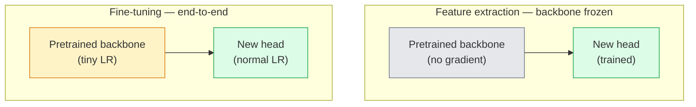

# 迁移学习与微调

> 别人已经花了上百万 GPU 小时教会网络认识边缘、纹理和物体部件。在训练你自己的模型之前，先借用这些特征。

**Type:** Build
**Languages:** Python
**Prerequisites:** Phase 4 Lesson 03 (CNNs), Phase 4 Lesson 04 (Image Classification)
**Time:** ~75 minutes

## 学习目标

- 区分特征提取与微调，并根据数据集规模、领域距离和计算预算选择合适方案
- 加载预训练 backbone，替换其分类头，并在 20 行以内仅训练头部得到一个可用的基线
- 使用判别学习率逐层解冻，让早期通用特征获得比晚期任务特定特征更小的更新
- 诊断三种常见失败：对未冻结块使用过高学习率导致的特征漂移、小数据集上的 BN 统计量崩溃，以及灾难性遗忘

## 问题

在 ImageNet 上训练一个 ResNet-50 大约需要 2,000 GPU 小时。很少有团队能为每个任务都承担这样的预算。几乎所有团队实际交付的，都是在几百或几千张任务特定图像上训练新头部的预训练 backbone。

这不是捷径。任何在 ImageNet 上训练过的 CNN，其第一个卷积块学习的是边缘和类 Gabor 滤波器；接下来几个块学习纹理和简单图案；中间块学习物体部件；最后几个块学习开始看起来像 1,000 个 ImageNet 类别的组合。这个层次结构的前 90% 几乎可以原样迁移到医学影像、工业检测、卫星数据和几乎所有其他视觉任务——因为自然图像的边缘和纹理词汇有限。最后 10% 才是你真正需要训练的部分。

把迁移学习做好，有三个陷阱在等着你：用太高的学习率破坏预训练特征、冻结太多导致模型学不到信息、以及让 BatchNorm 的 running statistics 向一个网络其余部分从未见过的小数据集漂移。本节课会故意带你走过每一个陷阱。

## 概念

### 特征提取 vs 微调

两种模式，取决于你对预训练特征的信任程度以及你拥有的数据量。



经验法则：

| Dataset size | Domain distance | Recipe |
|--------------|-----------------|--------|
| < 1k images | close to ImageNet | Freeze backbone, train head only |
| 1k-10k | close | Freeze first 2-3 stages, fine-tune the rest |
| 10k-100k | any | Fine-tune end-to-end with discriminative LR |
| 100k+ | far | Fine-tune everything; consider training from scratch if domain is far enough |

"Close to ImageNet" 大致指包含类物体内容的自然 RGB 照片。医学 CT 扫描、俯视卫星影像和显微图像属于远距离领域——特征仍然有帮助，但你需要让更多层参与适应。

### 为什么冻结能奏效

CNN 在 ImageNet 上学到的特征并不是专门针对那 1,000 个类别的，而是专门针对自然图像的统计规律：特定方向的边缘、纹理、对比度模式、形状基元。这些统计规律在人类能命名的几乎每个视觉领域都是稳定的。这就是为什么一个在 ImageNet 上训练、仅换了一个线性头而 backbone 完全未微调的模型，在 CIFAR-10 上能达到 80% 以上的准确率。分类头只是在学习为当前任务加权那些已经学到的特征。

### 判别学习率

当你解冻时，早期层应该比晚期层训练得更慢。早期层编码的是你希望保留的通用特征；晚期层编码的是需要大幅调整的任务特定结构。

```
Typical recipe:

  stage 0 (stem + first group): lr = base_lr / 100    (mostly fixed)
  stage 1:                       lr = base_lr / 10
  stage 2:                       lr = base_lr / 3
  stage 3 (last backbone group): lr = base_lr
  head:                          lr = base_lr  (or slightly higher)
```

在 PyTorch 中，这只需要把参数分组传给优化器。一个模型，五种学习率，零额外代码。

### BatchNorm 问题

BN 层保存了在 ImageNet 上计算得到的 `running_mean` 和 `running_var` 缓冲。如果你的任务有不同的像素分布——不同的光照、不同的传感器、不同的色彩空间——这些缓冲就是错的。按优先顺序有三种选择：

1. **在训练模式下微调 BN。** 让 BN 随其他参数一起更新 running statistics。这是中等规模数据集（>= 5k 样本）时的默认选择。
2. **在 eval 模式下冻结 BN。** 保留 ImageNet 统计量，只训练权重。当你的数据集小到 BN 的移动平均会很嘈杂时，这是正确选择。
3. **用 GroupNorm 替换 BN。** 彻底消除移动平均问题。用于检测和分割 backbone 中每 GPU batch size 极小的情况。

搞错这一点会悄无声息地让准确率下降 5-15%。

### 分类头设计

分类头通常是 1-3 层线性层，可选 dropout。每个 torchvision backbone 都带一个默认头，你需要替换它：

```python
backbone.fc = nn.Linear(backbone.fc.in_features, num_classes)          # ResNet
backbone.classifier[1] = nn.Linear(..., num_classes)                    # EfficientNet, MobileNet
backbone.heads.head = nn.Linear(..., num_classes)                       # torchvision ViT
```

对于小数据集，通常单层线性层就够了。当任务分布离 backbone 的训练分布较远时，增加一个隐藏层（Linear -> ReLU -> Dropout -> Linear）会有帮助。

### 逐层学习率衰减

判别学习率的一种更平滑版本，用于现代微调（BEiT、DINOv2、ViT-B 微调）。不再把层分成 stage，而是让每一层的学习率都比上一层稍小：

```math
\text{lr\_layer}_k = \text{base\_lr} \cdot \text{decay}^{L - k}
```

当 decay = 0.75、L = 12 个 transformer block 时，第一个 block 的学习率约为 head 的 `0.75^11 ≈ 0.04x`。这对 transformer 微调比 CNN 更重要，在 CNN 中按 stage 分组的学习率通常已经足够。

### 评估什么

迁移学习运行需要跟踪两个从零训练时不会跟踪的数值：

- **Pretrained-only accuracy** —— backbone 冻结时 head 的准确率。这是你的下限。
- **Fine-tuned accuracy** —— 端到端训练后的同一模型。这是你的上限。

如果微调后比仅预训练还差，说明你有学习率或 BN 的 bug。两个数都要打印出来。

```figure
transfer-learning
```

## 构建它

### Step 1: 加载预训练 backbone 并检查结构

```python
import torch
import torch.nn as nn
from torchvision.models import resnet18, ResNet18_Weights

backbone = resnet18(weights=ResNet18_Weights.IMAGENET1K_V1)
print(backbone)
print()
print("classifier head:", backbone.fc)
print("feature dim:", backbone.fc.in_features)
```

`ResNet18` 有四个 stage（`layer1..layer4`），加上 stem 和一个 `fc` 头。每个 torchvision 分类 backbone 都有类似的结构。

### Step 2: 特征提取 —— 冻结全部并替换头部

```python
def make_feature_extractor(num_classes=10):
    model = resnet18(weights=ResNet18_Weights.IMAGENET1K_V1)
    for p in model.parameters():
        p.requires_grad = False
    model.fc = nn.Linear(model.fc.in_features, num_classes)
    return model

model = make_feature_extractor(num_classes=10)
trainable = sum(p.numel() for p in model.parameters() if p.requires_grad)
frozen = sum(p.numel() for p in model.parameters() if not p.requires_grad)
print(f"trainable: {trainable:>10,}")
print(f"frozen:    {frozen:>10,}")
```

只有 `model.fc` 是可训练的。backbone 是一个冻结的特征提取器。

### Step 3: 判别微调

一个工具函数，用于构建带有 stage 特定学习率的参数分组。

```python
def discriminative_param_groups(model, base_lr=1e-3, decay=0.3):
    stages = [
        ["conv1", "bn1"],
        ["layer1"],
        ["layer2"],
        ["layer3"],
        ["layer4"],
        ["fc"],
    ]
    groups = []
    for i, names in enumerate(stages):
        lr = base_lr * (decay ** (len(stages) - 1 - i))
        params = [p for n, p in model.named_parameters()
                  if any(n.startswith(k) for k in names)]
        if params:
            groups.append({"params": params, "lr": lr, "name": "_".join(names)})
    return groups

model = resnet18(weights=ResNet18_Weights.IMAGENET1K_V1)
model.fc = nn.Linear(model.fc.in_features, 10)
for p in model.parameters():
    p.requires_grad = True

groups = discriminative_param_groups(model)
for g in groups:
    print(f"{g['name']:>10s}  lr={g['lr']:.2e}  params={sum(p.numel() for p in g['params']):>8,}")
```

`decay=0.3` 表示每个 stage 的学习率是下一个 stage 的 30%。`fc` 得到 `base_lr`，`layer4` 得到 `0.3 * base_lr`，`conv1` 得到 `0.3^5 * base_lr ≈ 0.00243 * base_lr`。听起来很极端；经验上它有效。

### Step 4: BatchNorm 处理

一个辅助函数：冻结 BN 的 running statistics，但不冻结它的权重。

```python
def freeze_bn_stats(model):
    for m in model.modules():
        if isinstance(m, (nn.BatchNorm1d, nn.BatchNorm2d, nn.BatchNorm3d)):
            m.eval()
            for p in m.parameters():
                p.requires_grad = False
    return model
```

在每个 epoch 开始调用 `model.train()` 之后再调用它。`model.train()` 会把所有模块切换到训练模式；这个函数只把 BN 层恢复回来。

### Step 5: 最小化端到端微调循环

```python
from torch.optim import SGD
from torch.utils.data import DataLoader
from torch.optim.lr_scheduler import CosineAnnealingLR
import torch.nn.functional as F

def fine_tune(model, train_loader, val_loader, device, epochs=5, base_lr=1e-3, freeze_bn=False):
    model = model.to(device)
    groups = discriminative_param_groups(model, base_lr=base_lr)
    optimizer = SGD(groups, momentum=0.9, weight_decay=1e-4, nesterov=True)
    scheduler = CosineAnnealingLR(optimizer, T_max=epochs)

    for epoch in range(epochs):
        model.train()
        if freeze_bn:
            freeze_bn_stats(model)
        tr_loss, tr_correct, tr_total = 0.0, 0, 0
        for x, y in train_loader:
            x, y = x.to(device), y.to(device)
            logits = model(x)
            loss = F.cross_entropy(logits, y, label_smoothing=0.1)
            optimizer.zero_grad()
            loss.backward()
            optimizer.step()
            tr_loss += loss.item() * x.size(0)
            tr_total += x.size(0)
            tr_correct += (logits.argmax(-1) == y).sum().item()
        scheduler.step()

        model.eval()
        va_total, va_correct = 0, 0
        with torch.no_grad():
            for x, y in val_loader:
                x, y = x.to(device), y.to(device)
                pred = model(x).argmax(-1)
                va_total += x.size(0)
                va_correct += (pred == y).sum().item()
        print(f"epoch {epoch}  train {tr_loss/tr_total:.3f}/{tr_correct/tr_total:.3f}  "
              f"val {va_correct/va_total:.3f}")
    return model
```

用上述配方在 CIFAR-10 上训练 5 个 epoch，`ResNet18-IMAGENET1K_V1` 的准确率可以从约 70% 的零样本线性探测准确率提升到约 93% 的微调准确率。如果不动 backbone，只训练 head 会在约 86% 处饱和。

### Step 6: 渐进式解冻

一种从末尾向开头每个 epoch 解冻一个 stage 的调度策略。以额外 epoch 为代价缓解特征漂移。

```python
def progressive_unfreeze_schedule(model):
    stages = ["layer4", "layer3", "layer2", "layer1"]
    yielded = set()

    def start():
        for p in model.parameters():
            p.requires_grad = False
        for p in model.fc.parameters():
            p.requires_grad = True

    def unfreeze(epoch):
        if epoch < len(stages):
            name = stages[epoch]
            yielded.add(name)
            for n, p in model.named_parameters():
                if n.startswith(name):
                    p.requires_grad = True
            return name
        return None

    return start, unfreeze
```

在第一个 epoch 前调用一次 `start()`。在每个 epoch 开始时调用 `unfreeze(epoch)`。当可训练参数集合发生变化时，要重建优化器，否则冻结参数仍持有缓存的动量，会干扰优化。

## 使用它

对于大多数真实任务，`torchvision.models` 加三行代码就够了。上面更复杂的机制只在库默认值无法解决的问题出现时才有意义。

```python
from torchvision.models import resnet50, ResNet50_Weights

model = resnet50(weights=ResNet50_Weights.IMAGENET1K_V2)
model.fc = nn.Linear(model.fc.in_features, num_classes)
optimizer = torch.optim.AdamW(model.parameters(), lr=1e-4, weight_decay=1e-4)
```

另外两个生产级默认值：

- `timm` 提供约 800 个预训练视觉 backbone，API 一致（`timm.create_model("resnet50", pretrained=True, num_classes=10)`）。对于超出 torchvision zoo 的任何微调，它是标准选择。
- 对于 transformer，`transformers.AutoModelForImageClassification.from_pretrained(name, num_labels=N)` 提供与文本模型相同加载语义的 ViT / BEiT / DeiT。

## 交付它

本节课产出：

- `outputs/prompt-fine-tune-planner.md` —— 一个 prompt，根据数据集规模、领域距离和计算预算选择特征提取、渐进解冻还是端到端微调。
- `outputs/skill-freeze-inspector.md` —— 一个 skill，给定一个 PyTorch 模型后报告哪些参数可训练、哪些 BatchNorm 层处于 eval 模式，以及优化器是否真的接收到了可训练参数。

## 练习

1. **（简单）** 在同一个合成 CIFAR 数据集上，把 `ResNet18` 分别作为线性探测（backbone 冻结）和完全微调来训练。并排报告两个准确率。解释哪个差距说明特征迁移良好，哪个说明迁移不佳。
2. **（中等）** 故意引入一个 bug：把 backbone stage 的 `base_lr` 设为 `1e-1`，而不是 head。展示训练损失如何爆炸，然后用 `discriminative_param_groups` 辅助函数恢复。记录每个 stage 开始发散时的学习率。
3. **（困难）** 取一个医学影像数据集（如 CheXpert-small、PatchCamelyon 或 HAM10000），比较三种方案：(a) ImageNet 预训练冻结 backbone + 线性头；(b) ImageNet 预训练端到端微调；(c) 从零训练。报告每种方案的准确率和计算成本。在什么数据量下从零训练变得有竞争力？

## 关键术语

| Term | What people say | What it actually means |
|------|----------------|----------------------|
| Feature extraction | "Freeze and train head" | Backbone parameters frozen, only the new classifier head receives gradient |
| Fine-tuning | "Retrain end-to-end" | All parameters trainable, usually with much smaller LR than scratch training |
| Discriminative LR | "Smaller LR for early layers" | Optimizer parameter groups where early-stage LR is a fraction of late-stage LR |
| Layer-wise LR decay | "Smooth LR gradient" | Per-layer LR multiplied by decay^(L - k); common in transformer fine-tunes |
| Catastrophic forgetting | "The model lost ImageNet" | A too-high LR overwrites pretrained features before the new task signal is learnt |
| BN statistics drift | "Running mean is wrong" | BatchNorm running_mean/var computed on a different distribution than the current task, silently hurting accuracy |
| Linear probe | "Frozen backbone + linear head" | Evaluation of pretrained features — accuracy of the best linear classifier on top of the frozen representation |
| Catastrophic collapse | "Everything predicts one class" | Happens when fine-tuning with an LR high enough to destroy features before gradients from the head can stabilise |

## 延伸阅读

- [How transferable are features in deep neural networks? (Yosinski et al., 2014)](https://arxiv.org/abs/1411.1792) —— 量化跨层特征可迁移性的论文
- [Universal Language Model Fine-tuning (ULMFiT, Howard & Ruder, 2018)](https://arxiv.org/abs/1801.06146) —— 原始判别学习率 / 渐进解冻配方；思想可直接迁移到视觉
- [timm documentation](https://huggingface.co/docs/timm) —— 现代视觉 backbone 及其精确微调默认设置的参考
- [A Simple Framework for Linear-Probe Evaluation (Kornblith et al., 2019)](https://arxiv.org/abs/1805.08974) —— 为什么线性探测准确率重要以及如何正确报告
