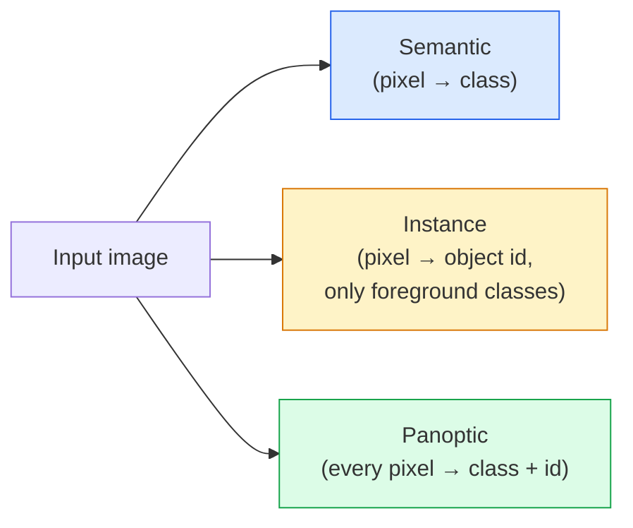
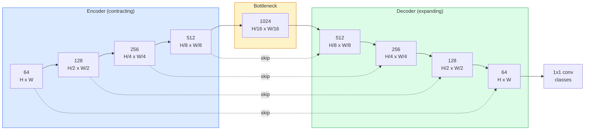

# 语义分割——U-Net

> 分割是对每个像素做分类。U-Net 通过把下采样编码器与上采样解码器配对，并在它们之间连接跳跃连接，让这件事成为可能。

**Type:** Build
**Languages:** Python
**Prerequisites:** Phase 4 Lesson 03 (CNNs), Phase 4 Lesson 04 (Image Classification)
**Time:** ~75 minutes

## 学习目标

- 区分语义分割、实例分割和全景分割，并针对给定问题选择正确任务
- 在 PyTorch 中从零构建 U-Net，包括编码器块、瓶颈、带转置卷积的解码器和跳跃连接
- 实现像素级交叉熵、Dice 损失，以及当前医学和工业分割默认使用的组合损失
- 读取每类的 IoU 和 Dice 指标，诊断差分来自小目标召回、边界精度还是类别不平衡

## 问题

分类输出每张图一个标签。检测输出每张图少量边界框。分割输出每个像素一个标签。对于 `H x W` 的输入，输出是 `H x W` 形状的张量（语义分割）或 `H x W x N_instances` 形状的张量（实例分割）。也就是说每张图要做上百万次预测，而不是一次。

分割的结构决定了它几乎支撑所有密集预测视觉产品：医学影像（肿瘤掩膜）、自动驾驶（道路、车道、障碍物）、卫星影像（建筑轮廓、作物边界）、文档解析（版面区域）、机器人（可抓取区域）。这些任务都不能靠给物体画个框解决；它们需要精确的轮廓。

建筑问题说起来简单，解决起来不易：你需要网络同时看到图像的全局上下文（这是什么场景）和局部像素细节（到底哪个像素属于道路而非人行道）。标准 CNN 为了获得上下文会压缩空间分辨率，从而丢弃细节。U-Net 正是同时拿到两者的设计。

## 概念

### 语义分割 vs 实例分割 vs 全景分割



- **Semantic（语义）** 说「这个像素是道路，那个像素是汽车」。相邻的两辆车会融合成一个 blob。
- **Instance（实例）** 说「这个像素属于车 #3，那个像素属于车 #5」。忽略背景类（stuff = 天空、道路、草地）。
- **Panoptic（全景）** 统一两者：每个像素都有类别标签，每个 thing 实例还有唯一 ID。

本节课讲语义分割。下一节课（Mask R-CNN）讲实例分割。

### U-Net 结构



编码器把空间分辨率减半四次，通道数翻倍。解码器则相反：空间分辨率翻倍四次，通道数减半。跳跃连接在每个分辨率上把对应编码器特征与解码器特征拼接。最后的 1x1 卷积把 `64 -> num_classes` 映射回全分辨率。

跳跃连接为何必要：解码器在尝试输出像素级预测时，只见过小尺寸特征图。没有跳跃连接，它无法精确定位边缘，因为这些信息在编码器中被压缩掉了。跳跃连接把编码器在下采样过程中计算的高分辨率特征图直接交给解码器。

### 转置卷积 vs 双线性上采样

解码器必须扩大空间尺寸。两种选择：

- **转置卷积**（`nn.ConvTranspose2d`）—— 可学习的上采样。历史上 U-Net 的默认选择。如果 stride 和 kernel size 不能整除，可能产生棋盘状伪影。
- **双线性上采样 + 3x3 卷积** —— 平滑上采样后再卷积。伪影更少，参数更少，现在是现代默认。

两者在业界都有使用。第一次实现 U-Net 时，双线性更安全。

### 像素网格上的交叉熵

对于具有 $C$ 个类别的语义分割，模型输出为 `(N, C, H, W)`，目标是 `(N, H, W)` 的整数类别 ID。交叉熵与分类情况完全相同，只是应用到每个空间位置：

```math
\text{Loss} = \mathop{\mathrm{mean}}\limits_{(n, h, w)} \left[ -\log\left( \mathop{\mathrm{softmax}}(\text{logits}[n, :, h, w])[\text{target}[n, h, w]] \right) \right]
```

PyTorch 的 `F.cross_entropy` 原生支持这种形状，无需 reshape。

### Dice 损失及为何需要它

交叉熵把每个像素同等对待。当一个类别主导整幅图像时，这是错误的（医学影像：99% 背景，1% 肿瘤）。网络可以靠全预测背景就拿到 99% 准确率，却仍然毫无用处。

Dice 损失通过直接优化预测掩膜与真实掩膜之间的重叠来解决：

```math
\begin{aligned}
\mathop{\mathrm{Dice}}(p, y) &= \frac{2 \sum (p \cdot y)}{\sum p + \sum y + \epsilon} \\
\text{Dice}_{\text{loss}} &= 1 - \text{Dice}
\end{aligned}
```

其中 `p` 是某类的 sigmoid/softmax 概率图，`y` 是二值真实掩膜。只有重叠完美时损失才为零。由于它是比例式的，类别失衡不再影响损失。

实践中使用**组合损失**：

```math
L = L_{\text{cross\_entropy}} + \lambda \cdot L_{\text{dice}} \qquad (\lambda \approx 1)
```

交叉熵在训练早期提供稳定梯度；Dice 在训练后期把注意力集中在真正匹配掩膜形状上。这种组合是医学影像的默认选择，在任何类别不平衡的数据集上都很难被击败。

### 评估指标

- **Pixel accuracy** —— 正确预测像素的比例。计算便宜。在数据不平衡时会失效，原因与分类中准确率会失效一样。
- **IoU per class** —— 每个类别掩膜的交并比；跨类平均即为 mIoU。
- **Dice（像素级 F1）** —— 与 IoU 类似；$\text{Dice} = 2 \cdot \text{IoU} / (1 + \text{IoU})$。医学影像偏好 Dice，自动驾驶社区偏好 IoU；两者单调相关。
- **Boundary F1** —— 测量预测边界与真实边界的接近程度，即使微小偏移也会受罚。对半导体检测等高精度任务很重要。

要报告每类 IoU，而不是只看 mIoU。平均 IoU 会掩盖「一个类别 15% 而另外九个类别 85%」的情况。

### 输入分辨率 trade-off

U-Net 的编码器把分辨率减半四次，因此输入必须能被 16 整除。医学图像常为 512x512 或 1024x1024。自动驾驶裁剪图为 2048x1024。U-Net 的内存成本与 `H * W * C_max` 成正比，1024x1024 输入配合 1024 通道瓶颈时，前向传播已经需要数 GB 显存。

两种常用解决方案：
1. 把输入切分成 256x256 的 tile，带重叠地处理，再拼接。
2. 把瓶颈换成空洞卷积（dilated conv），在保持更高空间分辨率的同时扩大感受野（DeepLab 系列）。

对于第一个模型，256x256 输入配合 64 通道基底的 U-Net 可在 8 GB 显存上舒适训练。

```figure
segmentation-flood
```

## 构建它

### Step 1: 编码器块

两个带批归一化和 ReLU 的 3x3 卷积。第一个卷积改变通道数；第二个保持。

```python
import torch
import torch.nn as nn
import torch.nn.functional as F

class DoubleConv(nn.Module):
    def __init__(self, in_c, out_c):
        super().__init__()
        self.net = nn.Sequential(
            nn.Conv2d(in_c, out_c, kernel_size=3, padding=1, bias=False),
            nn.BatchNorm2d(out_c),
            nn.ReLU(inplace=True),
            nn.Conv2d(out_c, out_c, kernel_size=3, padding=1, bias=False),
            nn.BatchNorm2d(out_c),
            nn.ReLU(inplace=True),
        )

    def forward(self, x):
        return self.net(x)
```

这个块被反复使用。`bias=False` 是因为 BN 的 beta 已经承担了偏置作用。

### Step 2: 下采样和上采样块

```python
class Down(nn.Module):
    def __init__(self, in_c, out_c):
        super().__init__()
        self.net = nn.Sequential(
            nn.MaxPool2d(2),
            DoubleConv(in_c, out_c),
        )

    def forward(self, x):
        return self.net(x)


class Up(nn.Module):
    def __init__(self, in_c, out_c):
        super().__init__()
        self.up = nn.Upsample(scale_factor=2, mode="bilinear", align_corners=False)
        self.conv = DoubleConv(in_c, out_c)

    def forward(self, x, skip):
        x = self.up(x)
        if x.shape[-2:] != skip.shape[-2:]:
            x = F.interpolate(x, size=skip.shape[-2:], mode="bilinear", align_corners=False)
        x = torch.cat([skip, x], dim=1)
        return self.conv(x)
```

仅检查空间尺寸（`shape[-2:]`）可以处理不能被 16 整除的输入；安全的 `F.interpolate` 会在拼接前对齐张量。如果比较完整形状，还会因通道数差异触发，那应该是显式报错，而不是默默插值。

### Step 3: U-Net

```python
class UNet(nn.Module):
    def __init__(self, in_channels=3, num_classes=2, base=64):
        super().__init__()
        self.inc = DoubleConv(in_channels, base)
        self.d1 = Down(base, base * 2)
        self.d2 = Down(base * 2, base * 4)
        self.d3 = Down(base * 4, base * 8)
        self.d4 = Down(base * 8, base * 16)
        self.u1 = Up(base * 16 + base * 8, base * 8)
        self.u2 = Up(base * 8 + base * 4, base * 4)
        self.u3 = Up(base * 4 + base * 2, base * 2)
        self.u4 = Up(base * 2 + base, base)
        self.outc = nn.Conv2d(base, num_classes, kernel_size=1)

    def forward(self, x):
        x1 = self.inc(x)
        x2 = self.d1(x1)
        x3 = self.d2(x2)
        x4 = self.d3(x3)
        x5 = self.d4(x4)
        x = self.u1(x5, x4)
        x = self.u2(x, x3)
        x = self.u3(x, x2)
        x = self.u4(x, x1)
        return self.outc(x)

net = UNet(in_channels=3, num_classes=2, base=32)
x = torch.randn(1, 3, 256, 256)
print(f"output: {net(x).shape}")
print(f"params: {sum(p.numel() for p in net.parameters()):,}")
```

输出形状 `(1, 2, 256, 256)` —— 与输入相同的空间尺寸，`num_classes` 个通道。`base=32` 时约 770 万参数。

### Step 4: 损失函数

```python
def dice_loss(logits, targets, num_classes, eps=1e-6):
    probs = F.softmax(logits, dim=1)
    targets_one_hot = F.one_hot(targets, num_classes).permute(0, 3, 1, 2).float()
    dims = (0, 2, 3)
    intersection = (probs * targets_one_hot).sum(dim=dims)
    denom = probs.sum(dim=dims) + targets_one_hot.sum(dim=dims)
    dice = (2 * intersection + eps) / (denom + eps)
    return 1 - dice.mean()


def combined_loss(logits, targets, num_classes, lam=1.0):
    ce = F.cross_entropy(logits, targets)
    dc = dice_loss(logits, targets, num_classes)
    return ce + lam * dc, {"ce": ce.item(), "dice": dc.item()}
```

Dice 按类计算再平均（macro Dice）。`eps` 防止批次中不存在的类别出现除零。

### Step 5: IoU 指标

```python
@torch.no_grad()
def iou_per_class(logits, targets, num_classes):
    preds = logits.argmax(dim=1)
    ious = torch.zeros(num_classes)
    for c in range(num_classes):
        pred_c = (preds == c)
        true_c = (targets == c)
        inter = (pred_c & true_c).sum().float()
        union = (pred_c | true_c).sum().float()
        ious[c] = (inter / union) if union > 0 else torch.tensor(float("nan"))
    return ious
```

返回长度为 C 的向量。`nan` 标记批次中不存在的类别——计算 mIoU 时不要对它们取平均。

### Step 6: 用于端到端验证的合成数据集

在彩色背景上生成形状，让网络学习形状而非像素颜色。

```python
import numpy as np
from torch.utils.data import Dataset, DataLoader

def synthetic_segmentation(num_samples=200, size=64, seed=0):
    rng = np.random.default_rng(seed)
    images = np.zeros((num_samples, size, size, 3), dtype=np.float32)
    masks = np.zeros((num_samples, size, size), dtype=np.int64)
    for i in range(num_samples):
        bg = rng.uniform(0, 1, (3,))
        images[i] = bg
        masks[i] = 0
        num_shapes = rng.integers(1, 4)
        for _ in range(num_shapes):
            cls = int(rng.integers(1, 3))
            color = rng.uniform(0, 1, (3,))
            cx, cy = rng.integers(10, size - 10, size=2)
            r = int(rng.integers(4, 12))
            yy, xx = np.meshgrid(np.arange(size), np.arange(size), indexing="ij")
            if cls == 1:
                mask = (xx - cx) ** 2 + (yy - cy) ** 2 < r ** 2
            else:
                mask = (np.abs(xx - cx) < r) & (np.abs(yy - cy) < r)
            images[i][mask] = color
            masks[i][mask] = cls
        images[i] += rng.normal(0, 0.02, images[i].shape)
        images[i] = np.clip(images[i], 0, 1)
    return images, masks


class SegDataset(Dataset):
    def __init__(self, images, masks):
        self.images = images
        self.masks = masks

    def __len__(self):
        return len(self.images)

    def __getitem__(self, i):
        img = torch.from_numpy(self.images[i]).permute(2, 0, 1).float()
        mask = torch.from_numpy(self.masks[i]).long()
        return img, mask
```

三个类别：背景（0）、圆形（1）、方形（2）。网络必须学会区分形状。

### Step 7: 训练循环

```python
def train_one_epoch(model, loader, optimizer, device, num_classes):
    model.train()
    loss_sum, total = 0.0, 0
    iou_sum = torch.zeros(num_classes)
    for x, y in loader:
        x, y = x.to(device), y.to(device)
        logits = model(x)
        loss, _ = combined_loss(logits, y, num_classes)
        optimizer.zero_grad()
        loss.backward()
        optimizer.step()
        loss_sum += loss.item() * x.size(0)
        total += x.size(0)
        iou_sum += iou_per_class(logits, y, num_classes).nan_to_num(0)
    return loss_sum / total, iou_sum / len(loader)
```

在合成数据集上运行 10-30 个 epoch，观察形状类别的 mIoU 超过 0.9。注意 `nan_to_num(0)` 把批次中不存在的类别当作零处理；若要精确计算每类 IoU，应按存在性 mask 并在评估时跨批次使用 `torch.nanmean`，而不是在这里简单平均。

## 使用它

生产环境中，`segmentation_models_pytorch`（简称 "smp"）把每个标准分割架构与任意 torchvision 或 timm backbone 封装在一起。三行代码：

```python
import segmentation_models_pytorch as smp

model = smp.Unet(
    encoder_name="resnet34",
    encoder_weights="imagenet",
    in_channels=3,
    classes=3,
)
```

实际工作中也值得了解：
- **DeepLabV3+** 用空洞卷积取代基于最大池化的下采样，使瓶颈保持分辨率；在卫星和驾驶数据上边界更快收敛。
- **SegFormer** 把卷积编码器换成层级式 transformer；在许多基准上是当前 SOTA。
- **Mask2Former** / **OneFormer** 把语义、实例和全景分割统一在一个架构中。

这三者在 `smp` 或 `transformers` 中都是即插即用的替换，数据加载器不变。

## 交付它

本节课产出：

- `outputs/prompt-segmentation-task-picker.md` —— 一个 prompt，在语义、实例和全景分割之间做选择，并给出对应任务应使用的架构。
- `outputs/skill-segmentation-mask-inspector.md` —— 一个 skill，报告类别分布、预测掩膜统计，以及预测不足或边界模糊的类别。

## 练习

1. **（简单）** 为二分类分割任务（前景 vs 背景）实现 `bce_dice_loss`。在前景仅占 5% 像素的合成二类数据集上验证，组合损失比单独 BCE 收敛更快。
2. **（中等）** 把 `nn.Upsample + conv` 上采样块替换成 `nn.ConvTranspose2d` 上采样块。在合成数据集上训练两者并比较 mIoU，观察转置卷积版本在哪些地方出现棋盘伪影。
3. **（困难）** 取一个真实分割数据集（Oxford-IIIT Pets、Cityscapes mini split 或医学子集），训练 U-Net 使其与 `smp.Unet` 参考的 IoU 差距在 2 个点以内。报告每类 IoU，并指出哪些类别因加入 Dice 损失而受益最大。

## 关键术语

| Term | What people say | What it actually means |
|------|----------------|----------------------|
| Semantic segmentation | "Label every pixel" | Per-pixel classification into C classes; instances of the same class merge |
| Instance segmentation | "Label every object" | Separates distinct instances of the same class; foreground-only |
| Panoptic segmentation | "Semantic + instance" | Every pixel gets a class; every thing instance also gets a unique id |
| Skip connection | "U-Net bridge" | Concatenation of encoder features into matching-resolution decoder features; preserves high-frequency detail |
| Transposed conv | "Deconvolution" | Learnable upsampling; can produce checkerboard artifacts |
| Dice loss | "Overlap loss" | 1 - 2|A ∩ B| / (|A| + |B|); optimises mask overlap directly and is robust to class imbalance |
| mIoU | "Mean intersection over union" | Average IoU across classes; the community-standard metric for segmentation |
| Boundary F1 | "Boundary accuracy" | F1 score computed on boundary pixels only; matters for precision-critical tasks |

## 延伸阅读

- [U-Net: Convolutional Networks for Biomedical Image Segmentation (Ronneberger et al., 2015)](https://arxiv.org/abs/1505.04597) —— 原始论文；所有人都在引用的图在第 2 页
- [Fully Convolutional Networks (Long et al., 2015)](https://arxiv.org/abs/1411.4038) —— 首次把分割变成端到端卷积问题的论文
- [segmentation_models_pytorch](https://github.com/qubvel/segmentation_models.pytorch) —— 生产分割的参考；包含每个标准架构和每个标准损失
- [iafoss, Unet34 submission with TTA (Kaggle notebook)](https://www.kaggle.com/code/iafoss/unet34-submission-tta-0-699-new-public-lb) —— 真实分割竞赛中 U-Net 的测试时增强
