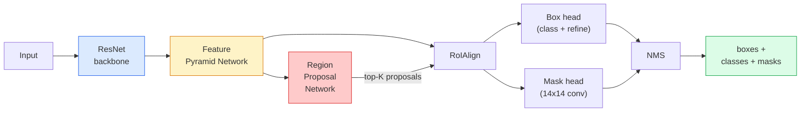

# 实例分割——Mask R-CNN

> 给 Faster R-CNN 检测器加一个小小的 mask 分支，你就得到了实例分割。难点是 RoIAlign，而且它比你想象的更难。

**Type:** Build + Learn
**Languages:** Python
**Prerequisites:** Phase 4 Lesson 06 (YOLO), Phase 4 Lesson 07 (U-Net)
**Time:** ~75 minutes

## 学习目标

- 端到端梳理 Mask R-CNN 架构：backbone、FPN、RPN、RoIAlign、框头、mask 头
- 从零实现 RoIAlign，并解释为什么 RoIPool 已被淘汰
- 使用 torchvision 的 `maskrcnn_resnet50_fpn_v2` 预训练模型获得生产级实例掩膜，并正确读取其输出格式
- 通过替换框头和 mask 头并冻结 backbone，在小规模自定义数据集上微调 Mask R-CNN

## 问题

语义分割给每个类别一个掩膜。实例分割给每个物体一个掩膜，即使两个物体属于同一类别。统计个体、跨帧跟踪、测量尺寸（墙上每块砖的边界框、显微图像中的每个细胞）都需要实例分割。

Mask R-CNN（He 等，2017）通过把实例分割重新定义为「检测 + 掩膜」解决了这个问题。设计非常简洁，以至于随后五年里几乎所有实例分割论文都是 Mask R-CNN 的变体；而 torchvision 的实现至今仍是中小规模数据集的生产默认。

工程难点在于采样：如何从一个角点并不与像素边界对齐的候选框中，裁剪出固定大小的特征区域？这一步做错会处处损失零点几个 mAP。RoIAlign 就是答案。

## 概念

### 架构



五个需要理解的组件：

1. **Backbone** —— 在 ImageNet 上训练的 ResNet-50 或 ResNet-101。在 stride 4、8、16、32 处产生特征图金字塔。
2. **FPN（Feature Pyramid Network，特征金字塔网络）** —— 自顶向下 + 横向连接，给每个层级提供 C 通道的语义丰富特征。检测器根据目标大小查询对应 FPN 层级。
3. **RPN（Region Proposal Network，区域候选网络）** —— 一个小型卷积头，在每个锚点位置预测「这里是否有目标？」和「如何修正这个框？」。每张图产生约 1,000 个候选框。
4. **RoIAlign** —— 从任意 FPN 层级的任意框中采样固定大小（如 7x7）的特征块。双线性采样，无量化。
5. **Heads** —— 两层框头负责修正框并选择类别；一个小型卷积头为每个候选框输出 `28x28` 的二值掩膜。

### 为什么用 RoIAlign，不用 RoIPool

早期 Fast R-CNN 使用 RoIPool：把候选框划分成网格，在每个格子取最大特征，并把坐标全部四舍五入成整数。这种舍入会让特征图与输入像素坐标之间产生最大一个特征图像素的错位——在 224x224 图像上很小，在 stride 32 的特征图上却是灾难。

```
RoIPool:
  box (34.7, 51.3, 98.2, 142.9)
  round -> (34, 51, 98, 142)
  split grid -> round each cell boundary
  misalignment accumulates at every step

RoIAlign:
  box (34.7, 51.3, 98.2, 142.9)
  sample at exact float coordinates using bilinear interpolation
  no rounding anywhere
```

RoIAlign 在 COCO 上把 mask AP 免费提升 3-4 个点。每个关心定位精度的检测器现在都用它——YOLOv7 seg、RT-DETR、Mask2Former 都是如此。

### RPN 一句话

在特征图的每个位置放置 K 个不同尺寸和形状的锚点框。为每个锚点预测一个目标置信度分数和一个回归偏移量，把锚点变成更贴合的框。按分数保留约前 1,000 个框，在 IoU 0.7 处做 NMS，把幸存者交给 heads。RPN 用自有的 mini 损失训练——结构与第 6 课的 YOLO 损失相同，只是二分类（目标 / 无目标）。

### Mask 头

对每个候选框（经过 RoIAlign 后），mask 头是一个小型 FCN：四个 3x3 卷积、一个 2x 反卷积、一个最终 1x1 卷积，输出 `num_classes` 个通道的 `28x28` 分辨率。只保留与预测类别对应的通道，其余忽略。这样就把掩膜预测与分类解耦。

把 28x28 的掩膜上采样到候选框原始像素尺寸，得到最终二值掩膜。

### 损失函数

Mask R-CNN 把四项损失相加：

```math
L = L_{\text{rpn\_cls}} + L_{\text{rpn\_box}} + L_{\text{box\_cls}} + L_{\text{box\_reg}} + L_{\text{mask}}
```

- `L_rpn_cls`、`L_rpn_box` —— RPN 候选框的目标置信度 + 边界框回归。
- `L_box_cls` —— 框头分类器对（C+1）个类别（含背景）的交叉熵。
- `L_box_reg` —— 框头边界框修正的 smooth L1。
- `L_mask` —— 28x28 mask 输出的逐像素二值交叉熵。

每项损失有自己的默认权重；torchvision 实现把它们作为构造参数暴露出来。

### 输出格式

`torchvision.models.detection.maskrcnn_resnet50_fpn_v2` 返回一个字典列表，每张图一个：

```
{
    "boxes":  (N, 4) in (x1, y1, x2, y2) pixel coordinates,
    "labels": (N,) class IDs, 0 = background so indices are 1-based,
    "scores": (N,) confidence scores,
    "masks":  (N, 1, H, W) float masks in [0, 1] — threshold at 0.5 for binary,
}
```

掩膜已经是全图分辨率。28x28 的 head 输出已在内部完成上采样。

```figure
cv3-roialign-sampling
```

## 构建它

### Step 1: 从零实现 RoIAlign

这是 Mask R-CNN 中那个用代码理解比用文字更简单的组件。

```python
import torch
import torch.nn.functional as F

def roi_align_single(feature, box, output_size=7, spatial_scale=1 / 16.0):
    """
    feature: (C, H, W) single-image feature map
    box: (x1, y1, x2, y2) in original image pixel coordinates
    output_size: side of the output grid (7 for box head, 14 for mask head)
    spatial_scale: reciprocal of the feature map stride
    """
    C, H, W = feature.shape
    x1, y1, x2, y2 = [c * spatial_scale - 0.5 for c in box]
    bin_w = (x2 - x1) / output_size
    bin_h = (y2 - y1) / output_size

    grid_y = torch.linspace(y1 + bin_h / 2, y2 - bin_h / 2, output_size)
    grid_x = torch.linspace(x1 + bin_w / 2, x2 - bin_w / 2, output_size)
    yy, xx = torch.meshgrid(grid_y, grid_x, indexing="ij")

    gx = 2 * (xx + 0.5) / W - 1
    gy = 2 * (yy + 0.5) / H - 1
    grid = torch.stack([gx, gy], dim=-1).unsqueeze(0)
    sampled = F.grid_sample(feature.unsqueeze(0), grid, mode="bilinear",
                            align_corners=False)
    return sampled.squeeze(0)
```

每个数值都位于双线性采样位置。无舍入、无量化、无梯度截断。

### Step 2: 与 torchvision 的 RoIAlign 对比

```python
from torchvision.ops import roi_align

feature = torch.randn(1, 16, 50, 50)
boxes = torch.tensor([[0, 10, 20, 100, 90]], dtype=torch.float32)  # (batch_idx, x1, y1, x2, y2)

ours = roi_align_single(feature[0], boxes[0, 1:].tolist(), output_size=7, spatial_scale=1/4)
theirs = roi_align(feature, boxes, output_size=(7, 7), spatial_scale=1/4, sampling_ratio=1, aligned=True)[0]

print(f"shape ours:   {tuple(ours.shape)}")
print(f"shape theirs: {tuple(theirs.shape)}")
print(f"max|diff|:    {(ours - theirs).abs().max().item():.3e}")
```

使用 `sampling_ratio=1` 和 `aligned=True` 时，两者差异在 `1e-5` 以内。

### Step 3: 加载预训练 Mask R-CNN

```python
import torch
from torchvision.models.detection import maskrcnn_resnet50_fpn_v2, MaskRCNN_ResNet50_FPN_V2_Weights

model = maskrcnn_resnet50_fpn_v2(weights=MaskRCNN_ResNet50_FPN_V2_Weights.DEFAULT)
model.eval()
print(f"params: {sum(p.numel() for p in model.parameters()):,}")
print(f"classes (including background): {len(model.roi_heads.box_predictor.cls_score.out_features * [0])}")
```

4,600 万参数，91 个类别（COCO）。第一个类别（id 0）是背景；模型实际检测到的所有东西从 id 1 开始。

### Step 4: 运行推理

```python
with torch.no_grad():
    x = torch.randn(3, 400, 600)
    predictions = model([x])
p = predictions[0]
print(f"boxes:  {tuple(p['boxes'].shape)}")
print(f"labels: {tuple(p['labels'].shape)}")
print(f"scores: {tuple(p['scores'].shape)}")
print(f"masks:  {tuple(p['masks'].shape)}")
```

mask 张量形状为 `(N, 1, H, W)`。以 0.5 为阈值得到每个物体的二值掩膜：

```python
binary_masks = (p['masks'] > 0.5).squeeze(1)  # (N, H, W) boolean
```

### Step 5: 替换 heads 以适配自定义类别数

常见微调配方：复用 backbone、FPN 和 RPN；替换两个分类头。

```python
from torchvision.models.detection.faster_rcnn import FastRCNNPredictor
from torchvision.models.detection.mask_rcnn import MaskRCNNPredictor

def build_custom_maskrcnn(num_classes):
    model = maskrcnn_resnet50_fpn_v2(weights=MaskRCNN_ResNet50_FPN_V2_Weights.DEFAULT)
    in_features = model.roi_heads.box_predictor.cls_score.in_features
    model.roi_heads.box_predictor = FastRCNNPredictor(in_features, num_classes)
    in_features_mask = model.roi_heads.mask_predictor.conv5_mask.in_channels
    hidden_layer = 256
    model.roi_heads.mask_predictor = MaskRCNNPredictor(in_features_mask, hidden_layer, num_classes)
    return model

custom = build_custom_maskrcnn(num_classes=5)
print(f"custom cls_score.out_features: {custom.roi_heads.box_predictor.cls_score.out_features}")
```

`num_classes` 必须包含背景类，所以包含 4 个物体类别的数据集应使用 `num_classes=5`。

### Step 6: 冻结不需要训练的部分

在小数据集上，冻结 backbone 和 FPN。只让 RPN 的目标置信度 + 回归以及两个 head 学习。

```python
def freeze_backbone_and_fpn(model):
    # torchvision Mask R-CNN packs the FPN inside `model.backbone` (as
    # `model.backbone.fpn`), so iterating `model.backbone.parameters()` covers
    # both the ResNet feature layers and the FPN lateral/output convs.
    for p in model.backbone.parameters():
        p.requires_grad = False
    return model

custom = freeze_backbone_and_fpn(custom)
trainable = sum(p.numel() for p in custom.parameters() if p.requires_grad)
print(f"trainable after freeze: {trainable:,}")
```

在 500 张图像的数据集上，这就是收敛与过拟合之间的差别。

## 使用它

torchvision 中 Mask R-CNN 的完整训练循环只有 40 行，且在不同任务之间没有本质变化——换数据集即可。

```python
def train_step(model, images, targets, optimizer):
    model.train()
    loss_dict = model(images, targets)
    losses = sum(loss for loss in loss_dict.values())
    optimizer.zero_grad()
    losses.backward()
    optimizer.step()
    return {k: v.item() for k, v in loss_dict.items()}
```

`targets` 列表必须包含每张图的字典，带有 `boxes`、`labels` 和 `masks`（形状为 `(num_instances, H, W)` 的二值张量）。训练时模型返回一个四损失字典；评估时返回一个预测列表；取决于 `model.training`。

`pycocotools` 评估器会给出边界框和掩膜两者的 mAP@IoU=0.5:0.95；你需要两个数才能知道瓶颈在框头还是 mask 头。

## 交付它

本节课产出：

- `outputs/prompt-instance-vs-semantic-router.md` —— 一个 prompt，通过三个问题在实例、语义和全景分割之间做选择，并给出应首先尝试的精确模型。
- `outputs/skill-mask-rcnn-head-swapper.md` —— 一个 skill，给定新的 `num_classes` 后，生成任意 torchvision 检测模型替换 head 所需的 10 行代码。

## 练习

1. **（简单）** 在 100 个随机框上把你的 RoIAlign 与 `torchvision.ops.roi_align` 对比。报告最大绝对差。同时运行 RoIPool（2017 年前的做法），证明它在边界附近框上差异约 1-2 个特征图像素。
2. **（中等）** 在 50 张自定义图像数据集（任意两个类别：气球、鱼、坑洼、logo）上微调 `maskrcnn_resnet50_fpn_v2`。冻结 backbone，训练 20 个 epoch，报告 mask AP@0.5。
3. **（困难）** 把 Mask R-CNN 的 mask 头从 28x28 改成预测 56x56。测量改动前后的 mAP@IoU=0.75。解释增益（或没有增益）为何符合预期的边界精度 / 显存 trade-off。

## 关键术语

| Term | What people say | What it actually means |
|------|----------------|----------------------|
| Mask R-CNN | "Detection plus masks" | Faster R-CNN + a small FCN head that predicts a 28x28 mask per proposal per class |
| FPN | "Feature pyramid" | Top-down + lateral connections that give every stride level C channels of semantic-rich features |
| RPN | "Region proposer" | A small conv head that produces ~1000 object/no-object proposals per image |
| RoIAlign | "No-rounding crop" | Bilinearly samples a fixed-size feature grid from any float-coordinate box |
| RoIPool | "Pre-2017 crop" | Same purpose as RoIAlign but rounds box coordinates; obsolete |
| Mask AP | "Instance mAP" | Average precision computed with mask IoU instead of box IoU; the COCO instance segmentation metric |
| Binary mask head | "Per-class mask" | Predicts one binary mask per class for each proposal; only the predicted class's channel is kept |
| Background class | "Class 0" | The catch-all "no object" class; indices for real classes start at 1 |

## 延伸阅读

- [Mask R-CNN (He et al., 2017)](https://arxiv.org/abs/1703.06870) —— 论文；第 3 节关于 RoIAlign 是必读
- [FPN: Feature Pyramid Networks (Lin et al., 2017)](https://arxiv.org/abs/1612.03144) —— FPN 论文；每个现代检测器都用它
- [torchvision Mask R-CNN tutorial](https://pytorch.org/tutorials/intermediate/torchvision_tutorial.html) —— 微调循环的参考
- [Detectron2 model zoo](https://github.com/facebookresearch/detectron2/blob/main/MODEL_ZOO.md) —— 生产实现，几乎涵盖每个检测和分割变体的训练权重
