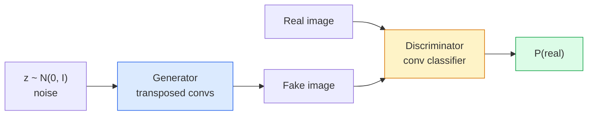
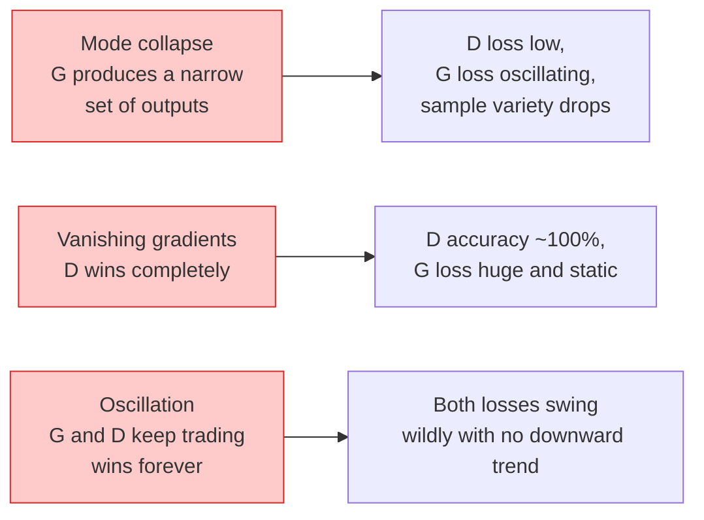

# 图像生成 —— GAN

> GAN 是两个神经网络在一场固定博弈中：一个负责生成，一个负责评判。它们共同进步，直到生成的图像能骗过评判者。

**Type:** Build
**Languages:** Python
**Prerequisites:** Phase 4 Lesson 03 (CNNs), Phase 3 Lesson 06 (Optimizers), Phase 3 Lesson 07 (Regularization)
**Time:** ~75 minutes

## 学习目标

- 解释生成器与判别器之间的极小极大博弈，以及均衡为何对应于 $p_{\text{model}} = p_{\text{data}}$
- 在 PyTorch 中实现 DCGAN，用不到 60 行代码生成可辨认的 32x32 合成图像
- 用三种标准技巧稳定 GAN 训练：非饱和损失、谱归一化、TTUR（双时间尺度更新规则）
- 读懂训练曲线，区分健康收敛与模式坍塌、振荡、判别器完全胜利

## 问题

分类任务把图像映射到标签。生成任务则反其道而行：采样出看起来仿佛来自同一分布的新图像。这里没有可拿来求差的「正确」输出，只有你想要模仿的分布。

标准损失函数（MSE、交叉熵）无法衡量「这个样本是否来自真实分布」。最小化逐像素误差会得到模糊的均值图像，而非逼真的样本。突破在于让损失本身也学习：训练第二个网络来区分真假，再用它的判断来推动生成器。

GAN（Goodfellow 等人，2014）定义了这一框架。到 2018 年，StyleGAN 已经能生成 1024x1024、难以与照片区分的人脸。扩散模型随后在质量和可控性上超越 GAN，但让扩散模型实用的每一项技巧——归一化选择、隐空间、特征损失——最初都是在 GAN 上被理解的。

## 概念

### 两个网络



**生成器（Generator）** G 接收一个噪声向量 `z`，输出一张图像。**判别器（Discriminator）** D 接收一张图像，输出一个标量：图像是真实的概率。

### 博弈

G 想让 D 犯错，D 想判断正确。形式化表达为：

```math
\min_G \max_D \; \mathbb{E}_x[\log D(x)] + \mathbb{E}_z[\log(1 - D(G(z)))]
```

从右往左读：D 最大化对真实样本（`log D(real)`）和生成样本（`log (1 - D(fake))`）的分类准确率；G 最小化 D 对生成样本的准确率——它希望 `D(G(z))` 尽可能高。

Goodfellow 证明，该极小极大博弈存在一个全局均衡：此时 `p_G = p_data`，D 处处输出 0.5，生成分布与真实分布之间的 Jensen-Shannon 散度为零。难点在于如何到达这个均衡。

### 非饱和损失

上面的形式在数值上不稳定。训练初期，对每个生成样本 `D(G(z))` 都接近 0，因此 `log(1 - D(G(z)))` 关于 G 的梯度几乎消失。解决方法是翻转 G 的损失：

```math
\begin{aligned}
L_D &= -\mathbb{E}_x[\log D(x)] - \mathbb{E}_z[\log(1 - D(G(z)))] \\
L_G &= -\mathbb{E}_z[\log D(G(z))] \qquad \text{(non-saturating)}
\end{aligned}
```

现在当 `D(G(z))` 接近 0 时，G 的损失很大，梯度也有信息。现代 GAN 都采用这一变体。

### DCGAN 架构规则

Radford、Metz、Chintala（2015）把多年失败实验提炼成五条让 GAN 训练稳定的规则：

1. 用步长卷积替代池化（两个网络都如此）。
2. 生成器和判别器中都使用 batch norm，但 G 的输出层和 D 的输入层除外。
3. 在更深的架构中去掉全连接层。
4. G 在所有层使用 ReLU，输出层使用 tanh（输出范围 [-1, 1]）。
5. D 在所有层使用 LeakyReLU（negative_slope=0.2）。

每个现代基于卷积的 GAN（StyleGAN、BigGAN、GigaGAN）都仍从这些规则出发，再逐块替换。

### 失效模式及其特征



- **模式坍塌（Mode collapse）**：G 找到一张能骗过 D 的图像后就只生成它。修复：加入 minibatch discrimination、谱归一化或标签条件。
- **判别器完全胜利**：D 变得太强太快，G 的梯度消失。修复：缩小 D、降低 D 的学习率，或对真实标签使用标签平滑。
- **振荡**：两个网络反复拉锯，永远无法接近均衡。修复：TTUR（D 的学习速度比 G 快 2-4 倍），或改用 Wasserstein 损失。

### 评估

GAN 没有真实标签，如何知道它训练得好？

- **样本检查**——每个 epoch 结束时直接看 64 张样本。这是不可妥协的。
- **FID（Fréchet Inception Distance）**——真实图像集与生成图像集在 Inception-v3 特征分布上的距离。越低越好，是社区标准。
- **Inception Score**——较老且更脆弱，优先使用 FID。
- **生成模型的 Precision / Recall**——分别衡量质量（precision）和覆盖度（recall），比单独 FID 更有信息量。

对于小型合成数据实验，样本检查已足够。

```figure
cv-gan-image
```

## 构建它

### 第 1 步：生成器

一个小的 DCGAN 生成器，接收 64 维噪声，输出 32x32 图像。

```python
import torch
import torch.nn as nn

class Generator(nn.Module):
    def __init__(self, z_dim=64, img_channels=3, feat=64):
        super().__init__()
        self.net = nn.Sequential(
            nn.ConvTranspose2d(z_dim, feat * 4, kernel_size=4, stride=1, padding=0, bias=False),
            nn.BatchNorm2d(feat * 4),
            nn.ReLU(inplace=True),
            nn.ConvTranspose2d(feat * 4, feat * 2, kernel_size=4, stride=2, padding=1, bias=False),
            nn.BatchNorm2d(feat * 2),
            nn.ReLU(inplace=True),
            nn.ConvTranspose2d(feat * 2, feat, kernel_size=4, stride=2, padding=1, bias=False),
            nn.BatchNorm2d(feat),
            nn.ReLU(inplace=True),
            nn.ConvTranspose2d(feat, img_channels, kernel_size=4, stride=2, padding=1, bias=False),
            nn.Tanh(),
        )

    def forward(self, z):
        return self.net(z.view(z.size(0), -1, 1, 1))
```

四层转置卷积，每层 `kernel_size=4, stride=2, padding=1`，因此空间尺寸干净地翻倍。输出通过 tanh 激活到 [-1, 1]。

### 第 2 步：判别器

生成器的镜像。使用 LeakyReLU、步长卷积，最后输出一个标量 logit。

```python
class Discriminator(nn.Module):
    def __init__(self, img_channels=3, feat=64):
        super().__init__()
        self.net = nn.Sequential(
            nn.Conv2d(img_channels, feat, kernel_size=4, stride=2, padding=1),
            nn.LeakyReLU(0.2, inplace=True),
            nn.Conv2d(feat, feat * 2, kernel_size=4, stride=2, padding=1, bias=False),
            nn.BatchNorm2d(feat * 2),
            nn.LeakyReLU(0.2, inplace=True),
            nn.Conv2d(feat * 2, feat * 4, kernel_size=4, stride=2, padding=1, bias=False),
            nn.BatchNorm2d(feat * 4),
            nn.LeakyReLU(0.2, inplace=True),
            nn.Conv2d(feat * 4, 1, kernel_size=4, stride=1, padding=0),
        )

    def forward(self, x):
        return self.net(x).view(-1)
```

最后一层卷积把 `4x4` 特征图降到 `1x1`。每张图像输出一个标量；只在计算损失时才应用 sigmoid。

### 第 3 步：训练步骤

交替：每批数据先更新一次 D，再更新一次 G。

```python
import torch.nn.functional as F

def train_step(G, D, real, z, opt_g, opt_d, device):
    real = real.to(device)
    bs = real.size(0)

    # D step
    opt_d.zero_grad()
    d_real = D(real)
    d_fake = D(G(z).detach())
    loss_d = (F.binary_cross_entropy_with_logits(d_real, torch.ones_like(d_real))
              + F.binary_cross_entropy_with_logits(d_fake, torch.zeros_like(d_fake)))
    loss_d.backward()
    opt_d.step()

    # G step
    opt_g.zero_grad()
    d_fake = D(G(z))
    loss_g = F.binary_cross_entropy_with_logits(d_fake, torch.ones_like(d_fake))
    loss_g.backward()
    opt_g.step()

    return loss_d.item(), loss_g.item()
```

D 步骤中的 `G(z).detach()` 至关重要：我们不希望梯度流入 G。忘记这一点是新手最经典的 bug。

### 第 4 步：在合成形状上完整训练

```python
from torch.utils.data import DataLoader, TensorDataset
import numpy as np

def synthetic_images(num=2000, size=32, seed=0):
    rng = np.random.default_rng(seed)
    imgs = np.zeros((num, 3, size, size), dtype=np.float32) - 1.0
    for i in range(num):
        r = rng.uniform(6, 12)
        cx, cy = rng.uniform(r, size - r, size=2)
        yy, xx = np.meshgrid(np.arange(size), np.arange(size), indexing="ij")
        mask = (xx - cx) ** 2 + (yy - cy) ** 2 < r ** 2
        color = rng.uniform(-0.5, 1.0, size=3)
        for c in range(3):
            imgs[i, c][mask] = color[c]
    return torch.from_numpy(imgs)

device = "cuda" if torch.cuda.is_available() else "cpu"
data = synthetic_images()
loader = DataLoader(TensorDataset(data), batch_size=64, shuffle=True)

G = Generator(z_dim=64, img_channels=3, feat=32).to(device)
D = Discriminator(img_channels=3, feat=32).to(device)
opt_g = torch.optim.Adam(G.parameters(), lr=2e-4, betas=(0.5, 0.999))
opt_d = torch.optim.Adam(D.parameters(), lr=2e-4, betas=(0.5, 0.999))

for epoch in range(10):
    for (batch,) in loader:
        z = torch.randn(batch.size(0), 64, device=device)
        ld, lg = train_step(G, D, batch, z, opt_g, opt_d, device)
    print(f"epoch {epoch}  D {ld:.3f}  G {lg:.3f}")
```

`Adam(lr=2e-4, betas=(0.5, 0.999))` 是 DCGAN 默认值——较低的 beta1 能防止动量项过早稳定对抗博弈。

### 第 5 步：采样

```python
@torch.no_grad()
def sample(G, n=16, z_dim=64, device="cpu"):
    G.eval()
    z = torch.randn(n, z_dim, device=device)
    imgs = G(z)
    imgs = (imgs + 1) / 2
    return imgs.clamp(0, 1)
```

采样前务必切换到 eval 模式。对 DCGAN 而言这很重要，因为 batch norm 会使用运行统计量而非当前 batch 的统计量。

### 第 6 步：谱归一化

一个可替换 D 中 batch norm 的模块，保证网络是 1-Lipschitz 的。能修复大多数「D 赢得太狠」的失败。

```python
from torch.nn.utils import spectral_norm

def build_sn_discriminator(img_channels=3, feat=64):
    return nn.Sequential(
        spectral_norm(nn.Conv2d(img_channels, feat, 4, 2, 1)),
        nn.LeakyReLU(0.2, inplace=True),
        spectral_norm(nn.Conv2d(feat, feat * 2, 4, 2, 1)),
        nn.LeakyReLU(0.2, inplace=True),
        spectral_norm(nn.Conv2d(feat * 2, feat * 4, 4, 2, 1)),
        nn.LeakyReLU(0.2, inplace=True),
        spectral_norm(nn.Conv2d(feat * 4, 1, 4, 1, 0)),
    )
```

把 `Discriminator` 换成 `build_sn_discriminator()`，你往往就不再需要 TTUR 技巧。谱归一化是最容易应用的单一鲁棒性升级。

## 使用它

对于严肃的生成任务，使用预训练权重或转向扩散模型。两个标准库：

- `torch_fidelity` 可以在不写自定义评估代码的情况下计算 FID / IS。
- `pytorch-gan-zoo`（legacy）和 `StudioGAN` 提供了经测试的 DCGAN、WGAN-GP、SN-GAN、StyleGAN 和 BigGAN 实现。

在 2026 年，GAN 仍是以下场景的最佳选择：实时图像生成（延迟 < 10 ms）、风格迁移、需要精确控制的图像到图像翻译（Pix2Pix、CycleGAN）。扩散模型在照片级真实感和文本条件方面占优。

## 交付它

本节课产出：

- `outputs/prompt-gan-training-triage.md` —— 一个 prompt，读取训练曲线描述并判断失效模式（模式坍塌、D 获胜、振荡），再给出单一推荐修复方案。
- `outputs/skill-dcgan-scaffold.md` —— 一个 skill，根据 `z_dim`、目标 `image_size` 和 `num_channels` 写出 DCGAN 脚手架，包括训练循环和采样保存。

## 练习

1. **（简单）** 用上述 DCGAN 在合成圆形数据集上训练，并在每个 epoch 结束时保存 16 张样本网格。到第几个 epoch 时，生成的圆形明显变圆？
2. **（中等）** 把判别器的 batch norm 替换为谱归一化。并排训练两个版本。哪个收敛更快？哪个在三个种子上的方差更小？
3. **（困难）** 实现条件 DCGAN：把类别标签同时输入 G 和 D（在 G 中把 one-hot 拼接到噪声，在 D 中拼接类别嵌入通道）。在第 7 课的合成「圆形 vs 方形」数据集上训练，并通过指定标签采样来证明类别条件有效。

## 关键术语

| 术语 | 常说的 | 实际含义 |
|---|---|---|
| 生成器（Generator / G） | "生成网络" | 把噪声映射为图像；训练目标是骗过判别器 |
| 判别器（Discriminator / D） | "评判者 / 批评者" | 二分类器；训练目标是区分真实图像与生成图像 |
| 极小极大（Minimax） | "博弈" | 对 G 取最小、对 D 取最大的对抗损失；均衡时 $p_G = p_{\text{data}}$ |
| 非饱和损失（Non-saturating loss） | "数值上更稳妥的版本" | G 的损失为 $-\log(D(G(z)))$，而非 $\log(1 - D(G(z)))$，以避免训练初期梯度消失 |
| 模式坍塌（Mode collapse） | "生成器只造一种东西" | G 只产生数据分布的一小部分；可通过 SN、minibatch discrimination 或更大 batch 修复 |
| TTUR | "两个学习率" | D 比 G 学得快，通常快 2-4 倍；用于稳定训练 |
| 谱归一化（Spectral norm） | "1-Lipschitz 层" | 一种权重归一化，限制每层 Lipschitz 常数；阻止 D 变得任意陡峭 |
| FID | "Fréchet Inception Distance" | 真实图像集与生成图像集在 Inception-v3 特征分布上的距离；标准评估指标 |

## 延伸阅读

- [Generative Adversarial Networks (Goodfellow et al., 2014)](https://arxiv.org/abs/1406.2661) —— 开创一切的论文
- [DCGAN (Radford, Metz, Chintala, 2015)](https://arxiv.org/abs/1511.06434) —— 让 GAN 可训练的架构规则
- [Spectral Normalization for GANs (Miyato et al., 2018)](https://arxiv.org/abs/1802.05957) —— 最有用的稳定技巧
- [StyleGAN3 (Karras et al., 2021)](https://arxiv.org/abs/2106.12423) —— 最先进的 GAN；读起来像过去十年所有技巧的精选集
