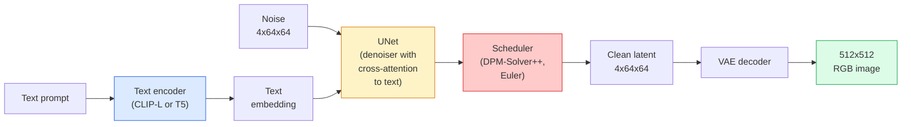

# Stable Diffusion —— 架构与微调

> Stable Diffusion 是一个在预训练 VAE 隐空间中运行的 DDPM，通过 cross-attention 接受文本条件，用快速确定性 ODE 求解器采样，并通过 classifier-free guidance 进行引导。

**Type:** Learn + Use
**Languages:** Python
**Prerequisites:** Phase 4 Lesson 10 (Diffusion), Phase 7 Lesson 02 (Self-Attention)
**Time:** ~75 minutes

## 学习目标

- 梳理 Stable Diffusion pipeline 的五个组成部分：VAE、文本编码器、U-Net、调度器、安全检查器——以及每个部分实际在做什么
- 解释什么是隐空间扩散，以及为什么在 4x64x64 的隐空间（而非 3x512x512 的图像空间）训练能在不损失质量的情况下把计算量降低 48 倍
- 使用 `diffusers` 生成图像、运行图生图、inpainting 和 ControlNet 引导生成
- 在小型自定义数据集上用 LoRA 微调 Stable Diffusion，并在推理时加载 LoRA adapter

## 问题

直接在 512x512 RGB 图像上训练 DDPM 非常昂贵。每一步训练都要把梯度反向传播给一个看到 3x512x512 = 786,432 个输入值的 U-Net，采样也需要 50+ 次通过同一个 U-Net。以 Stable Diffusion 1.5（2022 年发布）的质量水平，像素空间扩散大约需要 256 GPU 月的训练时间，在消费级 GPU 上每张图需要 10-30 秒。

让开放权重的文生图变得实用的技巧是**隐空间扩散**（Rombach 等人，CVPR 2022）。训练一个 VAE，把 3x512x512 的图像映射到 4x64x64 的隐变量再还原，然后在这个隐空间里做扩散。计算量下降到 `(3*512*512)/(4*64*64) = 48` 倍。在相同 GPU 上，采样从几十秒降到两秒以下。

几乎所有现代图像生成模型——SDXL、SD3、FLUX、HunyuanDiT、Wan-Video——都是隐空间扩散模型，区别只在于自编码器、去噪器（U-Net 或 DiT）和文本条件的具体实现。学会 Stable Diffusion，你就学会了这个模板。

## 概念

### Pipeline



- **VAE** —— 冻结的自编码器。编码器把图像转成隐变量（用于 img2img 和训练），解码器把隐变量还原成图像。
- **文本编码器** —— SD 1.x/2.x 用 CLIP 文本编码器，SDXL 用 CLIP-L + CLIP-G，SD3/FLUX 用 T5-XXL。输出一串 token embedding。
- **U-Net** —— 去噪器。含有 cross-attention 层，在每个分辨率级别上从隐变量 attend 到文本嵌入。
- **调度器** —— 采样算法（DDIM、Euler、DPM-Solver++）。选择 sigmas，把预测的噪声混合回隐变量。
- **安全检查器** —— 对输出图像可选的 NSFW / 非法内容过滤。

### 无分类器引导（CFG）

普通文本条件学习每个提示 `c` 的 `epsilon_theta(x_t, t, c)`。CFG 在训练时以 10% 的概率把 `c` 丢弃（替换为空嵌入），让同一个网络同时学习条件预测和非条件预测。推理时：

```math
\epsilon = \epsilon_{\text{uncond}} + w \cdot (\epsilon_{\text{cond}} - \epsilon_{\text{uncond}})
```

`w` 是引导尺度。`w=0` 是非条件生成，`w=1` 是纯条件生成，`w>1` 会让输出「更贴合提示」，但代价是多样性下降。SD 默认 `w=7.5`。

CFG 是文生图达到生产级质量的关键。没有它，提示只能微弱地偏置输出；有了它，提示就能主导输出。

### 隐空间几何

VAE 的 4 通道隐变量不只是压缩后的图像。它是一个流形，其中的算术大致对应语义编辑（提示工程 + 插值都发生在这里），扩散 U-Net 也把整个建模预算花在了这个流形上。对一个随机的 4x64x64 隐变量做解码，得到的不是随机图像，而是垃圾——因为只有隐变量的某个特定子流形才能解码出有效图像。

两个直接后果：

1. **Img2img** = 把图像编码成隐变量，加入部分噪声，运行去噪器，再解码。图像结构得以保留，因为编码近似可逆；内容根据提示改变。
2. **Inpainting** = 与 img2img 相同，但去噪器只更新被遮罩区域，未遮罩区域保持在编码后的隐变量中。

### U-Net 架构

SD 的 U-Net 是第 10 课 TinyUNet 的放大版，外加三个组件：

- **Transformer block**：每个空间分辨率都有，包含 self-attention + 对文本嵌入的 cross-attention。
- **时间嵌入**：对正弦编码做 MLP。
- **跳跃连接**：在相同分辨率的编码器与解码器之间。

SD 1.5 总参数量约 860M，SDXL 约 2.6B，FLUX 约 12B。参数增长主要来自 attention 层。

### LoRA 微调

全量微调 Stable Diffusion 需要 20 GB 以上显存，并更新 860M 参数。LoRA（Low-Rank Adaptation）保持基础模型冻结，只在 attention 层注入小型低秩分解矩阵。SD 的 LoRA adapter 通常 10-50 MB，在单张消费级 GPU 上训练 10-60 分钟，推理时可作为即插即用的修改加载。

```
Original: W_q : (d_in, d_out)   frozen
LoRA:     W_q + alpha * (A @ B)   where A : (d_in, r), B : (r, d_out)

r is typically 4-32.
```

LoRA 几乎是社区微调分发的唯一方式。CivitAI 和 Hugging Face 托管了数百万个 LoRA。

### 常见调度器

- **DDIM** —— 确定性，约 50 步，简单。
- **Euler ancestral** —— 随机性，30-50 步，样本更具创造性。
- **DPM-Solver++ 2M Karras** —— 确定性，20-30 步，生产默认。
- **LCM / TCD / Turbo** —— 一致性模型和蒸馏变体；1-4 步，牺牲部分质量。

在 `diffusers` 中换调度器只需改一行代码，有时无需重训练就能修复样本问题。

```figure
cv3-latent-compression
```

## 构建它

本节课全程使用 `diffusers`，而不是从零重建 Stable Diffusion。需要单独成课才能讲清的组件（VAE、文本编码器、U-Net、调度器）这里的目标是熟练运用生产 API。

### 第 1 步：文生图

```python
import torch
from diffusers import StableDiffusionPipeline

pipe = StableDiffusionPipeline.from_pretrained(
    "runwayml/stable-diffusion-v1-5",
    torch_dtype=torch.float16,
).to("cuda")

image = pipe(
    prompt="a dog riding a skateboard in tokyo, studio ghibli style",
    guidance_scale=7.5,
    num_inference_steps=25,
    generator=torch.Generator("cuda").manual_seed(42),
).images[0]
image.save("dog.png")
```

`float16` 在不损失可见质量的情况下把显存减半。默认 DPM-Solver++ 下 `num_inference_steps=25` 即可匹配 DDIM 下 `num_inference_steps=50` 的质量。

### 第 2 步：更换调度器

```python
from diffusers import DPMSolverMultistepScheduler, EulerAncestralDiscreteScheduler

pipe.scheduler = DPMSolverMultistepScheduler.from_config(pipe.scheduler.config)
pipe.scheduler = EulerAncestralDiscreteScheduler.from_config(pipe.scheduler.config)
```

调度器状态与 U-Net 权重解耦。你可以在 DDPM 上训练，用任意调度器采样。

### 第 3 步：图生图

```python
from diffusers import StableDiffusionImg2ImgPipeline
from PIL import Image

img2img = StableDiffusionImg2ImgPipeline.from_pretrained(
    "runwayml/stable-diffusion-v1-5",
    torch_dtype=torch.float16,
).to("cuda")

init_image = Image.open("dog.png").convert("RGB").resize((512, 512))
out = img2img(
    prompt="a dog riding a skateboard, oil painting",
    image=init_image,
    strength=0.6,
    guidance_scale=7.5,
).images[0]
```

`strength` 表示去噪前加多少噪声（0.0 = 不变，1.0 = 完全重生成）。风格迁移的标准范围是 0.5-0.7。

### 第 4 步：Inpainting

```python
from diffusers import StableDiffusionInpaintPipeline

inpaint = StableDiffusionInpaintPipeline.from_pretrained(
    "runwayml/stable-diffusion-inpainting",
    torch_dtype=torch.float16,
).to("cuda")

image = Image.open("dog.png").convert("RGB").resize((512, 512))
mask = Image.open("dog_mask.png").convert("L").resize((512, 512))

out = inpaint(
    prompt="a cat",
    image=image,
    mask_image=mask,
    guidance_scale=7.5,
).images[0]
```

遮罩中白色像素是需要重生成的区域，黑色像素是保留区域。

### 第 5 步：加载 LoRA

```python
pipe.load_lora_weights(
    "artificialguybr/studioghibli-redmond-1-5v-studio-ghibli-lora-for-liberteredmond-sd-1-5",
    weight_name="StudioGhibliRedmond-15V-LiberteRedmond-StdGBRedmAF-StudioGhibli.safetensors",
)
pipe.fuse_lora(lora_scale=0.8)

image = pipe(prompt="a village square, StdGBRedmAF, Studio Ghibli").images[0]
```

模型卡中的触发词（`StdGBRedmAF, Studio Ghibli`）会激活对应风格。`lora_scale` 控制强度：0.0 = 无效果，1.0 = 完全效果。`fuse_lora` 会把 adapter 原地烘焙进权重以提速，但会阻止切换。加载不同 adapter 前需调用 `pipe.unfuse_lora()`。

### 第 6 步：LoRA 训练（概览）

真正的 LoRA 训练在 `peft` 或 `diffusers.training` 中。大致流程：

```python
# Pseudocode
for step, batch in enumerate(dataloader):
    images, prompts = batch
    latents = vae.encode(images).latent_dist.sample() * 0.18215

    t = torch.randint(0, num_train_timesteps, (batch_size,))
    noise = torch.randn_like(latents)
    noisy_latents = scheduler.add_noise(latents, noise, t)

    text_emb = text_encoder(tokenizer(prompts))

    pred_noise = unet(noisy_latents, t, text_emb)  # LoRA weights injected here

    loss = F.mse_loss(pred_noise, noise)
    loss.backward()
    optimizer.step()
```

只有 LoRA 矩阵接收梯度；基础 U-Net、VAE 和文本编码器都冻结。batch size 为 1 并开启梯度检查点时，可放入 8 GB 显存。

## 使用它

生产中你实际要做的决策：

- **模型家族**：SD 1.5 适合开源社区微调，SDXL 适合更高保真，SD3 / FLUX 适合最先进水平及严格许可要求。
- **调度器**：20-30 步用 DPM-Solver++ 2M Karras；延迟低于 1 秒时用 LCM-LoRA。
- **精度**：4080/4090 用 `float16`，A100 及更新架构用 `bfloat16`，显存紧张时用 `int8`（通过 `bitsandbytes` 或 `compel`）。
- **条件**：纯文本即可；需要更强控制时，在基础 pipeline 上叠加 ControlNet（canny、depth、pose）。

批量生成可用社区工具 `AUTO1111` / `ComfyUI`；生产 API 推荐 `diffusers` + `accelerate` 或 `optimum-nvidia` 配合 TensorRT 编译。

## 交付它

本节课产出：

- `outputs/prompt-sd-pipeline-planner.md` —— 一个 prompt，根据延迟预算、保真目标和许可约束选择 SD 1.5 / SDXL / SD3 / FLUX，并给出调度器和精度建议。
- `outputs/skill-lora-training-setup.md` —— 一个 skill，为自定义数据集写出完整 LoRA 训练配置，包括 caption、rank、batch size 和学习率。

## 练习

1. **（简单）** 用同一提示、不同 `guidance_scale` 值 `[1, 3, 5, 7.5, 10, 15]` 生成图像。描述图像如何变化。在哪个 guidance 值开始出现伪影？
2. **（中等）** 取任意真实照片，用 `StableDiffusionImg2ImgPipeline` 在不同 `strength` 值 `[0.2, 0.4, 0.6, 0.8, 1.0]` 下运行。哪个 strength 能在改变风格的同时保留构图？为什么 1.0 会完全忽略输入？
3. **（困难）** 在 10-20 张同一主体（宠物、logo、角色）的图像上训练 LoRA，并生成包含该主体的新场景。报告在不过拟合到输入图像的前提下，身份保持最好的 LoRA rank 和训练步数。

## 关键术语

| 术语 | 常说的 | 实际含义 |
|---|---|---|
| 隐空间扩散（Latent diffusion） | "在隐变量里扩散" | 把整个 DDPM 放在 VAE 隐空间（4x64x64）而非像素空间（3x512x512）运行；计算量节省 48 倍 |
| VAE 缩放因子 | "0.18215" | 把 VAE 原始隐变量缩放到约单位方差的常数；每个 SD pipeline 都硬编码 |
| 无分类器引导（Classifier-free guidance） | "CFG" | 混合条件与非条件噪声预测；最具影响力的推理旋钮 |
| 调度器（Scheduler） | "采样器" | 把噪声和模型预测转化为去噪隐变量轨迹的算法 |
| LoRA | "低秩 adapter" | 不改动基础权重，用小型低秩分解矩阵微调 attention 层 |
| 交叉注意力（Cross-attention） | "文本-图像 attention" | 从隐变量 token 到文本 token 的 attention；在每层 U-Net 注入提示信息 |
| ControlNet | "结构条件" | 单独训练的 adapter，用额外输入（canny、depth、pose、segmentation）引导 SD |
| DPM-Solver++ | "默认调度器" | 二阶确定性 ODE 求解器；2026 年在低步数（20-30）下质量最佳 |

## 延伸阅读

- [High-Resolution Image Synthesis with Latent Diffusion (Rombach et al., 2022)](https://arxiv.org/abs/2112.10752) —— Stable Diffusion 论文；包含证明设计合理性的全部消融实验
- [Classifier-Free Diffusion Guidance (Ho & Salimans, 2022)](https://arxiv.org/abs/2207.12598) —— CFG 论文
- [LoRA: Low-Rank Adaptation of Large Language Models (Hu et al., 2021)](https://arxiv.org/abs/2106.09685) —— LoRA 先用于 NLP；迁移到 SD 时几乎无需改动
- [diffusers documentation](https://huggingface.co/docs/diffusers) —— 每个 SD / SDXL / SD3 / FLUX pipeline 的参考文档
