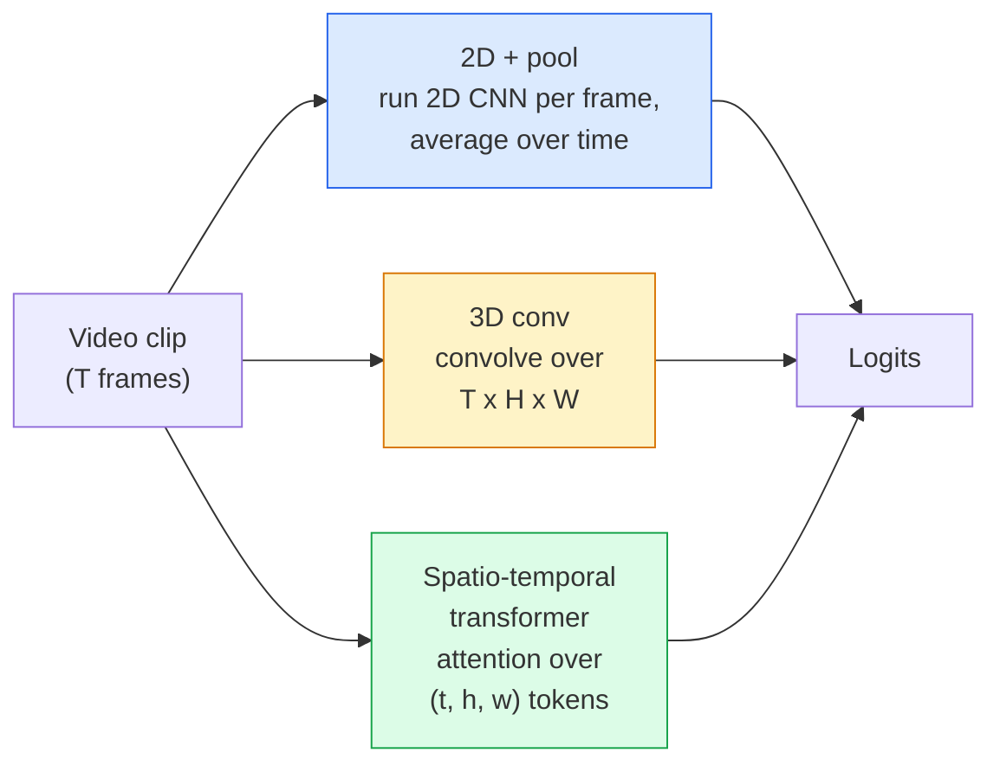

# 视频理解 —— 时间建模

> 视频是一串图像，加上连接它们的物理规律。每个视频模型要么把时间当作额外维度（3D 卷积），要么当作需要 attend 的序列（transformer），要么当作只提取一次再池化的特征（2D+pool）。

**Type:** Learn + Build
**Languages:** Python
**Prerequisites:** Phase 4 Lesson 03 (CNNs), Phase 4 Lesson 04 (Image Classification)
**Time:** ~45 minutes

## 学习目标

- 区分三种主要视频建模方法（2D+pool、3D 卷积、时空 transformer），并预判它们的成本与准确率权衡
- 在 PyTorch 中实现帧采样、时间池化和 2D+pool 基线分类器
- 解释 I3D 的「膨胀」3D 核为何能从 ImageNet 权重很好地迁移，以及分解式 (2+1)D 卷积有什么不同
- 了解标准动作识别数据集与指标：Kinetics-400/600、UCF101、Something-Something V2；以及 clip 级与视频级 top-1 准确率

## 问题

一段 30 秒、30 fps 的视频有 900 张图像。朴素的想法是：视频分类 = 把图像分类跑 900 次 + 某种聚合。当动作在几乎每帧都可见时（体育、烹饪、健身视频），这能工作；但当动作由运动本身定义时，它会彻底失败：「把某物从左推到右」在每一帧里都只是两个静止物体。

每个视频架构的核心问题是：时间结构在何时、以何种方式被建模？答案驱动着其他一切——计算成本、预训练策略、是否能复用 ImageNet 权重、模型在哪些数据集上训练。

本节课故意比静态图像课短。核心图像机制已经就位，视频理解主要讲的是时间这条线：采样、建模、聚合。

## 概念

### 三个架构家族



### 2D + pool

取一个 2D CNN（ResNet、EfficientNet、ViT），在每个采样帧上独立运行。对每帧的嵌入做平均（或最大池化、或 attention 池化），再把池化后的向量送入分类器。

优点：
- ImageNet 预训练权重可直接迁移。
- 实现最简单。
- 成本低：T 帧 × 单张图像推理成本。

缺点：
- 无法建模运动。动作 = 外观的聚合。
- 时间池化是顺序无关的；「开门」和「关门」看起来一样。

适用场景：外观偏重任务、小数据集上的迁移学习、初始基线。

### 3D 卷积

把 2D（H, W）核换成 3D（T, H, W）核，网络同时在空间和时间上卷积。早期家族：C3D、I3D、SlowFast。

I3D 技巧：取一个预训练的 2D ImageNet 模型，沿新的时间轴复制每个 2D 核，将其「膨胀」。一个 3x3 的 2D 卷积变成 3x3x3 的 3D 卷积。这样 3D 模型就获得了强大的预训练权重，而不是从零开始训练。

优点：
- 直接建模运动。
- I3D 膨胀提供了免费的迁移学习。

缺点：
- 计算量比 2D 对应版本大约多 T/8 倍（时间核为 3 且堆叠 3 次时）。
- 时间核很小；长程运动需要金字塔或双流方案。

适用场景：运动本身是信号的动作识别（Something-Something V2、Kinetics 中运动重的类别）。

### 时空 transformer

把视频 token 化成时空 patch 网格，然后在所有 patch 上做 attention。代表：TimeSformer、ViViT、Video Swin、VideoMAE。

重要的 attention 模式：
- **Joint** —— 一次大 attention 覆盖 (t, h, w)。与 `T*H*W` 成平方关系，很贵。
- **Divided** —— 每个 block 做两次 attention：一次在时间、一次在空间。近似线性扩展。
- **Factorised** —— 时间 attention 与空间 attention 在 block 之间交替。

优点：
- 在各大基准上达到 SOTA 准确率。
- 可通过 patch 膨胀从图像 transformer（ViT）迁移。
- 通过稀疏 attention 支持长上下文视频。

缺点：
- 计算开销大。
- 需要谨慎选择 attention 模式，否则运行时间会爆炸。

适用场景：大数据集、高保真视频理解、多模态视频+文本任务。

### 帧采样

一段 10 秒、30 fps 的视频有 300 帧，全部喂给任何模型都是浪费。常用策略：

- **均匀采样（Uniform sampling）** —— 在视频中均匀选取 T 帧。2D+pool 的默认做法。
- **稠密采样（Dense sampling）** —— 随机取一段连续的 T 帧窗口。3D 卷积常用，因为运动需要相邻帧。
- **多 clip 采样（Multi-clip）** —— 从同一视频中采样多个 T 帧窗口，每个窗口分别分类，测试时平均预测。

T 通常取 8、16、32 或 64。T 越大，捕获的时间信号越多，计算量也越大。

### 评估

两个层级：
- **Clip-level 准确率** —— 模型看到一个 T 帧 clip，给出 top-k。
- **视频级准确率** —— 对同一视频的多个 clip 预测做平均；更高、更稳定。

两个都要报。一个模型 clip 78% / 视频 82%，说明它严重依赖测试时平均；80% / 81% 则意味着逐 clip 更鲁棒。

### 你会遇到的数据集

- **Kinetics-400 / 600 / 700** —— 通用动作数据集。40 万段 clip；YouTube URL（很多已失效）。
- **Something-Something V2** —— 动作由运动定义（「把 X 从左移到右」）。2D+pool 无法解决。
- **UCF-101**、**HMDB-51** —— 更老、更小，但仍被引用。
- **AVA** —— 在时空上做动作*定位*；比分类更难。

```figure
v4-video-temporal
```

## 构建它

### 第 1 步：帧采样器

在帧列表（或视频张量）上工作的均匀采样和稠密采样。

```python
import numpy as np

def sample_uniform(num_frames_total, T):
    if num_frames_total <= T:
        return list(range(num_frames_total)) + [num_frames_total - 1] * (T - num_frames_total)
    step = num_frames_total / T
    return [int(i * step) for i in range(T)]


def sample_dense(num_frames_total, T, rng=None):
    rng = rng or np.random.default_rng()
    if num_frames_total <= T:
        return list(range(num_frames_total)) + [num_frames_total - 1] * (T - num_frames_total)
    start = int(rng.integers(0, num_frames_total - T + 1))
    return list(range(start, start + T))
```

两者都返回 T 个索引，用于切片视频张量。

### 第 2 步：2D+pool 基线

用 2D ResNet-18 跑每一帧，平均池化特征，再分类。

```python
import torch
import torch.nn as nn
from torchvision.models import resnet18, ResNet18_Weights

class FramePool(nn.Module):
    def __init__(self, num_classes=400, pretrained=True):
        super().__init__()
        weights = ResNet18_Weights.IMAGENET1K_V1 if pretrained else None
        backbone = resnet18(weights=weights)
        self.features = nn.Sequential(*(list(backbone.children())[:-1]))  # global avg pool kept
        self.head = nn.Linear(512, num_classes)

    def forward(self, x):
        # x: (N, T, 3, H, W)
        N, T = x.shape[:2]
        x = x.view(N * T, *x.shape[2:])
        feats = self.features(x).view(N, T, -1)
        pooled = feats.mean(dim=1)
        return self.head(pooled)

model = FramePool(num_classes=10)
x = torch.randn(2, 8, 3, 224, 224)
print(f"output: {model(x).shape}")
print(f"params: {sum(p.numel() for p in model.parameters()):,}")
```

1100 万参数，ImageNet 预训练，逐帧运行、平均、分类。这个基线在外观偏重任务上通常只比真正的 3D 模型低 5-10 个百分点——有时还更好，因为它复用了更强的 ImageNet backbone。

### 第 3 步：I3D 风格的膨胀 3D 卷积

通过沿新的时间轴重复权重，把单个 2D 卷积变成 3D 卷积。

```python
def inflate_2d_to_3d(conv2d, time_kernel=3):
    out_c, in_c, kh, kw = conv2d.weight.shape
    weight_3d = conv2d.weight.data.unsqueeze(2)  # (out, in, 1, kh, kw)
    weight_3d = weight_3d.repeat(1, 1, time_kernel, 1, 1) / time_kernel
    conv3d = nn.Conv3d(in_c, out_c, kernel_size=(time_kernel, kh, kw),
                        padding=(time_kernel // 2, conv2d.padding[0], conv2d.padding[1]),
                        stride=(1, conv2d.stride[0], conv2d.stride[1]),
                        bias=False)
    conv3d.weight.data = weight_3d
    return conv3d

conv2d = nn.Conv2d(3, 64, kernel_size=3, padding=1, bias=False)
conv3d = inflate_2d_to_3d(conv2d, time_kernel=3)
print(f"2D weight shape:  {tuple(conv2d.weight.shape)}")
print(f"3D weight shape:  {tuple(conv3d.weight.shape)}")
x = torch.randn(1, 3, 8, 56, 56)
print(f"3D output shape:  {tuple(conv3d(x).shape)}")
```

除以 `time_kernel` 能让激活幅度大致保持不变——这对第一次前向传播不破坏 batch norm 统计量很重要。

### 第 4 步：分解式 (2+1)D 卷积

把一个 3D 卷积拆成 2D（空间）卷积和 1D（时间）卷积。感受野相同，参数更少，在某些基准上准确率更高。

```python
class Conv2Plus1D(nn.Module):
    def __init__(self, in_c, out_c, kernel_size=3):
        super().__init__()
        mid_c = (in_c * out_c * kernel_size * kernel_size * kernel_size) \
                // (in_c * kernel_size * kernel_size + out_c * kernel_size)
        self.spatial = nn.Conv3d(in_c, mid_c, kernel_size=(1, kernel_size, kernel_size),
                                 padding=(0, kernel_size // 2, kernel_size // 2), bias=False)
        self.bn = nn.BatchNorm3d(mid_c)
        self.act = nn.ReLU(inplace=True)
        self.temporal = nn.Conv3d(mid_c, out_c, kernel_size=(kernel_size, 1, 1),
                                  padding=(kernel_size // 2, 0, 0), bias=False)

    def forward(self, x):
        return self.temporal(self.act(self.bn(self.spatial(x))))

c = Conv2Plus1D(3, 64)
x = torch.randn(1, 3, 8, 56, 56)
print(f"(2+1)D output: {tuple(c(x).shape)}")
```

完整的 R(2+1)D 网络就是把 ResNet-18 中的每个 3x3 卷积都替换成 `Conv2Plus1D`。

## 使用它

两个库覆盖了生产级视频工作：

- `torchvision.models.video` —— R(2+1)D、MViT、Swin3D，带 Kinetics 预训练权重。API 与图像模型一致。
- `pytorchvideo`（Meta）—— 模型仓库、Kinetics / SSv2 / AVA 数据加载器、标准变换。

视觉-语言视频模型（视频描述、视频问答）可用 `transformers`（`VideoMAE`、`VideoLLaMA`、`InternVideo`）。

## 交付它

本节课产出：

- `outputs/prompt-video-architecture-picker.md` —— 一个 prompt，根据外观 vs 运动、数据集大小和计算预算选择 2D+pool / I3D / (2+1)D / transformer。
- `outputs/skill-frame-sampler-auditor.md` —— 一个 skill，检查视频 pipeline 的采样器并标记常见 bug：索引差一、`num_frames < T` 时采样不均、缺少保持长宽比的裁剪等。

## 练习

1. **（简单）** 估算 FramePool（T=8）与 I3D 风格 3D ResNet（T=8）的 FLOPs，并说明为什么 2D+pool 便宜 3-5 倍。
2. **（中等）** 生成一个合成视频数据集：随机小球沿随机方向运动，标签为运动方向（「左到右」「右到左」「斜向上」）。用 FramePool 训练。证明它准确率接近随机，说明仅看外观不足以完成运动任务。
3. **（困难）** 把 ResNet-18 中的每个 Conv2d 替换成 `Conv2Plus1D`，构建 R(2+1)D-18。把第一层卷积的权重从一个 ImageNet 预训练 ResNet-18 膨胀过来。在第 2 题的运动数据集上训练并击败 FramePool。

## 关键术语

| 术语 | 常说的 | 实际含义 |
|---|---|---|
| 2D + pool | "逐帧分类器" | 对每帧运行 2D CNN，时间上做平均池化，再分类 |
| 3D 卷积（3D convolution） | "时空核" | 在 (T, H, W) 上做卷积；能天然建模运动 |
| 膨胀（Inflation） | "把 2D 权重升到 3D" | 沿新的时间轴重复 2D 卷积权重来初始化 3D 卷积，再除以 kernel_T 保持激活尺度 |
| (2+1)D | "分解卷积" | 把 3D 拆成 2D 空间卷积 + 1D 时间卷积；参数更少，中间多一层非线性 |
| Divided attention | "先时间后空间" | 每个 transformer block 做两次 attention：一次同帧内 token，一次同位置跨帧 token |
| Clip | "T 帧窗口" | 采样出的连续 T 帧子序列；视频模型消费的基本单元 |
| Clip vs 视频准确率 | "两种评估设置" | Clip = 每个视频一个样本；视频 = 多个采样 clip 预测的平均 |
| Kinetics | "视频界的 ImageNet" | 400-700 个动作类别，30 万+ YouTube clip，标准视频预训练语料 |

## 延伸阅读

- [I3D: Quo Vadis, Action Recognition (Carreira & Zisserman, 2017)](https://arxiv.org/abs/1705.07750) —— 引入膨胀技术和 Kinetics 数据集
- [R(2+1)D: A Closer Look at Spatiotemporal Convolutions (Tran et al., 2018)](https://arxiv.org/abs/1711.11248) —— 分解卷积，至今仍是强基线
- [TimeSformer: Is Space-Time Attention All You Need? (Bertasius et al., 2021)](https://arxiv.org/abs/2102.05095) —— 第一个有竞争力的视频 transformer
- [VideoMAE (Tong et al., 2022)](https://arxiv.org/abs/2203.12602) —— 视频的 masked autoencoder 预训练；当前主导的预训练范式
