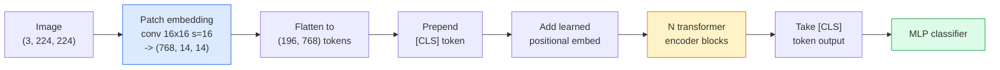

# 视觉 Transformer（ViT）

> 把图像切成 patch，把每个 patch 当作一个词，跑一个标准的 Transformer。不用回头。

**Type:** Build
**Languages:** Python
**Prerequisites:** Phase 7 Lesson 02 (Self-Attention), Phase 4 Lesson 04 (Image Classification)
**Time:** ~45 minutes

## 学习目标

- 从零实现 patch 嵌入（patch embedding）、可学习位置嵌入、class token 和 Transformer 编码器块，构建一个最小 ViT
- 解释为什么人们曾认为 ViT 需要海量预训练数据，直到 DeiT 和 MAE 证明了并非如此
- 从架构先验（无先验、局部窗口注意力、卷积主干）的角度比较 ViT、Swin 与 ConvNeXt
- 使用 `timm` 和标准的线性探针 / 微调流程，在小数据集上微调一个预训练 ViT

## 问题

十年来，卷积几乎就是计算机视觉的同义词。CNN 拥有强大的归纳偏置——局部性、平移等变性——没人认为这些可以被取代。随后 Dosovitskiy 等人（2020）证明：把展平的图像 patch 交给一个普通 Transformer，完全不用任何卷积机制，在足够规模下也能追平甚至超越最好的 CNN。

问题在于「规模」。ViT 在 ImageNet-1k 上输给了 ResNet；先在 ImageNet-21k 或 JFT-300M 上预训练、再在 ImageNet-1k 上微调的 ViT 则赢了。结论是：Transformer 缺少有用的先验，但可以从足够的数据中学到。后续工作（DeiT、MAE、DINO）表明，只要训练配方得当——强数据增强、自监督预训练、蒸馏——ViT 在小数据上也能训练得很好。

到 2026 年，纯 CNN 在边缘设备上仍有竞争力（ConvNeXt 最强），但 Transformer 统治了其他所有方向：分割（Mask2Former、SegFormer）、检测（DETR、RT-DETR）、多模态（CLIP、SigLIP）、视频（VideoMAE、VJEPA）。ViT 的 block 结构是必须掌握的结构。

## 概念

### 流水线



七步。patch → token → 注意力 → 分类器。每个变体（DeiT、Swin、ConvNeXt、MAE 预训练）只改动这七步中的一两步，其余保持不变。

### Patch 嵌入

第一个卷积就是秘密所在。卷积核大小 16、步长 16，于是 224x224 的图像变成 14x14 的网格，每个格子对应一个 16x16 的 patch，再投影成 768 维 embedding。这一个卷积同时完成了切块和线性投影。

```
Input:  (3, 224, 224)
Conv (3 -> 768, k=16, s=16, no padding):
Output: (768, 14, 14)
Flatten spatial: (196, 768)
```

196 个 patch 就是 196 个 token。每个 token 的特征维度为 768（ViT-B）、1024（ViT-L）或 1280（ViT-H）。

### 类别 token

在序列最前面拼上一个可学习向量：

```
tokens = [CLS; patch_1; patch_2; ...; patch_196]   shape (197, 768)
```

经过 N 个 Transformer block 后，`[CLS]` 的输出就是全局图像表示。分类头只读取这一个向量。

### 位置嵌入

Transformer 本身没有空间位置的概念。给每个 token 加上一个可学习向量：

```
tokens = tokens + learned_pos_embedding   (also shape (197, 768))
```

该嵌入是模型参数，基于梯度的训练会让它适应图像的二维结构。也存在正弦形式的二维替代方案，但实践中很少使用。

### Transformer 编码器块

标准结构：多头自注意力、MLP、残差连接、pre-LayerNorm。

```
x = x + MSA(LN(x))
x = x + MLP(LN(x))

MLP is two-layer with GELU: Linear(d -> 4d) -> GELU -> Linear(4d -> d)
```

ViT-B/16 堆叠 12 个这样的 block，每个含 12 个注意力头，总计 86M 参数。

### 为什么用 pre-LN

早期 Transformer 使用 post-LN（`x = LN(x + sublayer(x))`），在不做 warmup 的情况下，训练超过 6-8 层就很困难。pre-LN（`x = x + sublayer(LN(x))`）无需 warmup 也能稳定训练更深的网络。所有 ViT 和现代 LLM 都使用 pre-LN。

### Patch 大小的权衡

- 16x16 的 patch → 196 个 token，标准配置。
- 32x32 的 patch → 49 个 token，更快但分辨率更低。
- 8x8 的 patch → 784 个 token，更精细，但 $O(n^2)$ 的注意力开销会迅速膨胀。

patch 越大，token 越少，速度越快，但空间细节越少。SwinV2 在层次化窗口中使用 4x4 的 patch。

### DeiT 在 ImageNet-1k 上训练 ViT 的配方

原始 ViT 需要 JFT-300M 才能击败 CNN。DeiT（Touvron 等，2020）仅用 ImageNet-1k 就把 ViT-B 训练到 81.8% top-1，靠的是四项改动：

1. 强数据增强：RandAugment、Mixup、CutMix、Random Erasing。
2. 随机深度（训练时随机丢弃整个 block）。
3. 重复增强（同一张图在每个 batch 中被采样 3 次）。
4. 从 CNN 教师模型蒸馏（可选，能进一步提升准确率）。

现代所有 ViT 训练配方都源自 DeiT。

### Swin 与 ConvNeXt

- **Swin**（Liu 等，2021）——基于窗口的注意力。每个 block 只在局部窗口内做注意力；相邻 block 会平移窗口，让信息跨窗口混合。它在保留注意力算子的同时，重新引入了类似 CNN 的局部性先验。
- **ConvNeXt**（Liu 等，2022）——重新设计的 CNN，对齐了 Swin 的架构选择（深度可分离卷积、LayerNorm、GELU、倒置瓶颈）。它表明差距不在「注意力 vs 卷积」，而在「现代训练配方 + 架构」。

2026 年，ConvNeXt-V2 和 Swin-V2 都达到生产级水准；如何选择取决于你的推理栈（ConvNeXt 在边缘端编译得更好）和预训练语料。

### MAE 预训练

掩码自编码器（Masked Autoencoder，He 等，2022）：随机遮住 75% 的 patch，训练编码器只处理可见的 25%，再训练一个小解码器从编码器输出重建被遮住的 patch。预训练结束后丢弃解码器，微调编码器。

MAE 让 ViT 仅凭 ImageNet-1k 就能训练，达到了 SOTA，也是当前默认的自监督配方。

```figure
batchnorm-inference
```

## 构建它

### 第 1 步：Patch 嵌入

```python
import torch
import torch.nn as nn

class PatchEmbedding(nn.Module):
    def __init__(self, in_channels=3, patch_size=16, dim=192, image_size=64):
        super().__init__()
        assert image_size % patch_size == 0
        self.proj = nn.Conv2d(in_channels, dim, kernel_size=patch_size, stride=patch_size)
        num_patches = (image_size // patch_size) ** 2
        self.num_patches = num_patches

    def forward(self, x):
        x = self.proj(x)
        return x.flatten(2).transpose(1, 2)
```

一个卷积、一次展平、一次转置。这就是完整的「图像到 token」步骤。

### 第 2 步：Transformer block

pre-LN、多头自注意力、带 GELU 的 MLP、残差连接。

```python
class Block(nn.Module):
    def __init__(self, dim, num_heads, mlp_ratio=4, dropout=0.0):
        super().__init__()
        self.ln1 = nn.LayerNorm(dim)
        self.attn = nn.MultiheadAttention(dim, num_heads, dropout=dropout, batch_first=True)
        self.ln2 = nn.LayerNorm(dim)
        self.mlp = nn.Sequential(
            nn.Linear(dim, dim * mlp_ratio),
            nn.GELU(),
            nn.Dropout(dropout),
            nn.Linear(dim * mlp_ratio, dim),
            nn.Dropout(dropout),
        )

    def forward(self, x):
        a, _ = self.attn(self.ln1(x), self.ln1(x), self.ln1(x), need_weights=False)
        x = x + a
        x = x + self.mlp(self.ln2(x))
        return x
```

`nn.MultiheadAttention` 负责拆分注意力头、缩放点积和输出投影。`batch_first=True` 使形状为 `(N, seq, dim)`。

### 第 3 步：ViT

```python
class ViT(nn.Module):
    def __init__(self, image_size=64, patch_size=16, in_channels=3,
                 num_classes=10, dim=192, depth=6, num_heads=3, mlp_ratio=4):
        super().__init__()
        self.patch = PatchEmbedding(in_channels, patch_size, dim, image_size)
        num_patches = self.patch.num_patches
        self.cls_token = nn.Parameter(torch.zeros(1, 1, dim))
        self.pos_embed = nn.Parameter(torch.zeros(1, num_patches + 1, dim))
        self.blocks = nn.ModuleList([
            Block(dim, num_heads, mlp_ratio) for _ in range(depth)
        ])
        self.ln = nn.LayerNorm(dim)
        self.head = nn.Linear(dim, num_classes)
        nn.init.trunc_normal_(self.pos_embed, std=0.02)
        nn.init.trunc_normal_(self.cls_token, std=0.02)

    def forward(self, x):
        x = self.patch(x)
        cls = self.cls_token.expand(x.size(0), -1, -1)
        x = torch.cat([cls, x], dim=1)
        x = x + self.pos_embed
        for blk in self.blocks:
            x = blk(x)
        x = self.ln(x[:, 0])
        return self.head(x)

vit = ViT(image_size=64, patch_size=16, num_classes=10, dim=192, depth=6, num_heads=3)
x = torch.randn(2, 3, 64, 64)
print(f"output: {vit(x).shape}")
print(f"params: {sum(p.numel() for p in vit.parameters()):,}")
```

约 2.8M 参数——一个能在 CPU 上跑起来的微型 ViT。真正的 ViT-B 有 86M 参数，把 `dim=768, depth=12, num_heads=12` 代入同一份类定义即可。

### 第 4 步：健全性检查——单张图像推理

```python
logits = vit(torch.randn(1, 3, 64, 64))
print(f"logits: {logits}")
print(f"probs:  {logits.softmax(-1)}")
```

应当无报错地运行，概率之和为 1。

## 使用它

`timm` 提供所有 ViT 变体及其 ImageNet 预训练权重。一行代码：

```python
import timm

model = timm.create_model("vit_base_patch16_224", pretrained=True, num_classes=10)
```

2026 年，`timm` 是视觉 Transformer 的生产默认选择。它在同一套 API 下支持 ViT、DeiT、Swin、Swin-V2、ConvNeXt、ConvNeXt-V2、MaxViT、MViT、EfficientFormer 等数十种模型。

做多模态（图像 + 文本）时，`transformers` 提供 CLIP、SigLIP、BLIP-2、LLaVA。它们内部的图像编码器都是 ViT 变体。

## 交付它

本节课产出：

- `outputs/prompt-vit-vs-cnn-picker.md` —— 一个根据数据集规模、算力和推理栈，在 ViT、ConvNeXt 与 Swin 之间做选择的提示词。
- `outputs/skill-vit-patch-and-pos-embed-inspector.md` —— 一个检查 ViT 的 patch 嵌入与位置嵌入形状是否匹配模型期望序列长度的技能，能抓住最常见的移植 bug。

## 练习

1. **（简单）** 打印上面微型 ViT 前向传播中每个中间张量的形状。确认：输入 `(N, 3, 64, 64)` → patch `(N, 16, 192)` → 加入 CLS 后 `(N, 17, 192)` → 分类器输入 `(N, 192)` → 输出 `(N, num_classes)`。
2. **（中等）** 使用第 4 课中的合成 CIFAR 数据集，微调预训练的 `timm` ViT-S/16。与在同一数据上微调的 ResNet-18 对比，报告训练时间和最终准确率。
3. **（困难）** 为这个微型 ViT 实现 MAE 预训练：遮住 75% 的 patch，训练编码器加一个小解码器重建被遮住的 patch。评估预训练前后在合成数据上的线性探针准确率。

## 关键术语

| 术语 | 人们怎么说 | 实际含义 |
|------|----------------|----------------------|
| Patch embedding | 「第一个卷积」 | 卷积核大小 = 步长 = patch 大小的卷积；把图像变成 token 嵌入的网格 |
| Class token | 「[CLS]」 | 拼在 token 序列前面的可学习向量；其最终输出是全局图像表示 |
| Positional embedding | 「可学习位置」 | 加到每个 token 上的可学习向量，让 Transformer 知道每个 patch 来自哪里 |
| Pre-LN | 「子层前 LayerNorm」 | 稳定的 Transformer 变体：用 `x + sublayer(LN(x))` 而非 `LN(x + sublayer(x))` |
| Multi-head attention | 「并行注意力」 | 标准 Transformer 注意力拆成 num_heads 个独立子空间，最后拼接 |
| ViT-B/16 | 「Base，patch 16」 | 经典规格：dim=768、depth=12、heads=12、patch_size=16、image=224；约 86M 参数 |
| DeiT | 「数据高效 ViT」 | 仅用 ImageNet-1k 加强增强训练的 ViT；证明大规模预训练数据并非严格必需 |
| MAE | 「掩码自编码器」 | 自监督预训练：遮住 75% 的 patch 再重建；主流的 ViT 预训练配方 |

## 延伸阅读

- [An Image is Worth 16x16 Words (Dosovitskiy et al., 2020)](https://arxiv.org/abs/2010.11929) —— ViT 论文
- [DeiT: Data-efficient Image Transformers (Touvron et al., 2020)](https://arxiv.org/abs/2012.12877) —— 如何仅用 ImageNet-1k 训练 ViT
- [Masked Autoencoders are Scalable Vision Learners (He et al., 2022)](https://arxiv.org/abs/2111.06377) —— MAE 预训练
- [timm documentation](https://huggingface.co/docs/timm) —— 你在生产中会用到的每个视觉 Transformer 的参考文档
