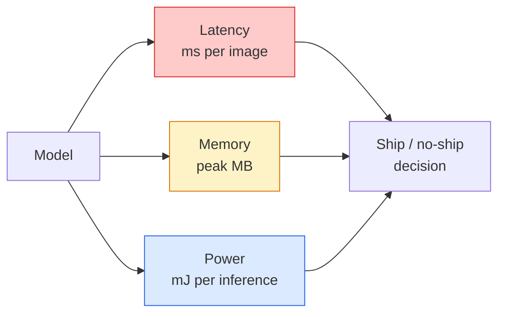

# 实时视觉——边缘部署

> 边缘推理是一门手艺：让一个准确率 90 的模型，在只有 2 GB 内存的设备上跑到 30 fps。每一点准确率都要用毫秒级的延迟去换。

**Type:** Learn + Build
**Languages:** Python
**Prerequisites:** Phase 4 Lesson 04 (Image Classification), Phase 10 Lesson 11 (Quantization)
**Time:** ~75 minutes

## 学习目标

- 为任意 PyTorch 模型测量推理延迟、峰值内存和吞吐量，并读懂 FLOPs / 参数 / 延迟之间的权衡
- 使用 PyTorch 的训练后量化把视觉模型量化到 INT8，并验证准确率损失小于 1%
- 导出 ONNX 并用 ONNX Runtime 或 TensorRT 编译；说出三种最常见的导出失败及其修复方法
- 解释在给定边缘约束时，何时选择 MobileNetV3、EfficientNet-Lite、ConvNeXt-Tiny 或 MobileViT

## 问题

训练阶段的视觉模型是个浮点怪兽：1 亿参数、每次前向 10 GFLOPs、2 GB 显存。这些东西塞不进手机、车载娱乐单元、工业相机或无人机。要把视觉系统交付出去，就得把同样的预测塞进小 100 倍的预算里。

三个旋钮承担了大部分工作：模型选择（用同样的配方换更小的架构）、量化（用 INT8 代替 FP32）、推理运行时（ONNX Runtime、TensorRT、Core ML、TFLite）。把这三个调对，决定了产品是只能在工作站上跑的 demo，还是能装进 30 美元摄像头模组的商品。

本节课先建立测量纪律（无法测量就无法优化），然后逐一走过这三个旋钮。目标不是学会每一个边缘运行时，而是知道有哪些杠杆，以及如何验证每个杠杆确实如你所想地起作用。

## 概念

### 三种预算



- **延迟**：p50、p95、p99。只看 p50 平均值会掩盖对实时系统至关重要的尾部行为。
- **峰值内存**：设备曾见过的最大值，而不是稳态平均值。这很重要，因为在嵌入式目标上 OOM 是致命的。
- **功耗 / 能量**：电池供电设备上每次推理的毫焦耳数。常用 CPU/GPU 利用率乘以时间作为近似。

边缘决策依据的是一张（模型、延迟、内存、准确率）表。每一格都要在目标设备上测量，而不是工作站。

### 测量纪律

每次边缘性能剖析都应遵守三条规则：

1. **预热**：测量前用 5-10 次虚拟前向传播预热模型。冷缓存和 JIT 编译会产生不具代表性的首次数字。
2. **同步**：在计时块前后用 `torch.cuda.synchronize()` 同步 GPU 工作负载。否则你测到的是内核调度，而不是内核执行。
3. **固定输入尺寸**：使用生产环境的实际分辨率。224x224 上的延迟不等于 512x512 上的延迟。

### FLOPs 作为代理指标

FLOPs（每次推理的浮点运算数）是廉价、与设备无关的延迟代理指标。它适合比较架构，但作为绝对耗时则会产生误导。FLOPs 多 10% 的模型，实际可能快 2 倍，因为它使用了硬件友好的算子（深度可分离卷积编译得好，大尺寸 7x7 卷积则不行）。

原则：架构搜索看 FLOPs，部署决策看设备端实测延迟。

### 一段话讲清量化

把 FP32 的权重和激活换成 INT8。模型体积缩小 4 倍，内存带宽降低 4 倍，在具备 INT8 内核的硬件上（每一颗现代移动 SoC、每一块带 Tensor Core 的 NVIDIA GPU）算力需求降低 2-4 倍。使用训练后静态量化时，视觉任务的准确率损失通常在 0.1-1 个百分点。

类型：

- **动态**——权重量化到 INT8，激活仍用浮点计算。简单，加速幅度小。
- **静态（训练后）**——量化权重，并在小型校准集上校准激活范围。比动态量化快得多。
- **量化感知训练（QAT）**——在训练中模拟量化，让模型学会适应。准确率最好，但需要带标签数据。

对视觉任务而言，训练后静态量化用 5% 的投入就能拿到 95% 的收益。只有当 PTQ 的准确率损失不可接受时，才使用 QAT。

### 剪枝与蒸馏

- **剪枝**——移除不重要的权重（基于幅度）或通道（结构化剪枝）。在过参数化的模型上效果好，在已经很紧凑的架构上作用有限。
- **蒸馏**——训练一个小学生模型去模仿大教师模型的 logit。通常能找回缩小模型所损失的大部分准确率，是生产边缘模型的标准做法。

### 推理运行时

- **PyTorch eager**——慢，不适合部署。仅用于开发。
- **TorchScript**——已是遗留方案，被 `torch.compile` 和 ONNX 导出取代。
- **ONNX Runtime**——中立的运行时。CPU、CUDA、CoreML、TensorRT、OpenVINO 都有对应的 ONNX provider。从这里开始。
- **TensorRT**——NVIDIA 的编译器。在 NVIDIA GPU（工作站和 Jetson）上延迟最低。可集成进 ONNX Runtime，也可独立使用。
- **Core ML**——Apple 面向 iOS/macOS 的运行时。需要 `.mlmodel` 或 `.mlpackage`。
- **TFLite**——Google 面向 Android/ARM 的运行时。需要 `.tflite`。
- **OpenVINO**——Intel 面向 CPU/VPU 的运行时。需要 `.xml` + `.bin`。

实践中的路线：PyTorch → ONNX → 为目标选择运行时。ONNX 是通用语。

### 边缘架构选择

| 预算 | 模型 | 理由 |
|--------|-------|-----|
| < 3M 参数 | MobileNetV3-Small | 到处都能编译，良好的基线 |
| 3-10M | EfficientNet-Lite-B0 | TFLite 上每参数准确率最佳 |
| 10-20M | ConvNeXt-Tiny | 每参数准确率最佳，CPU 友好 |
| 20-30M | MobileViT-S 或 EfficientViT | 达到 ImageNet 准确率的 Transformer |
| 30-80M | Swin-V2-Tiny | 如果推理栈支持窗口注意力 |

除非有特别理由，否则全部量化到 INT8。

```figure
cnn-param-count
```

## 构建它

### 第 1 步：正确测量延迟

```python
import time
import torch

def measure_latency(model, input_shape, device="cpu", warmup=10, iters=50):
    model = model.to(device).eval()
    x = torch.randn(input_shape, device=device)
    with torch.no_grad():
        for _ in range(warmup):
            model(x)
        if device == "cuda":
            torch.cuda.synchronize()
        times = []
        for _ in range(iters):
            if device == "cuda":
                torch.cuda.synchronize()
            t0 = time.perf_counter()
            model(x)
            if device == "cuda":
                torch.cuda.synchronize()
            times.append((time.perf_counter() - t0) * 1000)
    times.sort()
    return {
        "p50_ms": times[len(times) // 2],
        "p95_ms": times[int(len(times) * 0.95)],
        "p99_ms": times[int(len(times) * 0.99)],
        "mean_ms": sum(times) / len(times),
    }
```

预热、同步，使用 `time.perf_counter()`。报告百分位数，而不只是均值。

### 第 2 步：参数量与 FLOPs 统计

```python
def parameter_count(model):
    return sum(p.numel() for p in model.parameters())

def flops_estimate(model, input_shape):
    """
    Rough FLOP count for a conv/linear-only model. For production use `fvcore` or `ptflops`.
    """
    total = 0
    def conv_hook(m, inp, out):
        nonlocal total
        c_out, c_in, kh, kw = m.weight.shape
        h, w = out.shape[-2:]
        total += 2 * c_in * c_out * kh * kw * h * w
    def linear_hook(m, inp, out):
        nonlocal total
        total += 2 * m.in_features * m.out_features
    hooks = []
    for m in model.modules():
        if isinstance(m, torch.nn.Conv2d):
            hooks.append(m.register_forward_hook(conv_hook))
        elif isinstance(m, torch.nn.Linear):
            hooks.append(m.register_forward_hook(linear_hook))
    model.eval()
    with torch.no_grad():
        model(torch.randn(input_shape))
    for h in hooks:
        h.remove()
    return total
```

真实项目请使用 `fvcore.nn.FlopCountAnalysis` 或 `ptflops`；它们能正确处理每一种模块类型。

### 第 3 步：训练后静态量化

```python
def quantise_ptq(model, calibration_loader, backend="x86"):
    import torch.ao.quantization as tq
    model = model.eval().cpu()
    model.qconfig = tq.get_default_qconfig(backend)
    tq.prepare(model, inplace=True)
    with torch.no_grad():
        for x, _ in calibration_loader:
            model(x)
    tq.convert(model, inplace=True)
    return model
```

三步：配置、prepare（插入观察器）、用真实数据校准、convert（融合 + 量化）。这要求模型已经融合（`Conv -> BN -> ReLU` → `ConvBnReLU`），`torch.ao.quantization.fuse_modules` 负责这件事。

### 第 4 步：导出到 ONNX

```python
def export_onnx(model, sample_input, path="model.onnx"):
    model = model.eval()
    torch.onnx.export(
        model,
        sample_input,
        path,
        input_names=["input"],
        output_names=["output"],
        dynamic_axes={"input": {0: "batch"}, "output": {0: "batch"}},
        opset_version=17,
    )
    return path
```

`opset_version=17` 是 2026 年安全的默认值。`dynamic_axes` 让你能用任意 batch 大小运行 ONNX 模型。

### 第 5 步：基准测试与方案对比

```python
import torch.nn as nn
from torchvision.models import mobilenet_v3_small

def compare_regimes():
    model = mobilenet_v3_small(weights=None, num_classes=10)
    params = parameter_count(model)
    flops = flops_estimate(model, (1, 3, 224, 224))
    lat_fp32 = measure_latency(model, (1, 3, 224, 224), device="cpu")
    print(f"FP32 MobileNetV3-Small: {params:,} params  {flops/1e9:.2f} GFLOPs  "
          f"p50={lat_fp32['p50_ms']:.2f}ms  p95={lat_fp32['p95_ms']:.2f}ms")
```

对 `resnet50`、`efficientnet_v2_s` 和 `convnext_tiny` 运行同一个函数，你就得到了部署决策所需的对比表。

## 使用它

生产栈最终会收敛到三条路径之一：

- **Web / serverless**：PyTorch → ONNX → ONNX Runtime（CPU 或 CUDA provider）。最简单，对大多数场景够用。
- **NVIDIA 边缘（Jetson、GPU 服务器）**：PyTorch → ONNX → TensorRT。延迟最好，工程量最大。
- **移动端**：PyTorch → ONNX → Core ML（iOS）或 TFLite（Android）。导出前先量化。

测量方面，`torch-tb-profiler`、`nvprof` / `nsys` 以及 macOS 的 Instruments 能给出逐层分解。`benchmark_app`（OpenVINO）和 `trtexec`（TensorRT）能给出独立的 CLI 数字。

## 交付它

本节课产出：

- `outputs/prompt-edge-deployment-planner.md` —— 一个根据目标设备和延迟 SLA，选择骨干网络、量化策略和运行时的 prompt。
- `outputs/skill-latency-profiler.md` —— 一个编写完整延迟基准测试脚本的技能，包含预热、同步、百分位数和内存跟踪。

## 练习

1. **（简单）** 在 CPU 上测量 `resnet18`、`mobilenet_v3_small`、`efficientnet_v2_s` 和 `convnext_tiny` 在 224x224 下的 p50 延迟。报告表格，并指出哪个架构的每毫秒准确率最高。
2. **（中等）** 对 `mobilenet_v3_small` 应用训练后静态量化。报告 FP32 与 INT8 的延迟对比，以及在 CIFAR-10 或类似数据的留出子集上的准确率损失。
3. **（困难）** 把 `convnext_tiny` 导出到 ONNX，用 `onnxruntime` 的 `CPUExecutionProvider` 运行，并与 PyTorch eager 基线比较延迟。找出 ONNX Runtime 开始变快的第一个层，并解释原因。

## 关键术语

| 术语 | 人们怎么说 | 实际含义 |
|------|----------------|----------------------|
| Latency | 「有多快」 | 从输入到输出的时间；看 p50/p95/p99 百分位，而非均值 |
| FLOPs | 「模型大小」 | 每次前向传播的浮点运算数；计算成本的粗略代理 |
| INT8 quantisation | 「8 位」 | 用 8 位整数替换 FP32 权重/激活；体积约小 4 倍，速度快 2-4 倍 |
| PTQ | 「训练后量化」 | 不重新训练就对已训练模型做量化；简单，通常够用 |
| QAT | 「量化感知训练」 | 在训练中模拟量化；准确率最好，但需要带标签数据 |
| ONNX | 「中立格式」 | 被所有主流推理运行时支持的模型交换格式 |
| TensorRT | 「NVIDIA 编译器」 | 把 ONNX 编译成面向 NVIDIA GPU 的优化引擎 |
| Distillation | 「教师 → 学生」 | 训练小模型模仿大模型的 logit；找回大部分损失的准确率 |

## 延伸阅读

- [EfficientNet (Tan & Le, 2019)](https://arxiv.org/abs/1905.11946) —— 高效架构的复合缩放
- [MobileNetV3 (Howard et al., 2019)](https://arxiv.org/abs/1905.02244) —— 采用 h-swish 和 squeeze-excite 的移动优先架构
- [Accelerating Inference Up to 6x Faster in PyTorch with Torch-TensorRT (NVIDIA)](https://developer.nvidia.com/blog/accelerating-inference-up-to-6x-faster-in-pytorch-with-torch-tensorrt/) —— 如何真正复现论文中的吞吐量数字
- [ONNX Runtime docs](https://onnxruntime.ai/docs/) —— 量化、图优化、provider 选择
