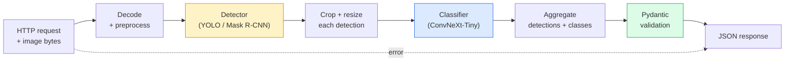

# 构建完整的视觉 pipeline——项目

> 生产级视觉系统是一串由模型和规则组成的链条，用数据契约缝合起来。零件在本阶段都已学过；项目把它们端到端地接起来。

**Type:** Build
**Languages:** Python
**Prerequisites:** Phase 4 Lessons 01-15
**Time:** ~120 minutes

## 学习目标

- 设计一条生产级视觉 pipeline：检测目标、对目标分类，并输出结构化 JSON——每条失败路径都有处理
- 把检测器（Mask R-CNN 或 YOLO）、分类器（ConvNeXt-Tiny）和数据契约（Pydantic）接入同一个服务
- 对端到端 pipeline 做基准测试，找出第一个瓶颈（通常是预处理，然后是检测器）
- 交付一个最小 FastAPI 服务：接收图像上传、运行 pipeline、返回带分类的检测结果

## 问题

单个视觉模型很好用；视觉产品则是由它们串成的链条。零售货架审计 = 检测器 + 商品分类器 + 价格 OCR pipeline。自动驾驶 = 2D 检测器 + 3D 检测器 + 分割器 + 跟踪器 + 规划器。医疗初筛 = 分割器 + 区域分类器 + 临床医生界面。

把这些链子接起来，才是 ML 原型与产品之间的分水岭。模型之间的每个接口都是新的 bug 温床。每次坐标变换、每次归一化、每次 mask 缩放，都可能是静默失败点。一条 pipeline 的强度，取决于它最薄弱的接口。

这个项目搭建最小可行的 pipeline：检测 + 分类 + 结构化输出 + 服务层。第 4 阶段的其他内容都能嵌进这个骨架：把 Mask R-CNN 换成 YOLOv8、加一个 OCR 头、加一个分割分支、加一个跟踪器。架构稳定，零件可插拔。

## 概念

### Pipeline



七个阶段。两个模型阶段最贵；另外五个阶段才是 bug 的藏身之处。

### 用 Pydantic 定义数据契约

每个模型边界都变成一个带类型的对象。这样静默失败就变成了响亮的失败。

```
Detection(
    box: tuple[float, float, float, float],   # (x1, y1, x2, y2), absolute pixels
    score: float,                              # [0, 1]
    class_id: int,                             # from detector's label map
    mask: Optional[list[list[int]]],           # RLE-encoded if present
)

PipelineResult(
    image_id: str,
    detections: list[Detection],
    classifications: list[Classification],
    inference_ms: float,
)
```

当检测器返回的框是 `(cx, cy, w, h)` 而不是 `(x1, y1, x2, y2)` 时，Pydantic 会在边界处校验失败，你立刻就能发现，而不用去调试一个静默返回空区域的下游裁剪。

### 延迟花在哪里

几乎每条视觉 pipeline 都成立的三条事实：

1. **预处理往往是最耗时的单一块。** 解码 JPEG、转换色彩空间、缩放——这些都受 CPU 限制，而且很容易被忽略。
2. **检测器主导 GPU 时间。** GPU 时间的 70-90% 花在检测的前向传播上。
3. **后处理（NMS、RLE 编解码）在 GPU 上便宜，在 CPU 上昂贵。** 始终用真实目标环境做剖析。

了解这个分布，才能把优化变成一份有优先级的清单。

### 失败模式

- **空检测**——返回空列表，不要崩溃。记录日志。
- **越界框**——裁剪前先钳制到图像尺寸范围内。
- **过小的裁剪**——对于小于分类器最小输入尺寸的框，跳过分类。
- **损坏的上传**——返回 400 和具体的错误码，而不是 500。
- **模型加载失败**——在服务启动时失败，而不是等到第一个请求。

生产级 pipeline 会逐一处理这些情况，而不是写一个掩盖失败的通用 `try/except`。每种失败都有具名错误码和对应响应。

### 批处理

生产服务要服务多个客户端。跨请求地对检测和分类做批处理，能成倍提升吞吐量。代价是等待 batch 凑满带来的额外延迟。典型配置：最多收集 20ms 的请求，组成 batch，处理，再分发响应。`torchserve` 和 `triton` 原生支持；负载可预测的小服务则自己实现 micro-batcher。

```figure
v4-vision-pipeline
```

## 构建它

### 第 1 步：数据契约

```python
from pydantic import BaseModel, Field
from typing import List, Optional, Tuple

class Detection(BaseModel):
    box: Tuple[float, float, float, float]
    score: float = Field(ge=0, le=1)
    class_id: int = Field(ge=0)
    mask_rle: Optional[str] = None


class Classification(BaseModel):
    detection_index: int
    class_id: int
    class_name: str
    score: float = Field(ge=0, le=1)


class PipelineResult(BaseModel):
    image_id: str
    detections: List[Detection]
    classifications: List[Classification]
    inference_ms: float
```

几秒钟的代码，能为任何严肃的 pipeline 省下一小时的调试。

### 第 2 步：一个最小的 Pipeline 类

```python
import time
import numpy as np
import torch
from PIL import Image

class VisionPipeline:
    def __init__(self, detector, classifier, class_names,
                 device="cpu", min_crop=32):
        self.detector = detector.to(device).eval()
        self.classifier = classifier.to(device).eval()
        self.class_names = class_names
        self.device = device
        self.min_crop = min_crop

    def preprocess(self, image):
        """
        image: PIL.Image or np.ndarray (H, W, 3) uint8
        returns: CHW float tensor on device
        """
        if isinstance(image, Image.Image):
            image = np.asarray(image.convert("RGB"))
        tensor = torch.from_numpy(image).permute(2, 0, 1).float() / 255.0
        return tensor.to(self.device)

    @torch.no_grad()
    def detect(self, image_tensor):
        return self.detector([image_tensor])[0]

    @torch.no_grad()
    def classify(self, crops):
        if len(crops) == 0:
            return []
        batch = torch.stack(crops).to(self.device)
        logits = self.classifier(batch)
        probs = logits.softmax(-1)
        scores, cls = probs.max(-1)
        return list(zip(cls.tolist(), scores.tolist()))

    def run(self, image, image_id="anonymous"):
        t0 = time.perf_counter()
        tensor = self.preprocess(image)
        det = self.detect(tensor)

        crops = []
        detections = []
        valid_indices = []
        for i, (box, score, cls) in enumerate(zip(det["boxes"], det["scores"], det["labels"])):
            x1, y1, x2, y2 = [max(0, int(b)) for b in box.tolist()]
            x2 = min(x2, tensor.shape[-1])
            y2 = min(y2, tensor.shape[-2])
            detections.append(Detection(
                box=(x1, y1, x2, y2),
                score=float(score),
                class_id=int(cls),
            ))
            if (x2 - x1) < self.min_crop or (y2 - y1) < self.min_crop:
                continue
            crop = tensor[:, y1:y2, x1:x2]
            crop = torch.nn.functional.interpolate(
                crop.unsqueeze(0),
                size=(224, 224),
                mode="bilinear",
                align_corners=False,
            )[0]
            crops.append(crop)
            valid_indices.append(i)

        class_preds = self.classify(crops)

        classifications = []
        for valid_idx, (cls_id, cls_score) in zip(valid_indices, class_preds):
            classifications.append(Classification(
                detection_index=valid_idx,
                class_id=int(cls_id),
                class_name=self.class_names[cls_id],
                score=float(cls_score),
            ))

        return PipelineResult(
            image_id=image_id,
            detections=detections,
            classifications=classifications,
            inference_ms=(time.perf_counter() - t0) * 1000,
        )
```

每个接口都有类型。每条失败路径都有明确的处理决策。

### 第 3 步：接上检测器与分类器

```python
from torchvision.models.detection import maskrcnn_resnet50_fpn_v2
from torchvision.models import convnext_tiny

# Use ImageNet-pretrained weights for a realistic pipeline without training
detector = maskrcnn_resnet50_fpn_v2(weights="DEFAULT")
classifier = convnext_tiny(weights="DEFAULT")
class_names = [f"imagenet_class_{i}" for i in range(1000)]

pipe = VisionPipeline(detector, classifier, class_names)

# Smoke test with a synthetic image
test_image = (np.random.rand(400, 600, 3) * 255).astype(np.uint8)
result = pipe.run(test_image, image_id="demo")
print(result.model_dump_json(indent=2)[:500])
```

### 第 4 步：FastAPI 服务

```python
from fastapi import FastAPI, UploadFile, HTTPException
from io import BytesIO

app = FastAPI()
pipe = None  # initialised on startup

@app.on_event("startup")
def load():
    global pipe
    detector = maskrcnn_resnet50_fpn_v2(weights="DEFAULT").eval()
    classifier = convnext_tiny(weights="DEFAULT").eval()
    pipe = VisionPipeline(detector, classifier, class_names=[f"c{i}" for i in range(1000)])

@app.post("/detect")
async def detect_endpoint(file: UploadFile):
    if file.content_type not in {"image/jpeg", "image/png", "image/webp"}:
        raise HTTPException(status_code=400, detail="unsupported image type")
    data = await file.read()
    try:
        img = Image.open(BytesIO(data)).convert("RGB")
    except Exception:
        raise HTTPException(status_code=400, detail="cannot decode image")
    result = pipe.run(img, image_id=file.filename or "upload")
    return result.model_dump()
```

用 `uvicorn main:app --host 0.0.0.0 --port 8000` 启动。用 `curl -F 'file=@dog.jpg' http://localhost:8000/detect` 测试。

### 第 5 步：对 pipeline 做基准测试

```python
import time

def benchmark(pipe, num_runs=20, image_size=(400, 600)):
    img = (np.random.rand(*image_size, 3) * 255).astype(np.uint8)
    pipe.run(img)  # warm up

    stages = {"preprocess": [], "detect": [], "classify": [], "total": []}
    for _ in range(num_runs):
        t0 = time.perf_counter()
        tensor = pipe.preprocess(img)
        t1 = time.perf_counter()
        det = pipe.detect(tensor)
        t2 = time.perf_counter()
        crops = []
        for box in det["boxes"]:
            x1, y1, x2, y2 = [max(0, int(b)) for b in box.tolist()]
            x2 = min(x2, tensor.shape[-1])
            y2 = min(y2, tensor.shape[-2])
            if (x2 - x1) >= pipe.min_crop and (y2 - y1) >= pipe.min_crop:
                crop = tensor[:, y1:y2, x1:x2]
                crop = torch.nn.functional.interpolate(
                    crop.unsqueeze(0), size=(224, 224), mode="bilinear", align_corners=False
                )[0]
                crops.append(crop)
        pipe.classify(crops)
        t3 = time.perf_counter()
        stages["preprocess"].append((t1 - t0) * 1000)
        stages["detect"].append((t2 - t1) * 1000)
        stages["classify"].append((t3 - t2) * 1000)
        stages["total"].append((t3 - t0) * 1000)

    for stage, times in stages.items():
        times.sort()
        print(f"{stage:12s}  p50={times[len(times)//2]:7.1f} ms  p95={times[int(len(times)*0.95)]:7.1f} ms")
```

CPU 上的典型输出：预处理约 3 ms，检测 300-500 ms，分类 20-40 ms，总计 350-550 ms。在 GPU 上，检测为 20-40 ms，预处理和分类在相对占比上开始变得重要。

## 使用它

生产模板最终都收敛到同样的结构，再加上：

- **模型版本管理**——始终在响应中记录模型名称和权重哈希。
- **每请求 trace ID**——为每个请求记录每个阶段的耗时，这样就能把慢响应与具体阶段关联起来。
- **回退路径**——如果分类器超时，返回不带分类的检测结果，而不是让整个请求失败。
- **安全过滤器**——NSFW / PII 过滤器在分类之后、响应离开服务之前运行。
- **批量端点**——`/detect_batch` 接受一组图像 URL，用于批量处理。

生产级服务方面，`torchserve`、`Triton Inference Server` 和 `BentoML` 开箱即用地处理批处理、版本管理、指标和健康检查。原型和小规模产品直接跑 `FastAPI` 完全够用。

## 交付它

本节课产出：

- `outputs/prompt-vision-service-shape-reviewer.md` —— 一个审查视觉服务代码是否违反契约 / 响应形状，并指出第一个破坏性 bug 的 prompt。
- `outputs/skill-pipeline-budget-planner.md` —— 一个在给定目标延迟和吞吐量后，为每个 pipeline 阶段分配时间预算，并标出哪个阶段会最先超预算的技能。

## 练习

1. **（简单）** 在任意开放数据集的 10 张图像上运行该 pipeline。报告每个阶段的平均耗时，以及每张图像检测数量的分布。
2. **（中等）** 给 `Detection` 增加一个 mask 输出字段，并用 RLE 编码。验证即使图像中有 10 个目标，JSON 仍保持在 1MB 以下。
3. **（困难）** 在分类器前加一个 micro-batcher：最多收集 10 ms 的裁剪，一次 GPU 调用全部完成分类，再按请求返回结果。测量每秒 5 个并发请求时的吞吐量增益和额外延迟。

## 关键术语

| 术语 | 人们怎么说 | 实际含义 |
|------|----------------|----------------------|
| Pipeline | 「系统」 | 预处理、推理、后处理按顺序组成的链，每一对之间都有带类型的接口 |
| Data contract | 「schema」 | Pydantic / dataclass 定义，每个阶段的输入输出都必须符合；在边界处抓住集成 bug |
| Preprocessing | 「模型之前」 | 解码、色彩转换、缩放、归一化；通常是最大的 CPU 时间黑洞 |
| Postprocessing | 「模型之后」 | NMS、mask 缩放、阈值、RLE 编码；GPU 上便宜，CPU 上昂贵 |
| Microbatcher | 「先收集再转发」 | 聚合器：固定窗口内等待多个请求，然后跑一次批量前向 |
| Trace ID | 「请求 id」 | 每个请求的标识符，在每个阶段都记录，便于端到端追踪慢请求 |
| Failure code | 「具名错误」 | 每类失败对应专门的错误码，而不是通用 500；让客户端能实现重试逻辑 |
| Health check | 「就绪探针」 | 廉价端点，报告服务能否应答；负载均衡器依赖它 |

## 延伸阅读

- [Full Stack Deep Learning — Deploying Models](https://fullstackdeeplearning.com/course/2022/lecture-5-deployment/) —— 生产 ML 部署的经典综述
- [BentoML docs](https://docs.bentoml.com) —— 支持批处理、版本管理和指标的服务框架
- [torchserve docs](https://pytorch.org/serve/) —— PyTorch 官方服务库
- [NVIDIA Triton Inference Server](https://developer.nvidia.com/triton-inference-server) —— 支持批处理和多模型的高吞吐服务
