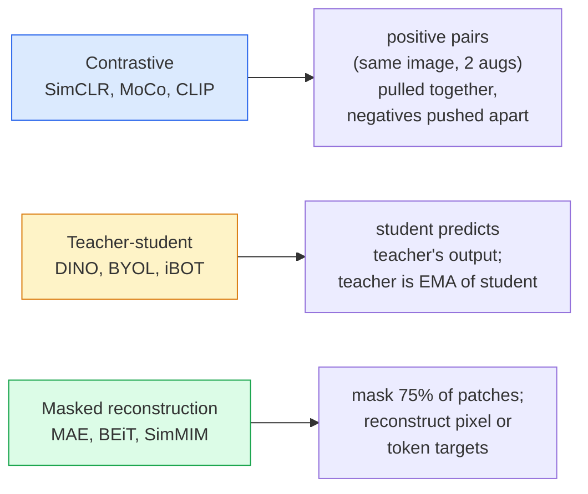

# 自监督视觉——SimCLR、DINO、MAE

> 标签是监督式视觉的瓶颈。自监督预训练把它绕开了：从 1 亿张无标签图像中学到视觉特征，再在 1 万张有标签图像上微调。

**Type:** Learn + Build
**Languages:** Python
**Prerequisites:** Phase 4 Lesson 04 (Image Classification), Phase 4 Lesson 14 (ViT)
**Time:** ~75 minutes

## 学习目标

- 梳理三大自监督流派——对比学习（SimCLR）、教师-学生（DINO）、掩码重建（MAE）——并说明各自优化什么
- 从零实现 InfoNCE 损失，并解释为什么 batch 为 512 可行而 32 会失败
- 解释 MAE 的 75% 掩码比例并非随意设定，以及它与 BERT 在文本上 15% 的比例有何不同
- 使用 DINOv2 或 MAE 的 ImageNet checkpoint 做线性探针和零样本检索

## 问题

监督式 ImageNet 有 130 万张带标签图像，标注成本估计达 1000 万美元。医疗和工业数据集更小，标注成本却更高。每个视觉团队都在问：能否在廉价的无标签数据上预训练——YouTube 视频帧、网页抓取、摄像头录像、卫星扫描——再在小型有标签数据集上微调？

自监督学习就是答案。现代自监督 ViT 在 LAION 或 JFT 上训练后，微调时能达到甚至超过监督式 ImageNet 的准确率。与监督预训练相比，它在下游任务（检测、分割、深度）上的迁移效果也更好。DINOv2（Meta，2023）和 MAE（Meta，2022）是当前可迁移视觉特征的生产默认选择。

观念上的转变在于：pretext 任务（代理任务）——模型被训练去做的事——不必等于下游任务。关键在于它迫使模型学到有用的特征。预测灰度图像的颜色、旋转图像让模型分类旋转角度、遮住 patch 再重建——这些方法都曾奏效。真正能扩展的是三条路线：对比学习、教师-学生蒸馏、掩码重建。

## 概念

### 三大流派



### 对比学习（SimCLR）

取一张图像，施加两种随机增强，得到两个视图。让两者通过同一个编码器加一个投影头。最小化一个损失，它要求「这两个 embedding 应该靠近」，同时「这个 embedding 应该远离 batch 中其他所有图像的 embedding」。

```
Loss for positive pair (z_i, z_j) among 2N views per batch:

   L_ij = -log( exp(sim(z_i, z_j) / tau) / sum_k in batch \ {i} exp(sim(z_i, z_k) / tau) )

sim = cosine similarity
tau = temperature (0.1 standard)
```

这就是 InfoNCE 损失。它要求每个正样本配大量负样本，因此 batch 大小很关键——SimCLR 需要 512-8192。MoCo 引入了过去 batch 的动量队列，把负样本数量与 batch 大小解耦。

### 教师-学生（DINO）

两个结构相同的网络：学生和教师。教师是学生权重的指数移动平均（EMA）。两者分别看到同一图像的不同增强视图。学生被训练去匹配教师的输出——不需要显式负样本。

```
loss = CE( student_output(view_1),  teacher_output(view_2) )
     + CE( student_output(view_2),  teacher_output(view_1) )

teacher_weights = m * teacher_weights + (1 - m) * student_weights   (m ≈ 0.996)
```

为什么它不会坍缩成「预测一个常数」：教师的输出会做中心化（减去各维度均值）和锐化（除以小温度）。中心化防止某一维独大；锐化防止输出坍缩为均匀分布。

DINOv2 就是把 DINO 放大到 1.42 亿张精选图像上的结果。其产出的特征在零样本视觉检索和稠密预测上是当前的 SOTA。

### 掩码重建（MAE）

遮住 ViT 输入中 75% 的 patch。只让可见的 25% 通过编码器。一个小解码器接收编码器输出，并在被遮位置加上 mask token，训练它重建被遮 patch 的像素。

```
Encoder:  visible 25% of patches -> features
Decoder:  features + mask tokens at masked positions -> reconstructed pixels
Loss:     MSE between reconstructed and original pixels on masked patches only
```

让 MAE 奏效的关键设计选择：

- **75% 掩码比例**——很高。它迫使编码器学习语义特征；重建 25% 近乎平凡（相邻像素相关性太强，一个 CNN 就能搞定）。
- **非对称编码器/解码器**——大的 ViT 编码器只处理可见 patch；小的解码器（8 层、512 维）负责重建。预训练速度比朴素 BEiT 快 3 倍。
- **像素空间重建目标**——比 BEiT 的 token 化目标更简单，在 ViT 上效果更好。

预训练结束后丢弃解码器。编码器就是特征提取器。

### 为什么是 75% 而不是 15%

BERT 遮住 15% 的 token，MAE 遮住 75%。差别在于信息密度。

- 自然语言每个 token 的熵很高。预测 15% 的 token 仍然很难，因为每个被遮位置都有许多合理的补全。
- 图像 patch 的熵很低——未遮住的邻域往往几乎完全决定了被遮 patch 的像素。要让预测必须依赖语义理解，就必须大力遮挡。

75% 足够高，简单空间外推无法完成任务；编码器必须表示图像内容。

### 线性探针评估

自监督预训练后，标准评估是**线性探针**：冻结编码器，在其上用一个线性分类器在 ImageNet 标签上训练，报告 top-1 准确率。

- SimCLR ResNet-50：约 71%（2020）
- DINO ViT-S/16：约 77%（2021）
- MAE ViT-L/16：约 76%（2022）
- DINOv2 ViT-g/14：约 86%（2023）

线性探针是特征质量的纯粹度量；微调通常会再加 2-5 个点，但也混入了分类头重新训练的影响。

```figure
data-augmentation
```

## 构建它

### 第 1 步：双视图增强 pipeline

```python
import torch
import torchvision.transforms as T

two_view_train = lambda: T.Compose([
    T.RandomResizedCrop(96, scale=(0.2, 1.0)),
    T.RandomHorizontalFlip(),
    T.ColorJitter(0.4, 0.4, 0.4, 0.1),
    T.RandomGrayscale(p=0.2),
    T.ToTensor(),
])


class TwoViewDataset(torch.utils.data.Dataset):
    def __init__(self, base):
        self.base = base
        self.aug = two_view_train()

    def __len__(self):
        return len(self.base)

    def __getitem__(self, i):
        img, _ = self.base[i]
        v1 = self.aug(img)
        v2 = self.aug(img)
        return v1, v2
```

每次 __getitem__ 返回同一图像的两个增强视图；不需要标签。

### 第 2 步：InfoNCE 损失

```python
import torch.nn.functional as F

def info_nce(z1, z2, tau=0.1):
    """
    z1, z2: (N, D) L2-normalised embeddings of paired views
    """
    N, D = z1.shape
    z = torch.cat([z1, z2], dim=0)  # (2N, D)
    sim = z @ z.T / tau              # (2N, 2N)

    mask = torch.eye(2 * N, dtype=torch.bool, device=z.device)
    sim = sim.masked_fill(mask, float("-inf"))

    targets = torch.cat([torch.arange(N, 2 * N), torch.arange(0, N)]).to(z.device)
    return F.cross_entropy(sim, targets)
```

调用前先对 embedding 做 L2 归一化。`tau=0.1` 是 SimCLR 的默认值；更低会让损失更尖锐，并需要更多负样本。

### 第 3 步：健全性检查 InfoNCE

```python
z1 = F.normalize(torch.randn(16, 32), dim=-1)
z2 = z1.clone()
loss_same = info_nce(z1, z2, tau=0.1).item()
z2_random = F.normalize(torch.randn(16, 32), dim=-1)
loss_random = info_nce(z1, z2_random, tau=0.1).item()
print(f"InfoNCE with identical pairs:  {loss_same:.3f}")
print(f"InfoNCE with random pairs:     {loss_random:.3f}")
```

相同样本对应该给出很低的损失（在大 batch 和低温度下接近 0）。随机样本对在 16 对 batch 下应给出 $\log(2N-1) \approx \log(31) \approx 3.4$。

### 第 4 步：MAE 风格掩码

```python
def random_mask_indices(num_patches, mask_ratio=0.75, seed=0):
    g = torch.Generator().manual_seed(seed)
    n_keep = int(num_patches * (1 - mask_ratio))
    perm = torch.randperm(num_patches, generator=g)
    visible = perm[:n_keep]
    masked = perm[n_keep:]
    return visible.sort().values, masked.sort().values


num_patches = 196
visible, masked = random_mask_indices(num_patches, mask_ratio=0.75)
print(f"visible: {len(visible)} / {num_patches}")
print(f"masked:  {len(masked)} / {num_patches}")
```

简单、快速，且对给定种子是确定性的。真实的 MAE 实现会把它批量化，并保留每个样本的掩码。

## 使用它

2026 年，DINOv2 是生产标准：

```python
import torch
from transformers import AutoImageProcessor, AutoModel

processor = AutoImageProcessor.from_pretrained("facebook/dinov2-base")
model = AutoModel.from_pretrained("facebook/dinov2-base")
model.eval()

# Per-image embeddings for zero-shot retrieval
with torch.no_grad():
    inputs = processor(images=[pil_image], return_tensors="pt")
    outputs = model(**inputs)
    embedding = outputs.last_hidden_state[:, 0]  # CLS token
```

得到的 768 维 embedding 是现代图像检索、稠密对应和零样本迁移 pipeline 的骨干。在下游任务上微调，通常只需要一个线性头。

图像-文本 embedding 的对应选择是 SigLIP 或 OpenCLIP；MAE 风格的微调则可以用 `timm` 仓库提供的所有 MAE checkpoint。

## 交付它

本节课产出：

- `outputs/prompt-ssl-pretraining-picker.md` —— 一个根据数据集规模、算力和下游任务，在 SimCLR / MAE / DINOv2 之间做选择的 prompt。
- `outputs/skill-linear-probe-runner.md` —— 一个为任意冻结编码器加有标签数据集编写线性探针评估的技能。

## 练习

1. **（简单）** 验证：对对齐良好的 embedding，降低温度会让 InfoNCE 损失下降；对随机 embedding，降低温度会让损失上升。绘制 `tau in [0.05, 0.1, 0.2, 0.5]` 与损失的关系图。
2. **（中等）** 实现 DINO 风格的居中缓冲区。证明没有中心化时，学生模型会在几个 epoch 内坍缩为常数向量。
3. **（困难）** 以第 10 课的 TinyUNet 为骨干，在 CIFAR-100 上训练 MAE。报告 10、50、200 个 epoch 的线性探针准确率。证明在同样的 1000 张图像子集上，MAE 预训练后的线性探针优于从零开始监督训练的线性探针。

## 关键术语

| 术语 | 人们怎么说 | 实际含义 |
|------|----------------|----------------------|
| Self-supervised | 「无标签」 | 一种 pretext 任务，能从无标签数据中产生有用的表示 |
| Pretext task | 「假任务」 | SSL 期间使用的目标（重建 patch、匹配视图）；预训练后丢弃 |
| Linear probe | 「冻结编码器 + 线性头」 | 标准 SSL 评估：只在冻结特征之上训练一个线性分类器 |
| InfoNCE | 「对比损失」 | 在余弦相似度上做 softmax；正样本对是目标类别，其余都是负样本 |
| EMA teacher | 「移动平均教师」 | 权重为学生权重的指数移动平均的教师；BYOL、MoCo、DINO 使用 |
| Mask ratio | 「隐藏 patch 的百分比」 | MAE 中被遮 patch 的比例；视觉 75%，文本 15% |
| Representation collapse | 「常数输出」 | SSL 失败模式：编码器对所有输入输出常数向量；通过中心化、锐化或负样本防止 |
| DINOv2 | 「生产级 SSL 骨干」 | Meta 2023 年的自监督 ViT；2026 年最强的通用图像特征 |

## 延伸阅读

- [SimCLR (Chen et al., 2020)](https://arxiv.org/abs/2002.05709) —— 对比学习参考
- [DINO (Caron et al., 2021)](https://arxiv.org/abs/2104.14294) —— 带动量、中心化、锐化的教师-学生方法
- [MAE (He et al., 2022)](https://arxiv.org/abs/2111.06377) —— 面向 ViT 的掩码自编码器预训练
- [DINOv2 (Oquab et al., 2023)](https://arxiv.org/abs/2304.07193) —— 把自监督 ViT 扩展到生产级特征
