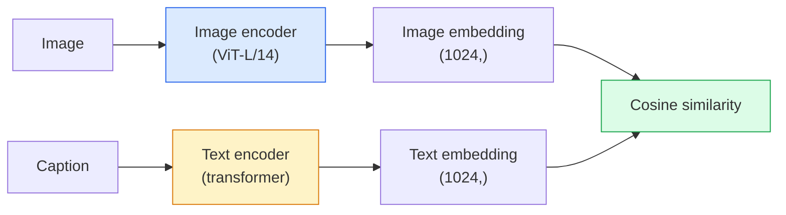

# 开放词汇视觉——CLIP

> 同时训练图像编码器和文本编码器，让匹配的（图像，描述）对落在共享空间中的同一处。整个技巧就这么多。

**Type:** Build + Use
**Languages:** Python
**Prerequisites:** Phase 4 Lesson 14 (ViT), Phase 4 Lesson 17 (Self-Supervised)
**Time:** ~45 minutes

## 学习目标

- 解释 CLIP 的双塔架构和对比训练目标
- 使用预训练的 CLIP（或 SigLIP）做零样本分类，无需任何任务特定训练
- 从零实现零样本分类：编码类别 prompt、计算余弦相似度、取 argmax
- 区分 CLIP、SigLIP、OpenCLIP 与 LLaVA/LLaMA-vision 模型——各自在 2026 年的用途

## 问题

传统分类器是封闭词表的：一个 1000 类的 ImageNet 模型只能预测 1000 个标签。每增加一个新类别，都需要带标签数据并重新训练分类头。

CLIP（Radford 等，OpenAI 2021）表明，用从网络抓取的 4 亿个（图像，描述）对训练出的模型，在推理时可以按任意类别集合分类，类别纯用自然语言描述。写一句话，就给它加了一个新类别。

这种能力——零样本迁移——正是现代视觉系统都从 CLIP 家族 checkpoint 起步的原因。检测（Grounding DINO、OWL-ViT）、分割（CLIPSeg、SAM）、检索、内容审核、VLM 以及文生图，全都构建在 CLIP 风格的联合 embedding 之上。

## 概念

### 双塔



两个编码器最后都通过线性投影到相同的 embedding 维度（CLIP-B/32 为 512，CLIP-L/14 为 1024）。做 L2 归一化后计算余弦相似度。

### 目标函数

给定一个包含 $N$ 个（图像，描述）对的 batch，构造 $N \times N$ 的相似度矩阵。训练两个编码器，使对角线（匹配对）相似度高，非对角线（不匹配）相似度低。

```
sim_matrix = image_embeddings @ text_embeddings.T / tau

loss_i2t = cross_entropy(sim_matrix,       targets=arange(N))
loss_t2i = cross_entropy(sim_matrix.T,     targets=arange(N))
loss = (loss_i2t + loss_t2i) / 2
```

之所以对称，是因为图像到文本和文本到图像两个方向的检索都应当可用。`tau`（温度）通常作为标量参数学习，初始化为 0.07。

### SigLIP：更好的损失

SigLIP（Zhai 等，2023）用逐对 sigmoid 取代了 softmax：

```math
\begin{aligned}
\text{loss} &= \mathop{\mathrm{mean}}\limits_{\text{pairs}} \log\left(1 + \exp(-y_{ij} \cdot \text{sim}_{ij})\right) \\
y_{ij} &= \begin{cases} +1 & \text{if matching} \\ -1 & \text{otherwise} \end{cases}
\end{aligned}
```

逐对损失去掉了 CLIP 所需的 batch 级归一化。SigLIP 在小 batch 上训练更好，在同等数据下追平或超过 CLIP。

### 零样本分类

给定一个训练好的 CLIP：

1. 对每个类别，拼一个 prompt："a photo of a {class}"。
2. 用文本编码器编码所有类别 prompt → `T`，形状 (C, d)。
3. 编码测试图像 → `I`，形状 (1, d)。
4. 相似度 = `I @ T.T`，形状 (1, C)。
5. 取 argmax → 预测类别。

prompt 工程很重要。OpenAI 为 ImageNet 发布了 80 个 prompt 模板（"a photo of a {}"、"a blurry photo of a {}"、"a sketch of a {}"……）。对每个类别，把所有模板的 embedding 取平均，可以再提升 1-3% 的 top-1 准确率。

### 2026 年 CLIP 风格模型的用武之地

- **零样本分类**——直接使用。
- **图像检索**——所有图像只编码一次，推理时嵌入查询。
- **文本条件检测**——Grounding DINO、OWL-ViT 把 CLIP 文本塔套在检测器上。
- **文本条件分割**——CLIPSeg；SAM 通过 CLIP 接收文本提示输入。
- **VLM**——LLaVA、Qwen-VL、InternVL 把 CLIP 家族的视觉编码器接入 LLM。
- **文生图**——Stable Diffusion、DALL-E 3 以 CLIP 文本 embedding 为条件。

一旦有了共享嵌入空间，每个视觉 + 语言任务都变成一次距离计算。

```figure
clip-contrastive
```

## 构建它

### 第 1 步：一个微型双塔模型

真正的 CLIP 是 ViT + Transformer。本课中，两座塔是在预提取特征上运行的小型 MLP，这样在 CPU 上也能看到训练信号。

```python
import torch
import torch.nn as nn
import torch.nn.functional as F


class TwoTower(nn.Module):
    def __init__(self, img_in=128, txt_in=64, emb=64):
        super().__init__()
        self.image_proj = nn.Sequential(nn.Linear(img_in, 128), nn.ReLU(), nn.Linear(128, emb))
        self.text_proj = nn.Sequential(nn.Linear(txt_in, 128), nn.ReLU(), nn.Linear(128, emb))
        self.logit_scale = nn.Parameter(torch.ones([]) * 2.6592)  # ln(1/0.07)

    def forward(self, img_feats, txt_feats):
        i = F.normalize(self.image_proj(img_feats), dim=-1)
        t = F.normalize(self.text_proj(txt_feats), dim=-1)
        return i, t, self.logit_scale.exp()
```

两个投影、共享维度输出、可学习温度。与真实 CLIP API 的形状一致。

### 第 2 步：对比损失

```python
def clip_loss(image_emb, text_emb, logit_scale):
    N = image_emb.size(0)
    sim = logit_scale * image_emb @ text_emb.T
    targets = torch.arange(N, device=sim.device)
    l_i = F.cross_entropy(sim, targets)
    l_t = F.cross_entropy(sim.T, targets)
    return (l_i + l_t) / 2
```

对称。logit_scale 越大，softmax 越尖锐，置信度越高，但有不稳定风险。

### 第 3 步：零样本分类器

```python
@torch.no_grad()
def zero_shot_classify(model, image_feats, class_text_feats, class_names):
    """
    image_feats:      (N, img_in)
    class_text_feats: (C, txt_in)   one averaged embedding per class
    """
    i = F.normalize(model.image_proj(image_feats), dim=-1)
    t = F.normalize(model.text_proj(class_text_feats), dim=-1)
    sim = i @ t.T
    pred = sim.argmax(dim=-1)
    return [class_names[p] for p in pred.tolist()]
```

每步一行。这正是用生产级 CLIP checkpoint 做零样本分类的流程。

### 第 4 步：健全性检查

```python
torch.manual_seed(0)
model = TwoTower()

img = torch.randn(8, 128)
txt = torch.randn(8, 64)
i, t, scale = model(img, txt)
loss = clip_loss(i, t, scale)
print(f"batch size: {i.size(0)}   loss: {loss.item():.3f}")
```

随机初始化的模型，损失应接近 `log(N) = log(8) = 2.08`——这是尚未学到任何结构时对称交叉熵的目标值。

## 使用它

2026 年，OpenCLIP 是社区默认选择：

```python
import open_clip
import torch
from PIL import Image

model, _, preprocess = open_clip.create_model_and_transforms("ViT-B-32", pretrained="laion2b_s34b_b79k")
tokenizer = open_clip.get_tokenizer("ViT-B-32")

image = preprocess(Image.open("dog.jpg")).unsqueeze(0)
text = tokenizer(["a photo of a dog", "a photo of a cat", "a photo of a car"])

with torch.no_grad():
    image_features = model.encode_image(image)
    text_features = model.encode_text(text)
    image_features = image_features / image_features.norm(dim=-1, keepdim=True)
    text_features = text_features / text_features.norm(dim=-1, keepdim=True)
    probs = (100.0 * image_features @ text_features.T).softmax(dim=-1)

print(probs)
```

SigLIP 更新，在小规模训练下表现更好，新项目更倾向于它：`google/siglip-base-patch16-224`。Hugging Face 两者都提供。

## 交付它

本节课产出：

- `outputs/prompt-zero-shot-class-picker.md` —— 一个在给定类别列表和领域后，为零样本 CLIP 设计类别模板的 prompt。
- `outputs/skill-image-text-retriever.md` —— 一个用任意 CLIP checkpoint 构建图像 embedding 索引，支持按文本查询和按图像查询的技能。

## 练习

1. **（简单）** 使用预训练的 OpenCLIP ViT-B/32，配合 80 个模板的 prompt 集，在 CIFAR-10 上做零样本分类。报告 top-1 准确率；应在 85-90% 左右。
2. **（中等）** 在同一 CIFAR-10 任务上比较单模板（"a photo of a {}"）与 80 模板平均 embedding。量化差距并解释模板为何有帮助。
3. **（困难）** 构建一个零样本图像检索索引：用 CLIP 嵌入 1000 张图像，建立 FAISS 索引，用自然语言描述查询。对你手写的 20 条留出查询报告 recall@5。

## 关键术语

| 术语 | 人们怎么说 | 实际含义 |
|------|----------------|----------------------|
| Two-tower | 「双编码器」 | 独立的图像和文本编码器，最后接到共享维度的投影头 |
| Zero-shot | 「无需任务特定训练」 | 推理时分类到仅由文本描述的类别；不接触任何标签 |
| Temperature / logit_scale | 「tau」 | 在 softmax 之前缩放相似度矩阵的可学习标量 |
| Prompt template | 「A photo of a {}」 | 包在类别名外面的自然语言模板；平均多个模板能提升零样本准确率 |
| CLIP | 「图像+文本模型」 | 2021 年 OpenAI 的模型；2026 年该领域的通用词汇 |
| SigLIP | 「Sigmoid CLIP」 | 用逐对 sigmoid 取代 softmax；小 batch 下训练更好 |
| OpenCLIP | 「开放复现」 | 社区在 LAION 上训练的 CLIP 变体；开源 pipeline 的生产默认 |
| VLM | 「视觉-语言模型」 | CLIP 家族编码器加一个 LLM，训练来回答关于图像的问题 |

## 延伸阅读

- [CLIP: Learning Transferable Visual Models from Natural Language Supervision (Radford et al., 2021)](https://arxiv.org/abs/2103.00020)
- [SigLIP: Sigmoid Loss for Language-Image Pre-Training (Zhai et al., 2023)](https://arxiv.org/abs/2303.15343)
- [OpenCLIP](https://github.com/mlfoundations/open_clip) —— 社区代码库
- [Oquab et al. (2023). DINOv2: Learning Robust Visual Features without Supervision](https://arxiv.org/abs/2304.07193) —— 该论文，包含与 CLIP 风格和 MAE 风格模型的特性基准对比
