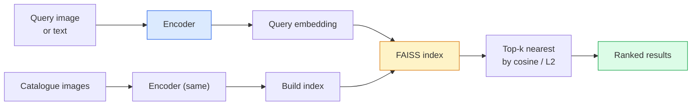

# 图像检索与度量学习

> 检索系统通过在 embedding 空间中的距离对候选结果排序。度量学习则是塑造这个空间，让距离真正反映你期望的相似性。

**Type:** Build
**Languages:** Python
**Prerequisites:** Phase 4 Lesson 14 (ViT), Phase 4 Lesson 18 (CLIP)
**Time:** ~45 minutes

## 学习目标

- 解释 triplet、contrastive 与 proxy-based 度量学习损失，并能为给定数据集选择合适的损失
- 正确实现 L2 归一化与余弦相似度，并审视「同一实例」与「同一类别」检索的差异
- 构建 FAISS 索引，用文本和图像进行查询，并报告留出查询集的 recall@K
- 使用 DINOv2、CLIP 和 SigLIP 作为现成 embedding 骨干，并了解各自何时占优

## 问题

检索在生产级视觉中无处不在：重复图像检测、以图搜图、视觉商品搜索（「找到相似产品」）、人脸重识别、监控视频中的行人重识别、电商的实例级匹配。产品问题始终一样：「给定这张查询图像，为我的商品目录排序。」

有两个设计决策决定整个系统。Embedding——用什么模型产出向量。索引——如何在规模下寻找最近邻。到了 2026 年，两者都已是成熟组件（DINOv2 负责 embedding，FAISS 负责索引），这反而提高了要求：真正的难点在于为你的应用定义*什么算相似*，然后塑造 embedding 空间，让距离与之匹配。

这种塑造就是度量学习。它是一个小众但高杠杆的学科。

## 概念

### 检索一览



### 四大损失家族

| Loss | Requires | Pros | Cons |
|------|----------|------|------|
| **Contrastive** | (anchor, positive) + negatives | Simple, works with any pair label | Slow to converge without many negatives |
| **Triplet** | (anchor, positive, negative) | Intuitive; direct margin control | Hard-triplet mining is expensive |
| **NT-Xent / InfoNCE** | Pairs + batch-mined negatives | Scales to large batches | Needs big batch or momentum queue |
| **Proxy-based (ProxyNCA)** | Class labels only | Fast, stable, no mining | Can overfit to proxies on small datasets |

对于大多数生产场景，先用预训练骨干，只有当现成 embedding 在你的测试集上表现不佳时，才加入度量学习微调。

### Triplet 损失的形式化

```math
L = \max\left(0, \lVert f(a) - f(p) \rVert^2 - \lVert f(a) - f(n) \rVert^2 + \text{margin}\right)
```

把 anchor `a` 拉近 positive `p`，推远 negative `n`，`margin` 保证二者之间有空隙。三图结构可推广到任意相似性排序。

挖掘很关键：简单 triplet（`n` 已经离 `a` 很远）对损失贡献为零；只有困难 triplet 才能教会网络。Semi-hard 挖掘（`n` 比 `p` 远但在 margin 内）是 2016 年 FaceNet 的做法，至今仍是主流。

### 余弦相似度与 L2

两种度量，两套约定：

- **Cosine**：向量夹角。要求 L2 归一化后的 embedding。
- **L2**：欧氏距离。可用于原始或归一化 embedding，但通常与 L2 归一化 + 平方 L2 配对。

对于大多数现代网络，二者等价：当 `||a|| = ||b|| = 1` 时，`||a - b||^2 = 2 - 2 cos(a, b)`。选择与 embedding 训练匹配的约定；混用会悄然改变「最近」的含义。

### Recall@K

标准检索指标：

```
recall@K = fraction of queries where at least one correct match is in the top K results
```

同时报告 recall@1、@5、@10。如果 recall@10 超过 0.95 而 recall@1 低于 0.5，说明 embedding 空间结构正确但排序嘈杂——可尝试更长时间的微调或加入重排序步骤。

对于重复图像检测，precision@K 更重要，因为每个误报都是用户可见的错误。对于视觉搜索，recall@K 才是产品信号。

### 一段话说清 FAISS

Facebook AI Similarity Search。最近邻搜索的事实标准库。三种索引选择：

- `IndexFlatIP` / `IndexFlatL2` —— 暴力精确检索，无需训练。适用于约 100 万向量以内。
- `IndexIVFFlat` —— 划分成 K 个单元格，只搜索最近的若干单元。近似、更快、需要训练数据。
- `IndexHNSW` —— 基于图，查询最快，索引体积大。

10 万向量推荐 `IndexFlatIP` 配合余弦相似度。1000 万用 `IndexIVFFlat`。1 亿以上结合乘积量化（`IndexIVFPQ`）。

### 实例级与类别级检索

两个同名但截然不同的问题：

- **类别级** —— 「在目录里找猫。」基于类别的相似性；现成 CLIP / DINOv2 embedding 效果就很好。
- **实例级** —— 「在目录里找到*这款具体产品*。」需要在同一类别的视觉相似物体间做细粒度区分；现成 embedding 表现不足；度量学习微调才重要。

选模型前务必先明确你在解决哪一个。

```figure
metric-embedding
```

## 构建它

### 第 1 步：Triplet 损失

```python
import torch
import torch.nn.functional as F

def triplet_loss(anchor, positive, negative, margin=0.2):
    d_ap = F.pairwise_distance(anchor, positive, p=2)
    d_an = F.pairwise_distance(anchor, negative, p=2)
    return F.relu(d_ap - d_an + margin).mean()
```

一行核心代码。适用于 L2 归一化或原始 embedding。

### 第 2 步：Semi-hard 挖掘

给定一批 embedding 和标签，为每个 anchor 找到最困难的 semi-hard negative。

```python
def semi_hard_negatives(emb, labels, margin=0.2):
    dist = torch.cdist(emb, emb)
    same_class = labels[:, None] == labels[None, :]
    diff_class = ~same_class
    N = emb.size(0)

    positives = dist.clone()
    positives[~same_class] = float("-inf")
    positives.fill_diagonal_(float("-inf"))
    pos_idx = positives.argmax(dim=1)

    semi_hard = dist.clone()
    semi_hard[same_class] = float("inf")
    d_ap = dist[torch.arange(N), pos_idx].unsqueeze(1)
    semi_hard[dist <= d_ap] = float("inf")
    neg_idx = semi_hard.argmin(dim=1)

    fallback_mask = semi_hard[torch.arange(N), neg_idx] == float("inf")
    if fallback_mask.any():
        hardest = dist.clone()
        hardest[same_class] = float("inf")
        neg_idx = torch.where(fallback_mask, hardest.argmin(dim=1), neg_idx)
    return pos_idx, neg_idx
```

每个 anchor 获得同类中最困难的 positive，以及一个比 positive 远但在 margin 内的 semi-hard negative。

### 第 3 步：Recall@K

```python
def recall_at_k(query_emb, gallery_emb, query_labels, gallery_labels, k=1):
    sim = query_emb @ gallery_emb.T
    _, top_k = sim.topk(k, dim=-1)
    matches = (gallery_labels[top_k] == query_labels[:, None]).any(dim=-1)
    return matches.float().mean().item()
```

在 L2 归一化 embedding 上按内积取 top-k 等价于按余弦取 top-k。报告至少有一个正确邻居的查询所占的平均比例。

### 第 4 步：整合

```python
import torch
import torch.nn as nn
from torch.optim import Adam

class Encoder(nn.Module):
    def __init__(self, in_dim=128, emb_dim=64):
        super().__init__()
        self.net = nn.Sequential(
            nn.Linear(in_dim, 128), nn.ReLU(),
            nn.Linear(128, emb_dim),
        )

    def forward(self, x):
        return F.normalize(self.net(x), dim=-1)

torch.manual_seed(0)
num_classes = 6
protos = F.normalize(torch.randn(num_classes, 128), dim=-1)

def sample_batch(bs=32):
    labels = torch.randint(0, num_classes, (bs,))
    x = protos[labels] + 0.15 * torch.randn(bs, 128)
    return x, labels

enc = Encoder()
opt = Adam(enc.parameters(), lr=3e-3)

for step in range(200):
    x, y = sample_batch(32)
    emb = enc(x)
    pos_idx, neg_idx = semi_hard_negatives(emb, y)
    loss = triplet_loss(emb, emb[pos_idx], emb[neg_idx])
    opt.zero_grad(); loss.backward(); opt.step()
```

几百步后，embedding 聚类会形成每类一个簇。

## 使用它

2026 年的生产栈：

- **DINOv2 + FAISS** —— 通用视觉检索。开箱即用。
- **CLIP + FAISS** —— 查询是文本时。
- **Fine-tuned DINOv2 + FAISS** —— 实例级检索、人脸重识别、时尚、电商。
- **Milvus / Weaviate / Qdrant** —— FAISS 或 HNSW 之上的托管向量数据库封装。

对于 SOTA 实例检索，标准做法是：DINOv2 骨干，加一个 embedding head，用 triplet 或 InfoNCE 损失在实例标注的配对上微调，再用 FAISS 索引。

## 交付它

本节课产出：

- `outputs/prompt-retrieval-loss-picker.md` —— 一个 prompt，针对给定检索问题选择 triplet / InfoNCE / ProxyNCA。
- `outputs/skill-recall-at-k-runner.md` —— 一个 skill，编写包含 train/val/gallery 划分与清晰数据约定的 recall@K 评估工具。

## 练习

1. **（简单）** 运行上面的玩具示例。用 PCA 绘制训练前后的 embedding，观察六个簇如何形成。
2. **（中等）** 增加 ProxyNCA 损失实现：每个类别一个可学习「proxy」，在余弦相似度上做标准交叉熵。在玩具数据上与 triplet 损失比较收敛速度。
3. **（困难）** 取 1000 张 ImageNet 验证图像，通过 Hugging Face 用 DINOv2 提取 embedding，构建 FAISS flat 索引，并以相同图像作为查询（recall 应为 1.0）、以及以 ImageNet 标签为真值的留出划分分别报告 recall@{1, 5, 10}。

## 关键术语

| Term | What people say | What it actually means |
|------|----------------|----------------------|
| Metric learning | "Shape the space" | Training an encoder so distances in its output space reflect a target similarity |
| Triplet loss | "Pull and push" | $L = \max(0, d(a, p) - d(a, n) + \text{margin})$; the canonical metric-learning loss |
| Semi-hard mining | "Useful negatives" | Negatives further from the anchor than the positive but within margin; empirically the most informative |
| Proxy-based loss | "Class prototypes" | One learned proxy per class; cross-entropy over similarity-to-proxies; no pair mining |
| Recall@K | "Top-K hit rate" | Fraction of queries with at least one correct result in the top K |
| Instance retrieval | "Find this exact thing" | Fine-grained matching; off-the-shelf features usually underperform |
| FAISS | "The NN library" | Facebook's nearest-neighbour library; supports exact and approximate indexes |
| HNSW | "Graph index" | Hierarchical navigable small world; fast approximate NN with small memory overhead |

## 延伸阅读

- [FaceNet: A Unified Embedding for Face Recognition (Schroff et al., 2015)](https://arxiv.org/abs/1503.03832) —— triplet loss / semi-hard mining 论文
- [In Defense of the Triplet Loss for Person Re-Identification (Hermans et al., 2017)](https://arxiv.org/abs/1703.07737) —— triplet 微调实践指南
- [FAISS documentation](https://github.com/facebookresearch/faiss/wiki) —— 每种索引与权衡
- [SMoT: Metric Learning Taxonomy (Kim et al., 2021)](https://arxiv.org/abs/2010.06927) —— 现代损失及其关联综述
