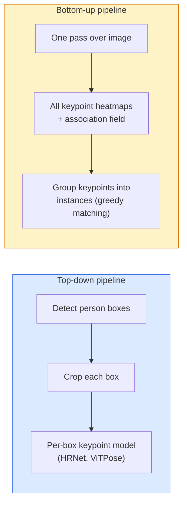

# 关键点检测与姿态估计

> 姿态是一组有序的关键点。关键点检测器就是热图回归器。其余都是工程细节。

**Type:** Build
**Languages:** Python
**Prerequisites:** Phase 4 Lesson 06 (Detection), Phase 4 Lesson 07 (U-Net)
**Time:** ~45 minutes

## 学习目标

- 区分 top-down 与 bottom-up 姿态估计，并说明各自适用场景
- 用每关键点一个高斯目标的方式回归 K 个关键点的热图，并在推理时提取关键点坐标
- 解释 Part Affinity Fields（PAF）以及 bottom-up 流程如何把关键点关联成实例
- 使用 MediaPipe Pose 或 MMPose 进行生产级关键点估计，并理解其输出格式

## 问题

关键点任务藏在许多名字之下：人体姿态（17 个身体关节）、人脸关键点（68 或 478 个点）、手部（21 个点）、动物姿态、机器人物姿、医学解剖标志。它们都有相同结构：检测物体上的 K 个离散点并输出其 (x, y) 坐标。

姿态估计是动作捕捉、健身应用、运动分析、手势控制、动画、AR 试穿和机器人抓取的基础。2D 情形已经成熟；3D 姿态（从单张图像估计关节在世界坐标中的位置）是当前研究前沿。

工程问题在于规模。单图单人的姿态是一个 20ms 的问题。人群场景下 30fps 的多人姿态则是架构完全不同的另一个问题。

## 概念

### Top-down 与 bottom-up



- **Top-down** —— 先检测出人，再对每个裁剪运行单人关键点模型。精度最高；耗时随人数线性增长。
- **Bottom-up** —— 一次前向传播预测所有关键点和一个关联场，再对它们分组。耗时与人群规模无关。

Top-down（HRNet、ViTPose）是精度领袖；bottom-up（OpenPose、HigherHRNet）是拥挤场景下的吞吐领袖。

### 热图回归

不直接回归 `(x, y)`，而是为每个关键点预测一个 `H x W` 热图，真实位置处有一个高斯 blob。

```math
\text{target}[k, y, x] = \exp\left(-\frac{(x - \mathit{cx}_k)^2 + (y - \mathit{cy}_k)^2}{2 \sigma^2}\right)
```

推理时，每个热图的 argmax 就是预测关键点位置。

热图比直接回归更有效的原因：网络的空间结构（卷积特征图）与空间输出天然对齐。高斯目标还能起到正则作用——一个小的定位误差只产生小的损失，而不是零。

### 亚像素定位

Argmax 给出整数坐标。为获得亚像素精度，可对 argmax 及其邻域拟合抛物线，或使用熟知的偏移方向 `(dx, dy) = 0.25 * (heatmap[y, x+1] - heatmap[y, x-1], ...)`。

### Part Affinity Fields（PAF）

OpenPose 解决 bottom-up 关联的诀窍。对于每一对相连关键点（例如左肩到左肘），预测一个 2 通道场，编码从一个点指向另一个点的单位向量。要把肩与肘关联起来，就沿连接候选对的直线积分 PAF；积分最高的那对即匹配。

```
For each connection (limb):
  PAF channels: 2 (unit vector x, y)
  Line integral: sum over sample points of (PAF . line_direction)
  Higher integral = stronger match
```

优雅，且能扩展到任意人群规模，无需逐人裁剪。

### COCO 关键点

标准人体姿态数据集：每人 17 个关键点，以 PCK（Percentage of Correct Keypoints）和 OKS（Object Keypoint Similarity）作为指标。OKS 是 IoU 的关键点对应物，COCO mAP@OKS 即基于此。

### 2D 与 3D

- **2D pose** —— 图像坐标；已在生产质量下解决（MediaPipe、HRNet、ViTPose）。
- **3D pose** —— 世界 / 相机坐标；仍是活跃研究方向。常见做法：
  - 用一个小 MLP 把 2D 预测提升到 3D（VideoPose3D）。
  - 直接从图像回归 3D（PyMAF、MHFormer）。
  - 多相机 setup（CMU Panoptic）获取真值。

```figure
cv3-pose-heatmap
```

## 构建它

### 第 1 步：高斯热图目标

```python
import numpy as np
import torch

def gaussian_heatmap(size, cx, cy, sigma=2.0):
    yy, xx = np.meshgrid(np.arange(size), np.arange(size), indexing="ij")
    return np.exp(-((xx - cx) ** 2 + (yy - cy) ** 2) / (2 * sigma ** 2)).astype(np.float32)

hm = gaussian_heatmap(64, 32, 32, sigma=2.0)
print(f"peak: {hm.max():.3f} at ({hm.argmax() % 64}, {hm.argmax() // 64})")
```

沿通道轴堆叠的每关键点热图构成完整目标张量。

### 第 2 步：微型关键点头

一个 U-Net 风格的模型，输出 K 个热图通道。

```python
import torch.nn as nn
import torch.nn.functional as F

class TinyKeypointNet(nn.Module):
    def __init__(self, num_keypoints=4, base=16):
        super().__init__()
        self.down1 = nn.Sequential(nn.Conv2d(3, base, 3, 2, 1), nn.ReLU(inplace=True))
        self.down2 = nn.Sequential(nn.Conv2d(base, base * 2, 3, 2, 1), nn.ReLU(inplace=True))
        self.mid = nn.Sequential(nn.Conv2d(base * 2, base * 2, 3, 1, 1), nn.ReLU(inplace=True))
        self.up1 = nn.ConvTranspose2d(base * 2, base, 2, 2)
        self.up2 = nn.ConvTranspose2d(base, num_keypoints, 2, 2)

    def forward(self, x):
        h1 = self.down1(x)
        h2 = self.down2(h1)
        h3 = self.mid(h2)
        u1 = self.up1(h3)
        return self.up2(u1)
```

输入 `(N, 3, H, W)`，输出 `(N, K, H, W)`。损失是与高斯目标的逐像素 MSE。

### 第 3 步：推理——提取关键点坐标

```python
def heatmap_to_coords(heatmaps):
    """
    heatmaps: (N, K, H, W)
    returns:  (N, K, 2) float coordinates in image pixels
    """
    N, K, H, W = heatmaps.shape
    hm = heatmaps.reshape(N, K, -1)
    idx = hm.argmax(dim=-1)
    ys = (idx // W).float()
    xs = (idx % W).float()
    return torch.stack([xs, ys], dim=-1)

coords = heatmap_to_coords(torch.randn(2, 4, 32, 32))
print(f"coords: {coords.shape}")  # (2, 4, 2)
```

推理时一行核心代码。为获得亚像素精度，可在 argmax 周围插值。

### 第 4 步：合成关键点数据集

简单做法：在白色画布上画四个点并学习预测它们。

```python
def make_synthetic_sample(size=64):
    img = np.ones((3, size, size), dtype=np.float32)
    rng = np.random.default_rng()
    kps = rng.integers(8, size - 8, size=(4, 2))
    for cx, cy in kps:
        img[:, cy - 2:cy + 2, cx - 2:cx + 2] = 0.0
    hms = np.stack([gaussian_heatmap(size, cx, cy) for cx, cy in kps])
    return img, hms, kps
```

简单到微型模型一分钟就能学会。

### 第 5 步：训练

```python
model = TinyKeypointNet(num_keypoints=4)
opt = torch.optim.Adam(model.parameters(), lr=3e-3)

for step in range(200):
    batch = [make_synthetic_sample() for _ in range(16)]
    imgs = torch.from_numpy(np.stack([b[0] for b in batch]))
    hms = torch.from_numpy(np.stack([b[1] for b in batch]))
    pred = model(imgs)
    # Upsample pred to full resolution
    pred = F.interpolate(pred, size=hms.shape[-2:], mode="bilinear", align_corners=False)
    loss = F.mse_loss(pred, hms)
    opt.zero_grad(); loss.backward(); opt.step()
```

## 使用它

- **MediaPipe Pose** —— Google 的生产级姿态估计器；提供 WebGL + 移动端运行时，延迟低于 10ms。
- **MMPose**（OpenMMLab）—— 全面的研究代码库；每种 SOTA 架构都带预训练权重。
- **YOLOv8-pose** —— 单次前向传播的最快实时多人姿态。
- **transformers HumanDPT / PoseAnything** —— 面向开放词汇姿态（任意对象、任意关键点集合）的新型视觉语言方法。

## 交付它

本节课产出：

- `outputs/prompt-pose-stack-picker.md` —— 一个 prompt，根据延迟、人群规模和 2D/3D 需求选择 MediaPipe / YOLOv8-pose / HRNet / ViTPose。
- `outputs/skill-heatmap-to-coords.md` —— 一个 skill，编写每个生产级姿态模型都在用的亚像素热图到坐标例程。

## 练习

1. **（简单）** 用合成 4 点数据集训练微型关键点模型。200 步后报告预测关键点与真实关键点之间的平均 L2 误差。
2. **（中等）** 添加亚像素精修：给定 argmax 位置，沿 x 和 y 对邻接像素拟合一维抛物线。报告相比整数 argmax 的精度提升。
3. **（困难）** 构建一个 2 人合成数据集，每张图显示两个 4 关键点模式的实例。训练一个带 PAF 的 bottom-up 流程，预测每个关键点属于哪个实例，并评估 OKS。

## 关键术语

| Term | What people say | What it actually means |
|------|----------------|----------------------|
| Keypoint | "A landmark" | A specific ordered point on an object (joint, corner, feature) |
| Pose | "The skeleton" | An ordered set of keypoints belonging to one instance |
| Top-down | "Detect then pose" | Two-stage pipeline: person detector + per-crop keypoint model; highest accuracy |
| Bottom-up | "Pose first, group later" | Single-pass all-keypoint prediction + grouping; constant time in crowd size |
| Heatmap | "Gaussian target" | H x W tensor per keypoint with peak at the true location; the preferred regression target |
| PAF | "Part Affinity Field" | 2-channel unit vector field encoding limb directions; used to group keypoints into instances |
| OKS | "Keypoint IoU" | Object Keypoint Similarity; the COCO metric for pose |
| HRNet | "High-Resolution Net" | The dominant top-down keypoint architecture; preserves high-res features throughout |

## 延伸阅读

- [OpenPose (Cao et al., 2017)](https://arxiv.org/abs/1812.08008) —— 使用 PAF 的 bottom-up 方法；仍是该领域最清晰的写作
- [HRNet (Sun et al., 2019)](https://arxiv.org/abs/1902.09212) —— top-down 参考架构
- [ViTPose (Xu et al., 2022)](https://arxiv.org/abs/2204.12484) —— 用纯 ViT 作为姿态骨干；在许多基准上为当前 SOTA
- [MediaPipe Pose](https://developers.google.com/mediapipe/solutions/vision/pose_landmarker) —— 生产级实时姿态；2026 年部署最快的栈
