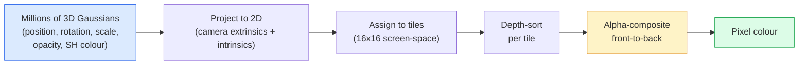

# 从零实现 3D Gaussian Splatting

> 场景由数百万个 3D 高斯组成的云构成。每个高斯都有位置、朝向、尺度、不透明度，以及随视角变化的颜色。把它们光栅化，再通过光栅化反向传播，就完成了。

**Type:** Build
**Languages:** Python
**Prerequisites:** Phase 4 Lesson 13 (3D Vision & NeRF), Phase 1 Lesson 12 (Tensor Operations), Phase 4 Lesson 10 (Diffusion basics optional)
**Time:** ~90 minutes

## 学习目标

- 解释 3D Gaussian Splatting 为何在 2026 年取代 NeRF，成为照片级真实 3D 重建的生产默认
- 说出六个每高斯参数（位置、旋转四元数、尺度、不透明度、球谐函数颜色、可选特征）以及每个贡献多少浮点数
- 从零实现一个基于 `alpha` 合成的 2D Gaussian Splatting 光栅化器，再展示 3D 情形如何投影到同一循环
- 使用 `nerfstudio`、`gsplat` 或 `SuperSplat`，从 20-50 张照片重建场景，并导出到 glTF 的 `KHR_gaussian_splatting` 扩展或 OpenUSD 26.03 的 `UsdVolParticleField3DGaussianSplat` schema

## 问题

NeRF 把场景存储为 MLP 的权重。渲染每个像素都要沿一条光线进行数百次 MLP 查询。训练耗时数小时，渲染耗时数秒，权重无法编辑——如果想移动场景里的一把椅子，必须重新训练。

3D Gaussian Splatting（Kerbl、Kopanas、Leimkühler、Drettakis，SIGGRAPH 2023）改变了这一切。场景是一组显式的 3D 高斯。渲染是 GPU 光栅化，可达 100+ fps。训练只需几分钟。编辑很直接：平移一部分高斯，椅子就被移动了。到 2026 年，Khronos Group 已批准 Gaussian splat 的 glTF 扩展，OpenUSD 26.03 已内置 Gaussian splat schema，Zillow 和 Apartments.com 用它们渲染房产，大多数 3D 重建新论文都是 3DGS 核心思想的变体。

心智模型很简单，但数学有不少活动部件，大多数介绍从光栅化讲起，跳过投影和球谐函数。本节课完整构建整个过程——先做 2D 版本，再做 3D 扩展。

## 概念

### 一个高斯携带什么

一个 3D 高斯是空间中一个参数化 blob，具有以下属性：

```
position         mu         (3,)    centre in world coordinates
rotation         q          (4,)    unit quaternion encoding orientation
scale            s          (3,)    log-scales per axis (exponentiated at render time)
opacity          alpha      (1,)    post-sigmoid opacity [0, 1]
SH coefficients  c_lm       (3 * (L+1)^2,)   view-dependent colour
```

旋转 + 尺度构建 3x3 协方差：`Sigma = R S S^T R^T`。这就是高斯在 3D 中的形状。球谐函数让颜色随视角变化——镜面高光、微妙光泽、视角相关的辉光——无需存储每视角纹理。SH 阶数为 3 时，每个颜色通道有 16 个系数，单是高斯颜色就需要 48 个浮点数。

一个场景通常有 100-500 万个高斯。每个高斯约存储 60 个浮点数（3 + 4 + 3 + 1 + 48 + 杂项）。500 万高斯的场景约 240 MB——远小于带逐点纹理的等效点云，也比在高分辨率下重新渲染的 NeRF MLP 权重小一个数量级。

### 光栅化，而非光线步进



五步，都高度 GPU 友好。没有每像素的 MLP 查询。单张 RTX 3080 Ti 能以 147 fps 渲染 600 万个 splat。

### 投影步骤

世界坐标位置为 `mu`、3D 协方差为 `Sigma` 的 3D 高斯，投影为屏幕位置 `mu'`、2D 协方差 `Sigma'` 的 2D 高斯：

```math
\begin{aligned}
\mu' &= \mathop{\mathrm{project}}(\mu) \\
\Sigma' &= J W \Sigma W^T J^T \qquad (2 \times 2) \\[6pt]
W &= \text{viewing transform (rotation + translation of camera)} \\
J &= \text{Jacobian of the perspective projection at } \mu'
\end{aligned}
```

2D 高斯的足迹是一个椭圆，轴为 `Sigma'` 的特征向量。椭圆内的每个像素都会收到该高斯的贡献，权重为 `exp(-0.5 * (p - mu')^T Sigma'^-1 (p - mu'))`。

### Alpha 合成规则

对于单个像素，覆盖它的那些高斯按从后往前（或等价地按从前到后并使用反向公式）排序。颜色合成使用自 1980 年代以来每个半透明光栅化器都在用的同一方程：

```math
\begin{aligned}
C_{\text{pixel}} &= \sum_i \alpha_i T_i c_i \\[6pt]
T_i &= \prod_{j < i} (1 - \alpha_j) && \text{transmittance up to } i \\
\alpha_i &= \text{opacity}_i \cdot \exp\left(-0.5 \, d^T \Sigma'^{-1} d\right) && \text{local contribution} \\
c_i &= \mathop{\mathrm{eval\_SH}}(\text{SH}_i, \text{view\_direction}) && \text{view-dependent colour}
\end{aligned}
```

这就是**与 NeRF 体渲染相同的方程**，只是对显式的稀疏高斯集合进行积分，而非沿光线密集采样。这一等价性解释了为什么渲染质量能与 NeRF 媲美——二者都在积分同一条辐射场方程。

### 为什么它是可微的

投影、瓦片分配、alpha 合成、SH 求值——每一步都对高斯参数可微。给定真值图像，计算渲染像素损失，反向传播通过光栅化器，用梯度下降更新所有 `(mu, q, s, alpha, c_lm)`。经过约 30,000 次迭代，高斯会找到正确的位置、尺度和颜色。

### 致密化与剪枝

固定数量的高斯无法覆盖复杂场景。训练包含两种自适应机制：

- **Clone** —— 当高斯梯度幅值大但尺度小时，在当前位置复制一个高斯——此处重建需要更多细节。
- **Split** —— 当梯度大且尺度大时，把一个高斯分裂成两个更小的高斯——一个大的高斯过于平滑，无法拟合该区域。
- **Prune** —— 删除不透明度低于阈值的高斯——它们没有贡献。

致密化每 N 次迭代运行一次。场景通常从约 10 万个初始高斯（从 SfM 点云播种）增长到训练结束时的 100-500 万。

### 一段话说清球谐函数

视角相关的颜色是单位球面上的函数 `c(direction)`。球谐函数是球面的傅里叶基。截断到阶数 `L`，每个通道得到 `(L+1)^2` 个基函数。对新视角求颜色，就是学到的 SH 系数与在该视角方向求值的基函数之间的点积。阶数 0 = 1 个系数 = 恒定颜色。阶数 3 = 16 个系数 = 足以捕捉朗伯着色、镜面反射和轻微反射。SD Gaussian Splatting 论文默认使用阶数 3。

### 2026 生产级流程

```
1. Capture         smartphone / DJI drone / handheld scanner
2. SfM / MVS       COLMAP or GLOMAP derives camera poses + sparse points
3. Train 3DGS      nerfstudio / gsplat / inria official / PostShot (~10-30 min on RTX 4090)
4. Edit            SuperSplat / SplatForge (clean floaters, segment)
5. Export          .ply -> glTF KHR_gaussian_splatting or .usd (OpenUSD 26.03)
6. View            Cesium / Unreal / Babylon.js / Three.js / Vision Pro
```

### 4D 与生成式变体

- **4D Gaussian Splatting** —— 高斯是时间的函数；用于体积视频（Superman 2026、A$AP Rocky 的《Helicopter》）。
- **Generative splats** —— 文本到 splat 的模型（World Labs 的 Marble）可幻觉出整个场景。
- **3D Gaussian Unscented Transform** —— NVIDIA NuRec 用于自动驾驶模拟的变体。

```figure
cv3-gaussian-splat
```

## 构建它

### 第 1 步：一个 2D 高斯

我们先构建 2D 光栅化器。3D 情形投影后也会归约到它。

```python
import torch
import torch.nn as nn
import torch.nn.functional as F


def eval_2d_gaussian(means, covs, points):
    """
    means:  (G, 2)      centres
    covs:   (G, 2, 2)   covariance matrices
    points: (H, W, 2)   pixel coordinates
    returns: (G, H, W)  density at every pixel for every Gaussian
    """
    G = means.size(0)
    H, W, _ = points.shape
    flat = points.view(-1, 2)
    inv = torch.linalg.inv(covs)
    diff = flat[None, :, :] - means[:, None, :]
    d = torch.einsum("gpi,gij,gpj->gp", diff, inv, diff)
    density = torch.exp(-0.5 * d)
    return density.view(G, H, W)
```

`einsum` 对每个（高斯，像素）对计算二次型 `diff^T Sigma^-1 diff`。

### 第 2 步：2D splatting 光栅化器

从前到后的 alpha 合成。2D 中深度无意义，因此用可学习的每高斯标量决定顺序。

```python
def rasterise_2d(means, covs, colours, opacities, depths, image_size):
    """
    means:     (G, 2)
    covs:      (G, 2, 2)
    colours:   (G, 3)
    opacities: (G,)     in [0, 1]
    depths:    (G,)     per-Gaussian scalar used for ordering
    image_size: (H, W)
    returns:   (H, W, 3) rendered image
    """
    H, W = image_size
    yy, xx = torch.meshgrid(
        torch.arange(H, dtype=torch.float32, device=means.device),
        torch.arange(W, dtype=torch.float32, device=means.device),
        indexing="ij",
    )
    points = torch.stack([xx, yy], dim=-1)

    densities = eval_2d_gaussian(means, covs, points)
    alphas = opacities[:, None, None] * densities
    alphas = alphas.clamp(0.0, 0.99)

    order = torch.argsort(depths)
    alphas = alphas[order]
    colours_sorted = colours[order]

    T = torch.ones(H, W, device=means.device)
    out = torch.zeros(H, W, 3, device=means.device)
    for i in range(means.size(0)):
        a = alphas[i]
        out += (T * a)[..., None] * colours_sorted[i][None, None, :]
        T = T * (1.0 - a)
    return out
```

速度不快——真实实现使用基于瓦片的 CUDA 核——但数学完全正确且完全可微。

### 第 3 步：可训练的 2D splat 场景

```python
class Splats2D(nn.Module):
    def __init__(self, num_splats=128, image_size=64, seed=0):
        super().__init__()
        g = torch.Generator().manual_seed(seed)
        H, W = image_size, image_size
        self.means = nn.Parameter(torch.rand(num_splats, 2, generator=g) * torch.tensor([W, H]))
        self.log_scale = nn.Parameter(torch.ones(num_splats, 2) * math.log(2.0))
        self.rot = nn.Parameter(torch.zeros(num_splats))  # single angle in 2D
        self.colour_logits = nn.Parameter(torch.randn(num_splats, 3, generator=g) * 0.5)
        self.opacity_logit = nn.Parameter(torch.zeros(num_splats))
        self.depth = nn.Parameter(torch.rand(num_splats, generator=g))

    def covs(self):
        s = torch.exp(self.log_scale)
        c, si = torch.cos(self.rot), torch.sin(self.rot)
        R = torch.stack([
            torch.stack([c, -si], dim=-1),
            torch.stack([si, c], dim=-1),
        ], dim=-2)
        S = torch.diag_embed(s ** 2)
        return R @ S @ R.transpose(-1, -2)

    def forward(self, image_size):
        covs = self.covs()
        colours = torch.sigmoid(self.colour_logits)
        opacities = torch.sigmoid(self.opacity_logit)
        return rasterise_2d(self.means, covs, colours, opacities, self.depth, image_size)
```

`log_scale`、`opacity_logit` 和 `colour_logits` 都是无约束参数，在渲染时通过合适的激活函数映射。这是每个 3DGS 实现的标准模式。

### 第 4 步：用 2D 高斯拟合目标图像

```python
import math
import numpy as np

def make_target(size=64):
    yy, xx = np.meshgrid(np.arange(size), np.arange(size), indexing="ij")
    img = np.zeros((size, size, 3), dtype=np.float32)
    # Red circle
    mask = (xx - 20) ** 2 + (yy - 20) ** 2 < 10 ** 2
    img[mask] = [1.0, 0.2, 0.2]
    # Blue square
    mask = (np.abs(xx - 45) < 8) & (np.abs(yy - 40) < 8)
    img[mask] = [0.2, 0.3, 1.0]
    return torch.from_numpy(img)


target = make_target(64)
model = Splats2D(num_splats=64, image_size=64)
opt = torch.optim.Adam(model.parameters(), lr=0.05)

for step in range(200):
    pred = model((64, 64))
    loss = F.mse_loss(pred, target)
    opt.zero_grad(); loss.backward(); opt.step()
    if step % 40 == 0:
        print(f"step {step:3d}  mse {loss.item():.4f}")
```

200 步后，64 个高斯会收敛成两个形状。这就是全部思想——在显式几何原语上做梯度下降。

### 第 5 步：从 2D 到 3D

3D 扩展保持同一循环。新增内容：

1. 每高斯旋转从单个角度变为四元数。
2. 协方差变为 `R S S^T R^T`，其中 `R` 由四元数构建，`S = diag(exp(log_scale))`。
3. 投影 `(mu, Sigma) -> (mu', Sigma')` 使用相机外参和 `mu` 处透视投影的雅可比。
4. 颜色变为球谐函数展开；在视角方向求值。
5. 深度排序使用真实相机空间 z，而非可学习标量。

每个生产级实现（`gsplat`、`inria/gaussian-splatting`、`nerfstudio`）都在 GPU 上用基于瓦片的 CUDA 核做完全相同的事。

### 第 6 步：球谐函数求值

SH 基到阶数 3 每通道有 16 项。求值如下：

```python
def eval_sh_degree_3(sh_coeffs, dirs):
    """
    sh_coeffs: (..., 16, 3)   last dim is RGB channels
    dirs:      (..., 3)       unit vectors
    returns:   (..., 3)
    """
    C0 = 0.282094791773878
    C1 = 0.488602511902920
    C2 = [1.092548430592079, 1.092548430592079,
          0.315391565252520, 1.092548430592079,
          0.546274215296039]
    x, y, z = dirs[..., 0], dirs[..., 1], dirs[..., 2]
    x2, y2, z2 = x * x, y * y, z * z
    xy, yz, xz = x * y, y * z, x * z

    result = C0 * sh_coeffs[..., 0, :]
    result = result - C1 * y[..., None] * sh_coeffs[..., 1, :]
    result = result + C1 * z[..., None] * sh_coeffs[..., 2, :]
    result = result - C1 * x[..., None] * sh_coeffs[..., 3, :]

    result = result + C2[0] * xy[..., None] * sh_coeffs[..., 4, :]
    result = result + C2[1] * yz[..., None] * sh_coeffs[..., 5, :]
    result = result + C2[2] * (2.0 * z2 - x2 - y2)[..., None] * sh_coeffs[..., 6, :]
    result = result + C2[3] * xz[..., None] * sh_coeffs[..., 7, :]
    result = result + C2[4] * (x2 - y2)[..., None] * sh_coeffs[..., 8, :]

    # degree 3 terms omitted here for brevity; full 16-coefficient version in the code file
    return result
```

学到的 `sh_coeffs` 存储了该高斯「每个方向的颜色」。渲染时对当前视角方向求值，得到 3 维 RGB。

## 使用它

真正的 3DGS 工作使用 `gsplat`（Meta）或 `nerfstudio`：

```bash
pip install nerfstudio gsplat
ns-download-data example
ns-train splatfacto --data path/to/data
```

`splatfacto` 是 nerfstudio 的 3DGS 训练器。典型场景在 RTX 4090 上运行 10-30 分钟。

2026 年重要的导出选项：

- `.ply` —— 原始高斯云（可移植，文件最大）。
- `.splat` —— PlayCanvas / SuperSplat 量化格式。
- glTF `KHR_gaussian_splatting` —— Khronos 标准，可在各查看器间移植（2026 年 2 月 RC）。
- OpenUSD `UsdVolParticleField3DGaussianSplat` —— USD 原生，用于 NVIDIA Omniverse 和 Vision Pro 流程。

对于 4D / 动态场景，`4DGS` 和 `Deformable-3DGS` 用随时间变化的位置和不透明度扩展了同一机制。

## 交付它

本节课产出：

- `outputs/prompt-3dgs-capture-planner.md` —— 一个 prompt，针对给定场景类型规划拍摄（照片数量、相机路径、光照）。
- `outputs/skill-3dgs-export-router.md` —— 一个 skill，根据下游查看器或引擎选择正确的导出格式（`.ply` / `.splat` / glTF / USD）。

## 练习

1. **（简单）** 用上面的 2D splat 训练器在另一张合成图像上实验。让 `num_splats` 取 `[16, 64, 256]`，分别绘制 MSE 随步数变化的曲线。找到收益递减点。
2. **（中等）** 扩展 2D 光栅化器，让每个高斯的 RGB 颜色通过一个 2 阶谐波依赖某个标量「视角角度」。用一对目标图像训练，验证模型能重建两者。
3. **（困难）** 克隆 `nerfstudio`，用 20 张任意场景（书桌、植物、人脸、房间）照片训练 `splatfacto`。导出到 glTF `KHR_gaussian_splatting`，并在查看器中打开（Three.js `GaussianSplats3D`、SuperSplat、Babylon.js V9）。报告训练时间、高斯数量和渲染 fps。

## 关键术语

| Term | What people say | What it actually means |
|------|----------------|----------------------|
| 3DGS | "Gaussian splats" | Explicit scene representation as millions of 3D Gaussians with per-Gaussian position, rotation, scale, opacity, SH colour |
| Covariance | "Shape of the Gaussian" | `Sigma = R S S^T R^T`; orientation and anisotropic scale of one Gaussian |
| Alpha compositing | "Back-to-front blend" | Same equation as NeRF's volumetric render, now over an explicit sparse set |
| Densification | "Clone and split" | Adaptive addition of new Gaussians where reconstruction is under-fit |
| Pruning | "Delete low-opacity" | Remove Gaussians that have collapsed to near-zero opacity during training |
| Spherical harmonics | "View-dependent colour" | Fourier basis on the sphere; stores colour as a function of viewing direction |
| Splatfacto | "nerfstudio's 3DGS" | The easiest path to training 3DGS in 2026 |
| `KHR_gaussian_splatting` | "glTF standard" | Khronos 2026 extension that makes 3DGS portable across viewers and engines |

## 延伸阅读

- [3D Gaussian Splatting for Real-Time Radiance Field Rendering (Kerbl et al., SIGGRAPH 2023)](https://repo-sam.inria.fr/fungraph/3d-gaussian-splatting/) —— 原始论文
- [gsplat (Meta/nerfstudio)](https://github.com/nerfstudio-project/gsplat) —— 生产级 CUDA 光栅化器
- [nerfstudio Splatfacto](https://docs.nerf.studio/nerfology/methods/splat.html) —— 参考训练配方
- [Khronos KHR_gaussian_splatting extension](https://github.com/KhronosGroup/glTF/blob/main/extensions/2.0/Khronos/KHR_gaussian_splatting/README.md) —— 2026 可移植格式
- [OpenUSD 26.03 release notes](https://openusd.org/release/) —— `UsdVolParticleField3DGaussianSplat` schema
- [THE FUTURE 3D State of Gaussian Splatting 2026](https://www.thefuture3d.com/blog-0/2026/4/4/state-of-gaussian-splatting-2026) —— 行业概览
