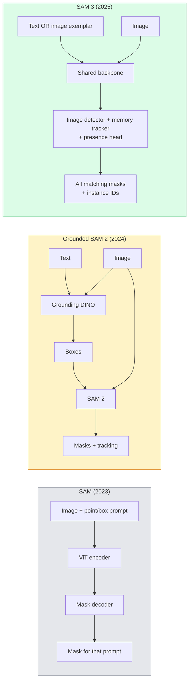

# SAM 3 与开放词汇分割

> 给模型一个文本提示和一张图像，它就能返回所有匹配物体的掩码。SAM 3 让这件事只需一次前向传播。

**Type:** Use + Build
**Languages:** Python
**Prerequisites:** Phase 4 Lesson 07 (U-Net), Phase 4 Lesson 08 (Mask R-CNN), Phase 4 Lesson 18 (CLIP)
**Time:** ~60 minutes

## 学习目标

- 区分 SAM（仅视觉提示）、Grounded SAM / SAM 2（检测器 + SAM）和 SAM 3（通过 Promptable Concept Segmentation 原生支持文本提示）
- 解释 SAM 3 架构：共享骨干 + 图像检测器 + 基于记忆的视频追踪器 + presence head + 解耦的检测器-追踪器设计
- 使用 Hugging Face `transformers` 的 SAM 3 集成进行文本提示检测、分割和视频跟踪
- 根据延迟、概念复杂度和部署目标，在 SAM 3、Grounded SAM 2、YOLO-World 和 SAM-MI 之间做选择

## 问题

2023 年的 SAM 是仅视觉提示模型：你点击一个点或画一个框，它返回一个掩码。要「把这张照片里的所有橙子给我」，你需要一个检测器（Grounding DINO）生成框，然后 SAM 逐个分割。Grounded SAM 把这件事变成了一条 pipeline，但它是两个冻结模型的级联，错误必然累积。

SAM 3（Meta，2025 年 11 月，ICLR 2026）把级联压缩了。它接受一个短名词短语或图像示例作为提示，一次前向传播返回所有匹配掩码和实例 ID。这就是 **Promptable Concept Segmentation（PCS）**。结合 2026 年 3 月的 Object Multiplex 更新（SAM 3.1），它能高效地跟踪视频中同一概念的多个实例。

本节课关注的是这次结构性转变。2D 分割、检测和图文 grounding 已经合并成一个模型。生产问题不再是「我该把哪些流水线串起来」，而是「哪个可提示模型能端到端处理我的场景」。

## 概念

### 三代演进



### Promptable Concept Segmentation

「概念提示」是一个短名词短语（`"yellow school bus"`、`"striped red umbrella"`、`"hand holding a mug"`）或一张图像示例。模型返回图像中每个匹配概念实例的分割掩码，以及每个匹配的唯一实例 ID。

这与经典视觉提示 SAM 有三点不同：

1. 不需要逐实例提示——一个文本提示返回所有匹配。
2. 开放词汇——概念可以是自然语言能描述的任何事物。
3. 一次返回多个实例，而非每个提示一个掩码。

### 关键架构组件

- **Shared backbone** —— 单个 ViT 处理图像。检测器头和基于记忆的追踪器都从中读取特征。
- **Presence head** —— 预测概念是否出现在图像中。把「它在吗？」和「它在哪？」解耦。减少概念不存在时的误报。
- **Decoupled detector-tracker** —— 图像级检测和视频级追踪使用独立头部，互不干扰。
- **Memory bank** —— 跨帧存储每个实例的特征用于视频追踪（与 SAM 2 使用相同机制）。

### 大规模训练

SAM 3 在由数据引擎生成的 **400 万个独特概念**上训练，该引擎通过 AI + 人工审核迭代标注和修正。新的 **SA-CO 基准**包含 27 万个独特概念，比 prior 开放词汇基准大 50 倍。SAM 3 在 SA-CO 上达到人类表现的 75-80%，在图像 + 视频 PCS 上把现有系统表现翻倍。

### SAM 3.1 Object Multiplex

2026 年 3 月更新：**Object Multiplex** 引入共享记忆机制，可一次性联合追踪同一概念的多个实例。此前，追踪 N 个实例意味着 N 个独立记忆库。Multiplex 把它们压缩成一个共享记忆，配合每实例查询。结果：多目标追踪显著提速，且不牺牲精度。

### Grounded SAM 在 2026 年仍何时重要

- 当你需要替换特定开放词汇检测器（DINO-X、Florence-2）时。
- 当 SAM 3 的许可证（在 HF 上 gated）成为阻碍时。
- 当你需要比 SAM 3 暴露的更细粒度检测器阈值控制时。
- 用于检测器组件的研究 / 消融工作。

模块化 pipeline 仍有一席之地。对于大多数生产工作，SAM 3 是更简单的答案。

### YOLO-World 与 SAM 3

- **YOLO-World** —— 仅开放词汇检测（无掩码）。实时。最适合高 fps 框检测。
- **SAM 3** —— 完整分割 + 追踪。更慢，但输出更丰富。

生产分工：YOLO-World 用于快速纯检测 pipeline（机器人导航、快速仪表盘），SAM 3 用于任何需要掩码或追踪的场景。

### SAM-MI 效率

SAM-MI（2025-2026）解决 SAM 的解码器瓶颈。核心思想：

- **Sparse point prompting** —— 用少量精选点替代密集提示；解码器调用减少 96%。
- **Shallow mask aggregation** —— 把粗糙掩码预测合并成一个更锐利的掩码。
- **Decoupled mask injection** —— 解码器接收预计算的掩码特征，而非重新运行。

结果：在开放词汇基准上比 Grounded-SAM 快约 1.6 倍。

### 三个模型的输出格式

三者都返回相同的通用结构（框 + 标签 + 分数 + 掩码 + ID），这很方便——下游 pipeline 不必因模型不同而分支。

```figure
cv3-open-vocab
```

## 构建它

### 第 1 步：提示构造

构建一个 helper，把用户句子拆成 SAM 3 概念提示列表。这是「用户输入了什么」与「模型消费什么」的边界。

```python
def split_concepts(sentence):
    """
    Heuristic splitter for multi-concept prompts.
    Returns list of short noun phrases.
    """
    for sep in [",", ";", "and", "or", "&"]:
        if sep in sentence:
            parts = [p.strip() for p in sentence.replace("and ", ",").split(",")]
            return [p for p in parts if p]
    return [sentence.strip()]

print(split_concepts("cats, dogs and balloons"))
```

SAM 3 每次前向传播接受一个概念；多概念查询需循环或批量处理。

### 第 2 步：后处理辅助函数

把 SAM 3 原始输出转换为符合我们第 4 课第 16 课 pipeline 约定的干净检测列表。

```python
from dataclasses import dataclass
from typing import List

@dataclass
class ConceptDetection:
    concept: str
    instance_id: int
    box: tuple          # (x1, y1, x2, y2)
    score: float
    mask_rle: str       # run-length encoded


def rle_encode(binary_mask):
    flat = binary_mask.flatten().astype("uint8")
    runs = []
    prev, count = flat[0], 0
    for v in flat:
        if v == prev:
            count += 1
        else:
            runs.append((int(prev), count))
            prev, count = v, 1
    runs.append((int(prev), count))
    return ";".join(f"{v}x{c}" for v, c in runs)
```

RLE 即使对许多高分辨率掩码也能保持响应体积小巧。SAM 2、SAM 3、Grounded SAM 2 都适用同一格式。

### 第 3 步：统一的开放词汇分割接口

把任何已有后端（SAM 3、Grounded SAM 2、YOLO-World + SAM 2）封装到统一方法背后。更换后端时，下游代码不变。

```python
from abc import ABC, abstractmethod
import numpy as np

class OpenVocabSeg(ABC):
    @abstractmethod
    def detect(self, image: np.ndarray, concept: str) -> List[ConceptDetection]:
        ...


class StubOpenVocabSeg(OpenVocabSeg):
    """
    Deterministic stub used for pipeline testing when real models are not loaded.
    """
    def detect(self, image, concept):
        h, w = image.shape[:2]
        return [
            ConceptDetection(
                concept=concept,
                instance_id=0,
                box=(w * 0.2, h * 0.3, w * 0.5, h * 0.8),
                score=0.89,
                mask_rle="0x100;1x50;0x200",
            ),
            ConceptDetection(
                concept=concept,
                instance_id=1,
                box=(w * 0.55, h * 0.25, w * 0.85, h * 0.75),
                score=0.74,
                mask_rle="0x80;1x40;0x220",
            ),
        ]
```

真正的 `SAM3OpenVocabSeg` 子类会包装 `transformers.Sam3Model` 和 `Sam3Processor`。

### 第 4 步：Hugging Face SAM 3 用法（参考）

真实模型可通过 `transformers` 集成调用：

```python
from transformers import Sam3Processor, Sam3Model
import torch

processor = Sam3Processor.from_pretrained("facebook/sam3")
model = Sam3Model.from_pretrained("facebook/sam3").eval()

inputs = processor(images=pil_image, return_tensors="pt")
inputs = processor.set_text_prompt(inputs, "yellow school bus")

with torch.no_grad():
    outputs = model(**inputs)

masks = processor.post_process_masks(
    outputs.masks, inputs.original_sizes, inputs.reshaped_input_sizes
)
boxes = outputs.boxes
scores = outputs.scores
```

一个提示，所有匹配一次调用返回。

### 第 5 步：量化 Grounded SAM 2 的隐性成本

一个诚实的基准：在真实 pipeline 中用 SAM 3 替换 Grounded SAM 2 会怎样？

- 延迟：SAM 3 省掉一次前向传播（没有独立检测器），但模型本身更重；通常净中性或略快。
- 精度：SAM 3 在稀有或组合概念（`"striped red umbrella"`）上显著更好。常见单字概念上两者相近。
- 灵活性：Grounded SAM 2 可换检测器（DINO-X、Florence-2、Grounding DINO 1.5）；SAM 3 是单一模型。

结论：SAM 3 是 2026 年开放词汇分割的默认选择。当你需要检测器灵活性或许可证条款不同时，Grounded SAM 2 仍是正确答案。

## 使用它

生产部署模式：

- **实时标注** —— SAM 3 + CVAT 的 label-as-text-prompt 功能。标注员选择标签名；SAM 3 预标注所有匹配实例。人工审阅并修正。
- **视频分析** —— SAM 3.1 Object Multiplex 用于多目标跟踪；把帧喂给基于记忆的追踪器。
- **机器人** —— SAM 3 用于开放词汇操作（「拿起红色杯子」）；作为规划原语运行。
- **医学影像** —— SAM 3 在医学概念上微调；需要在 HF 上申请访问权限。

Ultralytics 把 SAM 3 封装进 Python 包：

```python
from ultralytics import SAM

model = SAM("sam3.pt")
results = model(image_path, prompts="yellow school bus")
```

接口与 YOLO 和 SAM 2 相同。

## 交付它

本节课产出：

- `outputs/prompt-open-vocab-stack-picker.md` —— 一个 prompt，根据延迟、概念复杂度和许可证，在 SAM 3 / Grounded SAM 2 / YOLO-World / SAM-MI 之间做选择。
- `outputs/skill-concept-prompt-designer.md` —— 一个 skill，把用户话语转换为格式良好的 SAM 3 概念提示（拆分、消歧、回退）。

## 练习

1. **（简单）** 在你选择的 10 张图像上用自选概念提示运行 SAM 3。与 SAM 2 + Grounding DINO 1.5 在相同图像上做对比。报告每个模型漏掉了哪些概念。
2. **（中等）** 在 SAM 3 之上构建一个「点击纳入 / 点击排除」UI：文本提示返回候选实例；用户点击决定哪些算正例。输出最终概念集合为 JSON。
3. **（困难）** 在自定义概念集（例如 5 类电子元件）上微调 SAM 3，每类 20 张标注图像。与同一测试集上的 zero-shot SAM 3 比较；测量 mask IoU 提升。

## 关键术语

| Term | What people say | What it actually means |
|------|----------------|----------------------|
| Open-vocabulary segmentation | "Segment by text" | Produce masks for objects described in natural language, not a fixed label set |
| PCS | "Promptable Concept Segmentation" | SAM 3's core task — given a noun-phrase or image exemplar, segment all matching instances |
| Concept prompt | "The text input" | Short noun phrase or image exemplar; not a full sentence |
| Presence head | "Is it here?" | SAM 3 module that decides whether the concept exists in the image before localisation |
| SA-CO | "SAM 3 benchmark" | 270K-concept open-vocabulary segmentation benchmark; 50x larger than prior open-vocab benchmarks |
| Object Multiplex | "SAM 3.1 update" | Shared-memory multi-object tracking; fast joint tracking of many instances |
| Grounded SAM 2 | "Modular pipeline" | Detector + SAM 2 cascade; still relevant when detector swap matters |
| SAM-MI | "Efficient SAM variant" | Mask Injection for 1.6x speedup over Grounded-SAM |

## 延伸阅读

- [SAM 3: Segment Anything with Concepts (arXiv 2511.16719)](https://arxiv.org/abs/2511.16719)
- [SAM 3.1 Object Multiplex (Meta AI, March 2026)](https://ai.meta.com/blog/segment-anything-model-3/)
- [SAM 3 model page on Hugging Face](https://huggingface.co/facebook/sam3)
- [Grounded SAM 2 tutorial (PyImageSearch)](https://pyimagesearch.com/2026/01/19/grounded-sam-2-from-open-set-detection-to-segmentation-and-tracking/)
- [Ultralytics SAM 3 docs](https://docs.ultralytics.com/models/sam-3/)
- [SAM3-I: Instruction-aware SAM (arXiv 2512.04585)](https://arxiv.org/abs/2512.04585)
