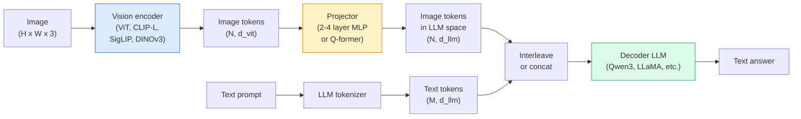

# 视觉语言模型 —— ViT-MLP-LLM 模式

> 视觉编码器把图像转换成 token。MLP 投影器把这些 token 映射到 LLM 的嵌入（embedding）空间。语言模型完成其余工作。这种 ViT-MLP-LLM 模式就是 2026 年所有生产级 VLM 的架构。

**Type:** Learn + Use
**Languages:** Python
**Prerequisites:** Phase 4 Lesson 14 (ViT), Phase 4 Lesson 18 (CLIP), Phase 7 Lesson 02 (Self-Attention)
**Time:** ~75 minutes

## 学习目标

- 阐述 ViT-MLP-LLM 架构，并说明三个组件各自的作用
- 比较 Qwen3-VL、InternVL3.5、LLaVA-Next 和 GLM-4.6V 的参数规模、上下文长度和基准性能
- 解释 DeepStack：为什么多层 ViT 特征比单层末层特征更能拉近视觉与语言的对齐
- 用跨模态错误率（CMER）在生产环境中测量 VLM 幻觉，并根据该指标采取行动

## 问题

CLIP（第 4 阶段第 18 课）为图像和文本提供了一个共享的 embedding 空间，足以完成零样本分类和检索。但它无法回答「这张图片里有多少辆红色汽车？」，因为 CLIP 不生成文本，只打分相似度。

视觉语言模型（VLM）—— Qwen3-VL、InternVL3.5、LLaVA-Next、GLM-4.6V —— 把 CLIP 家族的图像编码器接到一个完整的语言模型上。模型同时看到图像和问题，然后生成答案。2026 年的开源 VLM 在多模态基准（MMMU、MMBench、DocVQA、ChartQA、MathVista、OSWorld）上已经比肩或超越 GPT-5 和 Gemini-2.5-Pro。

这三个组件（ViT、投影器、LLM）就是标准。模型之间的差异在于：用哪个 ViT、哪个投影器、哪个 LLM、训练数据以及对齐方法。一旦理解这个模式，替换任何组件都是机械性的。

## 概念

### ViT-MLP-LLM 架构



1. **Vision encoder** —— 预训练的 ViT（CLIP-L/14、SigLIP、DINOv3 或微调变体），输出 patch token。
2. **Projector** —— 小模块（2-4 层 MLP 或 Q-former），把视觉 token 映射到 LLM 的 embedding 维度。这里是大部分微调发生的地方。
3. **LLM** —— 仅解码器的语言模型（Qwen3、Llama、Mistral、GLM、InternLM），按顺序读取视觉 + 文本 token 并生成文本。

三个部分原则上都可训练。实践中，视觉编码器和 LLM 大部分保持冻结，只训练投影器 —— 用几十亿参数的信号以较低成本完成训练。

### DeepStack

普通投影只用 ViT 最后一层。DeepStack（Qwen3-VL）从多个 ViT 深度采样特征并堆叠。深层携带高级语义，浅层携带细粒度的空间和纹理信息。把两者都输入 LLM，弥合了「图像里有什么」（语义）和「具体在哪里」（空间定位）之间的鸿沟。

### 三阶段训练

现代 VLM 分阶段训练：

1. **Alignment** —— 冻结 ViT 和 LLM，只在图像-标题对上训练投影器。教会投影器把视觉空间映射到语言空间。
2. **Pre-training** —— 解冻所有参数，在大规模交错的图像-文本数据（5 亿+ 对）上训练。建立模型的视觉知识。
3. **Instruction tuning** —— 在精选的（图像、问题、答案）三元组上微调。教会对话行为和任务格式。这一步把「有视觉感知的 LM」变成可用的助手。

大多数 LoRA 微调针对第 3 阶段，使用小规模标注数据集。

### 模型家族对比（2026 年初）

| 模型 | 参数量 | 视觉编码器 | LLM | 上下文长度 | 优势 |
|-------|--------|----------------|-----|---------|-----------|
| Qwen3-VL-235B-A22B (MoE) | 235B（22B 激活） | custom ViT + DeepStack | Qwen3 | 256K | 通用 SOTA、GUI 智能体 |
| Qwen3-VL-30B-A3B (MoE) | 30B（3B 激活） | custom ViT + DeepStack | Qwen3 | 256K | 更小的 MoE 替代方案 |
| Qwen3-VL-8B (dense) | 8B | custom ViT | Qwen3 | 128K | 生产级 dense 默认选择 |
| InternVL3.5-38B | 38B | InternViT-6B | Qwen3 + GPT-OSS | 128K | MMBench / MMVet 表现强 |
| InternVL3.5-241B-A28B | 241B（28B 激活） | InternViT-6B | Qwen3 | 128K | 可与 GPT-4o 竞争 |
| LLaVA-Next 72B | 72B | SigLIP | Llama-3 | 32K | 开源、易于微调 |
| GLM-4.6V | ~70B | custom | GLM | 64K | 开源、OCR 强 |
| MiniCPM-V-2.6 | 8B | SigLIP | MiniCPM | 32K | 适合边缘设备 |

### 视觉智能体

Qwen3-VL-235B 在 OSWorld 上达到了全球顶尖性能 —— 这是一个操作 GUI（桌面、移动、网页）的**视觉智能体**基准。模型看到屏幕截图，理解 UI，并输出动作（点击、输入、滚动）。结合工具后，它能闭环完成常见桌面任务。这就是 2026 年大多数「AI PC」演示在底层运行的东西。

### 智能体能力 + RoPE 变体

VLM 需要知道视频中的某一帧在**何时**出现。Qwen3-VL 从 T-RoPE（时间旋转位置编码）演进为**基于文本的时间对齐**—— 在视频帧之间插入显式的时间戳文本 token。模型看到「`<timestamp 00:32>` 帧，prompt」，就能推理时间关系。

### 对齐问题

爬取数据集中 12% 的图像-文本对的描述并未完全基于图像。在这样的数据上训练的 VLM 会悄然学会幻觉 —— 捏造物体、误读数字、虚构关系。在生产环境中，这是主导的失效模式。

Skywork.ai 提出了**跨模态错误率（CMER）**来跟踪它：

```
CMER = fraction of outputs where the text confidence is high but the image-text similarity (via a CLIP-family checker) is low
```

高 CMER 意味着模型正在自信地说出图像中没有依据的内容。在他们的部署中，把 CMER 作为生产 KPI 监控并将其路由到人工复核，使幻觉率下降了约 35%。关键不是「修复模型」，而是「把高 CMER 输出路由到人工审核」。

### 用 LoRA / QLoRA 微调

对 70B VLM 进行全量微调对大多数团队来说不现实。在注意力层 + 投影器层上使用 LoRA（秩 16-64），或使用 4-bit 基权重的 QLoRA，可以在单张 A100 / H100 上完成。成本：5,000-50,000 个样本、100-5,000 美元算力、2-10 小时训练。

### 空间推理仍然薄弱

当前 VLM 在空间推理基准（上下、左右、计数、距离）上的得分约为 50-60%。如果你的用例依赖「哪个物体在另一个上面」，请大量验证 —— 通用 VLM 的表现低于人类。针对纯空间任务的更好替代方案：专门的关键点 / 姿态估计器、深度模型，或带几何后处理的检测模型。

```figure
v4-vlm-projector
```

## 构建它

### 第 1 步：投影器

你最常训练的部分。2-4 层 MLP，使用 GELU。

```python
import torch
import torch.nn as nn


class Projector(nn.Module):
    def __init__(self, vit_dim=768, llm_dim=4096, hidden=4096):
        super().__init__()
        self.net = nn.Sequential(
            nn.Linear(vit_dim, hidden),
            nn.GELU(),
            nn.Linear(hidden, llm_dim),
        )

    def forward(self, x):
        return self.net(x)
```

输入是 `(N_patches, d_vit)` 的 token 张量，输出是 `(N_patches, d_llm)`。LLM 把每一行输出都当作一个普通 token。

### 第 2 步：端到端组装 ViT-MLP-LLM

最小 VLM 前向传播的骨架。真实代码使用 `transformers`；这是概念布局。

```python
class MinimalVLM(nn.Module):
    def __init__(self, vit, projector, llm, image_token_id):
        super().__init__()
        self.vit = vit
        self.projector = projector
        self.llm = llm
        self.image_token_id = image_token_id  # placeholder token in text prompt

    def forward(self, image, input_ids, attention_mask):
        # 1. vision features
        vision_tokens = self.vit(image)                     # (B, N_patches, d_vit)
        vision_embeds = self.projector(vision_tokens)       # (B, N_patches, d_llm)

        # 2. text embeddings
        text_embeds = self.llm.get_input_embeddings()(input_ids)  # (B, M, d_llm)

        # 3. replace image placeholder tokens with vision embeds
        merged = self._merge(text_embeds, vision_embeds, input_ids)

        # 4. run LLM
        return self.llm(inputs_embeds=merged, attention_mask=attention_mask)

    def _merge(self, text_embeds, vision_embeds, input_ids):
        out = text_embeds.clone()
        expected = vision_embeds.size(1)
        for b in range(input_ids.size(0)):
            positions = (input_ids[b] == self.image_token_id).nonzero(as_tuple=True)[0]
            if len(positions) != expected:
                raise ValueError(
                    f"batch item {b} has {len(positions)} image tokens but vision_embeds has {expected} patches."
                    " Every sample in the batch must be pre-padded to the same number of image placeholder tokens.")
            out[b, positions] = vision_embeds[b]
        return out
```

文本中的 `<image>` 占位 token 被替换为真实图像 embedding —— LLaVA、Qwen-VL 和 InternVL 都使用这一模式。

### 第 3 步：CMER 计算

一种轻量级运行时检查。

```python
import torch.nn.functional as F


def cross_modal_error_rate(image_emb, text_emb, text_confidence, sim_threshold=0.25, conf_threshold=0.8):
    """
    image_emb, text_emb: embeddings of image and generated text (normalised internally)
    text_confidence:     mean per-token probability in [0, 1]
    Returns:             fraction of high-confidence outputs with low image-text alignment
    """
    image_emb = F.normalize(image_emb, dim=-1)
    text_emb = F.normalize(text_emb, dim=-1)
    sim = (image_emb * text_emb).sum(dim=-1)        # cosine similarity
    high_conf_low_sim = (text_confidence > conf_threshold) & (sim < sim_threshold)
    return high_conf_low_sim.float().mean().item()
```

把 CMER 当作生产 KPI。按端点、按 prompt 类型、按客户监控。CMER 上升说明模型在某些输入分布上开始出现幻觉。

### 第 4 步：可运行的玩具 VLM 分类器

演示投影器可以训练。输入伪造的「ViT 特征」；一个极小的 LLM 风格 token 预测类别。

```python
class ToyVLM(nn.Module):
    def __init__(self, vit_dim=32, llm_dim=64, num_classes=5):
        super().__init__()
        self.projector = Projector(vit_dim, llm_dim, hidden=64)
        self.head = nn.Linear(llm_dim, num_classes)

    def forward(self, vision_tokens):
        projected = self.projector(vision_tokens)
        pooled = projected.mean(dim=1)
        return self.head(pooled)
```

用合成的（特征、类别）对在 200 步以内就能拟合 —— 足够说明投影器模式有效。

## 使用它

2026 年生产团队使用 VLM 的三种方式：

- **托管 API** —— OpenAI Vision、Anthropic Claude Vision、Google Gemini Vision。零基础设施，但承担供应商风险。
- **开源自托管** —— 通过 `transformers` 和 `vllm` 部署 Qwen3-VL 或 InternVL3.5。完全可控，但前期投入更高。
- **领域微调** —— 加载 Qwen2.5-VL-7B 或 LLaVA-1.6-7B，在 5k-50k 个自定义样本上 LoRA，用 `vllm` 或 `TGI` serving。

```python
from transformers import AutoProcessor, AutoModelForVision2Seq
import torch
from PIL import Image

model_id = "Qwen/Qwen3-VL-8B-Instruct"
processor = AutoProcessor.from_pretrained(model_id)
model = AutoModelForVision2Seq.from_pretrained(model_id, torch_dtype=torch.bfloat16, device_map="auto")

messages = [{
    "role": "user",
    "content": [
        {"type": "image", "image": Image.open("plot.png")},
        {"type": "text", "text": "What does this chart show?"},
    ],
}]
inputs = processor.apply_chat_template(messages, add_generation_prompt=True, tokenize=True, return_dict=True, return_tensors="pt").to("cuda")
generated = model.generate(**inputs, max_new_tokens=256)
answer = processor.decode(generated[0][inputs["input_ids"].shape[1]:], skip_special_tokens=True)
```

`apply_chat_template` 隐藏了 `<image>` 占位 token 的分词；模型内部完成合并。

## 交付它

本节课产出：

- `outputs/prompt-vlm-selector.md` —— 根据准确率、延迟、上下文长度和预算选择 Qwen3-VL / InternVL3.5 / LLaVA-Next / API。
- `outputs/skill-cmer-monitor.md` —— 提供代码，用于给生产 VLM 端点接入跨模态错误率、按端点仪表板和告警阈值。

## 练习

1. **（简单）** 任选一款开源 VLM，对 5 张图像运行 3 个 prompt（「这是什么？」、「数一下物体」、「描述场景」）。手工把每个答案评为正确 / 部分正确 / 幻觉。计算一个初版的类 CMER 比率。
2. **（中等）** 在 500 张带 caption 的目标领域图像上，用 LoRA（秩 16）微调 Qwen2.5-VL-3B 或 LLaVA-1.6-7B。比较 zero-shot 与微调后的 MMBench 风格准确率。
3. **（困难）** 把 VLM 的图像编码器从默认 SigLIP/CLIP 换成 DINOv3，只重新训练投影器（LLM 和 DINOv3 冻结）。测量密集预测任务（计数、空间推理）是否提升。

## 关键术语

| 术语 | 常见说法 | 实际含义 |
|------|----------------|----------------------|
| ViT-MLP-LLM | "The VLM pattern" | 视觉编码器 + 投影器 + 语言模型；2026 年所有 VLM 的通用模式 |
| Projector | "The bridge" | 2-4 层 MLP（或 Q-former），把视觉 token 映射到 LLM embedding 空间 |
| DeepStack | "Qwen3-VL feature trick" | 多层 ViT 特征堆叠，而非只用末层 |
| Image token | "<image> placeholder" | 文本流中的特殊 token，被投影后的视觉 embedding 替换 |
| CMER | "Hallucination KPI" | 跨模态错误率；文本置信度高但图像-文本相似度低时偏高 |
| Visual agent | "VLM that clicks" | 操作 GUI（OSWorld、移动端、网页）的 VLM，会调用工具 |
| Q-former | "Fixed-count token bridge" | BLIP-2 风格的投影器，输出固定数量的视觉查询 token |
| Alignment / pre-training / instruction tuning | "Three stages" | VLM 的标准三阶段训练流程 |

## 延伸阅读

- [Qwen3-VL 技术报告（arXiv 2511.21631）](https://arxiv.org/abs/2511.21631)
- [InternVL3.5：推进开源多模态模型（arXiv 2508.18265）](https://arxiv.org/html/2508.18265v1)
- [LLaVA-Next 系列](https://llava-vl.github.io/blog/2024-05-10-llava-next-stronger-llms/)
- [BentoML：2026 年最佳开源 VLM](https://www.bentoml.com/blog/multimodal-ai-a-guide-to-open-source-vision-language-models)
- [MMMU：多学科多模态理解基准](https://mmmu-benchmark.github.io/)
- [制造业中的 VLM（Robotics Tomorrow，2026 年 3 月）](https://www.roboticstomorrow.com/story/2026/03/when-machines-learn-to-see-like-experts-the-rise-of-vision-language-models-in-manufacturing/26335/)
