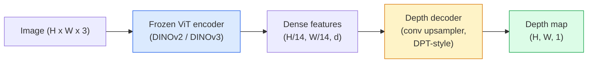

# 单目深度与几何估计

> 深度图（depth map）是一张单通道图像，每个像素代表与相机之间的距离。过去，没有立体视觉或 LiDAR 就无法从单张 RGB 帧预测深度。到 2026 年，冻结的 ViT 编码器加上轻量头部已能把误差控制在真值的几个百分点以内。

**Type:** Build + Use
**Languages:** Python
**Prerequisites:** Phase 4 Lesson 14 (ViT), Phase 4 Lesson 17 (Self-Supervised Vision), Phase 4 Lesson 07 (U-Net)
**Time:** ~60 minutes

## 学习目标

- 区分相对深度与度量深度，并说明每个生产模型（MiDaS、Marigold、Depth Anything V3、ZoeDepth）解决的是哪一种
- 使用 Depth Anything V3（DINOv2 主干）在未标定的任意单张图像上预测深度
- 解释单目深度为何能从单张图像工作（透视线索、纹理梯度、学习先验），以及它无法恢复什么（绝对尺度、被遮挡的几何）
- 利用深度图和针孔相机内参把 2D 检测提升到 3D 点

## 问题

深度是 2D 计算机视觉中缺失的维度。给定 RGB，你知道物体出现在图像平面的哪个位置，但不知道它们有多远。深度传感器（立体装置、LiDAR、ToF）能直接解决这个问题，但昂贵、脆弱且作用范围有限。

单目深度估计 —— 从单张 RGB 帧预测深度 —— 过去会输出模糊、不可靠的结果。到 2026 年，大型预训练编码器改变了这一点：Depth Anything V3 使用冻结的 DINOv2 主干，生成的深度图能泛化到室内、室外、医学和卫星领域。Marigold 把深度重新建模为条件扩散问题。ZoeDepth 则回归真实的度量距离。

深度也是 2D 检测与 3D 理解之间的桥梁：把检测框的像素乘以深度，就能把 2D 对象抬升到 3D 点云。这是每个 AR 遮挡系统、每个避障管线、每个「拿起杯子」机器人的核心。

## 概念

### 相对深度与度量深度

- **相对深度** —— 有序的 `z` 值，但没有真实世界单位。「像素 A 比像素 B 更近，但距离比例并不以米为单位。」
- **度量深度** —— 从相机出发的绝对距离（米）。要求模型学会图像线索与真实距离之间的统计关系。

MiDaS 和 Depth Anything V3 输出相对深度。Marigold 输出相对深度。ZoeDepth、UniDepth 和 Metric3D 输出度量深度。度量模型对相机内参敏感；相对模型则不敏感。

### 编码器-解码器模式



Depth Anything V3 冻结编码器，只训练 DPT 风格的解码器。编码器提供丰富特征；解码器把它们插值回图像分辨率并回归深度。

### 为什么单张图像也能产生深度

一张 2D 图像包含许多与深度相关的单目线索：

- **透视** —— 3D 中的平行线在 2D 中汇聚。
- **纹理梯度** —— 远处表面的纹理更小、更密集。
- **遮挡顺序** —— 近处物体遮挡远处物体。
- **大小恒常性** —— 已知物体（汽车、人）提供近似尺度。
- **大气透视** —— 室外场景中远处物体显得更朦胧、更偏蓝。

在数十亿张图像上训练的 ViT 把这些线索内化。只要有足够数据和强大的主干，单目深度无需任何显式 3D 监督就能达到合理的精度。

### 单目深度不能做什么

- **绝对度量尺度**，在没有内参或场景中已知物体的情况下。网络可以预测「杯子是勺子的两倍远」，却不知道杯子是在 1 米还是 10 米外。
- **被遮挡的几何** —— 椅背看不见，无法可靠推断。
- **真正无纹理 / 反光表面** —— 镜子、玻璃、均质墙面。网络会输出看似合理但实际错误的深度。

### 2026 年的 Depth Anything V3

- 使用普通 DINOv2 ViT-L/14 作为编码器（冻结）。
- DPT 解码器。
- 在来自多种来源的已标定图像对（posed image pairs）上训练（只需光度一致性，无需显式深度监督）。
- 从**任意数量的视觉输入**预测空间一致的几何，无论是否已知相机位姿。
- 在单目深度、任意视角几何、视觉渲染、相机位姿估计上均达到 SOTA。

这就是 2026 年需要深度时可以直接调用的模型。

### Marigold —— 用扩散模型做深度

Marigold（Ke 等，CVPR 2024）把深度估计重新建模为条件图像到图像扩散。条件：RGB；目标：深度图。使用预训练的 Stable Diffusion 2 U-Net 作为主干。输出的深度图在物体边界异常清晰。代价：比前馈模型推理慢（10-50 步去噪）。

### 内参与针孔相机

把深度为 `d` 的像素 `(u, v)` 提升到相机坐标系中的 3D 点 `(X, Y, Z)`：

```math
\begin{aligned}
f_x, f_y, c_x, c_y &= \text{camera intrinsics} \\
X &= (u - c_x) \cdot d / f_x \\
Y &= (v - c_y) \cdot d / f_y \\
Z &= d
\end{aligned}
```

内参来自 EXIF 元数据、标定板，或单目内参估计器（Perspective Fields、UniDepth）。没有内参时，仍可假设 60-70° 视场角和中分辨率主点来渲染点云 —— 可用于可视化，不能用于测量。

### 评估

两个标准指标：

- **AbsRel**（绝对相对误差）：`mean(|d_pred - d_gt| / d_gt)`。越低越好。生产模型通常为 0.05-0.1。
- **delta < 1.25**（阈值准确率）：满足 `max(d_pred/d_gt, d_gt/d_pred) < 1.25` 的像素比例。越高越好。SOTA 可达 0.9+。

对于相对深度（Depth Anything V3、MiDaS），评估使用两种指标的尺度-平移不变版本。

```figure
depth-sweep
```

## 构建它

### 第 1 步：深度指标

```python
import torch

def abs_rel_error(pred, target, mask=None):
    if mask is not None:
        pred = pred[mask]
        target = target[mask]
    return (torch.abs(pred - target) / target.clamp(min=1e-6)).mean().item()


def delta_accuracy(pred, target, threshold=1.25, mask=None):
    if mask is not None:
        pred = pred[mask]
        target = target[mask]
    ratio = torch.maximum(pred / target.clamp(min=1e-6), target / pred.clamp(min=1e-6))
    return (ratio < threshold).float().mean().item()
```

评估前务必屏蔽无效深度像素（零、NaN、饱和）。

### 第 2 步：尺度-平移对齐

对于相对深度模型，在计算指标前先把预测对齐到真值。用最小二乘拟合 `a * pred + b = target`：

```python
def align_scale_shift(pred, target, mask=None):
    if mask is not None:
        p = pred[mask]
        t = target[mask]
    else:
        p = pred.flatten()
        t = target.flatten()
    A = torch.stack([p, torch.ones_like(p)], dim=1)
    coeffs, *_ = torch.linalg.lstsq(A, t.unsqueeze(-1))
    a, b = coeffs[:2, 0]
    return a * pred + b
```

评估 MiDaS / Depth Anything 时，先运行 `align_scale_shift`，再运行 `abs_rel_error`。

### 第 3 步：把深度提升为点云

```python
import numpy as np

def depth_to_point_cloud(depth, intrinsics):
    H, W = depth.shape
    fx, fy, cx, cy = intrinsics
    v, u = np.meshgrid(np.arange(H), np.arange(W), indexing="ij")
    z = depth
    x = (u - cx) * z / fx
    y = (v - cy) * z / fy
    return np.stack([x, y, z], axis=-1)


depth = np.random.uniform(0.5, 4.0, (240, 320))
intr = (320.0, 320.0, 160.0, 120.0)
pc = depth_to_point_cloud(depth, intr)
print(f"point cloud shape: {pc.shape}  (H, W, 3)")
```

一个函数，覆盖所有 3D 提升应用。把点云导出为 `.ply`，然后在 MeshLab 或 CloudCompare 中打开。

### 第 4 步：用合成深度场景做冒烟测试

```python
def synthetic_depth(size=96):
    yy, xx = np.meshgrid(np.arange(size), np.arange(size), indexing="ij")
    # Floor: linear gradient from near (top) to far (bottom)
    depth = 1.0 + (yy / size) * 4.0
    # Box in the middle: closer
    mask = (np.abs(xx - size / 2) < size / 6) & (np.abs(yy - size * 0.6) < size / 6)
    depth[mask] = 2.0
    return depth.astype(np.float32)


gt = torch.from_numpy(synthetic_depth(96))
pred = gt + 0.3 * torch.randn_like(gt)  # simulated prediction
aligned = align_scale_shift(pred, gt)
print(f"before align  absRel = {abs_rel_error(pred, gt):.3f}")
print(f"after align   absRel = {abs_rel_error(aligned, gt):.3f}")
```

### 第 5 步：Depth Anything V2 用法（参考）

```python
import numpy as np
from transformers import pipeline
from PIL import Image

pipe = pipeline(task="depth-estimation", model="depth-anything/Depth-Anything-V2-Large-hf")

image = Image.open("street.jpg").convert("RGB")
out = pipe(image)
depth_np = np.array(out["depth"])
```

三行代码。`out["depth"]` 是 PIL 灰度图；转 numpy 后才能做数学运算。Depth Anything 3（2025 年 11 月）不能通过这个 pipeline 加载。它自带 `depth_anything_3` 包：`DepthAnything3.from_pretrained("depth-anything/DA3MONO-LARGE")` 加载相对单目模型，`model.inference(images).depth` 返回 `[N, H, W]` 的深度数组。

## 使用它

- **Depth Anything V3**（Meta AI / ByteDance，2024-2026）—— 相对深度的默认选择。生产中最快的 ViT-Large 主干模型。
- **Marigold**（ETH，2024）—— 视觉质量最高，推理慢。
- **UniDepth**（ETH，2024）—— 度量深度，带相机内参估计。
- **ZoeDepth**（Intel，2023）—— 度量深度；较老，仍然可靠。
- **MiDaS v3.1** —— 经典但稳定；不错的对比基线。

典型集成模式：

1. RGB 帧到达。
2. 深度模型生成深度图。
3. 检测器生成边界框。
4. 通过深度把框中心提升到 3D；有点云时与之融合。
5. 下游：AR 遮挡、路径规划、物体尺寸估计、立体视觉替代。

实时使用时，Depth Anything V2 Small（INT8 量化）在消费级 GPU 上以 518×518 分辨率可达约 30 fps。

## 交付它

本节课产出：

- `outputs/prompt-depth-model-picker.md` —— 根据延迟、度量/相对深度需求以及场景类型，在 Depth Anything V3、Marigold、UniDepth、MiDaS 之间做选择。
- `outputs/skill-depth-to-pointcloud.md` —— 一个 skill，用于根据深度图构建点云，正确处理内参并导出为 `.ply`。

## 练习

1. **（简单）** 用 Depth Anything V2 跑你桌面上的任意 10 张图像。把深度存为灰度 PNG 并检查。找出一个预测深度明显错误的物体，并解释单目线索为何失效。
2. **（中等）** 给定 Depth Anything V2 的 RGB + 深度，提升到点云并用 `open3d` 渲染。比较两个场景（室内 / 室外），记录哪个看起来更可信。
3. **（困难）** 取 5 组图像，每组仅有一个已知物体的位置不同（例如瓶子向相机移动 30 cm）。用 UniDepth 在两张图像上预测度量深度。报告预测距离差值与真实 30 cm 的对比。

## 关键术语

| 术语 | 常见说法 | 实际含义 |
|------|----------------|----------------------|
| Monocular depth | "Single-image depth" | 从单张 RGB 帧估计深度，无需立体视觉或 LiDAR |
| Relative depth | "Ordered depth" | 有序的 z 值，没有真实世界单位 |
| Metric depth | "Absolute distance" | 以米为单位的深度；需要标定或模型接受度量监督训练 |
| AbsRel | "Absolute relative error" | $\lvert d_{\text{pred}} - d_{\text{gt}} \rvert / d_{\text{gt}}$ 的均值；标准深度指标 |
| Delta accuracy | "delta < 1.25" | 预测值与真值相差在 25% 以内的像素比例 |
| Pinhole camera | "fx, fy, cx, cy" | 用于把 (u, v, d) 提升到 (X, Y, Z) 的相机模型 |
| DPT | "Dense Prediction Transformer" | 用于冻结 ViT 编码器之上的深度卷积解码器 |
| DINOv2 backbone | "The reason it works" | 自监督特征，跨领域泛化且无需深度标签 |

## 延伸阅读

- [Depth Anything V3 论文页面](https://depth-anything.github.io/) —— 使用 DINOv2 编码器的 SOTA 单目深度
- [Marigold（Ke 等，CVPR 2024）](https://marigoldmonodepth.github.io/) —— 基于扩散的深度估计
- [UniDepth（Piccinelli 等，2024）](https://arxiv.org/abs/2403.18913) —— 带内参的度量深度
- [MiDaS v3.1（Intel ISL）](https://github.com/isl-org/MiDaS) —— 经典的相对深度基线
- [DINOv3 博客文章（Meta）](https://ai.meta.com/blog/dinov3-self-supervised-vision-model/) —— 提升深度精度的编码器家族
