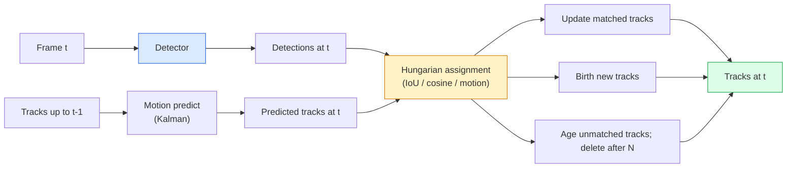

# 多目标跟踪与视频记忆

> 跟踪就是检测加关联。每帧都做检测，把这帧的检测结果按 ID 与上一帧的轨迹匹配起来。

**Type:** Build
**Languages:** Python
**Prerequisites:** Phase 4 Lesson 06 (YOLO Detection), Phase 4 Lesson 08 (Mask R-CNN), Phase 4 Lesson 24 (SAM 3)
**Time:** ~60 minutes

## 学习目标

- 区分跟踪-检测范式与基于查询的跟踪，并能说出算法家族（SORT、DeepSORT、ByteTrack、BoT-SORT、SAM 2 记忆跟踪器、SAM 3.1 Object Multiplex）
- 从头实现经典跟踪-检测范式的 IoU + 匈牙利分配
- 解释 SAM 2 的记忆库，以及它为何比基于 IoU 的关联更擅长处理遮挡
- 读懂三个跟踪指标（MOTA、IDF1、HOTA），并能针对具体用例选择该报告哪一个

## 问题

检测器告诉你单帧中物体的位置。跟踪器告诉你第 `t` 帧中的哪个检测与第 `t-1` 帧中的哪个检测是同一个物体。没有它，你无法统计越过某条线的物体数量、无法跟踪一颗穿过遮挡的球，也无法知道「4 号车已经在车道里待了 8 秒」。

跟踪对每个面向视频的产品都至关重要：体育分析、监控、自动驾驶、医学视频分析、野生动物监测、水印计数。核心构建块是共通的：每帧检测器、运动模型（卡尔曼滤波器或更复杂的模型）、关联步骤（在 IoU / 余弦 / 学习特征上运行匈牙利算法），以及轨迹生命周期（诞生、更新、死亡）。

2026 年出现了两种新模式：**SAM 2 基于记忆的跟踪**（用特征记忆替代运动模型关联）和 **SAM 3.1 Object Multiplex**（同一概念的多个实例共享记忆）。本节课先走经典技术栈，再讲基于记忆的方法。

## 概念

### 跟踪-检测范式



2026 年你会遇到的每个跟踪器都是这个循环的变体。差异在于：

- **SORT**（2016）：卡尔曼滤波 + IoU 匈牙利算法。简单、快速、没有外观模型。
- **DeepSORT**（2017）：SORT + 每条轨迹的基于 CNN 的外观特征（ReID embedding）。更擅长处理交叉场景。
- **ByteTrack**（2021）：把低置信度检测作为第二阶段进行关联；无需外观特征，却在 MOT17 上表现顶尖。
- **BoT-SORT**（2022）：Byte + 相机运动补偿 + ReID。
- **StrongSORT / OC-SORT** —— ByteTrack 的后裔，运动与外观建模更优。

### 一段话讲清卡尔曼滤波器

卡尔曼滤波器为每条轨迹维护一个状态 `(x, y, w, h, dx, dy, dw, dh)` 和协方差。每帧先用恒速模型**预测**状态，再用匹配到的检测**更新**。预测不确定性高时，更新更信任检测。这样能得到平滑轨迹，并让轨迹在短时遮挡（1-5 帧）中得以延续。

每个经典跟踪器都在运动预测步骤中使用卡尔曼滤波器。

### 匈牙利算法

给定 `M x N` 的代价矩阵（轨迹 × 检测），寻找使总代价最小的一对一分配。代价通常是 `1 - IoU(track_bbox, detection_bbox)`，或外观特征负余弦相似度。运行时间为 $O((M+N)^3)$；当 $M, N$ 达到约 1000 时，通过 `scipy.optimize.linear_sum_assignment` 在 Python 中也足够快。

### ByteTrack 的核心思想

标准跟踪器会丢弃低置信度检测（< 0.5）。ByteTrack 把它们保留为**第二阶段候选**：先把轨迹与高置信度检测匹配，未匹配的轨迹再用稍宽松的 IoU 阈值去匹配低置信度检测。这样能恢复短时遮挡，减少人群附近的 ID 切换。

### SAM 2 基于记忆的跟踪

SAM 2 通过维护一个每实例的时空特征**记忆库**来处理视频。在某一帧给定提示（点击、框、文本），它把该实例编码进记忆。后续帧中，记忆与新帧特征做交叉注意力，解码器在新帧中为同一实例生成 mask。

没有卡尔曼滤波器，也没有匈牙利分配。关联隐含在记忆-注意力操作中。

优点：

- 对大幅遮挡鲁棒（记忆能在多帧间保持实例身份）。
- 结合 SAM 3 的文本提示后可实现开放词汇。
- 无需单独的运动模型。

缺点：

- 多目标跟踪时比 ByteTrack 慢。
- 记忆库不断增长；限制了上下文窗口。

### SAM 3.1 Object Multiplex

之前的 SAM 2 / SAM 3 跟踪为每个实例维护单独的记忆库。50 个对象就需要 50 个记忆库。Object Multiplex（2026 年 3 月）把它们合并成一个共享记忆，并用**每实例查询 token**。成本随实例数量次线性增长。

Multiplex 是 2026 年人群跟踪的新默认：演唱会人群、仓库工人、十字路口。

### 需要知道的三个指标

- **MOTA（多目标跟踪准确率）** —— 1 - (FN + FP + ID 切换) / GT。按错误类型加权；单一指标，混合了检测与关联失败。
- **IDF1（ID F1）** —— ID 精确率与召回率的调和平均。专门关注每条真值轨迹随时间保持 ID 的能力。对 ID 切换敏感的任务比 MOTA 更合适。
- **HOTA（高阶跟踪准确率）** —— 分解为检测准确率（DetA）和关联准确率（AssA）。自 2020 年以来的社区标准；最全面。

监控场景（谁是谁）：报告 IDF1。体育分析（统计传球）：HOTA。一般学术对比：HOTA。

```figure
cv3-track-assoc
```

## 构建它

### 第 1 步：基于 IoU 的代价矩阵

```python
import numpy as np


def bbox_iou(a, b):
    """
    a, b: (N, 4) arrays of [x1, y1, x2, y2].
    Returns (N_a, N_b) IoU matrix.
    """
    ax1, ay1, ax2, ay2 = a[:, 0], a[:, 1], a[:, 2], a[:, 3]
    bx1, by1, bx2, by2 = b[:, 0], b[:, 1], b[:, 2], b[:, 3]
    inter_x1 = np.maximum(ax1[:, None], bx1[None, :])
    inter_y1 = np.maximum(ay1[:, None], by1[None, :])
    inter_x2 = np.minimum(ax2[:, None], bx2[None, :])
    inter_y2 = np.minimum(ay2[:, None], by2[None, :])
    inter = np.clip(inter_x2 - inter_x1, 0, None) * np.clip(inter_y2 - inter_y1, 0, None)
    area_a = (ax2 - ax1) * (ay2 - ay1)
    area_b = (bx2 - bx1) * (by2 - by1)
    union = area_a[:, None] + area_b[None, :] - inter
    return inter / np.clip(union, 1e-8, None)
```

### 第 2 步：最小 SORT 风格跟踪器

为简洁起见省略了固定恒速卡尔曼 —— 这里只用简单 IoU 关联；生产中卡尔曼预测必不可少。`sort` Python 包提供完整实现。

```python
from scipy.optimize import linear_sum_assignment


class Track:
    def __init__(self, tid, bbox, frame):
        self.id = tid
        self.bbox = bbox
        self.last_frame = frame
        self.hits = 1

    def update(self, bbox, frame):
        self.bbox = bbox
        self.last_frame = frame
        self.hits += 1


class SimpleTracker:
    def __init__(self, iou_threshold=0.3, max_age=5):
        self.tracks = []
        self.next_id = 1
        self.iou_threshold = iou_threshold
        self.max_age = max_age

    def step(self, detections, frame):
        if not self.tracks:
            for d in detections:
                self.tracks.append(Track(self.next_id, d, frame))
                self.next_id += 1
            return [(t.id, t.bbox) for t in self.tracks]

        track_boxes = np.array([t.bbox for t in self.tracks])
        det_boxes = np.array(detections) if len(detections) else np.empty((0, 4))

        iou = bbox_iou(track_boxes, det_boxes) if len(det_boxes) else np.zeros((len(track_boxes), 0))
        cost = 1 - iou
        cost[iou < self.iou_threshold] = 1e6

        matched_track = set()
        matched_det = set()
        if cost.size > 0:
            row, col = linear_sum_assignment(cost)
            for r, c in zip(row, col):
                if cost[r, c] < 1.0:
                    self.tracks[r].update(det_boxes[c], frame)
                    matched_track.add(r); matched_det.add(c)

        for i, d in enumerate(det_boxes):
            if i not in matched_det:
                self.tracks.append(Track(self.next_id, d, frame))
                self.next_id += 1

        self.tracks = [t for t in self.tracks if frame - t.last_frame <= self.max_age]
        return [(t.id, t.bbox) for t in self.tracks]
```

60 行代码。输入每帧检测，返回每帧轨迹 ID。真实系统会加入卡尔曼预测、ByteTrack 第二阶段重匹配以及外观特征。

### 第 3 步：合成轨迹测试

```python
def synthetic_frames(num_frames=20, num_objects=3, H=240, W=320, seed=0):
    rng = np.random.default_rng(seed)
    starts = rng.uniform(20, 200, size=(num_objects, 2))
    velocities = rng.uniform(-5, 5, size=(num_objects, 2))
    frames = []
    for f in range(num_frames):
        dets = []
        for i in range(num_objects):
            cx, cy = starts[i] + f * velocities[i]
            dets.append([cx - 10, cy - 10, cx + 10, cy + 10])
        frames.append(dets)
    return frames


tracker = SimpleTracker()
for f, dets in enumerate(synthetic_frames()):
    tracks = tracker.step(dets, f)
```

三个沿直线运动的物体应在全部 20 帧中保持各自 ID。

### 第 4 步：ID 切换指标

```python
def count_id_switches(tracks_per_frame, gt_per_frame):
    """
    tracks_per_frame:  list of list of (track_id, bbox)
    gt_per_frame:      list of list of (gt_id, bbox)
    Returns number of ID switches.
    """
    prev_assignment = {}
    switches = 0
    for tracks, gts in zip(tracks_per_frame, gt_per_frame):
        if not tracks or not gts:
            continue
        t_boxes = np.array([b for _, b in tracks])
        g_boxes = np.array([b for _, b in gts])
        iou = bbox_iou(g_boxes, t_boxes)
        for g_idx, (gt_id, _) in enumerate(gts):
            j = iou[g_idx].argmax()
            if iou[g_idx, j] > 0.5:
                t_id = tracks[j][0]
                if gt_id in prev_assignment and prev_assignment[gt_id] != t_id:
                    switches += 1
                prev_assignment[gt_id] = t_id
    return switches
```

这是一个简化的类 IDF1 指标：统计真值对象被分配到的预测轨迹 ID 改变次数。真正的 MOTA / IDF1 / HOTA 工具在 `py-motmetrics` 和 `TrackEval` 中。

## 使用它

2026 年的生产级跟踪器：

- `ultralytics` —— 内置 YOLOv8 + ByteTrack / BoT-SORT。`results = model.track(source, tracker="bytetrack.yaml")`。这是默认选择。
- `supervision`（Roboflow）—— ByteTrack 封装加标注工具。
- SAM 2 / SAM 3.1 —— 通过 `processor.track()` 进行基于记忆的跟踪。
- 自定义栈：检测器（YOLOv8 / RT-DETR）+ `sort-tracker` / `OC-SORT` / `StrongSORT`。

选择：

- 行人 / 汽车 / 箱子，30+ fps：**ultralytics 里的 ByteTrack**。
- 人群中某一类的多个实例：**SAM 3.1 Object Multiplex**。
- 有明显外观特征的重度遮挡：**DeepSORT / StrongSORT**（ReID 特征）。
- 体育 / 复杂交互：**BoT-SORT** 或学习型跟踪器（MOTRv3）。

## 交付它

本节课产出：

- `outputs/prompt-tracker-picker.md` —— 根据场景类型、遮挡模式和延迟预算，在 SORT / ByteTrack / BoT-SORT / SAM 2 / SAM 3.1 之间做选择。
- `outputs/skill-mot-evaluator.md` —— 编写完整的 MOTA / IDF1 / HOTA 评估框架，与真值轨迹对比。

## 练习

1. **（简单）** 用上述合成跟踪器分别跑 3、10、30 个对象。报告每种情况下的 ID 切换次数。找出仅 IoU 关联开始失效的位置。
2. **（中等）** 在关联前加入恒速卡尔曼预测步骤。证明短时（2-3 帧）遮挡不再导致 ID 切换。
3. **（困难）** 通过 `transformers` 集成 SAM 2 的基于记忆跟踪器作为替代后端。在一段 30 秒的人群视频上同时运行 SimpleTracker 和 SAM 2，比较 ID 切换次数，并手工为 5 个显眼人物标注真值 ID。

## 关键术语

| 术语 | 常见说法 | 实际含义 |
|------|----------------|----------------------|
| Tracking-by-detection | "Detect then associate" | 每帧检测器 + 在 IoU / 外观上做匈牙利分配 |
| Kalman filter | "Motion predict" | 线性动力学 + 协方差，用于平滑轨迹预测和遮挡处理 |
| Hungarian algorithm | "Optimal assignment" | 求解最小代价二分匹配；`scipy.optimize.linear_sum_assignment` |
| ByteTrack | "Low-confidence second pass" | 未匹配轨迹与低置信度检测再次匹配，以恢复短时遮挡 |
| DeepSORT | "SORT + appearance" | 增加 ReID 特征用于跨帧匹配；更利于保持 ID |
| Memory bank | "SAM 2 trick" | 跨帧存储每实例时空特征；交叉注意力替代显式关联 |
| Object Multiplex | "SAM 3.1 shared memory" | 单一共享记忆 + 每实例查询，用于快速多目标跟踪 |
| HOTA | "Modern tracking metric" | 分解为检测与关联准确率；社区标准 |

## 延伸阅读

- [SORT（Bewley 等，2016）](https://arxiv.org/abs/1602.00763) —— 最简跟踪-检测论文
- [DeepSORT（Wojke 等，2017）](https://arxiv.org/abs/1703.07402) —— 增加外观特征
- [ByteTrack（Zhang 等，2022）](https://arxiv.org/abs/2110.06864) —— 低置信度第二阶段
- [BoT-SORT（Aharon 等，2022）](https://arxiv.org/abs/2206.14651) —— 相机运动补偿
- [HOTA（Luiten 等，2020）](https://arxiv.org/abs/2009.07736) —— 分解式跟踪指标
- [SAM 2 视频分割（Meta，2024）](https://ai.meta.com/sam2/) —— 基于记忆的跟踪器
- [SAM 3.1 Object Multiplex（Meta，2026 年 3 月）](https://ai.meta.com/blog/segment-anything-model-3/)
