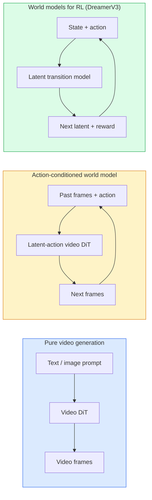

# 世界模型与视频扩散

> 一个能预测场景接下来几秒的视频模型，就是一台世界模拟器。再把预测条件化到动作上，你就得到了一个学习出来的游戏引擎。

**Type:** Learn + Build
**Languages:** Python
**Prerequisites:** Phase 4 Lesson 10 (Diffusion), Phase 4 Lesson 12 (Video Understanding), Phase 4 Lesson 23 (DiT + Rectified Flow)
**Time:** ~75 minutes

## 学习目标

- 解释纯视频生成模型（Sora 2）与动作条件世界模型（Genie 3、DreamerV3）之间的区别
- 描述视频 DiT：时空 patch、3D 位置编码、跨 (T, H, W) token 的联合注意力
- 梳理世界模型如何接入机器人系统：VLM 规划 → 视频模型模拟 → 逆动力学输出动作
- 针对给定用例（创意视频、交互式仿真、自动驾驶合成）在 Sora 2、Genie 3、Runway GWM-1 Worlds、Wan-Video 和 HunyuanVideo 之间做出选择

## 问题

视频生成与世界建模在 2026 年汇合了。一个能生成连贯一分钟视频的模型，在某种意义上已经学会了世界如何运动：物体恒存、重力、因果、风格。如果你把这个预测条件化到动作上（向左走、开门），视频模型就变成了一个可学习的模拟器，可以替代游戏引擎、驾驶模拟器或机器人环境。

这件事的分量很具体。Genie 3 能从一张图生成可玩的环境。Runway GWM-1 Worlds 合成无限可探索的场景。Sora 2 生成带同步音频、有建模物理的一分钟长视频。NVIDIA Cosmos-Drive、Wayve Gaia-2 和 Tesla DrivingWorld 为自动驾驶训练数据生成逼真的驾驶视频。世界模型范式正在悄悄接管机器人领域的 sim-to-real。

本课是 Phase 4 的「全景」课。它把图像生成、视频理解和 Agent 推理串成当前主流研究正在靠拢的架构模式。

## 概念

### 世界建模的三个流派



- **Sora 2** 是纯视频生成，以 prompt 为条件。没有动作接口。你无法在生成过程中「操控」它。
- **Genie 3**、**GWM-1 Worlds**、**Mirage / Magica** 是动作条件世界模型。它们从观察到的视频推断潜动作（latent action），再把未来帧的预测条件化到动作上。它是可交互的——你按键或移动镜头，场景就会响应。
- **DreamerV3** 和经典强化学习世界模型家族在潜空间中预测，显式地以动作为条件，并用奖励信号训练。视觉上没那么炫，但对样本高效的强化学习更有用。

### 视频 DiT 架构

```
Video latent:          (C, T, H, W)
Patchify (spatial):    grid of P_h x P_w patches per frame
Patchify (temporal):   group P_t frames into a temporal patch
Resulting tokens:      (T / P_t) * (H / P_h) * (W / P_w) tokens
```

位置编码是 3D 的：每个 (t, h, w) 坐标对应一个旋转式或可学习 embedding。注意力可以有以下几种：

- **完全联合（full joint）**——所有 token 互相注意。$N$ 个 token 时为 $O(N^2)$。长视频下代价无法承受。
- **分解式（divided）**——交替使用时间注意力（同一空间位置、跨时间：`(H*W) * T^2`）和空间注意力（同一时间步、跨空间：`T * (H*W)^2`）。TimeSformer 和大多数视频 DiT 采用这种方案。
- **窗口式（window）**——在 (t, h, w) 上取局部窗口。Video Swin 采用这种方案。

2026 年的每个视频扩散模型都使用这三种模式之一，外加 AdaLN 条件化（第 23 课）和整流流（rectified flow）。

### 将动作作为条件：潜动作模型

Genie 通过判别式地预测一对连续帧之间的动作，为每一帧学习一个**潜动作**。模型的解码器随后以推断出的潜动作为条件——而不是以显式的键盘按键为条件。推理时，用户可以指定一个潜动作（或从先验中新采样一个），模型就会生成与该动作一致的下一帧。

Sora 完全跳过了动作接口。它的解码器从过去的时空 token 预测下一批时空 token。prompt 只决定起点；生成过程中没有任何东西可以操控它。

### 物理合理性

Sora 2 的 2026 版本明确宣传了**物理合理性**：重量、平衡、物体恒存、因果关系。团队通过人工评分的合理性分数来度量；与 Sora 1 相比，该模型在坠落物体、角色碰撞和刻意失败（比如跳空）上都有肉眼可见的提升。

合理性仍然是主要的失败模式。2024-2025 年那些人吃意大利面、用杯子喝水的视频，暴露了模型缺乏持久的物体表示。2026 年的模型（Sora 2、Runway Gen-5、HunyuanVideo）减轻了但并未消除这些问题。

### 自动驾驶世界模型

驾驶世界模型以轨迹、边界框或导航地图为条件，生成逼真的道路场景。用途包括：

- **Cosmos-Drive-Dreams**（NVIDIA）——为强化学习训练生成数分钟的驾驶视频。
- **Gaia-2**（Wayve）——以轨迹为条件的场景合成，用于策略评估。
- **DrivingWorld**（Tesla）——模拟不同的天气、时段和交通状况。
- **Vista**（ByteDance）——反应式驾驶场景合成。

它们替代了为长尾场景（corner case）进行的昂贵真实数据采集——夜间行人乱穿马路、结冰路口、罕见车型——这些场景原本需要数百万英里的路测。

### 机器人技术栈：VLM + 视频模型 + 逆动力学

正在成形的三组件机器人闭环：

1. **VLM** 解析目标（「拿起红杯子」），规划高层动作序列。
2. **视频生成模型**模拟执行每个动作会是什么样子——预测 N 帧之后的观察。
3. **逆动力学模型**提取能产生这些观察的具体电机指令。

这取代了奖励塑形和样本密集的强化学习。世界模型负责想象，逆动力学在驱动端闭合回路。Genie Envisioner 是其中一种实例；许多研究组正在向这一结构收敛。

### 评估

- **视觉质量**——FVD（Fréchet Video Distance）、用户研究。
- **prompt 对齐**——逐帧 CLIPScore、VQA 式评估。
- **物理合理性**——在基准套件（Sora 2 内部基准、VBench）上人工评分。
- **可控性**（针对交互式世界模型）——动作到观察的一致性；能否回到之前的状态？

### 2026 年的模型版图

| 模型 | 用途 | 参数量 | 输出 | 许可 |
|-------|-----|------------|--------|---------|
| Sora 2 | 文生视频、音频 | — | 1 分钟 1080p + 音频 | 仅 API |
| Runway Gen-5 | 文生视频/图生视频 | — | 10 秒片段 | API |
| Runway GWM-1 Worlds | 交互式世界 | — | 无限 3D 推演 | API |
| Genie 3 | 从图像生成交互式世界 | 11B+ | 可玩帧 | 研究预览 |
| Wan-Video 2.1 | 开源文生视频 | 14B | 高质量片段 | 非商用 |
| HunyuanVideo | 开源文生视频 | 13B | 10 秒片段 | 宽松许可 |
| Cosmos / Cosmos-Drive | 自动驾驶仿真 | 7-14B | 驾驶场景 | NVIDIA 开放 |
| Magica / Mirage 2 | AI 原生游戏引擎 | — | 可修改的世界 | 产品 |

```figure
v4-world-rollout
```

## 构建它

### 步骤 1：视频的 3D patch 化

```python
import torch
import torch.nn as nn


class VideoPatch3D(nn.Module):
    def __init__(self, in_channels=4, dim=64, patch_t=2, patch_h=2, patch_w=2):
        super().__init__()
        self.proj = nn.Conv3d(
            in_channels, dim,
            kernel_size=(patch_t, patch_h, patch_w),
            stride=(patch_t, patch_h, patch_w),
        )
        self.patch_t = patch_t
        self.patch_h = patch_h
        self.patch_w = patch_w

    def forward(self, x):
        # x: (N, C, T, H, W)
        x = self.proj(x)
        n, c, t, h, w = x.shape
        tokens = x.reshape(n, c, t * h * w).transpose(1, 2)
        return tokens, (t, h, w)
```

步长等于卷积核的 3D 卷积就充当了时空 patch 化器。得到 `(T, H, W) -> (T/2, H/2, W/2)` 的 token 网格。

### 步骤 2：3D 旋转位置编码

旋转位置编码（RoPE）分别沿 `t`、`h`、`w` 轴应用：

```python
def rope_3d(tokens, t_dim, h_dim, w_dim, grid):
    """
    tokens: (N, T*H*W, D)
    grid: (T, H, W) sizes
    t_dim + h_dim + w_dim == D
    """
    T, H, W = grid
    n, seq, d = tokens.shape
    if t_dim + h_dim + w_dim != d:
        raise ValueError(f"t_dim+h_dim+w_dim ({t_dim}+{h_dim}+{w_dim}) must equal D={d}")
    assert seq == T * H * W
    t_idx = torch.arange(T, device=tokens.device).repeat_interleave(H * W)
    h_idx = torch.arange(H, device=tokens.device).repeat_interleave(W).repeat(T)
    w_idx = torch.arange(W, device=tokens.device).repeat(T * H)
    # Simplified: just scale channels by frequencies. Real RoPE rotates pairs.
    freqs_t = torch.exp(-torch.log(torch.tensor(10000.0)) * torch.arange(t_dim // 2, device=tokens.device) / (t_dim // 2))
    freqs_h = torch.exp(-torch.log(torch.tensor(10000.0)) * torch.arange(h_dim // 2, device=tokens.device) / (h_dim // 2))
    freqs_w = torch.exp(-torch.log(torch.tensor(10000.0)) * torch.arange(w_dim // 2, device=tokens.device) / (w_dim // 2))
    emb_t = torch.cat([torch.sin(t_idx[:, None] * freqs_t), torch.cos(t_idx[:, None] * freqs_t)], dim=-1)
    emb_h = torch.cat([torch.sin(h_idx[:, None] * freqs_h), torch.cos(h_idx[:, None] * freqs_h)], dim=-1)
    emb_w = torch.cat([torch.sin(w_idx[:, None] * freqs_w), torch.cos(w_idx[:, None] * freqs_w)], dim=-1)
    return tokens + torch.cat([emb_t, emb_h, emb_w], dim=-1)
```

这是简化后的加性形式。真正的 RoPE 按频率旋转成对的通道；位置信息是一样的。

### 步骤 3：分解注意力块

```python
class DividedAttentionBlock(nn.Module):
    def __init__(self, dim=64, heads=2):
        super().__init__()
        self.time_attn = nn.MultiheadAttention(dim, heads, batch_first=True)
        self.space_attn = nn.MultiheadAttention(dim, heads, batch_first=True)
        self.ln1 = nn.LayerNorm(dim)
        self.ln2 = nn.LayerNorm(dim)
        self.ln3 = nn.LayerNorm(dim)
        self.mlp = nn.Sequential(nn.Linear(dim, 4 * dim), nn.GELU(), nn.Linear(4 * dim, dim))

    def forward(self, x, grid):
        T, H, W = grid
        n, seq, d = x.shape
        # time attention: same (h, w), across t
        xt = x.view(n, T, H * W, d).permute(0, 2, 1, 3).reshape(n * H * W, T, d)
        a, _ = self.time_attn(self.ln1(xt), self.ln1(xt), self.ln1(xt), need_weights=False)
        xt = (xt + a).reshape(n, H * W, T, d).permute(0, 2, 1, 3).reshape(n, seq, d)
        # space attention: same t, across (h, w)
        xs = xt.view(n, T, H * W, d).reshape(n * T, H * W, d)
        a, _ = self.space_attn(self.ln2(xs), self.ln2(xs), self.ln2(xs), need_weights=False)
        xs = (xs + a).reshape(n, T, H * W, d).reshape(n, seq, d)
        xs = xs + self.mlp(self.ln3(xs))
        return xs
```

时间注意力在每个空间位置内部跨时间进行；空间注意力在每一帧内部跨位置进行。两次 $O(T^2 + (HW)^2)$ 运算，替代一次 $O((THW)^2)$ 运算。这是 TimeSformer 和所有现代视频 DiT 的核心。

### 步骤 4：组装一个微型视频 DiT

```python
class TinyVideoDiT(nn.Module):
    def __init__(self, in_channels=4, dim=64, depth=2, heads=2):
        super().__init__()
        self.patch = VideoPatch3D(in_channels=in_channels, dim=dim, patch_t=2, patch_h=2, patch_w=2)
        self.blocks = nn.ModuleList([DividedAttentionBlock(dim, heads) for _ in range(depth)])
        self.out = nn.Linear(dim, in_channels * 2 * 2 * 2)

    def forward(self, x):
        tokens, grid = self.patch(x)
        for blk in self.blocks:
            tokens = blk(tokens, grid)
        return self.out(tokens), grid
```

它不是一个能用的视频生成器；只是一个演示结构、确认每个部件形状正确的样例。

### 步骤 5：检查形状

```python
vid = torch.randn(1, 4, 8, 16, 16)  # (N, C, T, H, W)
model = TinyVideoDiT()
out, grid = model(vid)
print(f"input  {tuple(vid.shape)}")
print(f"tokens grid {grid}")
print(f"output {tuple(out.shape)}")
```

预期 patch 化之后 `grid = (4, 8, 8)`、`out = (1, 256, 32)`；输出头再把每个 token 投影成时空 patch，随时可以反 patch 化还原成视频。

## 使用它

2026 年的生产接入方式：

- **Sora 2 API**（OpenAI）——文生视频、同步音频。定价较高。
- **Runway Gen-5 / GWM-1**（Runway）——图生视频、交互式世界。
- **Wan-Video 2.1 / HunyuanVideo**——开源、可自托管。
- **Cosmos / Cosmos-Drive**（NVIDIA）——驾驶仿真，开放权重。
- **Genie 3**——研究预览，需申请访问。

要做一个交互式世界模型 demo：从 Wan-Video 起步保证质量，再叠加一个潜动作适配器实现交互。自动驾驶仿真方面：Cosmos-Drive 是 2026 年的开放参考实现。

机器人领域，实际在用的技术栈：

1. 语言目标 -> VLM（Qwen3-VL）-> 高层规划。
2. 规划 -> 潜动作视频模型 -> 想象中的推演。
3. 推演 -> 逆动力学模型 -> 底层动作。
4. 执行动作 -> 观察反馈回第 1 步。

## 交付它

本课产出：

- `outputs/prompt-video-model-picker.md`——根据任务、许可和延迟，在 Sora 2 / Runway / Wan / HunyuanVideo / Cosmos 之间做选择。
- `outputs/skill-physical-plausibility-checks.md`——一个定义自动化检查（物体恒存、重力、连续性）的 skill，在发布前对任何生成的视频运行。

## 练习

1. **（简单）** 计算一段 5 秒 360p 视频在 patch-t=2、patch-h=8、patch-w=8 下的 token 数量。分析这个规模下注意力所需的内存。
2. **（中等）** 把上面的分解注意力块换成完全联合注意力块，测量形状和参数量。解释为什么真实视频模型必须使用分解注意力。
3. **（困难）** 构建一个最小的潜动作视频模型：取 (frame_t, action_t, frame_{t+1}) 三元组数据集（任意简单的 2D 游戏），训练一个以动作 embedding 为条件的微型视频 DiT，并展示不同动作会产生不同的下一帧。

## 关键术语

| 术语 | 人们怎么说 | 实际含义 |
|------|----------------|----------------------|
| 世界模型 | 「学习出来的模拟器」 | 给定状态和动作，预测未来观察的模型 |
| 视频 DiT | 「时空 Transformer」 | 带 3D patch 化和分解注意力的扩散 Transformer |
| 潜动作 | 「推断出的控制信号」 | 从帧对推断出的离散或连续动作潜变量，用来条件化下一帧生成 |
| 分解注意力 | 「先时间后空间」 | 每个块里做两次注意力——先跨时间再跨空间——让 $O(N^2)$ 保持在可控范围 |
| 物体恒存 | 「东西一直都在」 | 视频模型必须学会的场景属性；在食物、玻璃器皿上是经典失败点 |
| FVD | 「Fréchet Video Distance」 | 视频版的 FID；主要的视觉质量指标 |
| 逆动力学模型 | 「从观察到动作」 | 给定（状态，下一状态），输出连接二者的动作；闭合机器人回路 |
| Cosmos-Drive | 「NVIDIA 驾驶仿真」 | 开放权重的自动驾驶世界模型，用于强化学习和评测 |

## 延伸阅读

- [Sora 技术报告（OpenAI）](https://openai.com/index/video-generation-models-as-world-simulators/)
- [Genie: Generative Interactive Environments (Bruce et al., 2024)](https://arxiv.org/abs/2402.15391)——潜动作世界模型
- [TimeSformer (Bertasius et al., 2021)](https://arxiv.org/abs/2102.05095)——视频 Transformer 的分解注意力
- [DreamerV3 (Hafner et al., 2023)](https://arxiv.org/abs/2301.04104)——用于强化学习的世界模型
- [Cosmos-Drive-Dreams (NVIDIA, 2025)](https://research.nvidia.com/labs/toronto-ai/cosmos-drive-dreams/)——驾驶世界模型
- [2026 年十大视频生成模型（DataCamp）](https://www.datacamp.com/blog/top-video-generation-models)
- [From Video Generation to World Model——综述仓库](https://github.com/ziqihuangg/Awesome-From-Video-Generation-to-World-Model/)
