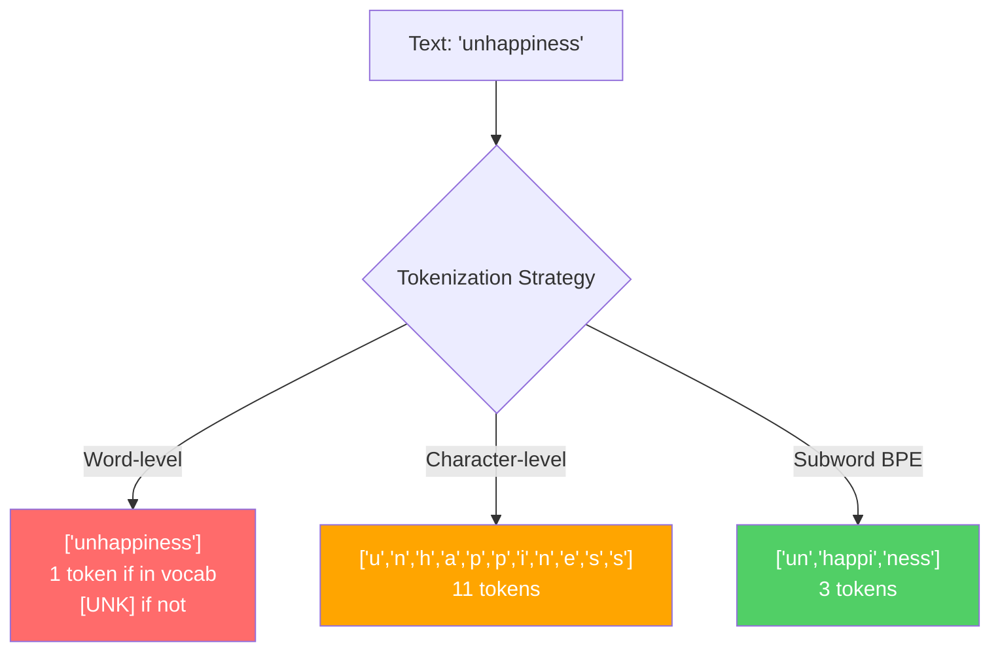
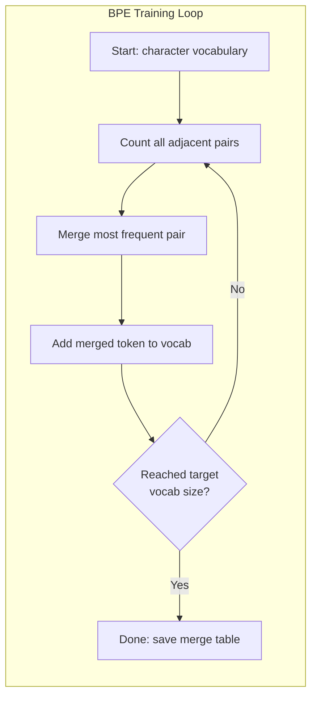
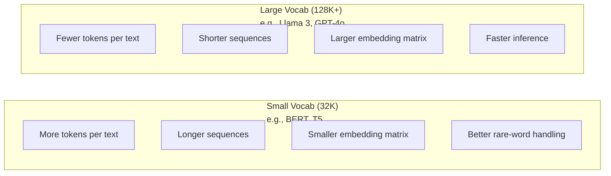

# 分词器：BPE、WordPiece、SentencePiece

> 你的 LLM 不读英文。它读的是整数。分词器决定了这些整数是在承载意义，还是在浪费它们。

**Type:** Build
**Languages:** Python
**Prerequisites:** Phase 05 (NLP Foundations)
**Time:** ~90 minutes

## 学习目标

- 从零实现 BPE、WordPiece 和 Unigram 分词算法，并比较它们的合并策略
- 解释词表大小如何影响模型效率：词表太小会产生长序列，词表太大则浪费 embedding 参数
- 分析跨语言和代码场景下的分词伪影，找出特定分词器失效的位置
- 使用 tiktoken 和 sentencepiece 库对文本分词，并检查生成的 token ID

## 问题

你的 LLM 不读英文。它不读任何语言。它读的是数字。

「Hello, world!」与 [15496, 11, 995, 0] 之间的那道鸿沟，就是分词器。每个单词、每个空格、每个标点符号，都必须在模型处理之前转换成整数。这个转换并不中立。它把一些假设烙进模型，之后再也没法撤销。

这一步做错，模型就会浪费容量，用多个 token 去编码常见单词。「unfortunately」变成四个 token 而不是一个。面对多音节词密集的文本，你的 128K 上下文窗口刚刚缩水了 75%。做对了，同样的上下文窗口能容纳两倍的意义。「这个模型擅长处理代码」与「这个模型一碰 Python 就废」之间的差别，往往就取决于分词器是怎么训练的。

你对 GPT-4 或 Claude 的每一次 API 调用都按 token 计价。模型生成的每个 token 都消耗算力。表示同一个输出所需的 token 越少，端到端推理就越快。分词不是预处理。它就是架构。

## 概念

### 三种失败的方法（和一种胜出的方法）

把文本转换成数字有三种显而易见的方式。其中两种在规模化时行不通。

**词级分词（Word-level tokenization）** 按空格和标点切分。「The cat sat」变成 ["The", "cat", "sat"]。简单。可「tokenization」怎么办？「GPT-4o」呢？或者德语复合词「Geschwindigkeitsbegrenzung」？词级分词需要巨大的词表才能覆盖每种语言里的每个单词。漏掉一个词，你就会得到那个可怕的 `[UNK]` token——模型在说「我完全不知道这是什么」。光英语就有一百多万种词形。再加上代码、URL、科学记数法和另外 100 种语言，你需要一个无限大的词表。

**字符级分词（Character-level tokenization）** 走另一个极端。「hello」变成 ["h", "e", "l", "l", "o"]。词表很小（几百个字符）。永远不会出现未知 token。但序列变得极长。一句在词级只需 10 个 token 的话，在字符级要 50 个 token。模型必须学会「t」「h」「e」放在一起代表「the」——把注意力容量烧在人类三岁就学会的东西上。

**子词分词（Subword tokenization）** 找到了最佳平衡点。常见词保持完整：「the」就是一个 token。生僻词被拆解成有意义的片段：「unhappiness」变成 ["un", "happi", "ness"]。词表保持可控（30K 到 128K 个 token）。序列保持简短。未知 token 基本消失，因为任何单词都能由子词片段拼出来。

每个现代 LLM 都使用子词分词。GPT-2、GPT-4、BERT、Llama 3、Claude——无一例外。问题在于选哪种算法。



### BPE：字节对编码

BPE 是一种贪心压缩算法，被改用途做了分词。它的想法简单到可以写在一张索引卡上。

从单个字符开始。统计训练语料中每一对相邻字符。把出现最频繁的一对合并成新 token。重复，直到达到目标词表大小。

```figure
tokenizer-bpe
```

下面是 BPE 在一个小语料上运行的过程，语料包含「lower」「lowest」「newest」三个词：

```
Corpus (with word frequencies):
  "lower"  x5
  "lowest" x2
  "newest" x6

Step 0 -- Start with characters:
  l o w e r       (x5)
  l o w e s t     (x2)
  n e w e s t     (x6)

Step 1 -- Count adjacent pairs:
  (e,s): 8    (s,t): 8    (l,o): 7    (o,w): 7
  (w,e): 13   (e,r): 5    (n,e): 6    ...

Step 2 -- Merge most frequent pair (w,e) -> "we":
  l o we r        (x5)
  l o we s t      (x2)
  n e we s t      (x6)

Step 3 -- Recount and merge (e,s) -> "es":
  l o we r        (x5)
  l o we s t      (x2)    <- 'es' only forms from 'e'+'s', not 'we'+'s'
  n e we s t      (x6)    <- wait, the 'e' before 'we' and 's' after 'we'

Actually tracking this precisely:
  After "we" merge, remaining pairs:
  (l,o): 7   (o,we): 7   (we,r): 5   (we,s): 8
  (s,t): 8   (n,e): 6    (e,we): 6

Step 3 -- Merge (we,s) -> "wes" or (s,t) -> "st" (tied at 8, pick first):
  Merge (we,s) -> "wes":
  l o we r        (x5)
  l o wes t       (x2)
  n e wes t       (x6)

Step 4 -- Merge (wes,t) -> "west":
  l o we r        (x5)
  l o west        (x2)
  n e west        (x6)

...continue until target vocab size reached.
```

合并表就是分词器。要编码新文本，就按学习时的顺序依次施加合并。训练语料决定了存在哪些合并，而这个选择会永久地塑造模型所看到的世界。



### 字节级 BPE（GPT-2、GPT-3、GPT-4）

标准 BPE 在 Unicode 字符上操作。字节级 BPE 在原始字节（0-255）上操作。这样基础词表恰好是 256 个，能处理任何语言或编码，而且永远不会产生未知 token。

GPT-2 引入了这种方法。基础词表覆盖所有可能的字节值，BPE 合并在其上构建。OpenAI 的 tiktoken 库实现了字节级 BPE，对应的词表大小如下：

- GPT-2：50,257 个 token
- GPT-3.5/GPT-4：约 100,256 个 token（cl100k_base 编码）
- GPT-4o：200,019 个 token（o200k_base 编码）

### WordPiece（BERT）

WordPiece 看起来和 BPE 相似，但挑选合并的方式不同。它不直接用原始频次，而是最大化训练数据的似然：

```
BPE merge criterion:      count(A, B)
WordPiece merge criterion: count(AB) / (count(A) * count(B))
```

BPE 问：「哪一对出现得最频繁？」WordPiece 问：「哪一对共同出现的频率高于随机期望？」这个微妙的差别产生了不同的词表。WordPiece 偏爱共现令人意外的合并，而不只是高频的合并。

WordPiece 还用「##」前缀标记续接子词：

```
"unhappiness" -> ["un", "##happi", "##ness"]
"embedding"   -> ["em", "##bed", "##ding"]
```

「##」前缀告诉你这个片段是接在前一个 token 后面的。BERT 使用 WordPiece，词表大小为 30,522 个 token。每个 BERT 变体——DistilBERT、RoBERTa 的分词器其实是 BPE，但 BERT 本身是 WordPiece。

### SentencePiece（Llama、T5）

SentencePiece 把输入当作原始的 Unicode 字符流，包括空白字符。没有预分词步骤。没有针对语言特定的词边界规则。这使它真正与语言无关——它能处理中文、日文、泰文等不用空格分隔单词的语言。

SentencePiece 支持两种算法：
- **BPE 模式**：与标准 BPE 相同的合并逻辑，作用在原始字符序列上
- **Unigram 模式**：从一个较大的词表开始，迭代删除对整体似然影响最小的 token。这是 BPE 的反向操作——剪枝而非合并。

Llama 2 使用 SentencePiece BPE，词表 32,000 个 token。T5 使用 SentencePiece Unigram，32,000 个 token。注意：Llama 3 换成了基于 tiktoken 的字节级 BPE 分词器，词表 128,256 个 token。

### 词表大小的权衡

这是一个真实的工程决策，后果可以量化。



具体数字。128K 词表配 4,096 维 embedding，单是 embedding 矩阵就是 128,000 x 4,096 = 5.24 亿参数。32K 词表则是 1.31 亿参数。仅分词器这一个选择就带来约 4 亿参数的差距。

但更大的词表压缩文本更激进。同一段英文，用 32K 词表需要 100 个 token，用 128K 词表可能只需 70 个。这意味着生成时少跑 30% 的前向传播。对于一个每天服务数百万请求的模型，这是算力成本的直接下降。

趋势很明确：词表在变大。GPT-2 用了 50,257。GPT-4 约 100K。Llama 3 用 128K。GPT-4o 用 200K。

| 模型 | 词表大小 | 分词器类型 | 每个英文单词平均 token 数 |
|-------|-----------|----------------|---------------------------|
| BERT | 30,522 | WordPiece | ~1.4 |
| GPT-2 | 50,257 | Byte-level BPE | ~1.3 |
| Llama 2 | 32,000 | SentencePiece BPE | ~1.4 |
| GPT-4 | ~100,256 | Byte-level BPE | ~1.2 |
| Llama 3 | 128,256 | Byte-level BPE (tiktoken) | ~1.1 |
| GPT-4o | 200,019 | Byte-level BPE | ~1.0 |

### 多语言税

主要用英文训练的分词器对其他语言很残酷。韩文在 GPT-2 的分词器里平均每个词要 2-3 个 token。中文可能更糟。这意味着韩国用户实际可用的上下文窗口只有英文用户的一半——付同样的钱，得到更低的信息密度。

这就是 Llama 3 把词表从 32K 翻四倍到 128K 的原因。更多 token 分给非英文书写系统，意味着跨语言的压缩更公平。

```figure
tokenizer-tradeoff
```

## 构建它

### 第 1 步：字符级分词器

从最基础的开始。字符级分词器把每个字符映射到它的 Unicode 码点。不需要训练。没有未知 token。只是一个直接的映射。

```python
class CharTokenizer:
    def encode(self, text):
        return [ord(c) for c in text]

    def decode(self, tokens):
        return "".join(chr(t) for t in tokens)
```

「hello」变成 [104, 101, 108, 108, 111]。每个字符都是自己的 token。这就是我们要改进的基线。

### 第 2 步：从零实现 BPE 分词器

真正的实现。我们在原始字节上训练（像 GPT-2 那样），统计字节对，合并最频繁的一对，并按顺序记录每一次合并。合并表就是分词器。

```python
from collections import Counter

class BPETokenizer:
    def __init__(self):
        self.merges = {}
        self.vocab = {}

    def _get_pairs(self, tokens):
        pairs = Counter()
        for i in range(len(tokens) - 1):
            pairs[(tokens[i], tokens[i + 1])] += 1
        return pairs

    def _merge_pair(self, tokens, pair, new_token):
        merged = []
        i = 0
        while i < len(tokens):
            if i < len(tokens) - 1 and tokens[i] == pair[0] and tokens[i + 1] == pair[1]:
                merged.append(new_token)
                i += 2
            else:
                merged.append(tokens[i])
                i += 1
        return merged

    def train(self, text, num_merges):
        tokens = list(text.encode("utf-8"))
        self.vocab = {i: bytes([i]) for i in range(256)}

        for i in range(num_merges):
            pairs = self._get_pairs(tokens)
            if not pairs:
                break
            best_pair = max(pairs, key=pairs.get)
            new_token = 256 + i
            tokens = self._merge_pair(tokens, best_pair, new_token)
            self.merges[best_pair] = new_token
            self.vocab[new_token] = self.vocab[best_pair[0]] + self.vocab[best_pair[1]]

        return self

    def encode(self, text):
        tokens = list(text.encode("utf-8"))
        for pair, new_token in self.merges.items():
            tokens = self._merge_pair(tokens, pair, new_token)
        return tokens

    def decode(self, tokens):
        byte_sequence = b"".join(self.vocab[t] for t in tokens)
        return byte_sequence.decode("utf-8", errors="replace")
```

训练循环是 BPE 的核心：统计字节对，合并胜出者，重复。每次合并都会减少总 token 数。经过 `num_merges` 轮后，词表从 256（基础字节）增长到 256 + num_merges。

编码按学习时的精确顺序施加合并。这一点很重要。如果第 1 次合并创建了「th」，第 5 次合并创建了「the」，那么编码时必须先施加第 1 次合并，这样第 5 次合并才能由「th」+「e」形成「the」。

解码是其逆过程：在词表中查找每个 token ID，拼接字节，再解码为 UTF-8。

### 第 3 步：编码与解码往返验证

```python
corpus = (
    "The cat sat on the mat. The cat ate the rat. "
    "The dog sat on the log. The dog ate the frog. "
    "Natural language processing is the study of how computers "
    "understand and generate human language. "
    "Tokenization is the first step in any NLP pipeline."
)

tokenizer = BPETokenizer()
tokenizer.train(corpus, num_merges=40)

test_sentences = [
    "The cat sat on the mat.",
    "Natural language processing",
    "tokenization pipeline",
    "unhappiness",
]

for sentence in test_sentences:
    encoded = tokenizer.encode(sentence)
    decoded = tokenizer.decode(encoded)
    raw_bytes = len(sentence.encode("utf-8"))
    ratio = len(encoded) / raw_bytes
    print(f"'{sentence}'")
    print(f"  Tokens: {len(encoded)} (from {raw_bytes} bytes) -- ratio: {ratio:.2f}")
    print(f"  Roundtrip: {'PASS' if decoded == sentence else 'FAIL'}")
```

压缩比告诉你分词器有多高效。比例 0.50 意味着分词器把文本压缩到了原始字节数一半的 token 数。越低越好。在训练语料上，这个比例会不错。对于分布外的文本，比如「unhappiness」（语料中并未出现），比例会更差——分词器对没见过的模式会退回到字符级编码。

### 第 4 步：与 tiktoken 对比

```python
import tiktoken

enc = tiktoken.get_encoding("cl100k_base")

texts = [
    "The cat sat on the mat.",
    "unhappiness",
    "Hello, world!",
    "def fibonacci(n): return n if n < 2 else fibonacci(n-1) + fibonacci(n-2)",
    "Geschwindigkeitsbegrenzung",
]

for text in texts:
    our_tokens = tokenizer.encode(text)
    tiktoken_tokens = enc.encode(text)
    tiktoken_pieces = [enc.decode([t]) for t in tiktoken_tokens]
    print(f"'{text}'")
    print(f"  Our BPE:   {len(our_tokens)} tokens")
    print(f"  tiktoken:  {len(tiktoken_tokens)} tokens -> {tiktoken_pieces}")
```

tiktoken 用完全相同的算法，但在数百 GB 的文本上训练，做了 100,000 次合并。算法本身一模一样。差别在于训练数据和合并次数。你在一个段落上训练、只做了 40 次合并的分词器，比不过在超大语料上做了 100K 次合并的 tiktoken。但机制是相同的。

### 第 5 步：词表分析

```python
def analyze_vocabulary(tokenizer, test_texts):
    total_tokens = 0
    total_chars = 0
    token_usage = Counter()

    for text in test_texts:
        encoded = tokenizer.encode(text)
        total_tokens += len(encoded)
        total_chars += len(text)
        for t in encoded:
            token_usage[t] += 1

    print(f"Vocabulary size: {len(tokenizer.vocab)}")
    print(f"Total tokens across all texts: {total_tokens}")
    print(f"Total characters: {total_chars}")
    print(f"Avg tokens per character: {total_tokens / total_chars:.2f}")

    print(f"\nMost used tokens:")
    for token_id, count in token_usage.most_common(10):
        token_bytes = tokenizer.vocab[token_id]
        display = token_bytes.decode("utf-8", errors="replace")
        print(f"  Token {token_id:4d}: '{display}' (used {count} times)")

    unused = [t for t in tokenizer.vocab if t not in token_usage]
    print(f"\nUnused tokens: {len(unused)} out of {len(tokenizer.vocab)}")
```

这会揭示你词表中的 Zipf 分布。少数 token 占据主导（空格、「the」、「e」）。大多数 token 很少被用到。生产级分词器针对这个分布做优化——常见模式获得较短的 token ID，罕见模式获得较长的表示。

## 使用它

你的从零实现的 BPE 能用了。现在看看生产工具长什么样。

### tiktoken（OpenAI）

```python
import tiktoken

enc = tiktoken.get_encoding("cl100k_base")

text = "Tokenizers convert text to integers"
tokens = enc.encode(text)
print(f"Tokens: {tokens}")
print(f"Pieces: {[enc.decode([t]) for t in tokens]}")
print(f"Roundtrip: {enc.decode(tokens)}")
```

tiktoken 用 Rust 编写，带 Python 绑定。它每秒能编码数百万个 token。同样的 BPE 算法，工业级实现。

### Hugging Face tokenizers

```python
from tokenizers import Tokenizer
from tokenizers.models import BPE
from tokenizers.trainers import BpeTrainer
from tokenizers.pre_tokenizers import ByteLevel

tokenizer = Tokenizer(BPE())
tokenizer.pre_tokenizer = ByteLevel()

trainer = BpeTrainer(vocab_size=1000, special_tokens=["<pad>", "<eos>", "<unk>"])
tokenizer.train(["corpus.txt"], trainer)

output = tokenizer.encode("The cat sat on the mat.")
print(f"Tokens: {output.tokens}")
print(f"IDs: {output.ids}")
```

Hugging Face 的 tokenizers 库底层同样是 Rust。它能在几秒钟内于 GB 级语料上训练 BPE。训练自己的模型时，就用它。

### 加载 Llama 的分词器

```python
from transformers import AutoTokenizer

tokenizer = AutoTokenizer.from_pretrained("meta-llama/Llama-3.1-8B")

text = "Tokenizers are the unsung heroes of LLMs"
tokens = tokenizer.encode(text)
print(f"Token IDs: {tokens}")
print(f"Tokens: {tokenizer.convert_ids_to_tokens(tokens)}")
print(f"Vocab size: {tokenizer.vocab_size}")

multilingual = ["Hello world", "Hola mundo", "Bonjour le monde"]
for text in multilingual:
    ids = tokenizer.encode(text)
    print(f"'{text}' -> {len(ids)} tokens")
```

Llama 3 的 128K 词表对非英文文本的压缩效果明显好于 GPT-2 的 50K 词表。你可以自己验证——把同一句话用多种语言编码，然后数 token。

## 交付它

本课产出 `outputs/prompt-tokenizer-analyzer.md`——一个可复用的 prompt，用于分析任意文本与模型组合的分词效率。把文本样本喂给它，它会告诉你哪个模型的分词器处理得最好。

## 练习

1. 修改 BPE 分词器，在每次合并时打印词表。观察「t」+「h」如何变成「th」，然后「th」+「e」如何变成「the」。追踪常见英文单词是怎样一块一块拼出来的。

2. 给 BPE 分词器添加特殊 token（`<pad>`、`<eos>`、`<unk>`）。把它们分配为 ID 0、1、2，并把其他所有 token 的 ID 相应后移。实现一个预分词步骤，在运行 BPE 之前按空白切分。

3. 实现 WordPiece 的合并准则（用似然比代替频次）。在同一语料、相同合并次数下分别训练 BPE 和 WordPiece。比较得到的词表——哪一个产生的子词在语言学上更有意义？

4. 构建一个多语言分词器效率基准。取 10 句英文、西班牙文、中文、韩文和阿拉伯文句子。分别用 tiktoken（cl100k_base）分词，测量每个字符的平均 token 数。量化每种语言的「多语言税」。

5. 在更大的语料上训练你的 BPE 分词器（下载一篇维基百科文章）。调整合并次数，使同一文本上的压缩比与 tiktoken 相差在 10% 以内。这会迫使你理解语料规模、合并次数与压缩质量之间的关系。

## 关键术语

| 术语 | 人们怎么说 | 实际含义 |
|------|----------------|----------------------|
| Token | 「一个单词」 | 模型词表中的一个单元——可能是字符、子词、单词或多词块 |
| BPE | 「某种压缩技术」 | Byte Pair Encoding——迭代合并最频繁的相邻 token 对，直到达到目标词表大小 |
| WordPiece | 「BERT 的分词器」 | 类似 BPE，但合并准则是最大化似然比 count(AB)/(count(A)*count(B))，而不是原始频次 |
| SentencePiece | 「一个分词器库」 | 与语言无关的分词器，在原始 Unicode 上操作、无需预分词，支持 BPE 和 Unigram 两种算法 |
| 词表大小 | 「它认识多少词」 | 唯一 token 的总数：GPT-2 是 50,257，BERT 是 30,522，Llama 3 是 128,256 |
| Fertility | 「不是分词器术语」 | 每个单词的平均 token 数——衡量分词器跨语言效率（1.0 为完美，3.0 意味着模型要多花三倍的力气） |
| 字节级 BPE | 「GPT 的分词器」 | 在原始字节（0-255）而非 Unicode 字符上运行的 BPE，保证任何输入都不会产生未知 token |
| 合并表 | 「分词器文件」 | 训练期间学到的字节对合并的有序列表——它本身就是分词器，顺序至关重要 |
| 预分词 | 「按空格切分」 | 在子词分词之前施加的规则：按空白切分、数字分隔、标点处理 |
| 压缩比 | 「分词器有多高效」 | 产出 token 数除以输入字节数——越低表示压缩越好、推理越快 |

## 延伸阅读

- [Sennrich et al., 2016 -- "Neural Machine Translation of Rare Words with Subword Units"](https://arxiv.org/abs/1508.07909)——把 BPE 引入 NLP 的论文，将一个 1994 年的压缩算法变成了现代分词的基础
- [Kudo & Richardson, 2018 -- "SentencePiece: A simple and language independent subword tokenizer"](https://arxiv.org/abs/1808.06226)——与语言无关的分词，让多语言模型变得实用
- [OpenAI tiktoken repository](https://github.com/openai/tiktoken)——Rust 生产级 BPE 实现，带 Python 绑定，被 GPT-3.5/4/4o 使用
- [Hugging Face Tokenizers documentation](https://huggingface.co/docs/tokenizers)——具有 Rust 性能的生产级分词器训练
