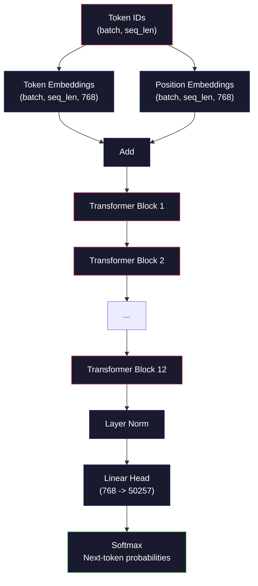
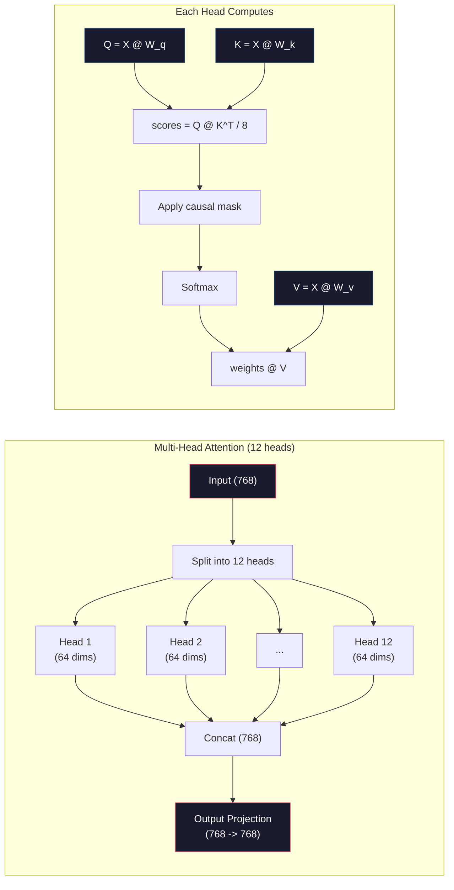
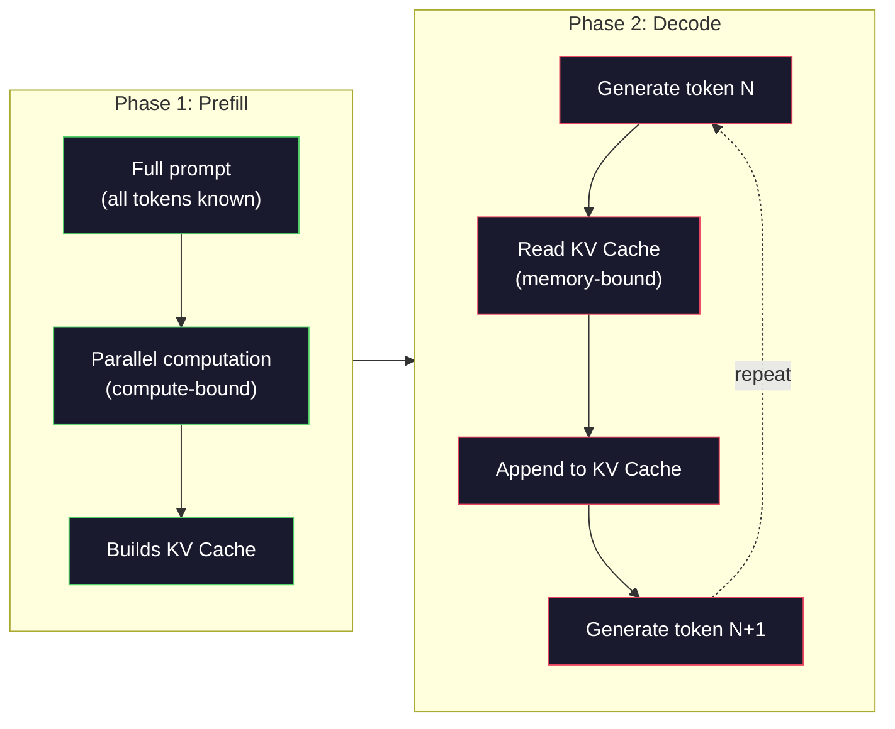

# 预训练一个 Mini GPT（1.24 亿参数）

> GPT-2 Small 有 1.24 亿个参数。这意味着 12 个 Transformer 层、12 个注意力头和 768 维的嵌入（embedding）。你可以只用一块 GPU，在几个小时内从零把它训练出来。大多数人从不这样做，他们直接使用预训练的 checkpoint。但如果你没有亲手训练过一个模型，你就并不真正理解自己构建产品所依赖的模型内部在发生什么。

**Type:** Build
**Languages:** Python (with numpy)
**Prerequisites:** Phase 10, Lessons 01-03 (Tokenizers, Building a Tokenizer, Data Pipelines)
**Time:** ~120 minutes

## 学习目标

- 从零实现完整的 GPT-2 架构（1.24 亿参数）：token 嵌入、位置嵌入、Transformer 块和语言模型头
- 使用下一 token 预测和交叉熵损失，在文本语料上训练一个 GPT 模型
- 实现带温度采样和 top-k/top-p 过滤的自回归文本生成
- 监控训练损失曲线，验证模型学到了连贯的语言模式

## 问题

你知道 Transformer 是什么。你看过那些示意图。你能背出「attention is all you need」，也能在白板上画出标着「Multi-Head Attention」的方框。

但这些都不代表你理解模型生成文本时到底发生了什么。

GPT-2 Small 有 124,438,272 个参数（使用权重绑定）。每一个参数都是通过运行训练循环设好的：前向传播、计算损失、反向传播、更新权重。12 个 Transformer 块。每块 12 个注意力头。768 维的嵌入空间。50,257 个 token 的词表。模型每生成一个 token，全部 1.24 亿个参数都会参与一条矩阵乘法链，把一串 token ID 变成下一个 token 的概率分布。

如果你从未亲手构建过它，你面对的就是一个黑箱。你可以调用 API。你可以做微调（fine-tuning）。但一旦出了问题——模型产生幻觉、开始重复自己、拒绝遵循指令——你对*为什么*毫无心智模型。

本课从零构建 GPT-2 Small。不用 PyTorch，用 numpy。每一次矩阵乘法都看得见。每一个梯度都由你的代码算出。你会亲眼看到 1.24 亿个数字如何协同预测下一个词。

## 概念

### GPT 架构

GPT 是一个自回归语言模型。「自回归」意味着它一次生成一个 token，每个 token 都以所有之前的 token 为条件。其架构是 Transformer 解码器块的堆叠。

下面是从 token ID 到下一个 token 概率的完整计算图：

1. 输入 token ID。形状：(batch_size, seq_len)。
2. 查 token 嵌入表。每个 ID 映射为一个 768 维向量。形状：(batch_size, seq_len, 768)。
3. 查位置嵌入表。每个位置（0、1、2、……）映射为一个 768 维向量。形状相同。
4. 把 token 嵌入与位置嵌入相加。
5. 依次通过 12 个 Transformer 块。
6. 最后的层归一化。
7. 线性投影到词表大小。形状：(batch_size, seq_len, vocab_size)。
8. 用 softmax 得到概率。

这就是整个模型。没有卷积，没有循环。只是嵌入、注意力、前馈网络和层归一化，堆叠 12 次。



### Transformer 块

12 个块中的每一个都遵循同样的模式。这是 pre-norm 架构（GPT-2 使用 pre-norm，而不是原始 Transformer 的 post-norm）：

1. LayerNorm
2. 多头自注意力
3. 残差连接（把输入加回去）
4. LayerNorm
5. 前馈网络（MLP）
6. 残差连接（把输入加回去）

残差连接至关重要。没有它们，反向传播时梯度到达第 1 个块时就已经消失殆尽。有了它们，梯度可以沿「跳过」路径从损失直接流向任意一层。正因如此，你才能堆叠 12 层、32 层甚至 96 层（据传 GPT-4 用了 120 层）。

### 注意力：核心机制

自注意力让每个 token 都能看向之前的每个 token，并决定对每个 token 关注多少。下面是其中的数学。

对每个 token 位置，从输入计算三个向量：
- **Query（Q）**：「我在找什么？」
- **Key（K）**：「我包含什么？」
- **Value（V）**：「我携带什么信息？」

```
Q = input @ W_q    (768 -> 768)
K = input @ W_k    (768 -> 768)
V = input @ W_v    (768 -> 768)

attention_scores = Q @ K^T / sqrt(d_k)
attention_scores = mask(attention_scores)   # causal mask: -inf for future positions
attention_weights = softmax(attention_scores)
output = attention_weights @ V
```

因果掩码是 GPT 具备自回归能力的关键。位置 5 可以关注位置 0-5，但不能关注 6、7、8 等等。这防止模型在训练时通过偷看未来的 token「作弊」。

**多头注意力**把 768 维空间拆成 12 个头，每个头 64 维。每个头学习不同的注意力模式。一个头可能追踪句法关系（主谓一致）。另一个头可能追踪语义相似性（同义词）。还有一个头可能追踪位置邻近性（附近的词）。12 个头的输出被拼接起来，再投影回 768 维。



除以 $\sqrt{d_k}$——$\sqrt{64} = 8$——就是缩放。没有它，高维向量的点积会变得很大，把 softmax 推入梯度几乎为零的区域。这是原始论文「Attention Is All You Need」的关键洞见之一。

### KV cache：为什么推理很快

训练时，你一次性处理整个序列。推理（inference）时，你一次生成一个 token。如果不做优化，生成第 $N$ 个 token 需要为之前全部 $N-1$ 个 token 重新计算注意力。也就是每生成一个 token 需要 $O(N^2)$，长度为 $N$ 的序列总共 $O(N^3)$。

KV cache 解决了这个问题。为每个 token 算完 K 和 V 之后就存起来。生成第 $N+1$ 个 token 时，你只需为新 token 算 Q，再从缓存里取出之前所有 token 的 K 和 V。这样，K 和 V 计算中每个 token 的开销从 $O(N)$ 降到 $O(1)$。注意力分数的计算仍然是 $O(N)$，因为你要关注所有之前的位置，但你避免了在输入上做冗余的矩阵乘法。

对于 12 层、12 个头的 GPT-2，KV cache 每个 token 存储 2（K + V）× 12 层 × 12 头 × 64 维 = 18,432 个值。对 1024 个 token 的序列，FP32 下约为 75MB。对于 128 层的 Llama 3 405B，单个序列的 KV cache 可以超过 10GB。这就是长上下文推理受限于内存的原因。

### Prefill 与 Decode：推理的两个阶段

当你向 LLM 发送一个 prompt，推理会经历两个截然不同的阶段。

**Prefill** 并行处理整个 prompt。所有 token 都已知，因此模型可以同时计算所有位置的注意力。这个阶段是计算受限的（compute-bound）——GPU 以满吞吐量做矩阵乘法。在 A100 上，1000 个 token 的 prompt，prefill 大约需要 20-50ms。

**Decode** 一次生成一个 token。每个新 token 都依赖之前所有 token。这个阶段是内存受限的（memory-bound）——瓶颈是从 GPU 内存读取模型权重和 KV cache，而不是矩阵运算本身。GPU 的计算核心大多空闲，等待内存读取。对 GPT-2 来说，不管矩阵乘法需要多少 FLOPs，每个 decode 步耗时都差不多，因为受限于内存带宽。

这一区别对生产系统很重要。Prefill 吞吐量随 GPU 算力扩展（FLOPS 越多，prefill 越快）。Decode 吞吐量随内存带宽扩展（内存越快，decode 越快）。这就是 NVIDIA 的 H100 相比 A100 重点提升内存带宽的原因——它直接加速了 token 生成。



### 训练循环

训练 LLM 就是下一 token 预测。给定 token [0, 1, 2, ..., N-1]，预测 token [1, 2, 3, ..., N]。损失函数是模型预测的概率分布与真实下一 token 之间的交叉熵。

一个训练步：

1. **前向传播**：让 batch 通过全部 12 个块。得到每个位置的 logit（softmax 之前的分数）。
2. **计算损失**：logit 与目标 token（输入偏移一位）之间的交叉熵。
3. **反向传播**：用反向传播计算全部 1.24 亿个参数的梯度。
4. **优化器步**：更新权重。GPT-2 使用 Adam，配合学习率预热和余弦衰减。

学习率调度的重要性可能超出你的预期。GPT-2 在前 2,000 步里从 0 预热到峰值学习率，然后按余弦曲线衰减。一开始就用高学习率会导致模型发散。一直保持高学习率会导致训练后期震荡。先预热再衰减的模式被所有主流 LLM 采用。

### GPT-2 Small：数字一览

| 组件 | 形状 | 参数数量 |
|-----------|-------|------------|
| Token 嵌入 | (50257, 768) | 38,597,376 |
| 位置嵌入 | (1024, 768) | 786,432 |
| 每块注意力（$W_q, W_k, W_v, W_{\text{out}}$） | 4 x (768, 768) | 2,359,296 |
| 每块 FFN（上 + 下） | (768, 3072) + (3072, 768) | 4,718,592 |
| 每块 LayerNorm（2 个） | 2 x 768 x 2 | 3,072 |
| 最终 LayerNorm | 768 x 2 | 1,536 |
| **每块总计** | | **7,080,960** |
| **总计（12 块）** | | **85,054,464 + 39,383,808 = 124,438,272** |

输出投影（logit 头）与 token 嵌入矩阵共享权重。这叫做权重绑定（weight tying）——它把参数数量减少 3,800 万，并提升性能，因为它迫使模型在输入和输出上使用同一个表示空间。

## 构建它

```figure
iso-machine {"machine":"mini-gpt"}
```

### 第 1 步：嵌入层

Token 嵌入把 50,257 个可能 token 中的每一个映射为 768 维向量。位置嵌入补充每个 token 在序列中所处位置的信息。两者相加。

```python
import numpy as np

class Embedding:
    def __init__(self, vocab_size, embed_dim, max_seq_len):
        self.token_embed = np.random.randn(vocab_size, embed_dim) * 0.02
        self.pos_embed = np.random.randn(max_seq_len, embed_dim) * 0.02

    def forward(self, token_ids):
        seq_len = token_ids.shape[-1]
        tok_emb = self.token_embed[token_ids]
        pos_emb = self.pos_embed[:seq_len]
        return tok_emb + pos_emb
```

初始化标准差 0.02 来自 GPT-2 论文。太大，最初的几次前向传播会产生极端值，使训练不稳定。太小，初始输出对所有输入几乎相同，早期的梯度信号就毫无用处。

### 第 2 步：带因果掩码的自注意力

先看单头注意力。因果掩码在 softmax 之前把未来位置置为负无穷，确保每个位置只能关注自身及更早的位置。

```python
def attention(Q, K, V, mask=None):
    d_k = Q.shape[-1]
    scores = Q @ K.transpose(0, -1, -2 if Q.ndim == 4 else 1) / np.sqrt(d_k)
    if mask is not None:
        scores = scores + mask
    weights = np.exp(scores - scores.max(axis=-1, keepdims=True))
    weights = weights / weights.sum(axis=-1, keepdims=True)
    return weights @ V
```

softmax 的实现先减去最大值再做指数运算。否则 exp(大数) 会溢出为无穷。这是一个数值稳定技巧，不改变输出，因为对任意常数 $c$，有 $\mathop{\mathrm{softmax}}(x - c) = \mathop{\mathrm{softmax}}(x)$。

### 第 3 步：多头注意力

把 768 维输入拆成 12 个头，每个头 64 维。每个头独立计算注意力。拼接结果，再投影回 768 维。

```python
class MultiHeadAttention:
    def __init__(self, embed_dim, num_heads):
        self.num_heads = num_heads
        self.head_dim = embed_dim // num_heads
        self.W_q = np.random.randn(embed_dim, embed_dim) * 0.02
        self.W_k = np.random.randn(embed_dim, embed_dim) * 0.02
        self.W_v = np.random.randn(embed_dim, embed_dim) * 0.02
        self.W_out = np.random.randn(embed_dim, embed_dim) * 0.02

    def forward(self, x, mask=None):
        batch, seq_len, d = x.shape
        Q = (x @ self.W_q).reshape(batch, seq_len, self.num_heads, self.head_dim).transpose(0, 2, 1, 3)
        K = (x @ self.W_k).reshape(batch, seq_len, self.num_heads, self.head_dim).transpose(0, 2, 1, 3)
        V = (x @ self.W_v).reshape(batch, seq_len, self.num_heads, self.head_dim).transpose(0, 2, 1, 3)

        scores = Q @ K.transpose(0, 1, 3, 2) / np.sqrt(self.head_dim)
        if mask is not None:
            scores = scores + mask
        weights = np.exp(scores - scores.max(axis=-1, keepdims=True))
        weights = weights / weights.sum(axis=-1, keepdims=True)
        attn_out = weights @ V

        attn_out = attn_out.transpose(0, 2, 1, 3).reshape(batch, seq_len, d)
        return attn_out @ self.W_out
```

reshape-transpose-reshape 这套操作是多头注意力里最令人困惑的部分。过程是这样的：(batch, seq_len, 768) 的张量变成 (batch, seq_len, 12, 64)，再变成 (batch, 12, seq_len, 64)。此时 12 个头各自拥有一个 (seq_len, 64) 矩阵来运行注意力。注意力之后反向操作：(batch, 12, seq_len, 64) 变回 (batch, seq_len, 12, 64)，再变回 (batch, seq_len, 768)。

### 第 4 步：Transformer 块

一个完整的 Transformer 块：LayerNorm、带残差的多头注意力、LayerNorm、带残差的前馈网络。

```python
class LayerNorm:
    def __init__(self, dim, eps=1e-5):
        self.gamma = np.ones(dim)
        self.beta = np.zeros(dim)
        self.eps = eps

    def forward(self, x):
        mean = x.mean(axis=-1, keepdims=True)
        var = x.var(axis=-1, keepdims=True)
        return self.gamma * (x - mean) / np.sqrt(var + self.eps) + self.beta


class FeedForward:
    def __init__(self, embed_dim, ff_dim):
        self.W1 = np.random.randn(embed_dim, ff_dim) * 0.02
        self.b1 = np.zeros(ff_dim)
        self.W2 = np.random.randn(ff_dim, embed_dim) * 0.02
        self.b2 = np.zeros(embed_dim)

    def forward(self, x):
        h = x @ self.W1 + self.b1
        h = np.maximum(0, h)  # GELU approximation: ReLU for simplicity
        return h @ self.W2 + self.b2


class TransformerBlock:
    def __init__(self, embed_dim, num_heads, ff_dim):
        self.ln1 = LayerNorm(embed_dim)
        self.attn = MultiHeadAttention(embed_dim, num_heads)
        self.ln2 = LayerNorm(embed_dim)
        self.ffn = FeedForward(embed_dim, ff_dim)

    def forward(self, x, mask=None):
        x = x + self.attn.forward(self.ln1.forward(x), mask)
        x = x + self.ffn.forward(self.ln2.forward(x))
        return x
```

前馈网络把 768 维输入扩展到 3,072 维（4 倍），施加非线性，再投影回 768 维。这种先扩张再收缩的模式让模型在每个位置有「更宽」的内部表示可用。GPT-2 使用 GELU 激活，但这里为简单起见使用 ReLU——对于理解架构而言差别很小。

### 第 5 步：完整的 GPT 模型

堆叠 12 个 Transformer 块。前面加上嵌入层，后面加上输出投影。

```python
class MiniGPT:
    def __init__(self, vocab_size=50257, embed_dim=768, num_heads=12,
                 num_layers=12, max_seq_len=1024, ff_dim=3072):
        self.embedding = Embedding(vocab_size, embed_dim, max_seq_len)
        self.blocks = [
            TransformerBlock(embed_dim, num_heads, ff_dim)
            for _ in range(num_layers)
        ]
        self.ln_f = LayerNorm(embed_dim)
        self.vocab_size = vocab_size
        self.embed_dim = embed_dim

    def forward(self, token_ids):
        seq_len = token_ids.shape[-1]
        mask = np.triu(np.full((seq_len, seq_len), -1e9), k=1)

        x = self.embedding.forward(token_ids)
        for block in self.blocks:
            x = block.forward(x, mask)
        x = self.ln_f.forward(x)

        logits = x @ self.embedding.token_embed.T
        return logits

    def count_parameters(self):
        total = 0
        total += self.embedding.token_embed.size
        total += self.embedding.pos_embed.size
        for block in self.blocks:
            total += block.attn.W_q.size + block.attn.W_k.size
            total += block.attn.W_v.size + block.attn.W_out.size
            total += block.ffn.W1.size + block.ffn.b1.size
            total += block.ffn.W2.size + block.ffn.b2.size
            total += block.ln1.gamma.size + block.ln1.beta.size
            total += block.ln2.gamma.size + block.ln2.beta.size
        total += self.ln_f.gamma.size + self.ln_f.beta.size
        return total
```

注意权重绑定：`logits = x @ self.embedding.token_embed.T`。输出投影复用了 token 嵌入矩阵（转置后）。这不只是省参数的技巧。它意味着模型用同一个向量空间来理解 token（嵌入）和预测 token（输出）。

### 第 6 步：训练循环

要在 1.24 亿参数上做真正的训练，你需要 GPU 和 PyTorch。这里的训练循环是在一个纯 numpy 能跑的小模型上演示机制。我们用一个很小的模型（4 层、4 头、128 维）让它可运行。

```python
def cross_entropy_loss(logits, targets):
    batch, seq_len, vocab_size = logits.shape
    logits_flat = logits.reshape(-1, vocab_size)
    targets_flat = targets.reshape(-1)

    max_logits = logits_flat.max(axis=-1, keepdims=True)
    log_softmax = logits_flat - max_logits - np.log(
        np.exp(logits_flat - max_logits).sum(axis=-1, keepdims=True)
    )

    loss = -log_softmax[np.arange(len(targets_flat)), targets_flat].mean()
    return loss


def train_mini_gpt(text, vocab_size=256, embed_dim=128, num_heads=4,
                   num_layers=4, seq_len=64, num_steps=200, lr=3e-4):
    tokens = np.array(list(text.encode("utf-8")[:2048]))
    model = MiniGPT(
        vocab_size=vocab_size, embed_dim=embed_dim, num_heads=num_heads,
        num_layers=num_layers, max_seq_len=seq_len, ff_dim=embed_dim * 4
    )

    print(f"Model parameters: {model.count_parameters():,}")
    print(f"Training tokens: {len(tokens):,}")
    print(f"Config: {num_layers} layers, {num_heads} heads, {embed_dim} dims")
    print()

    for step in range(num_steps):
        start_idx = np.random.randint(0, max(1, len(tokens) - seq_len - 1))
        batch_tokens = tokens[start_idx:start_idx + seq_len + 1]

        input_ids = batch_tokens[:-1].reshape(1, -1)
        target_ids = batch_tokens[1:].reshape(1, -1)

        logits = model.forward(input_ids)
        loss = cross_entropy_loss(logits, target_ids)

        if step % 20 == 0:
            print(f"Step {step:4d} | Loss: {loss:.4f}")

    return model
```

损失初始值接近 ln(vocab_size)——对 256 个 token 的字节级词表，就是 ln(256) = 5.55。随机模型给每个 token 分配相同概率。随着训练推进，损失下降，因为模型学会了预测常见模式：「t」后面是「h」，句号后面是空格，等等。

在生产环境中，你会使用 Adam 优化器，配合梯度累积、学习率预热和梯度裁剪。前向-求损失-反向-更新的循环完全相同。只是优化器更复杂。

### 第 7 步：文本生成

生成阶段用训练好的模型一次预测一个 token。每次预测都从输出分布中采样（或者贪心地取 argmax）。

```python
def generate(model, prompt_tokens, max_new_tokens=100, temperature=0.8):
    tokens = list(prompt_tokens)
    seq_len = model.embedding.pos_embed.shape[0]

    for _ in range(max_new_tokens):
        context = np.array(tokens[-seq_len:]).reshape(1, -1)
        logits = model.forward(context)
        next_logits = logits[0, -1, :]

        next_logits = next_logits / temperature
        probs = np.exp(next_logits - next_logits.max())
        probs = probs / probs.sum()

        next_token = np.random.choice(len(probs), p=probs)
        tokens.append(next_token)

    return tokens
```

温度控制随机性。温度 1.0 使用原始分布。温度 0.5 让它更尖锐（更确定——模型更频繁地选它的首选）。温度 1.5 让它更平坦（更随机——低概率 token 获得更大机会）。温度 0.0 是贪心解码（总是选概率最高的 token）。

`tokens[-seq_len:]` 窗口是必要的，因为模型有最大上下文长度（GPT-2 是 1024）。一旦超过，就必须丢弃最旧的 token。这就是大家所说的「上下文窗口」。

```figure
sampling-decoder
```

## 使用它

### 完整的训练与生成演示

```python
corpus = """The transformer architecture has revolutionized natural language processing.
Attention mechanisms allow the model to focus on relevant parts of the input.
Self-attention computes relationships between all pairs of positions in a sequence.
Multi-head attention splits the representation into multiple subspaces.
Each attention head can learn different types of relationships.
The feedforward network provides nonlinear transformations at each position.
Residual connections enable gradient flow through deep networks.
Layer normalization stabilizes training by normalizing activations.
Position embeddings give the model information about token ordering.
The causal mask ensures autoregressive generation during training.
Pre-training on large text corpora teaches the model general language understanding.
Fine-tuning adapts the pre-trained model to specific downstream tasks."""

model = train_mini_gpt(corpus, num_steps=200)

prompt = list("The transformer".encode("utf-8"))
output_tokens = generate(model, prompt, max_new_tokens=100, temperature=0.8)
generated_text = bytes(output_tokens).decode("utf-8", errors="replace")
print(f"\nGenerated: {generated_text}")
```

在小语料和小模型上，生成的文本最多只是半连贯的。它会从训练文本中学到一些字节级模式，但无法像 GPT-2 那样用 40GB 训练数据和完整 1.24 亿参数架构来泛化。重点不在于输出质量。重点在于你可以追踪每一步：嵌入查表、注意力计算、前馈变换、logit 投影、softmax 和采样。每个操作都看得见。

## 交付它

本课产出 `outputs/prompt-gpt-architecture-analyzer.md`——一个 prompt（prompt），用于分析任何 GPT 风格模型的架构选择。把一个模型卡或技术报告喂给它，它会拆解参数分配、注意力设计和扩展决策。

## 练习

1. 修改模型，使用 24 层、16 个头，而不是 12/12。数一数参数。把深度翻倍与把宽度（嵌入维度）翻倍相比如何？

2. 实现 GELU 激活函数 $(\mathop{\mathrm{GELU}}(x) = x \cdot 0.5 \cdot (1 + \mathop{\mathrm{erf}}(x / \sqrt{2})))$ 并替换前馈网络中的 ReLU。每种激活各训练 500 步，比较最终损失。

3. 给生成函数添加 KV cache。在第一次前向传播后为每一层存储 K 和 V 张量，后续 token 复用它们。测量加速比：分别带缓存和不带缓存生成 200 个 token，比较实际耗时。

4. 实现 top-k 采样（只考虑概率最高的 k 个 token）和 top-p 采样（核采样：考虑累计概率超过 p 的最小 token 集合）。在温度 0.8 下比较 top-k=50 与 top-p=0.95 的输出质量。

5. 构建一个训练损失曲线绘图器。训练模型 1000 步并绘制损失随步数的变化。识别三个阶段：初始快速下降（学习常见字节）、中段变缓（学习字节模式）和平台期（在小语料上过拟合）。无论你训练的是 128 维模型还是 GPT-4，这条曲线的形状都一样。

## 关键术语

| 术语 | 人们的说法 | 实际含义 |
|------|----------------|----------------------|
| 自回归（Autoregressive） | 「它一次生成一个词」 | 每个输出 token 都以所有之前的 token 为条件——模型预测 P(token_n \| token_0, ..., token_{n-1}) |
| 因果掩码（Causal mask） | 「它看不到未来」 | 一个上三角的负无穷矩阵，训练时阻止注意力看向未来位置 |
| 多头注意力（Multi-head attention） | 「多种注意力模式」 | 把 Q、K、V 拆成并行的头（例如 GPT-2 的 12 个头，每个 64 维），让每个头学习不同类型的关系 |
| KV cache | 「为了提速的缓存」 | 存储之前 token 已算出的 Key 和 Value 张量，避免自回归生成时的冗余计算 |
| Prefill | 「处理 prompt」 | 第一个推理阶段，所有 prompt token 并行处理——受 GPU FLOPS 计算限制 |
| Decode | 「生成 token」 | 第二个推理阶段，一次生成一个 token——受 GPU 带宽内存限制 |
| 权重绑定（Weight tying） | 「共享嵌入」 | 输入 token 嵌入和输出投影头使用同一个矩阵——GPT-2 中节省 3,800 万参数 |
| 残差连接（Residual connection） | 「跳跃连接」 | 把输入直接加到子层输出上（x + sublayer(x)）——让梯度在深层网络中流动 |
| 层归一化（Layer normalization） | 「归一化激活值」 | 沿特征维度归一化到均值 0、方差 1，带有可学习的缩放和偏置参数 |
| 交叉熵损失（Cross-entropy loss） | 「预测错得有多离谱」 | $-\log(\text{probability assigned to the correct next token})$，对所有位置取平均——标准的 LLM 训练目标 |

## 延伸阅读

- [Radford 等，2019——「Language Models are Unsupervised Multitask Learners」（GPT-2）](https://cdn.openai.com/better-language-models/language_models_are_unsupervised_multitask_learners.pdf) —— 介绍 1.24 亿到 15 亿参数家族的 GPT-2 论文
- [Vaswani 等，2017——「Attention Is All You Need」](https://arxiv.org/abs/1706.03762) —— 原始 Transformer 论文，提出缩放点积注意力和多头注意力
- [Llama 3 技术报告](https://arxiv.org/abs/2407.21783) —— Meta 如何用 16K GPU 把 GPT 架构扩展到 4050 亿参数
- [Pope 等，2022——「Efficiently Scaling Transformer Inference」](https://arxiv.org/abs/2211.05102) —— 形式化了 prefill 与 decode 以及 KV cache 分析的论文
