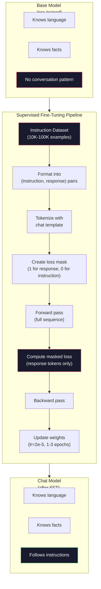

# 指令微调（SFT）

> 基础模型只会预测下一个 token。仅此而已。它不会遵循指令、回答问题，也不会拒绝有害请求。SFT 是 token 预测器与有用助手之间的桥梁。你交谈过的每一个模型——Claude、GPT、Llama Chat——都经历过这一步。

**Type:** Build
**Languages:** Python (with numpy)
**Prerequisites:** Phase 10, Lesson 04 (Pre-Training a Mini GPT)
**Time:** ~90 minutes

## 学习目标

- 实现监督微调（SFT），把基础语言模型转化为能遵循指令的助手
- 使用包含 system、user、assistant 角色的聊天模板格式化训练数据，并在非 assistant token 上屏蔽损失
- 解释 SFT 为何必要：基础模型只会续写文本，而不是回答问题
- 通过在留出指令集上比较基础模型与微调模型的回答，评估 SFT 质量

## 问题

你在第 04 课训练了一个模型。给定一个序列，它能预测下一个 token。输入 "The transformer architecture"，它可能会续写 "has revolutionized natural language processing."。对一个下一 token 预测器来说，这已经很了不起了。

现在试试这个：输入 "What is the capital of France?"。基础模型不会回答 "Paris."。它会延续模式。它可能生成 "What is the capital of Germany? What is the capital of Spain?"，因为它在包含问题列表的文档上学习过。或者它可能生成 "is a question that many people ask"，因为这是一个看似合理的下一 token 续写。模型没有*回答*的概念。它只知道*续写*。

这就是 GPT-3（基础模型，2020 年 6 月发布）与 ChatGPT（指令微调，2022 年 11 月发布）之间的差距。同样的架构，同样的预训练。区别在于 20,000 到 100,000 个精心构造的（指令，回答）对，它们教会了模型遵循对话模式。

Stanford Alpaca 证明了你不需要数百万个样本。2023 年 3 月，他们仅用 52,000 个由 GPT-3.5 生成的指令-回答对微调了 Llama 7B。总成本：600 美元。结果是一个能遵循指令、回答问题、进行对话的聊天机器人。虽然不如 ChatGPT，但以 600 美元和几个小时的训练换来这样的效果，已经惊人地接近了。

Meta 的 Llama 2 Chat 在初始 SFT 阶段只用了约 27,000 个高质量样本。关键洞见是：质量比数量更重要。由熟练标注员编写的 27,000 个样本，胜过从互联网抓取的 100 万个噪声样本。

## 概念

### SFT 实际做了什么

监督微调延续了预训练中的同一个训练循环——前向传播、计算损失、反向传播、更新权重——但使用的数据类型不同。你不再训练原始文本，而是训练结构化对话：

```json
{
  "system": "You are a helpful assistant.",
  "user": "What is the capital of France?",
  "assistant": "The capital of France is Paris."
}
```

模型已经知道巴黎是法国的首都。它在预训练期间从维基百科、教科书和网页中学到了这一点。SFT 并不教模型新的事实。它教模型一种新的*行为*：看到问题时给出回答；看到指令时给出完成；看到有害请求时给出拒绝。

可以这样理解：预训练赋予模型知识，而 SFT 赋予模型礼貌。

### 数据格式

业界主流的有三种格式。它们编码相同的信息——谁说了什么——只是使用了不同的分隔符。

**Alpaca 格式**（Stanford，2023 年 3 月）：

```json
{
  "instruction": "Summarize the following article in 3 sentences.",
  "input": "The European Central Bank raised interest rates...",
  "output": "The ECB increased rates by 25 basis points..."
}
```

简单且广泛使用。`input` 字段是可选的——许多指令不需要额外上下文。Stanford 以这种格式发布了 52,000 个样本，由 GPT-3.5 生成，花费 600 美元。这开启了开源指令微调运动。

**ShareGPT 格式**（社区，2023 年）：

```json
{
  "conversations": [
    {"from": "system", "value": "You are a helpful assistant."},
    {"from": "human", "value": "What causes tides?"},
    {"from": "gpt", "value": "Tides are caused by the gravitational pull of the Moon..."},
    {"from": "human", "value": "How often do they occur?"},
    {"from": "gpt", "value": "Most coastal areas experience two high tides and two low tides per day..."}
  ]
}
```

支持多轮对话。"from" 字段按惯例使用 "human" 和 "gpt"，与实际使用的模型无关。Vicuna 在 70,000 段从用户分享的 ChatGPT 对话记录中抓取的 ShareGPT 对话上训练。

**ChatML 格式**（OpenAI，被许多开源模型采用）：

```
<|im_start|>system
You are a helpful assistant.<|im_end|>
<|im_start|>user
What is the capital of France?<|im_end|>
<|im_start|>assistant
The capital of France is Paris.<|im_end|>
```

使用特殊 token（`<|im_start|>`、`<|im_end|>`）来界定角色。这些 token 在微调期间被加入 tokenizer 的词表。Qwen、Yi 以及许多其他模型使用 ChatML。

三种格式完成的是同一件事：它们告诉模型「这是指令，这是回答，学会这个模式」。

### 为什么有效

模型通过预训练已经掌握了语言。它见过数十亿个问题后跟回答、指令后跟完成、人与人对话的例子。这些模式已经编码在权重中。

SFT 把这种潜在能力集中起来。模型原本需要从上下文中自行判断应该回答问题还是续写文档，而 SFT 显式地在对话模式上训练。经过几千个样本后，模型学会了：看到 assistant 角色标记时，生成有用的回答。

这就是 27,000 个样本足够的原因。你并不在教模型英语，也不在教它世界知识。你只教它一个简单的行为：响应指令。知识早已在那里。

### 掩码损失

这是 SFT 中最重要的技术细节，而大多数教程都跳过了它。

预训练时，你对每个 token 计算损失。模型学习预测序列中的每一个下一 token。SFT 时，你只对*回答* token 计算损失。指令 token 仅作为上下文存在，模型不会因「预测」它们不准确而受到惩罚。

为什么？因为你不希望模型学会*生成*指令，你希望它学会*回应*指令。如果对指令 token 计算损失，你就是在训练模型把 "What is the capital of France?" 当作自己在提问来预测。这会浪费梯度信号，还可能让模型对自己的角色感到困惑。

实践中，你创建一个损失掩码：回答 token 为 1，指令 token 为 0。在取平均之前，把逐 token 损失乘以这个掩码。

```
Tokens:    [SYS] You are helpful [USER] What is the capital? [ASST] Paris is the capital [EOS]
Loss mask:   0    0    0     0      0     0   0  0     0       1     1    1   1     1      1
```

只有 `[ASST]` 之后的 token 对损失有贡献。模型在前向传播时看到完整对话（它需要指令才能生成正确的回答），但只根据它对回答的预测好坏来更新权重。

### 训练超参数

SFT 使用的超参数与预训练截然不同。你不是从头训练，而是在调整一个已经能工作的模型。

| 参数 | 预训练（Llama 2 7B） | SFT（Llama 2 Chat） |
|-----------|---------------------------|---------------------|
| 学习率 | 3e-4（峰值） | 2e-5 |
| Epoch 数 | 1（对数据单遍） | 2 |
| Batch size | 4M token | 64 个样本 |
| Warmup 步数 | 2,000 | 0-100 |
| Weight decay | 0.1 | 0.0-0.1 |
| 数据规模 | 2T token | 27,000 个样本 |

学习率在 SFT 中低 15 倍。这一点至关重要。微调时使用高学习率会破坏预训练知识。模型「遗忘」了已学到的东西，并过拟合到很小的微调数据集上。这就是灾难性遗忘。

两个 epoch 意味着模型把每个训练样本看两次。在小数据集上训练超过 3 个 epoch 会导致记忆化——模型开始逐字复现训练样本，而不是泛化。

### 灾难性遗忘

微调可能摧毁通用能力。在指令遵循数据上训练太久，模型会失去写代码、做数学或创作文本的能力。它会非常擅长训练数据中的特定格式，却在其他一切上表现糟糕。

三种缓解措施：

1. **低学习率。** 1e-5 到 5e-5。更小的更新意味着对预训练特征的破坏更少。

2. **短训练。** 1-3 个 epoch。在模型过拟合之前停下。

3. **混入预训练数据。** Llama 2 Chat 在 SFT 数据集中混入了少量（2-5%）原始预训练数据。这在学习新的指令遵循行为的同时，「提醒」模型它原有的通用能力。

### 真实数字

在单张 NVIDIA A100 80GB GPU 上，用 10,000 个高质量指令对微调 7B 模型大约需要 1 小时。计算如下：

- 10,000 个样本 × 平均 512 token = 5.12M token
- 2 个 epoch = 总计 10.24M token
- 7B 模型微调的 A100 吞吐量：约 3,000 token/秒
- 10.24M / 3,000 ≈ 3,400 秒 ≈ 57 分钟

对于我们的 mini GPT（4 层，128 维），训练几乎瞬间完成。重点在于理解机制，而不是规模。



```figure
loss-masking
```

## 构建它

### 步骤 1：指令数据集

创建一个合成指令数据集。在生产环境中，Scale AI 和 Anthropic 这样的公司会雇佣人类标注员来编写这些数据。我们将以编程方式生成它们，以演示格式。

```python
import numpy as np

INSTRUCTION_DATA = [
    {
        "instruction": "What is the capital of France?",
        "response": "The capital of France is Paris."
    },
    {
        "instruction": "Explain gravity in one sentence.",
        "response": "Gravity is the force that attracts objects with mass toward each other."
    },
    {
        "instruction": "Write a haiku about the ocean.",
        "response": "Waves crash on the shore, salt and foam beneath the sun, endless blue expanse."
    },
    {
        "instruction": "What is 15 multiplied by 7?",
        "response": "15 multiplied by 7 is 105."
    },
    {
        "instruction": "Name three programming languages.",
        "response": "Three programming languages are Python, Rust, and TypeScript."
    },
    {
        "instruction": "Summarize photosynthesis.",
        "response": "Photosynthesis converts sunlight, water, and carbon dioxide into glucose and oxygen."
    },
    {
        "instruction": "What year did World War II end?",
        "response": "World War II ended in 1945."
    },
    {
        "instruction": "Define machine learning.",
        "response": "Machine learning is a field where algorithms learn patterns from data to make predictions."
    },
]
```

八个样本很少。Stanford Alpaca 用了 52,000 个。但无论你有 8 个还是 52,000 个，机制完全相同：tokenize、掩码、只在回答上计算损失。

### 步骤 2：使用聊天模板进行 tokenize

把指令-回答对转换为带特殊角色标记的 token 序列。标记告诉模型指令在哪里结束、回答从哪里开始。

```python
SPECIAL_TOKENS = {
    "INST_START": 253,
    "INST_END": 254,
    "RESP_START": 255,
}


def tokenize_instruction_pair(instruction, response, vocab_size=256):
    inst_tokens = list(instruction.encode("utf-8"))
    resp_tokens = list(response.encode("utf-8"))

    inst_tokens = [min(t, vocab_size - 4) for t in inst_tokens]
    resp_tokens = [min(t, vocab_size - 4) for t in resp_tokens]

    tokens = (
        [SPECIAL_TOKENS["INST_START"]]
        + inst_tokens
        + [SPECIAL_TOKENS["INST_END"]]
        + [SPECIAL_TOKENS["RESP_START"]]
        + resp_tokens
    )

    return tokens


def create_loss_mask(tokens):
    mask = np.zeros(len(tokens), dtype=np.float32)
    in_response = False

    for i, token in enumerate(tokens):
        if token == SPECIAL_TOKENS["RESP_START"]:
            in_response = True
            continue
        if in_response:
            mask[i] = 1.0

    return mask
```

损失掩码对指令 token 全为零，对回答 token 全为一。`RESP_START` token 本身的掩码为 0，因为它是分隔符，不属于回答内容。

### 步骤 3：掩码交叉熵损失

标准交叉熵，但乘以损失掩码。只有回答 token 对梯度有贡献。

```python
def masked_cross_entropy_loss(logits, targets, loss_mask):
    batch, seq_len, vocab_size = logits.shape
    logits_flat = logits.reshape(-1, vocab_size)
    targets_flat = targets.reshape(-1)
    mask_flat = loss_mask.reshape(-1)

    max_logits = logits_flat.max(axis=-1, keepdims=True)
    log_softmax = logits_flat - max_logits - np.log(
        np.exp(logits_flat - max_logits).sum(axis=-1, keepdims=True)
    )

    per_token_loss = -log_softmax[np.arange(len(targets_flat)), targets_flat]

    masked_loss = per_token_loss * mask_flat
    num_response_tokens = mask_flat.sum()
    if num_response_tokens == 0:
        return 0.0
    loss = masked_loss.sum() / num_response_tokens

    return loss
```

分母是 `num_response_tokens`，而不是 `seq_len`。如果除以总序列长度，较长的指令会稀释梯度信号。除以回答 token 数则确保每个回答 token 权重相等，不受指令长度影响。

### 步骤 4：SFT 训练循环

复用第 04 课的 MiniGPT。训练循环看起来几乎与预训练相同，只是增加了指令格式化和掩码损失。

```python
import sys
import os
sys.path.insert(0, os.path.join(os.path.dirname(__file__), "..", "..", "04-pre-training-mini-gpt", "code"))
from main import MiniGPT, LayerNorm, FeedForward, MultiHeadAttention, TransformerBlock, Embedding


def sft_train(model, dataset, num_epochs=2, lr=2e-5, seq_len=64):
    formatted_data = []
    for example in dataset:
        tokens = tokenize_instruction_pair(example["instruction"], example["response"])
        mask = create_loss_mask(tokens)
        formatted_data.append((tokens, mask))

    print(f"SFT Training: {len(formatted_data)} examples, {num_epochs} epochs, lr={lr}")
    print(f"Total tokens: {sum(len(t) for t, _ in formatted_data):,}")
    print()

    losses = []

    for epoch in range(num_epochs):
        epoch_loss = 0.0
        num_batches = 0

        indices = np.random.permutation(len(formatted_data))

        for idx in indices:
            tokens, mask = formatted_data[idx]

            if len(tokens) < 3:
                continue
            if len(tokens) > seq_len:
                tokens = tokens[:seq_len]
                mask = mask[:seq_len]

            input_ids = np.array(tokens[:-1]).reshape(1, -1)
            target_ids = np.array(tokens[1:]).reshape(1, -1)
            loss_mask = np.array(mask[1:]).reshape(1, -1)

            logits = model.forward(input_ids)
            loss = masked_cross_entropy_loss(logits, target_ids, loss_mask)

            batch_size, s_len, v_size = logits.shape
            probs = np.exp(logits - logits.max(axis=-1, keepdims=True))
            probs = probs / probs.sum(axis=-1, keepdims=True)
            dlogits = probs.copy()
            dlogits[np.arange(batch_size)[:, None], np.arange(s_len), target_ids] -= 1.0

            mask_expanded = loss_mask[:, :, np.newaxis]
            num_resp = loss_mask.sum()
            if num_resp > 0:
                dlogits = dlogits * mask_expanded / num_resp

            for block in model.blocks:
                block.ffn.W1 -= lr * np.random.randn(*block.ffn.W1.shape) * 0.01
                block.ffn.W2 -= lr * np.random.randn(*block.ffn.W2.shape) * 0.01
                block.ffn.b1 -= lr * np.random.randn(*block.ffn.b1.shape) * 0.01
                block.ffn.b2 -= lr * np.random.randn(*block.ffn.b2.shape) * 0.01

            epoch_loss += loss
            num_batches += 1
            losses.append(loss)

        avg_loss = epoch_loss / max(num_batches, 1)
        print(f"Epoch {epoch + 1}/{num_epochs} | Avg Loss: {avg_loss:.4f}")

    return model, losses
```

学习率为 2e-5，与 Llama 2 Chat 一致。对比预训练使用的 3e-4——小了 15 倍。梯度被掩码：指令 token 产生零梯度，只有回答 token 推动权重。

### 步骤 5：比较基础模型与 SFT 模型

SFT 的全部意义在于行为改变。让我们通过检查模型如何响应指令格式输入和原始文本续写来衡量这一点。

```python
def generate_response(model, prompt_tokens, max_new_tokens=50, temperature=0.8):
    tokens = list(prompt_tokens)
    seq_len = model.embedding.pos_embed.shape[0]

    for _ in range(max_new_tokens):
        context = np.array(tokens[-seq_len:]).reshape(1, -1)
        logits = model.forward(context)
        next_logits = logits[0, -1, :]

        next_logits = next_logits / max(temperature, 1e-8)
        probs = np.exp(next_logits - next_logits.max())
        probs = probs / probs.sum()
        probs = np.clip(probs, 1e-10, 1.0)
        probs = probs / probs.sum()

        next_token = np.random.choice(len(probs), p=probs)
        tokens.append(int(next_token))

    return tokens


def evaluate_instruction_following(model, instructions):
    print("Evaluating instruction following:")
    print("-" * 50)

    for instruction in instructions:
        tokens = (
            [SPECIAL_TOKENS["INST_START"]]
            + [min(t, 252) for t in list(instruction.encode("utf-8"))]
            + [SPECIAL_TOKENS["INST_END"]]
            + [SPECIAL_TOKENS["RESP_START"]]
        )

        output = generate_response(model, tokens, max_new_tokens=30, temperature=0.6)
        response_start = len(tokens)
        response_tokens = output[response_start:]
        response_bytes = bytes([t for t in response_tokens if t < 128])
        response_text = response_bytes.decode("utf-8", errors="replace")

        print(f"  Q: {instruction}")
        print(f"  A: {response_text[:80]}")
        print()
```

在只有 8 个样本的微型模型上，回答不会有什么意义。这是意料之中的。重要的是*结构*：模型学会了在回答标记之后生成输出，而不是继续生成更多指令。

### 步骤 6：衡量灾难性遗忘

比较 SFT 前后模型的下一 token 预测能力。如果 SFT 损害了通用能力，原始文本上的损失会上升。

```python
def measure_forgetting(model, test_text, seq_len=64):
    tokens = np.array(list(test_text.encode("utf-8")[:512]))

    total_loss = 0.0
    num_windows = 0

    for start in range(0, len(tokens) - seq_len - 1, seq_len):
        input_ids = tokens[start:start + seq_len].reshape(1, -1)
        target_ids = tokens[start + 1:start + seq_len + 1].reshape(1, -1)

        logits = model.forward(input_ids)

        batch, s_len, vocab_size = logits.shape
        logits_flat = logits.reshape(-1, vocab_size)
        targets_flat = target_ids.reshape(-1)

        max_logits = logits_flat.max(axis=-1, keepdims=True)
        log_softmax = logits_flat - max_logits - np.log(
            np.exp(logits_flat - max_logits).sum(axis=-1, keepdims=True)
        )

        loss = -log_softmax[np.arange(len(targets_flat)), targets_flat].mean()
        total_loss += loss
        num_windows += 1

    return total_loss / max(num_windows, 1)
```

在真实微调中，你会在整个训练过程中跟踪这个指标。如果原始文本损失增加超过 10-15%，说明你的 SFT 过于激进。降低学习率或减少 epoch 数。

## 使用它

### 完整的 SFT 流水线演示

```python
if __name__ == "__main__":
    np.random.seed(42)

    test_text = """The transformer architecture processes sequences through self-attention.
Each layer applies multi-head attention followed by a feedforward network.
Residual connections and layer normalization stabilize deep networks.
The model learns to predict the next token given all previous tokens."""

    print("=" * 70)
    print("INSTRUCTION TUNING (SFT) DEMO")
    print("=" * 70)
    print()

    model = MiniGPT(
        vocab_size=256, embed_dim=128, num_heads=4,
        num_layers=4, max_seq_len=128, ff_dim=512
    )
    print(f"Model: {model.count_parameters():,} parameters")
    print(f"Config: 4 layers, 4 heads, 128 dims (mini GPT from Lesson 04)")
    print()

    print("PRE-SFT: Measuring base model loss on raw text")
    base_loss = measure_forgetting(model, test_text)
    print(f"  Base model loss: {base_loss:.4f}")
    print()

    print("=" * 70)
    print("SFT TRAINING")
    print("=" * 70)

    model, losses = sft_train(
        model, INSTRUCTION_DATA, num_epochs=3, lr=2e-5, seq_len=128
    )

    print()
    print("POST-SFT: Measuring fine-tuned model loss on raw text")
    sft_loss = measure_forgetting(model, test_text)
    print(f"  SFT model loss: {sft_loss:.4f}")
    print(f"  Change: {((sft_loss - base_loss) / base_loss * 100):+.1f}%")
    if abs(sft_loss - base_loss) / base_loss < 0.15:
        print("  Minimal forgetting (< 15% change)")
    else:
        print("  Significant forgetting detected")
    print()

    print("=" * 70)
    print("INSTRUCTION FOLLOWING EVALUATION")
    print("=" * 70)
    print()

    test_instructions = [
        "What is the capital of France?",
        "Name a programming language.",
        "Define gravity.",
    ]
    evaluate_instruction_following(model, test_instructions)

    print("=" * 70)
    print("DATA FORMAT EXAMPLES")
    print("=" * 70)
    print()

    for i, example in enumerate(INSTRUCTION_DATA[:3]):
        tokens = tokenize_instruction_pair(example["instruction"], example["response"])
        mask = create_loss_mask(tokens)
        resp_count = int(mask.sum())
        total_count = len(tokens)
        print(f"  Example {i + 1}: {total_count} tokens, {resp_count} response tokens ({resp_count/total_count:.0%} of sequence)")
        print(f"    Instruction: {example['instruction']}")
        print(f"    Response: {example['response']}")
        print()

    print("=" * 70)
    print("TRAINING LOSS CURVE")
    print("=" * 70)
    print()

    if losses:
        window = max(1, len(losses) // 5)
        for i in range(0, len(losses), window):
            chunk = losses[i:i + window]
            avg = sum(chunk) / len(chunk)
            print(f"  Steps {i:3d}-{i + len(chunk) - 1:3d}: avg loss = {avg:.4f}")
```

## 交付它

本课产出 `outputs/prompt-sft-data-curator.md`——一个帮助你设计和整理 SFT 指令数据集的 prompt。给定目标能力（代码生成、数学、对话），它会生成一份数据收集计划，包含格式规范、质量标准和多样性要求。

## 练习

1. 添加 system prompt 支持。修改 `tokenize_instruction_pair`，让它接受 system 消息并将其前置到指令之前。创建 5 个使用不同 system prompt 的样本（"You are a poet"、"You are a math tutor"），并验证模型在训练期间能看到不同的 system prompt。

2. 实现数据混合。编写一个函数，接受 SFT 数据集和原始文本语料，生成训练批次，其中 5% 的样本是原始文本（不掩码），95% 是指令对（掩码）。运行 3 个 epoch，比较遗忘指标与纯 SFT 训练的差异。

3. 构建数据质量评分器。对每个指令-回答对计算：(a) 回答的 token 长度，(b) 指令与回答的比例，(c) 词汇多样性（唯一 token / 总 token）。过滤掉回答长度 < 10 token 或多样性 < 0.3 的样本。展示过滤如何影响最终损失。

4. 实现多轮对话训练。扩展 tokenization 以处理 3 轮对话（user-assistant-user-assistant-user-assistant）。损失掩码应覆盖全部三个 assistant 轮次。为一个样本打印 token-掩码对齐情况，验证掩码正确。

5. 比较学习率。用 lr=1e-4、lr=2e-5 和 lr=1e-6 分别训练同一个模型三次。绘制损失曲线。1e-4 那一组应在初期快速下降，但最终损失更高（过拟合）。1e-6 那一组几乎不动。2e-5 应是甜点区。

## 关键术语

| 术语 | 大家怎么说 | 实际含义 |
|------|----------------|----------------------|
| SFT | 「在对话上微调」 | Supervised Fine-Tuning（监督微调）：在（指令，回答）对上继续训练，且只在回答 token 上计算损失 |
| Instruction tuning | 「教模型遵循指令」 | 在显式的指令-回答对上训练，让基础模型学会对话模式，而不是新知识 |
| Loss masking | 「忽略 prompt」 | 将指令 token 的损失设为零，使梯度只从回答 token 的预测中流动 |
| ChatML | 「Chat Markup Language」 | 一种使用 `<\|im_start\|>` 和 `<\|im_end\|>` 分隔符在对话数据中标记说话者角色的 token 格式 |
| Alpaca format | 「Stanford 的格式」 | 一个含 instruction/input/output 字段的 JSON 格式，用于 52K 个由 GPT-3.5 生成、花费 600 美元的样本 |
| Catastrophic forgetting | 「模型变笨了」 | 微调破坏了预训练能力，因为梯度更新用任务特定的模式覆盖了通用知识 |
| Weight tying | 「共享 embedding」 | 输入 token embedding 与输出预测头使用同一矩阵，节省参数并提升连贯性 |
| Chat template | 「你如何格式化 prompt」 | 为模型组织对话的特定 token 序列（角色标记、分隔符） |

## 延伸阅读

- [Ouyang et al., 2022 -- "Training language models to follow instructions with human feedback" (InstructGPT)](https://arxiv.org/abs/2203.02155) —— 在 OpenAI 引入指令微调 + RLHF 的论文
- [Taori et al., 2023 -- "Stanford Alpaca: An Instruction-following LLaMA Model"](https://github.com/tatsu-lab/stanford_alpaca) —— 用 600 美元和 52K 个指令样本证明 SFT 在小数据集上可行
- [Touvron et al., 2023 -- "Llama 2: Open Foundation and Fine-Tuned Chat Models"](https://arxiv.org/abs/2307.09288) —— Meta 的 SFT + RLHF 流水线，使用 27K 个高质量样本
- [Chiang et al., 2023 -- "Vicuna: An Open-Source Chatbot Impressing GPT-4"](https://lmsys.org/blog/2023-03-30-vicuna/) —— 在 70K 段 ShareGPT 对话上训练
- [Zhou et al., 2023 -- "LIMA: Less Is More for Alignment"](https://arxiv.org/abs/2305.11206) —— 证明 1,000 个精心挑选的样本可以匹敌在更大数据集上做的 SFT
