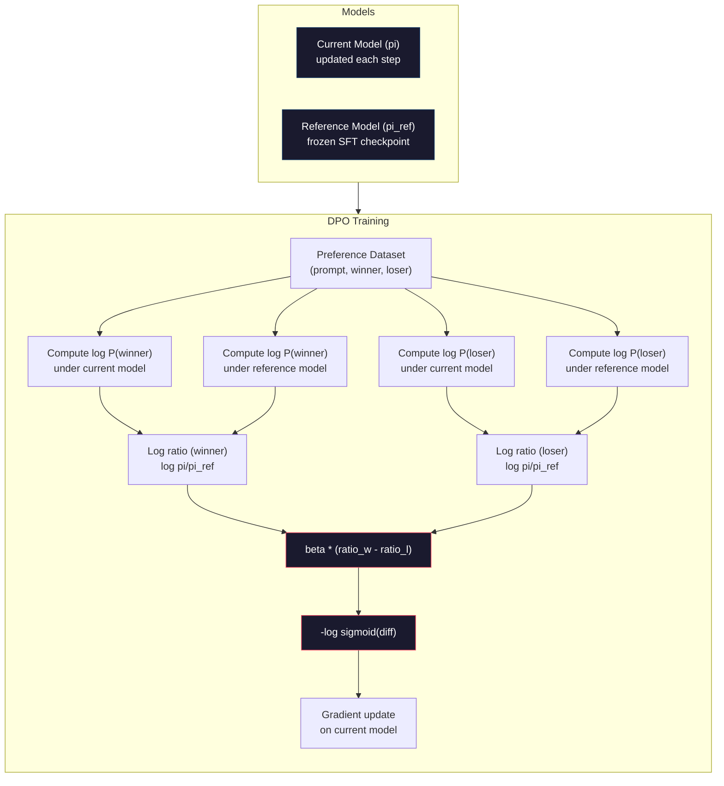

# DPO：直接偏好优化（Direct Preference Optimization）

> RLHF 可行。但它需要训练三个模型（SFT、奖励模型、策略模型），要处理 PPO 的不稳定性，还要调节 KL 惩罚系数。DPO 提出了一个问题：如果能跳过这一切呢？DPO 直接在你的偏好对上优化语言模型。不需要奖励模型。不需要 PPO。只有一个训练循环。同样的效果。

**Type:** Build
**Languages:** Python (with numpy)
**Prerequisites:** Phase 10, Lesson 07 (RLHF)
**Time:** ~90 minutes

## 学习目标

- 实现 DPO 训练，直接在偏好对上优化语言模型，无需单独的奖励模型
- 推导 DPO 损失函数，并解释它如何通过策略模型的对数概率隐式地表示一个奖励模型
- 从训练稳定性、计算成本和所需模型数量三个方面比较 DPO 与 RLHF
- 调节 beta 参数，控制训练后的策略偏离参考模型的程度

## 问题

你在第 07 课搭建了一个 RLHF pipeline。三个阶段。三个模型：SFT 模型、奖励模型，以及用 PPO 优化的策略模型。仅奖励模型就需要数千个人类偏好对和一个单独的训练循环。PPO 则需要仔细调节 KL 系数、学习率、裁剪比例和 epoch 数。

在实践中，PPO 训练以极不稳定著称。超参数稍有变化就可能导致训练发散。奖励模型只是人类偏好的不完美代理，而策略模型总能找到利用其弱点的方法。KL 惩罚有帮助，但它本身也需要调参——太低会引发奖励作弊（reward hacking），太高则模型几乎学不到东西。

正是这种复杂性，使得 InstructGPT 发表后数年里，大多数开源模型都难以用好 RLHF。三阶段 pipeline 很脆弱。每个阶段都有自己的失效模式，而误差会逐级累积。

2023 年 5 月，斯坦福大学的 Rafael Rafailov、Archit Sharma 及其同事发表了《Direct Preference Optimization: Your Language Model is Secretly a Reward Model》。核心洞见是：你不需要单独的奖励模型。最优奖励函数在数学上由语言模型自身的 token 概率决定。你完全可以跳过奖励模型，直接基于偏好对优化语言模型。

DPO 把 RLHF 简化为一步监督学习。一个模型。一个损失函数。一个训练循环。没有强化学习。Zephyr-7B 是首批大规模使用 DPO 的模型之一，在多项基准上追平甚至超过了用完整 RLHF 训练的模型。Meta 将 DPO 用作 Llama 3 对齐 pipeline 的一部分。Anthropic 也在其对齐研究中引用过 DPO 风格的方法。

## 概念

### 核心洞见

RLHF 优化的目标如下：

```math
\text{maximize:} \quad \mathbb{E}[R(x, y)] - \beta \cdot \mathrm{KL}(\pi \,\|\, \pi_{\text{ref}})
```

其中 $R$ 是奖励模型，$\pi$ 是策略，$\pi_{\text{ref}}$ 是参考模型，$\beta$ 是 KL 系数。

DPO 论文表明，这个目标存在闭式最优解。对任意奖励函数 $R$，最优策略为：

```math
\pi^*(y \mid x) = \pi_{\text{ref}}(y \mid x) \cdot \exp(R(x, y) / \beta) / Z(x)
```

其中 $Z(x)$ 是归一化常数。重新整理可得：

```math
R(x, y) = \beta \log \frac{\pi^*(y \mid x)}{\pi_{\text{ref}}(y \mid x)} + \beta \log Z(x)
```

这就是突破口。奖励完全可以用策略模型的概率和参考模型的概率来表达。你无需训练单独的奖励模型。奖励*隐式*地存在于概率比值之中。

把它代入 Bradley-Terry 偏好模型：

```math
\begin{aligned}
P(y_w > y_l \mid x) &= \mathop{\mathrm{sigmoid}}(R(x, y_w) - R(x, y_l)) \\
&= \mathop{\mathrm{sigmoid}}\left(\beta \left(\log \frac{\pi(y_w \mid x)}{\pi_{\text{ref}}(y_w \mid x)} - \log \frac{\pi(y_l \mid x)}{\pi_{\text{ref}}(y_l \mid x)}\right)\right)
\end{aligned}
```

$Z(x)$ 项相互抵消，因为两个回复都以同一个 prompt $x$ 为条件。剩下的只是策略模型和参考模型在偏好回复与被拒回复上的对数概率函数。

### DPO 损失

```math
L_{\text{DPO}} = -\log \mathop{\mathrm{sigmoid}}\left(\beta \left(\log \frac{\pi(y_w \mid x)}{\pi_{\text{ref}}(y_w \mid x)} - \log \frac{\pi(y_l \mid x)}{\pi_{\text{ref}}(y_l \mid x)}\right)\right)
```

逐项拆解：

- **$y_w$** = 偏好的（胜出）回复
- **$y_l$** = 被拒的（失败）回复
- **$x$** = prompt
- **$\pi$** = 当前模型（正在训练）
- **$\pi_{\text{ref}}$** = 参考模型（冻结的 SFT checkpoint）
- **$\beta$** = 温度参数，控制偏离参考模型的程度（通常为 0.1 到 0.5）

比值 `log pi(y|x) / pi_ref(y|x)` 是对数概率比。当该比值为正时，当前模型给回复 $y$ 的概率高于参考模型；为负时则低于参考模型。

DPO 损失推动模型提高偏好回复的对数概率比，同时降低被拒回复的对数概率比。beta 参数控制模型偏离参考模型的激进程度——beta 小允许较大偏离，beta 大则让模型贴近参考模型。



### 为什么 DPO 更简单

| 方面 | RLHF（PPO） | DPO |
|--------|-----------|-----|
| 需要训练的模型 | 3 个（SFT + 奖励模型 + 策略模型） | 1 个（仅策略模型） |
| 训练循环 | 3 个（SFT、奖励模型训练、PPO） | 2 个（SFT、DPO） |
| 超参数 | lr、KL 系数、裁剪比例、奖励模型 lr、epoch 数 x3 | lr、beta、epoch 数 |
| 奖励模型 | 必需（单独训练） | 隐式存在于模型概率中 |
| RL 算法 | PPO（复杂、不稳定） | 监督学习（稳定） |
| GPU 显存 | PPO 期间需在显存中保留 3-4 个模型 | 2 个模型（当前模型 + 参考模型） |
| 训练稳定性 | 对超参数敏感 | 稳健，与 SFT 相近 |

DPO 在训练期间只需在显存中保留两个模型——当前模型和冻结的参考模型。RLHF 则需要三到四个：策略、参考、奖励模型，以及可选的价值函数基线。对于 70B 模型，每份副本在 FP16 下占用 140GB。去掉奖励模型带来的显存节省相当可观。

### 何时 DPO 优于 RLHF

**小数据集。** 在 5,000 到 20,000 个偏好对下，DPO 往往能追平甚至超过 RLHF。RLHF 中的奖励模型需要足够的数据才能泛化——数据有限时它会过拟合，产生不可靠的奖励信号。DPO 完全不需要奖励模型，因此绕开了这个问题。

**计算资源有限。** DPO 所需的算力约为完整 RLHF 的三分之一（一个训练循环而非三个）。对于没有大型 GPU 集群的团队，这是更实际的选择。

**快速迭代。** 想试 10 个不同的偏好数据集，看看哪个能产出最好的模型？DPO 让你能在几小时内跑完每个实验。RLHF 则要为每个数据集重新训练奖励模型。

### 何时 RLHF 优于 DPO

**大规模训练。** 在 GPT-4 或 Claude 这样的规模上，RLHF 的独立奖励模型能捕捉更细微的偏好信号。奖励模型相当于一个学到的损失函数，能适应复杂的质量准则。

**复杂的奖励信号。** 当「更好」涉及多个维度（有用性、无害性、诚实性）时，奖励模型可以学到这种多目标权衡。DPO 把每个偏好对当作二元信号处理——一个更好、一个更差——并不建模其中的原因。

**迭代式对齐。** RLHF pipeline 可以用当前策略生成新回复，让人类打分，再在在线循环中重新训练奖励模型。DPO 则工作在固定的偏好对数据集上。宪法式 AI（Anthropic 的方法）大量利用了 RLHF 的这种迭代特性。

### DPO 之后：KTO、ORPO、SimPO

DPO 启发了一系列简化的对齐方法。

**KTO（Kahneman-Tversky Optimization，2024）：** 你甚至不需要成对数据。KTO 使用非成对反馈——只需把每个回复标注为「好」或「坏」，无需与另一个回复比较。这极大简化了数据收集。不用再给标注员看两个回复问「哪个更好？」，而是给一个回复问「这个好吗？」损失函数引入了前景理论中的损失厌恶：坏回复被惩罚的力度大于好回复被奖励的力度。

**ORPO（Odds Ratio Preference Optimization，2024）：** 把 SFT 和对齐合并为单个训练步骤。ORPO 不先做 SFT 再做 DPO，而是修改 SFT 损失以包含偏好信号。损失有两项：偏好回复上的标准下一 token 预测损失，加上一个比值比（odds ratio）项，用来拉大偏好回复与被拒回复概率之间的差距。两个训练循环合并为一个。

**SimPO（Simple Preference Optimization，2024）：** 彻底去掉参考模型。SimPO 不再针对冻结的参考模型计算对数概率比，而是用回复的平均对数概率（按长度归一化）作为隐式奖励。这节省了显存（无需参考模型），也简化了训练。长度归一化可以防止模型偏爱更短的回复。

| 方法 | 年份 | 显存中的模型数 | 需要成对数据？ | 需要参考模型？ | 训练循环数 |
|--------|------|-----------------|-------------|-----------------|----------------|
| RLHF | 2022 | 3-4 | 是（用于奖励模型） | 是 | 3 |
| DPO | 2023 | 2 | 是 | 是 | 2 |
| KTO | 2024 | 2 | 否（非成对） | 是 | 2 |
| ORPO | 2024 | 1 | 是 | 否 | 1 |
| SimPO | 2024 | 1 | 是 | 否 | 1 |

趋势很明确：每个方法都再去掉一块复杂性。RLHF 需要奖励模型和 PPO。DPO 把两者都去掉了。KTO 去掉了成对数据。ORPO 去掉了单独的 SFT 阶段。SimPO 去掉了参考模型。对齐税（alignment tax）——从基础模型走到对齐模型所需的算力和复杂度成本——持续下降。

### 真实的 DPO 部署

**Zephyr-7B（HuggingFace，2023 年 10 月）：** 以 Mistral 7B 为基础，在 UltraChat（20 万条样本）上做 SFT，然后在 UltraFeedback（6 万个偏好对）上做 DPO。MT-Bench 得分 6.47——当时 7B 模型中的最高分。作为对比，Llama 2 Chat 70B 得分 6.86，也就是说 Zephyr 只用 DPO 对齐，就达到了 10 倍参数量模型 6% 以内的水平。

**Llama 3（Meta，2024 年 4 月）：** 在初始 RLHF 阶段之后使用了 DPO。这种组合说明 DPO 与 RLHF 可以互补——RLHF 负责广泛对齐，DPO 负责定向精修。

**Neural Magic / nm-chat（2024）：** 将 DPO 应用于多个开源模型，在对齐基准上相比仅做 SFT 的基线稳定提升 5-15%。

```figure
dpo-loss
```

## 构建它

### 第 1 步：偏好数据集

格式与 RLHF 相同——（prompt, preferred, rejected）三元组。DPO 直接消费这些数据，无需中间的奖励模型。

```python
import numpy as np
import sys
import os
sys.path.insert(0, os.path.join(os.path.dirname(__file__), "..", "..", "04-pre-training-mini-gpt", "code"))
from main import MiniGPT, LayerNorm, Embedding, TransformerBlock

PREFERENCE_DATA = [
    {
        "prompt": "What is the capital of France?",
        "preferred": "The capital of France is Paris.",
        "rejected": "France is a country in Europe. It has many cities. The capital is Paris. Paris is known for the Eiffel Tower.",
    },
    {
        "prompt": "Explain gravity in one sentence.",
        "preferred": "Gravity is the force that attracts objects with mass toward each other.",
        "rejected": "Gravity is something that makes things fall down when you drop them.",
    },
    {
        "prompt": "What is 15 times 7?",
        "preferred": "15 times 7 is 105.",
        "rejected": "Let me think about this. 15 times 7. Well, 10 times 7 is 70, and 5 times 7 is 35, so the answer might be around 105.",
    },
    {
        "prompt": "Name three programming languages.",
        "preferred": "Python, Rust, and TypeScript.",
        "rejected": "There are many programming languages. Some popular ones include various languages like Python and others.",
    },
    {
        "prompt": "What year did World War II end?",
        "preferred": "World War II ended in 1945.",
        "rejected": "World War II was a major global conflict. It involved many countries. The war ended in the mid-1940s, specifically in 1945.",
    },
    {
        "prompt": "Define machine learning.",
        "preferred": "Machine learning is a field where algorithms learn patterns from data to make predictions without being explicitly programmed.",
        "rejected": "Machine learning is a type of AI. AI stands for artificial intelligence. Machine learning uses data to learn.",
    },
]
```

### 第 2 步：序列对数概率

DPO 损失需要计算回复在给定 prompt 下的总对数概率。这意味着要在完整的（prompt + response）序列上运行模型，并对每个回复 token 的对数概率求和。

```python
def tokenize_sequence(text, vocab_size=256):
    return [min(t, vocab_size - 1) for t in list(text.encode("utf-8"))]


def compute_sequence_log_prob(model, prompt_tokens, response_tokens, max_seq_len=128):
    full_sequence = prompt_tokens + response_tokens
    if len(full_sequence) > max_seq_len:
        full_sequence = full_sequence[:max_seq_len]

    if len(full_sequence) < 2:
        return 0.0

    input_ids = np.array(full_sequence[:-1]).reshape(1, -1)
    target_ids = np.array(full_sequence[1:])

    logits = model.forward(input_ids)
    logits = logits[0]

    max_logits = logits.max(axis=-1, keepdims=True)
    log_probs = logits - max_logits - np.log(
        np.exp(logits - max_logits).sum(axis=-1, keepdims=True)
    )

    prompt_len = len(prompt_tokens)
    response_start = max(0, prompt_len - 1)
    response_end = len(target_ids)

    if response_start >= response_end:
        return 0.0

    response_log_probs = log_probs[response_start:response_end, :]
    response_targets = target_ids[response_start:response_end]

    total_log_prob = 0.0
    for i, target in enumerate(response_targets):
        total_log_prob += response_log_probs[i, target]

    return total_log_prob
```

这个函数是 DPO 的主力。对每个偏好对，它要运行四次：当前模型处理偏好回复、当前模型处理被拒回复、参考模型处理偏好回复、参考模型处理被拒回复。每个训练样本 4 次前向传播，而 RLHF 需要生成 + 奖励打分 + 价值估计 + PPO 更新。更简单、更快、更稳定。

### 第 3 步：DPO 损失

论文核心的代码化。一个函数。一个损失。没有奖励模型。

```python
def sigmoid(x):
    return np.where(
        x >= 0,
        1.0 / (1.0 + np.exp(-x)),
        np.exp(x) / (1.0 + np.exp(x))
    )


def dpo_loss(policy_logprob_preferred, policy_logprob_rejected,
             ref_logprob_preferred, ref_logprob_rejected, beta=0.1):
    preferred_ratio = policy_logprob_preferred - ref_logprob_preferred
    rejected_ratio = policy_logprob_rejected - ref_logprob_rejected

    logit = beta * (preferred_ratio - rejected_ratio)

    loss = -np.log(sigmoid(logit) + 1e-8)

    preferred_reward = beta * preferred_ratio
    rejected_reward = beta * rejected_ratio

    return loss, {
        "preferred_ratio": float(preferred_ratio),
        "rejected_ratio": float(rejected_ratio),
        "logit": float(logit),
        "implicit_preferred_reward": float(preferred_reward),
        "implicit_rejected_reward": float(rejected_reward),
        "reward_margin": float(preferred_reward - rejected_reward),
    }
```

`preferred_ratio` 和 `rejected_ratio` 就是 DPO 推导中的对数概率比。当当前模型（相对于参考模型）给偏好回复更高的概率、给被拒回复更低的概率时，logit 为正，损失很低。训练信号正是把模型推向这个方向。

`implicit_preferred_reward` 和 `implicit_rejected_reward` 是 DPO 损失隐式赋予的奖励。你可以把它们提取出来验证训练是否在起效——偏好与被拒奖励之间的差距应该随训练增大。

### 第 4 步：DPO 训练循环

一个标准的监督训练循环。没有 PPO。没有奖励模型。只有前向传播和梯度更新。

```python
def copy_model_weights(source, target):
    target.embedding.token_embed = source.embedding.token_embed.copy()
    target.embedding.pos_embed = source.embedding.pos_embed.copy()
    target.ln_f.gamma = source.ln_f.gamma.copy()
    target.ln_f.beta = source.ln_f.beta.copy()
    for s_block, t_block in zip(source.blocks, target.blocks):
        t_block.attn.W_q = s_block.attn.W_q.copy()
        t_block.attn.W_k = s_block.attn.W_k.copy()
        t_block.attn.W_v = s_block.attn.W_v.copy()
        t_block.attn.W_out = s_block.attn.W_out.copy()
        t_block.ffn.W1 = s_block.ffn.W1.copy()
        t_block.ffn.W2 = s_block.ffn.W2.copy()
        t_block.ffn.b1 = s_block.ffn.b1.copy()
        t_block.ffn.b2 = s_block.ffn.b2.copy()
        t_block.ln1.gamma = s_block.ln1.gamma.copy()
        t_block.ln1.beta = s_block.ln1.beta.copy()
        t_block.ln2.gamma = s_block.ln2.gamma.copy()
        t_block.ln2.beta = s_block.ln2.beta.copy()


def dpo_train(policy_model, reference_model, preference_data,
              num_epochs=5, lr=5e-6, beta=0.1, max_seq_len=128):
    print(f"DPO Training: {len(preference_data)} pairs, {num_epochs} epochs, "
          f"lr={lr}, beta={beta}")
    print()

    losses = []
    margins = []

    for epoch in range(num_epochs):
        epoch_loss = 0.0
        epoch_margin = 0.0
        num_examples = 0

        indices = np.random.permutation(len(preference_data))

        for idx in indices:
            pair = preference_data[idx]

            prompt_tokens = tokenize_sequence(pair["prompt"])
            preferred_tokens = tokenize_sequence(pair["preferred"])
            rejected_tokens = tokenize_sequence(pair["rejected"])

            pi_logprob_w = compute_sequence_log_prob(
                policy_model, prompt_tokens, preferred_tokens, max_seq_len
            )
            pi_logprob_l = compute_sequence_log_prob(
                policy_model, prompt_tokens, rejected_tokens, max_seq_len
            )
            ref_logprob_w = compute_sequence_log_prob(
                reference_model, prompt_tokens, preferred_tokens, max_seq_len
            )
            ref_logprob_l = compute_sequence_log_prob(
                reference_model, prompt_tokens, rejected_tokens, max_seq_len
            )

            loss, metrics = dpo_loss(
                pi_logprob_w, pi_logprob_l,
                ref_logprob_w, ref_logprob_l, beta
            )

            update_direction = 1.0 if metrics["logit"] < 0 else -0.1
            for block in policy_model.blocks:
                block.ffn.W1 += lr * update_direction * np.random.randn(*block.ffn.W1.shape) * 0.01
                block.ffn.W2 += lr * update_direction * np.random.randn(*block.ffn.W2.shape) * 0.01

            epoch_loss += loss
            epoch_margin += metrics["reward_margin"]
            num_examples += 1
            losses.append(float(loss))
            margins.append(metrics["reward_margin"])

        avg_loss = epoch_loss / max(num_examples, 1)
        avg_margin = epoch_margin / max(num_examples, 1)

        print(f"  Epoch {epoch + 1}/{num_epochs} | Loss: {avg_loss:.4f} | "
              f"Avg Margin: {avg_margin:.4f}")

    return policy_model, losses, margins
```

与 RLHF 相比，这个训练循环简单得令人耳目一新。对每个偏好对：计算四个对数概率（两个模型、两个回复），代入 DPO 损失，计算梯度，更新策略。没有生成步骤。没有奖励模型推理。没有优势估计。没有裁剪。

### 第 5 步：比较 DPO 与 RLHF

测量隐式奖励差距和对数概率变化，将 DPO 与第 07 课的 RLHF 模型进行对比。

```python
def evaluate_preference_accuracy(model, reference_model, preference_data, beta=0.1, max_seq_len=128):
    correct = 0
    total = 0

    for pair in preference_data:
        prompt_tokens = tokenize_sequence(pair["prompt"])
        preferred_tokens = tokenize_sequence(pair["preferred"])
        rejected_tokens = tokenize_sequence(pair["rejected"])

        pi_w = compute_sequence_log_prob(model, prompt_tokens, preferred_tokens, max_seq_len)
        pi_l = compute_sequence_log_prob(model, prompt_tokens, rejected_tokens, max_seq_len)
        ref_w = compute_sequence_log_prob(reference_model, prompt_tokens, preferred_tokens, max_seq_len)
        ref_l = compute_sequence_log_prob(reference_model, prompt_tokens, rejected_tokens, max_seq_len)

        preferred_reward = beta * (pi_w - ref_w)
        rejected_reward = beta * (pi_l - ref_l)

        if preferred_reward > rejected_reward:
            correct += 1
        total += 1

    return correct / max(total, 1)


def analyze_implicit_rewards(model, reference_model, preference_data, beta=0.1, max_seq_len=128):
    print("Implicit Reward Analysis:")
    print("-" * 65)
    print(f"  {'Prompt':<30} {'Pref Reward':>12} {'Rej Reward':>12} {'Margin':>10}")
    print("  " + "-" * 60)

    for pair in preference_data:
        prompt_tokens = tokenize_sequence(pair["prompt"])
        preferred_tokens = tokenize_sequence(pair["preferred"])
        rejected_tokens = tokenize_sequence(pair["rejected"])

        pi_w = compute_sequence_log_prob(model, prompt_tokens, preferred_tokens, max_seq_len)
        pi_l = compute_sequence_log_prob(model, prompt_tokens, rejected_tokens, max_seq_len)
        ref_w = compute_sequence_log_prob(reference_model, prompt_tokens, preferred_tokens, max_seq_len)
        ref_l = compute_sequence_log_prob(reference_model, prompt_tokens, rejected_tokens, max_seq_len)

        pref_reward = beta * (pi_w - ref_w)
        rej_reward = beta * (pi_l - ref_l)
        margin = pref_reward - rej_reward

        truncated = pair["prompt"][:28] + ".." if len(pair["prompt"]) > 30 else pair["prompt"]
        print(f"  {truncated:<30} {pref_reward:>12.4f} {rej_reward:>12.4f} {margin:>10.4f}")

    print()
```

### 第 6 步：Beta 敏感性分析

beta 参数相当于 DPO 中的 KL 系数。它控制模型能偏离参考模型多远。这个实验展示其效果。

```python
def beta_sensitivity_analysis(sft_model, preference_data, betas, max_seq_len=128):
    print("Beta Sensitivity Analysis")
    print("-" * 60)
    print(f"  {'Beta':>8} {'Final Loss':>12} {'Final Margin':>14} {'Accuracy':>10}")
    print("  " + "-" * 55)

    results = []

    for beta in betas:
        policy = MiniGPT(
            vocab_size=256, embed_dim=128, num_heads=4,
            num_layers=4, max_seq_len=max_seq_len, ff_dim=512
        )
        reference = MiniGPT(
            vocab_size=256, embed_dim=128, num_heads=4,
            num_layers=4, max_seq_len=max_seq_len, ff_dim=512
        )
        copy_model_weights(sft_model, policy)
        copy_model_weights(sft_model, reference)

        policy, losses, margins_list = dpo_train(
            policy, reference, preference_data,
            num_epochs=3, lr=5e-6, beta=beta, max_seq_len=max_seq_len
        )

        accuracy = evaluate_preference_accuracy(
            policy, reference, preference_data, beta, max_seq_len
        )

        final_loss = losses[-1] if losses else 0
        final_margin = margins_list[-1] if margins_list else 0

        print(f"  {beta:>8.3f} {final_loss:>12.4f} {final_margin:>14.4f} {accuracy:>10.1%}")
        results.append({
            "beta": beta,
            "final_loss": final_loss,
            "final_margin": final_margin,
            "accuracy": accuracy,
        })

        print()

    return results
```

beta 较小（0.01）时，模型可以自由偏离参考模型——学得快，但有退化解的风险。beta 较大（1.0）时，模型被约束在参考模型附近——稳定但学得慢。大多数应用的最佳区间是 0.1 到 0.3。

## 使用它

### 完整 DPO Pipeline 演示

```python
if __name__ == "__main__":
    np.random.seed(42)

    print("=" * 70)
    print("DPO: DIRECT PREFERENCE OPTIMIZATION")
    print("=" * 70)
    print()

    print("STEP 1: Initialize SFT Model (from Lesson 06)")
    print("-" * 50)
    sft_model = MiniGPT(
        vocab_size=256, embed_dim=128, num_heads=4,
        num_layers=4, max_seq_len=128, ff_dim=512
    )
    print(f"  Parameters: {sft_model.count_parameters():,}")
    print()

    print("STEP 2: DPO Training")
    print("-" * 50)

    policy_model = MiniGPT(
        vocab_size=256, embed_dim=128, num_heads=4,
        num_layers=4, max_seq_len=128, ff_dim=512
    )
    reference_model = MiniGPT(
        vocab_size=256, embed_dim=128, num_heads=4,
        num_layers=4, max_seq_len=128, ff_dim=512
    )
    copy_model_weights(sft_model, policy_model)
    copy_model_weights(sft_model, reference_model)

    policy_model, losses, margins = dpo_train(
        policy_model, reference_model, PREFERENCE_DATA,
        num_epochs=5, lr=5e-6, beta=0.1
    )
    print()

    print("=" * 70)
    print("STEP 3: Evaluate")
    print("=" * 70)
    print()

    pre_accuracy = evaluate_preference_accuracy(
        sft_model, reference_model, PREFERENCE_DATA, beta=0.1
    )
    post_accuracy = evaluate_preference_accuracy(
        policy_model, reference_model, PREFERENCE_DATA, beta=0.1
    )

    print(f"  Preference accuracy (pre-DPO):  {pre_accuracy:.1%}")
    print(f"  Preference accuracy (post-DPO): {post_accuracy:.1%}")
    print()

    analyze_implicit_rewards(policy_model, reference_model, PREFERENCE_DATA, beta=0.1)

    print("=" * 70)
    print("STEP 4: Training Dynamics")
    print("=" * 70)
    print()

    if losses:
        print("  Loss curve:")
        window = max(1, len(losses) // 5)
        for i in range(0, len(losses), window):
            chunk = losses[i:i + window]
            avg = sum(chunk) / len(chunk)
            print(f"    Steps {i:3d}-{i + len(chunk) - 1:3d}: loss = {avg:.4f}")
        print()

    if margins:
        print("  Reward margin curve:")
        window = max(1, len(margins) // 5)
        for i in range(0, len(margins), window):
            chunk = margins[i:i + window]
            avg = sum(chunk) / len(chunk)
            print(f"    Steps {i:3d}-{i + len(chunk) - 1:3d}: margin = {avg:.4f}")
        print()

    print("=" * 70)
    print("STEP 5: Beta Sensitivity")
    print("=" * 70)
    print()

    beta_results = beta_sensitivity_analysis(
        sft_model, PREFERENCE_DATA, betas=[0.01, 0.1, 0.3, 1.0]
    )

    print("=" * 70)
    print("DPO vs RLHF COMPARISON")
    print("=" * 70)
    print()
    print("  DPO advantages:")
    print("    - 1 training loop (vs 3 for RLHF)")
    print("    - 2 models in memory (vs 3-4 for RLHF)")
    print("    - Supervised learning (vs RL, more stable)")
    print("    - No reward model to train or maintain")
    print()
    print("  RLHF advantages:")
    print("    - Separate reward model captures complex preferences")
    print("    - Online learning: generate, rate, retrain")
    print("    - Better for multi-objective alignment")
    print("    - Proven at largest scales (GPT-4, Claude)")
    print()
    print("  Practical guidance:")
    print("    - Start with DPO. It's simpler and often sufficient.")
    print("    - Switch to RLHF if DPO plateaus on your eval metrics.")
    print("    - Many production systems use both: RLHF first, DPO to refine.")
```

## 交付它

本课产出 `outputs/prompt-alignment-method-selector.md`——一个帮助你为用例选择正确对齐方法（SFT、RLHF、DPO、KTO、ORPO、SimPO）的 prompt。它会根据你的数据可用性、算力预算和对齐目标，推荐一种方法和一套训练计划。

## 练习

1. 实现 KTO（Kahneman-Tversky Optimization）。KTO 不需要成对数据——只需把每个回复标注为「好」或「坏」。好回复的损失为 `-log(sigmoid(beta * log_ratio))`，坏回复的损失为 `-log(1 - sigmoid(beta * log_ratio))`，坏回复的损失上带一个损失厌恶乘子（通常为 1.5 倍）。在同一份数据上训练（把偏好回复视为「好」、被拒回复视为「坏」，两者独立处理），并与 DPO 比较准确率。

2. 实现长度归一化的 DPO。不用原始对数概率，而是除以回复 token 数：`normalized_logprob = total_logprob / num_tokens`。这可以防止模型偏爱更短的回复（其总对数概率更高）。比较归一化前后隐式奖励差距的变化。

3. 构建一个 ORPO 风格的组合损失。在 DPO 损失上加入偏好回复的标准下一 token 预测损失：`L = L_sft(preferred) + alpha * L_dpo`。尝试 alpha 取 0.1、0.5 和 1.0。组合损失应产出一个既遵循指令（来自 SFT 项）、又偏好更好回复（来自 DPO 项）的模型，从而省去单独的 SFT 阶段。

4. 实现迭代式 DPO。先跑 3 个 epoch 的 DPO，然后用训练后的模型生成新回复，将它们与原始偏好回复配对成新的偏好对，再次运行 DPO。这样的「自博弈」过程跑两轮。比较第 1 轮和第 2 轮后的偏好准确率，看迭代精修是否有帮助。

5. 用不同的参考模型比较 DPO。不要用 SFT checkpoint 作参考模型，试试：(a) 基础模型（SFT 之前），(b) DPO 第 1 个 epoch 的 checkpoint，(c) 策略模型的指数移动平均。报告哪种参考模型带来最高的偏好准确率和最稳定的训练曲线。

## 关键术语

| 术语 | 人们怎么说 | 它实际意味着什么 |
|------|----------------|----------------------|
| DPO | 「没有 RL 的 RLHF」 | 直接偏好优化（Direct Preference Optimization）：一种直接在偏好对上优化语言模型的监督学习算法，绕过奖励模型和 PPO |
| 隐式奖励（implicit reward） | 「奖励在模型里」 | 奖励函数由策略模型与参考模型之间的对数概率比决定——无需单独的奖励模型 |
| Beta（DPO） | 「温度」 | 控制策略偏离参考模型的程度——beta 小允许大偏离，beta 大让模型贴近参考模型 |
| 对数概率比（log-probability ratio） | 「模型改变了多少」 | $\log \pi(y \mid x) - \log \pi_{\text{ref}}(y \mid x)$——为正表示当前模型赋予的概率高于参考模型 |
| 参考模型（reference model） | 「冻结的 checkpoint」 | SFT 模型的一份副本，权重永不变化——作为计算概率比的锚点 |
| KTO | 「不需要成对数据的 DPO」 | Kahneman-Tversky Optimization：使用非成对的「好」或「坏」标签，而无需偏好对 |
| ORPO | 「一步对齐」 | Odds Ratio Preference Optimization：通过在 SFT 损失中加入偏好项，将 SFT 与对齐合并为一个训练循环 |
| SimPO | 「不需要参考模型」 | Simple Preference Optimization：用长度归一化的平均对数概率作为隐式奖励，从而去掉参考模型 |
| 对齐税（alignment tax） | 「让模型变安全的代价」 | 从基础模型走到对齐模型所需的额外算力、数据和复杂度——DPO 显著降低了这一成本 |

## 延伸阅读

- [Rafailov et al., 2023 -- "Direct Preference Optimization: Your Language Model is Secretly a Reward Model"](https://arxiv.org/abs/2305.18290)——将对齐从 RLHF 简化为监督学习的 DPO 论文
- [Tunstall et al., 2023 -- "Zephyr: Direct Distillation of LM Alignment"](https://arxiv.org/abs/2310.16944)——Zephyr-7B，展示在 UltraFeedback 上做 DPO 可在基准上追平 RLHF
- [Ethayarajh et al., 2024 -- "KTO: Model Alignment as Prospect Theoretic Optimization"](https://arxiv.org/abs/2402.01306)——摆脱成对偏好数据
- [Hong et al., 2024 -- "ORPO: Monolithic Preference Optimization without Reference Model"](https://arxiv.org/abs/2403.07691)——将 SFT 与对齐合并为一步
- [Meng et al., 2024 -- "SimPO: Simple Preference Optimization with a Reference-Free Reward"](https://arxiv.org/abs/2405.14734)——彻底去掉参考模型
- [Llama 3 Technical Report](https://arxiv.org/abs/2407.21783)——Meta 结合 RLHF 与 DPO 的对齐 pipeline
