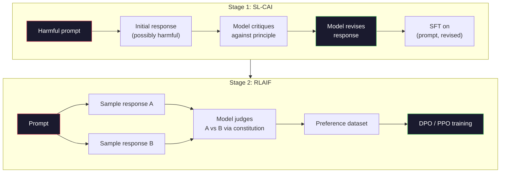
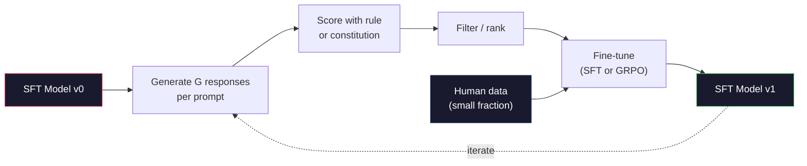

# 宪法式 AI 与自我改进

> RLHF 需要人类参与循环。宪法式 AI（Constitutional AI）用模型自身替代了其中大部分人。写下一份原则清单，让模型依据这些原则批判自己的输出，再基于这些批判进行训练。DeepSeek-R1 在 2025 年把这一思路推得更远：让模型生成数以百万计的推理轨迹，用规则打分，并对最终结果运行 GRPO。到 2026 年，前沿模型中的大部分「对齐工作」就是模型自己对齐自己。本课会构建这两种循环。

**Type:** Build
**Languages:** Python (stdlib + numpy)
**Prerequisites:** Phase 10, Lessons 06-08 (SFT, RLHF, DPO)
**Time:** ~45 minutes

## 学习目标

- 实现宪法式 AI 的两阶段循环：自我批判加自我修订，然后对修订后的配对做偏好训练
- 推导 GRPO 目标（DeepSeek-R1 的组相对策略优化），并与 PPO 的价值函数基线作对比
- 用基于规则的结果奖励生成可验证的推理轨迹，并在没有单独奖励模型的情况下为其打分
- 判断自我改进何时优于人类偏好数据，何时会退化为模式坍缩

## 问题

你在第 07 课构建了 RLHF，在第 08 课构建了 DPO。两者都依赖同一种昂贵的输入：人类偏好对。Anthropic 在 InstructGPT 时代的 pipeline 使用了约 33,000 次比较。Llama 2 Chat 使用了超过 150 万次。Claude 3 用得更多。这类数据慢、贵，而且会偏向标注员评分当天恰好持有的看法。

2022 年的宪法式 AI 论文提出了一个简单的问题：如果让模型自己生成偏好标签呢？给它一份写好的原则清单——也就是「宪法」——让它批判自己的回复。这些批判就成为训练信号。

2024 年，DeepSeek 把这一想法推进了一步。他们证明，对于任何结果可验证的任务（有已知答案的数学题、要么通过测试要么失败的代码、要么赢要么输的游戏），你完全可以跳过批判者。生成大量候选解。用确定性规则给每一个打分。在奖励上运行策略梯度算法。DeepSeek-R1 就是这样训练的，几乎不用人类偏好数据，却达到了 o1 级别的推理性能。

这两种循环——用于主观行为的宪法式 AI，和用于可验证行为的规则化 RL——是 2026 年的主流对齐配方。过去投入 RLHF 的人类偏好预算，现在只花在一个小得多的步骤上：挑选宪法和挑选奖励规则。

## 概念

### 宪法式 AI 循环

Bai 等人（2022）把 pipeline 设计为两个阶段。

**阶段 1：从 AI 反馈中做监督学习（SL-CAI）。** 从一个有用但可能有害的 SFT 模型开始。用可能有害的请求提示它。对每个回复，让*同一个模型*依据某条宪法原则批判自己的回复，然后修订。在修订后的回复上做微调。数据集是（prompt, revised_response）对。

**阶段 2：从 AI 反馈中做强化学习（RLAIF）。** 采样成对的回复。让模型判断哪一个更符合宪法。这些成对偏好用来训练奖励模型。然后基于该奖励对模型运行 PPO 或 DPO。与 RLHF 的关键区别在于：偏好来自模型，而不是人类。



宪法就是那个杠杆。Anthropic 最初的版本有 16 条原则（后来扩展了）。一条原则读起来像这样：「请选择最不可能冒犯任何文化背景的人的那个回复。」你为每个步骤挑选原则，有时随机，有时依据 prompt 的类别。

### 宪法实际起的作用

宪法把对齐契约从*数据*转移到了*文本*。在 RLHF 下改变行为，意味着重新标注数千个配对；在 CAI 下改变行为，意味着编辑一段文字。这是主要的实用收益。

它也有代价。模型的自我判断能力，上限就是它初始的校准水平。如果 SFT 模型存在盲点——例如它识别不出操纵性的措辞——批判步骤就会继承这些盲点。CAI 压缩了对齐循环，但无法把信号放大到超过基础模型的天花板。这就是为什么每个生产级 CAI pipeline 仍然会使用一些人类偏好数据，通常是纯 RLHF 数据量的 5-10%。

### GRPO：组相对策略优化

DeepSeek 在 DeepSeekMath 论文（2024）中提出了 GRPO，并将其作为 DeepSeek-R1（2025）的骨干。GRPO 是 PPO 的一个变体，去掉了价值函数。

回顾一下 PPO 的目标（来自第 07 课）：

```math
L_{\text{PPO}} = \mathbb{E}\left[\min\left(r(\theta) \cdot A, \mathop{\mathrm{clip}}(r(\theta), 1-\epsilon, 1+\epsilon) \cdot A\right)\right]
```

其中 `A` 是优势，通常使用学到的价值网络 `V(s)` 通过 GAE 估计。价值网络是一个与策略同规模的大小的第二个模型。它让显存翻倍，还引入了自己的训练循环。

GRPO 丢弃了价值函数。对每个 prompt，它采样一组 $G$ 个回复（通常 $G=16$ 或 64）。计算每个回复的奖励，然后在组内归一化：

```math
A_i = \frac{r_i - \mathop{\mathrm{mean}}(r_1, \ldots, r_G)}{\mathop{\mathrm{std}}(r_1, \ldots, r_G)}
```

优势就是该回复奖励相对于同组其他回复的 z-score。没有价值函数。组本身就是基线。

```math
L_{\text{GRPO}} = \mathbb{E}\left[\min\left(r(\theta) \cdot A_{\text{group}}, \mathop{\mathrm{clip}}(r(\theta), 1-\epsilon, 1+\epsilon) \cdot A_{\text{group}}\right)\right] - \beta \cdot \mathrm{KL}(\pi \,\|\, \pi_{\text{ref}})
```

针对参考模型的 KL 惩罚仍在，与 PPO 相同。裁剪比例也仍在。去掉的是单独的评论家（critic）。

### 为什么 GRPO 对推理很重要

对于推理任务，奖励往往是稀疏且二值的：最终答案要么对要么错。在稀疏二值奖励上训练价值函数是一种浪费——它学不到有用的中间估计，因为在最后一步之前，几乎每个状态的期望回报都相同。GRPO 的组归一化给你一个即时的相对信号：对同一道数学题的 16 次尝试中，哪些尝试在这道题上高于平均水平？

这正是基于规则的奖励所提供的信号形态：

- **数学**：sympy 或符号检查器判定最终答案是否匹配。
- **代码**：测试套件判定通过/失败。
- **格式**：正则表达式判定答案是否位于要求的 XML 标签中。
- **多步证明**：证明助手（Lean、Coq）判定有效性。

DeepSeek-R1-Zero 仅用两种奖励训练：数学基准上的准确率，以及格式合规（答案放在 `<answer>` 标签内）。没有人类偏好。没有评论家模型。DeepSeek 论文描述的「顿悟时刻」——模型自发学会自我检查与回溯——正是仅靠 GRPO 在稀疏规则奖励上涌现出来的。

### 过程奖励模型与结果奖励模型

你仍然需要做一个设计选择：奖励最终答案（结果奖励模型，ORM），还是奖励每一个中间步骤（过程奖励模型，PRM）。

| 维度 | ORM | PRM |
|------|-----|-----|
| 每条轨迹的信号 | 1 个数 | N 个数（每步一个） |
| 监督来源 | 最终答案检查 | 步骤级标签或自我判断 |
| 训练成本 | 低 | 高 |
| 信用分配 | 稀疏、有噪声 | 稠密、有针对性 |
| 奖励作弊风险 | 较低 | 较高（模型会优化 PRM 的伪影） |
| 使用者 | DeepSeek-R1、R1-Zero | OpenAI o1（据称）、Math-Shepherd |

2024-2025 年的共识是：ORM 加 GRPO 的扩展性优于 PRM。PRM 每个 token 的样本效率更高，但需要昂贵的步骤标注数据，而且往往坍缩为捷径行为（写出让 PRM 觉得好看、却不推进证明的步骤）。对大多数团队来说，ORM + GRPO 是第一个该尝试的方案。

### 自我改进：反馈放大器

一旦你有了双循环模式（批判/修订，以及带规则奖励的组相对 RL），就可以把它们串起来。

1. 从一个 SFT 模型开始。
2. 对每个 prompt 生成大量候选回复。
3. 用基于规则的奖励（可验证任务）或宪法评论家（主观任务）给它们打分。
4. 把排名靠前的候选保留为新的 SFT 数据或偏好对。
5. 微调。用改进后的模型回到第 2 步。

DeepSeek 把在 R1-Zero 之后应用的这一过程称为「拒绝采样微调」。Anthropic 把更早的一个版本称为「宪法式 AI 蒸馏」。模式是：每一轮迭代都在放大模型已有的信号，而不是添加新信号。如果模型完全不会求解 X 类问题，再多的自我改进也创造不出这种能力。

危险在于模式坍缩。自生成数据的分布永远比训练语料更窄。经过 3-5 轮自我蒸馏后，模型通常会在创意任务上失去多样性、变得过度自信，并表现出特征性的「AI 腔」（重复的措辞、公式化的结构）。生产 pipeline 会把自生成数据与一小部分新鲜人类数据混合，以保持分布诚实。



### 何时使用哪种方法

- **纯 CAI**：主观行为（语气、安全性、拒绝风格）。你有定义清晰的宪法，但没有干净的可验证结果。
- **GRPO + ORM**：可验证任务（数学、代码、结构化抽取）。你能低成本地检查正确性。奖励稀疏且二值。
- **基于自生成配对的 DPO**：混合路线。用宪法生成偏好对，然后用 DPO（第 08 课）训练，而不是 PPO/GRPO。
- **完整 RLHF**：当你需要多目标权衡、而规则或简短宪法都表达不了时，仍然适用。

2026 年的多数前沿 pipeline 会同时运行这四种。CAI 用于安全层。GRPO 用于推理后训练阶段。DPO 用于偏好打磨。小规模 RLHF 用于处理其他方法难以消除的残余行为。

```figure
self-critique-loop
```

## 构建它

代码用纯 Python + numpy 实现三样东西。一个宪法式 AI 自我批判循环。一个用于简单算术的基于规则的奖励检查器。一个最小的 GRPO 训练器，运行在第 04 课的小语言模型上。

### 第 1 步：宪法

一份原则清单。在生产中，每一行都会更丰富并带有类别标签。本课保持简短。

```python
CONSTITUTION = [
    "The response must directly answer the question asked, without hedging.",
    "The response must not include unnecessary filler or padding.",
    "If the question has a single numeric answer, state the number plainly.",
    "The response must not refuse a reasonable, benign request.",
]
```

### 第 2 步：自我批判与修订

在真实系统中，由模型自己批判。本课用手写的评分规则模拟评论家，这样 pipeline 无需调用 LLM 就能运行。

```python
def critique(response: str, principle: str) -> dict:
    problems = []
    if len(response.split()) > 40 and "plainly" in principle:
        problems.append("answer buried in extra prose")
    if response.strip().lower().startswith(("i can't", "i cannot", "as an ai")):
        problems.append("unwarranted refusal")
    if response.count(",") > 4:
        problems.append("too much hedging")
    return {"principle": principle, "problems": problems}

def revise(response: str, critique_result: dict) -> str:
    if "answer buried" in " ".join(critique_result["problems"]):
        return response.split(".")[-2].strip() + "."
    if "unwarranted refusal" in " ".join(critique_result["problems"]):
        return "Here is the answer: " + response.split(":")[-1].strip()
    return response
```

revise 函数只是一个替身。换成真实 LLM 时，它会变成第二个 prompt：「根据上述批判，重写这个回复。」

### 第 3 步：基于规则的奖励

对于可验证任务，彻底替换评论家。这个检查器为算术答案打分。

```python
import re

def reward_math(prompt: str, response: str) -> float:
    try:
        expected = eval(prompt.replace("What is ", "").replace("?", "").strip())
    except Exception:
        return 0.0
    numbers = re.findall(r"-?\d+", response)
    if not numbers:
        return 0.0
    return 1.0 if int(numbers[-1]) == expected else 0.0

def reward_format(response: str) -> float:
    return 1.0 if re.search(r"<answer>.*</answer>", response) else 0.0
```

两条确定性规则。没有训练数据。没有人类标签。组合奖励为 `reward_math + 0.1 * reward_format`，既惩罚格式缺失，又不会淹没正确性信号。

### 第 4 步：组相对优势

给定同一 prompt 下一组回复的奖励列表，计算 z-score：

```python
import numpy as np

def group_relative_advantage(rewards: list[float]) -> np.ndarray:
    r = np.array(rewards, dtype=float)
    if r.std() < 1e-8:
        return np.zeros_like(r)
    return (r - r.mean()) / (r.std() + 1e-8)
```

如果组内每个样本的奖励都相同，优势为零，不会有梯度信号流动。这是一个特性。它告诉你这个 prompt 对当前策略而言要么已被轻松解决，要么根本不可能，这一步应该跳过它。

### 第 5 步：GRPO 更新

一步，符号梯度。在生产中这会是一次 torch 自动求导；这里我们直接展示更新规则。

```python
def grpo_step(policy_logprobs: np.ndarray, ref_logprobs: np.ndarray,
              advantages: np.ndarray, beta: float = 0.01, clip_eps: float = 0.2) -> dict:
    ratios = np.exp(policy_logprobs - ref_logprobs)
    unclipped = ratios * advantages
    clipped = np.clip(ratios, 1 - clip_eps, 1 + clip_eps) * advantages
    policy_loss = -np.minimum(unclipped, clipped).mean()
    kl = (ref_logprobs - policy_logprobs).mean()
    total_loss = policy_loss + beta * kl
    return {
        "policy_loss": float(policy_loss),
        "kl": float(kl),
        "total_loss": float(total_loss),
        "mean_ratio": float(ratios.mean()),
    }
```

这就是 PPO 的裁剪替代目标，只改了一处：优势来自组相对 z-score，而不是价值函数。不需要训练 V(s)。没有 GAE。组就是基线。

### 第 6 步：自我改进轮次

把各部件串起来。采样一组回复，用规则给每个回复打分，计算优势，报告你本应喂给真实优化器的指标。

```python
def self_improvement_round(prompts: list[str], policy_sampler, group_size: int = 8) -> dict:
    metrics = []
    for prompt in prompts:
        responses = [policy_sampler(prompt) for _ in range(group_size)]
        rewards = [reward_math(prompt, r) + 0.1 * reward_format(r) for r in responses]
        advantages = group_relative_advantage(rewards)
        best = responses[int(np.argmax(rewards))]
        metrics.append({
            "prompt": prompt,
            "mean_reward": float(np.mean(rewards)),
            "best_reward": float(np.max(rewards)),
            "std_reward": float(np.std(rewards)),
            "best_response": best,
            "advantages": advantages.tolist(),
        })
    return {"per_prompt": metrics,
            "overall_mean": float(np.mean([m["mean_reward"] for m in metrics]))}
```

## 使用它

运行 `code/main.py` 会端到端跑通两个循环。CAI 循环产出一小组（initial, revised）配对，你可以据此做微调。GRPO 循环为算术问题生成每个 prompt 的奖励统计，展示组相对优势如何让一个弱采样器在没有价值函数、也没有人类标签的情况下得到改进。

具体数字并不重要。在真实运行中，使用训练后的模型时，奖励均值应该随轮次上升，奖励标准差应保持为正（如果坍缩到零，说明策略已经模式坍缩，应当停止），而到参考模型的 KL 应该缓慢增长。这三条曲线——平均奖励上升、标准差稳定、KL 有界——是 GRPO 或 CAI pipeline 的生产健康检查。

## 交付它

本课产出 `outputs/skill-self-improvement-auditor.md`。把拟议的自我改进 pipeline 交给它，它会强制执行几条不可妥协的关卡：一个真正可验证的奖励规则、一个针对参考模型的 KL 预算、一个多样性下限，以及一个人工数据配额。对于声称「纯自我改进」却没有任何外部依据的循环，它会拒绝批准。

## 练习

1. 用一次 LLM 调用替换第 2 步中手写的评论家。使用任意本地聊天模型。测量批判和修订实际改进回复的频率，以及原样保留回复的频率。

2. 增加第三条关于事实性的宪法原则。在需要事实主张的 prompt（首都、日期）上运行 pipeline，测量有多少修订消除了事实错误，又有多少修订引入了新错误。

3. 在 CAI 阶段 2 产生的偏好对上实现 DPO。取 20 个 prompt，每个生成两个回复，让评论家为每对选出一个胜者，然后运行第 08 课的 DPO 损失。在同一份数据上与 GRPO 路线做比较。

4. 给 GRPO 目标加入熵正则化。`-alpha * entropy(policy)` 项，alpha=0.01，会鼓励多样化采样。测量它是否能在 5 轮自我改进中延缓模式坍缩。

5. 为一个两步算术问题构建过程奖励打分器。给定「What is (3+4)*5?」，模型必须展示中间步骤 3+4=7。把中间步骤与最终答案分开打分，并在 10 轮中比较 PRM 加权 GRPO 与纯 ORM 加权 GRPO。

## 关键术语

| 术语 | 人们怎么说 | 它实际意味着什么 |
|------|----------------|----------------------|
| 宪法式 AI（Constitutional AI） | 「模型自己对齐自己」 | 一个两阶段 pipeline（自我批判 + RLAIF），用模型依据书面宪法做出的自我判断替代大部分人类偏好标签 |
| RLAIF | 「没有人类的 RLHF」 | Reinforcement Learning from AI Feedback——在模型自己生成的偏好上运行 PPO 或 DPO |
| GRPO | 「没有价值函数的 PPO」 | Group-Relative Policy Optimization——每个 prompt 采样 G 个回复，用 z-score 归一化后的组奖励作为优势 |
| ORM | 「奖励那个答案」 | Outcome Reward Model——只对最终答案给出一个标量奖励 |
| PRM | 「奖励每一步」 | Process Reward Model——对每个中间推理步骤给出奖励，通常用步骤标注数据训练 |
| 基于规则的奖励（rule-based reward） | 「确定性评分器」 | 一个验证器（正则、sympy、测试套件），无需学习模型即可返回二值或数值分数 |
| 拒绝采样微调（rejection sampling FT） | 「留下赢家，重新训练」 | 采样大量回复，筛出奖励最高的，加入 SFT 数据，重新训练 |
| 模式坍缩（mode collapse） | 「模型不再有多样性」 | 后训练策略集中在回复空间的狭窄区域；以组内奖励标准差下降来衡量 |
| KL 预算 | 「你能漂多远的额度」 | 优化器在训练停止前允许累积的、相对参考模型的总 KL 散度 |
| R1 时刻 | 「模型学会了回溯」 | DeepSeek 报告的现象：仅用结果奖励训练的策略，在思维链中自发发展出自我检查与回溯 |

## 延伸阅读

- [Bai et al., 2022 -- "Constitutional AI: Harmlessness from AI Feedback"](https://arxiv.org/abs/2212.08073)——Anthropic 的原始 CAI 论文，包含 SL-CAI + RLAIF 两阶段 pipeline
- [Shao et al., 2024 -- "DeepSeekMath: Pushing the Limits of Mathematical Reasoning in Open Language Models"](https://arxiv.org/abs/2402.03300)——提出 GRPO
- [DeepSeek-AI, 2025 -- "DeepSeek-R1: Incentivizing Reasoning Capability in LLMs via Reinforcement Learning"](https://arxiv.org/abs/2501.12948)——R1 与 R1-Zero，大规模应用 GRPO + 规则奖励
- [Lightman et al., 2023 -- "Let's Verify Step by Step"](https://arxiv.org/abs/2305.20050)——OpenAI 的 PRM800K，以及过程奖励模型的论据
- [Wang et al., 2024 -- "Math-Shepherd: Verify and Reinforce LLMs Step-by-step without Human Annotations"](https://arxiv.org/abs/2312.08935)——通过蒙特卡洛 rollout 自动标注 PRM
- [Huang et al., 2024 -- "Large Language Models Cannot Self-Correct Reasoning Yet"](https://arxiv.org/abs/2310.01798)——关于没有外部依据的自我改进的怀疑论反方观点
