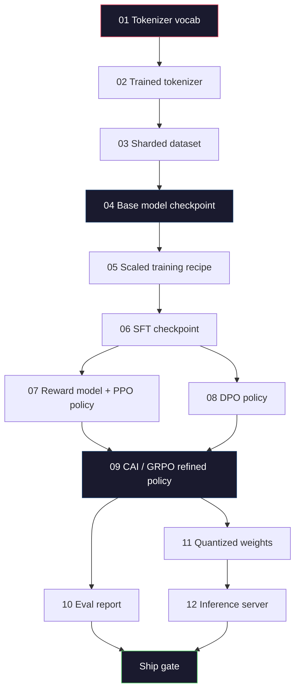
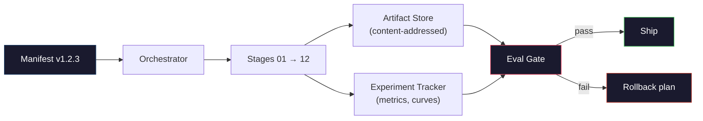

# 构建完整的 LLM Pipeline

> 第 01 到第 12 课的每一项都是同一条 pipeline 的一个阶段。本节课是把这些阶段串成一次端到端运行的脚手架：tokenize、预训练、扩展、SFT、对齐、评估、量化、服务。你不会在笔记本上训练 70B 模型。你要产出的是编排层、manifest、评估门和回滚方案——2026 年前沿团队用来决定什么能上线的那些东西。这是项目。

**Type:** Build
**Languages:** Python (stdlib)
**Prerequisites:** All Phase 10 lessons 01-12
**Time:** ~120 minutes

## 学习目标

- 把此前十一节课（tokenizer、数据、预训练、扩展、SFT、RLHF、DPO、CAI、评估、量化、推理）组合成一份可复现的 pipeline 规格
- 定义阶段之间的产物契约：每个阶段消费什么、产出什么，以及下一阶段如何验证输入
- 构建一个编排器，跟踪实验、对产物做哈希，并以评估阈值作为上线决策的门禁
- 设计回滚方案：哪些产物重跑代价低、哪些高，以及一个损坏的 checkpoint 会带来什么成本

## 问题

此前的每一节课单独看都能跑通。tokenizer 训练好了。小 GPT 预训练完了。SFT 数据集拼好了。奖励模型训好了。DPO 跑过了。评估测过了。量化权重导出了。推理服务起起来了。每一课都是一个 notebook，都有自己的约定、自己的输出路径、自己的随机种子。

前沿训练不是 notebook。Llama 3 405B 在约 54 天里消耗了 3,000 万个 H100 小时。DeepSeek-V3 用了约 280 万个 H800 小时。在那段时间里，一个损坏的 checkpoint、一次数据污染、一次评估回退，就可能让团队损失一周的墙钟时间和一个月的 GPU 预算。团队能扛住这些，靠的是 pipeline 卫生：每个阶段都有确定性的输入、确定性的输出、manifest、哈希和门禁。

这是项目。你不会在笔记本上端到端跑完这条 pipeline。你要写的是编排各阶段的编排器、描述本次运行的 manifest、把守上线决策的验证器，以及让第三方只凭一个文件就能复跑你工作的回放方案。代码很小，纪律很大。

这套模式从 1 亿参数到 1 万亿参数都不用改。同样的四个组件——manifest、编排器、评估门、产物存储——既跑 Llama 3，也跑你的业余 GPT。区别只在于各阶段配置里的数字大小，而不在 pipeline 的形状。

## 概念

### 十二个阶段

Phase 10 的每一节课都是一个阶段。下面是完整的依赖图。



阶段 07 和 08 可以并行。其余都是硬依赖。阶段 02（tokenizer）一改，所有下游产物全部失效。阶段 10（评估）一改，只有上线决策失效。

### Manifest

manifest 是一个文件，它把一次运行描述得足够完整，可以据此复跑。pipeline 产出的任何东西，都不应依赖 manifest 之外的状态。字段很枯燥，但都是必填的。

```
pipeline_version: 1.2.3
seed: 42
git_commit: a1b2c3d4
stages:
  01_tokenizer:
    recipe: bpe_32k
    input_hash: sha256:...
    output_hash: sha256:...
    wall_clock_sec: 3600
    cost_usd: 12
```

阶段 N 的输出哈希就是阶段 N+1 的输入哈希。任何偏差都会让 pipeline 停下来。这能让你尽早发现数据损坏，也能让另一个大陆的同事验证他的复跑产出了和你相同的产物。

实践中，团队会使用一套小的 YAML schema，外加一个 manifest 检查器，与上一次成功运行做 diff。任何超出预期字段（成本、墙钟时间）的差异都是危险信号。

### 产物类型化

每个阶段的输出都是一个带类型的产物。不是一坨目录，也不是一个 pickle，而是有已知 schema 的具名类型。

| 阶段 | 产物类型 | 关键字段 |
|-------|--------------|-----------|
| 01-02 | Tokenizer | vocab.json、merges.txt、config.json、hash |
| 03 | 数据集 | shards[]、行数、token 数、去重统计 |
| 04-05 | Checkpoint | weights.safetensors、config.json、优化器状态、step 数 |
| 06 | SFT 模型 | checkpoint + SFT 配方 + 数据配比 |
| 07 | 奖励模型 | RM checkpoint + 偏好数据哈希 |
| 08-09 | 策略模型 | checkpoint + 参考模型哈希 + beta + 已消耗的 KL 预算 |
| 10 | 评估报告 | 基准分数 + 回退 diff + 评估数据哈希 |
| 11 | 量化模型 | 量化权重 + 校准数据 + 相对 FP16 的精度差 |
| 12 | 服务规格 | endpoint + 模型哈希 + 配置 + 可观测性钩子 |

类型化杜绝了最常见的失败模式：把阶段 08 的输出当作阶段 06 的输入，用 SFT 的路径去上线一个 DPO 训练出来的模型。类型化的产物与类型化的阶段签名，让这类错误变成编译期失败，而不是第五天才暴露的失败。

### 评估门

上线不是「训练完了」。上线是「训练完了，而且评估门通过了」。门在运行开始之前就已定义。

```
gates:
  mmlu:      >= baseline + 0.5   # no regression
  humaneval: >= baseline + 1.0
  truthfulqa: >= baseline         # no drop
  safety_refusal_rate: <= 0.05
  kl_from_reference: <= 25.0
  cost_total_usd: <= 50000
```

每一道门都是数值阈值。没有「看起来不错」的门，没有主观签字。所有门都通过，产物才被标记为可上线。任何一道门失败，这次运行就挂起，等待具名评审人显式覆盖——覆盖本身也要记入 manifest。

两道门能拦住大多数灾难。*回退门*（新模型在核心基准上至少要和老模型一样好）能抓住训练 bug。*KL 预算门*（对齐后的策略相对参考模型的漂移不得超过 X）能抓住对齐过度。每个生产 pipeline 都有这两道门。

### 编排器

一小段代码：读取 manifest、派发阶段、跟踪产物，并在任何契约被违反时中止。这不是 Airflow，也不是 Kubeflow。做 pipeline 卫生，你要的是一个你亲手写的、无聊的东西。

编排器的职责很窄：

1. 从 manifest 解析出 DAG。
2. 对每个阶段，检查预期输出是否已存在于正确哈希下（是则跳过）。
3. 运行该阶段，捕获 stdout/stderr，测量墙钟时间与成本。
4. 将输出哈希与下游阶段期望的输入哈希核对。
5. 失败时，写出一个部分 manifest，精确记录失败的阶段，并以非零码退出。

这大约是 200 行 Python，就是本节课 `code/main.py` 的样子。底层上，真实 pipeline 用 `torchrun` 或 `ray` 在集群上执行各个阶段，但编排器本身跑在一台机器上。

### 实验跟踪与产物存储

两个外部系统为 pipeline 提供锚点。

**实验跟踪器（wandb、neptune、mlflow）。** 记录每个阶段的损失曲线、评估指标、系统遥测。三周后需要比较运行 A 和运行 B 时，你要去的就是跟踪器。团队几乎总是使用托管跟踪器——自己写会浪费本应投入训练的时间。

**产物存储（S3、R2、GCS）。** 用于 checkpoint、数据集、tokenizer、评估报告的不可变对象存储。产物按哈希寻址，而不是按文件名。像 `latest.pt` 这样的文件名是个陷阱；`ckpt-7b-step-20000-sha256:abc123.safetensors` 才是一份契约。

编排器同时写入两者。跟踪器给人看图表，产物存储给下一阶段查输入。

### 成本核算

每一次前沿训练都对应一个美元数字。预算纪律体现在两个地方。

**运行前估算。** 从 manifest 出发，计算预期 FLOPs（预训练：6 × 参数量 × token 数）、预期 GPU 小时（FLOPs / 峰值吞吐 / 利用率），以及按当前租赁价格计算的美元成本。如果估算超过预算门，pipeline 拒绝启动。

**运行中跟踪。** 逐阶段把墙钟时间和成本记入 manifest。每完成一个阶段，就检查剩余预算。如果某个阶段超支，下一阶段的预算门将以新的剩余预算来评估。不要等到投资人打电话时才发现钱花完了。

Llama 3 公布的成本是 6,100 万美元。DeepSeek-V3 的主预训练运行公布成本为 560 万美元。这个比例主要来自硬件效率和混合专家架构——但具体成本之所以可见，是因为两个团队都按阶段而不是按整次运行来跟踪。

### 可复现性 vs 确定性

两者不是一回事。*可复现*（reproducible）指相同的 manifest、相同的代码、相同的基础设施，产出一个下游指标等价的 checkpoint。*确定性*（deterministic）指逐比特完全相同的输出。

现代 LLM 训练是可复现的，但不是确定性的。分布式训练的归约顺序、GPU kernel 的非确定性（cuBLAS、flash-attn）以及混合精度舍入共同作用，使得两次运行之间的浮点数在第 1e-5 的量级上存在差异。这对最终指标无所谓，因为指标不会变。但如果你试图用比特级 diff 来调试，这就是致命的。解药是记录每个阶段的输入哈希、输出哈希和关键指标——只要这些对得上，这次运行就算「复现」了，哪怕权重并非逐比特一致。



### 回滚方案

运行开始之前，就把每个阶段失败时的处理写下来。分三类。

- **重跑代价低**（小时级）：tokenizer、评估、量化、推理服务。直接重跑。
- **中等**（天级）：SFT、DPO、CAI。保留基座模型，只重跑对齐阶段。
- **昂贵**（周级、数百万美元）：预训练。这时的回滚方案不是「重跑」，而是「使用上一个好的 checkpoint，并用修订后的数据重跑更便宜的下游阶段」。

由于阶段依赖是类型化且带哈希的，编排器可以自动计算回滚集合：让失败阶段及其所有后代失效。阶段 06（SFT）失败会让 06、07、08、09、10、11、12 失效。阶段 11（量化）失败只会让 11 和 12 失效。事前把这些写清楚，就能避免团队凌晨 4 点精疲力竭时临场发挥。

### 2026 年观察到的生产配方

多数前沿团队已经收敛到同一套骨架。

- Tokenizer：128k BPE，带 byte fallback。在一个小而均衡的多语言切片上训练。
- 预训练：10-20T token，以网页、代码和合成数据为主。Muon 或 AdamW 优化器。FSDP2 或 DeepSpeed ZeRO-3。梯度检查点。BF16 权重，FP32 master。
- SFT：50 万到 200 万条指令对，人类与合成数据混合，并严格对评估集去重。
- 对齐：DPO 或 CAI + GRPO。只有当偏好信号对 DPO 来说过于多维时，才用 RLHF。
- 评估：MMLU-Pro、MATH、HumanEval+、GPQA、SWE-Bench Verified、LiveBench，外加一个公众永远看不到的私有留出集。
- 量化：服务用 4-bit GPTQ 或 AWQ；安全评估关注精度差，用 8-bit。
- 服务：vLLM、TensorRT-LLM 或自研。Continuous batching。投机解码。KV cache 淘汰。

数字每六个月变一次，骨架不变。

```figure
beam-search
```

## 构建它

本节课的代码是一个编排器加一个 manifest 检查器，而不是十二个训练脚本。每个阶段都用占位实现模拟，产出形状和哈希都正确的产物。端到端跑一遍编排器，就能在你真金白银烧 GPU 之前证明 pipeline 的管道是通的。

完整实现见 `code/main.py`。关键部分：

- `Manifest` dataclass：pipeline 版本、seed、git commit、stages、gates。
- `Stage` dataclass：name、type、inputs（哈希）、output（哈希）、墙钟时间、成本。
- `Orchestrator.run()`：解析 DAG、派发阶段、校验哈希、更新 manifest。
- `EvalGate.check()`：读取阈值，与最新评估报告比对，返回通过/失败。
- `ArtifactStore`（内存桩）：按哈希存取，模拟 S3。
- `CostTracker`：按阶段与累计跟踪，超出上限时中止。

`main.py` 中的 pipeline 会运行十二个占位阶段，产出一份 manifest，并故意触发一次失败的评估门，展示被挂起的运行是什么样。把每个占位替换为对应课程里的真实训练脚本，你就得到了真实前沿 pipeline 使用的骨架。

## 使用它

标准工作流有三条命令。

```
python code/main.py plan    # validate manifest, compute cost estimate, print DAG
python code/main.py run     # execute stages, writing to manifest.out.yaml
python code/main.py gate    # read manifest.out.yaml, apply eval gates, ship-or-hold
```

每次都先跑 `plan`。大多数 pipeline bug 会在 plan 阶段暴露——缺少门阈值、过期的哈希、预算超支。跑 `plan` 是免费的，跑 `run` 很贵。在便宜的一侧抓 bug，省钱。

`gate` 的输出要么是 `SHIP`，要么是 `HOLD: <reason>`。被挂起不是失败，而是一个决策点。具名评审人要么覆盖（覆盖会被记录），要么批准回滚。

## 交付它

本节课产出 `outputs/skill-llm-pipeline-reviewer.md`。把一份拟议的 pipeline manifest 交给它，它会检查所有契约：阶段类型、哈希链、门禁、回滚方案、成本估算。缺少评估门、KL 预算无上限、或是把评估数据和训练数据混在一起的 manifest，它都会拒绝批准。

## 练习

1. 扩展编排器，支持阶段 07 和 08 并行执行。使用 stdlib 的 `concurrent.futures` 模块。确认最终 manifest 记录了两个阶段的输出，且阶段 09 的输入哈希是两者确定的组合。

2. 增加一道「污染检查」门。给定评估数据集哈希和训练数据集分片，计算重叠（精确字符串匹配或 13-gram 匹配）。重叠超过 0.1% 时门失败。喂给它一个被污染的训练集，确认门会挂起这次运行。

3. 从第一性原理实现一个成本估算器。对阶段 04（预训练），按 6 × 参数量 × token 数估算 FLOPs，假设 H100 上 989 TFLOPs BF16、MFU（模型 FLOPs 利用率）为 40%，单价 $2.50/GPU 小时。报告 7B 模型训练 2T token 的估算值，并与已公布的 Llama 2 数据比较。

4. 实现部分回滚。模拟阶段 09（CAI）失败，然后重跑阶段 09 到 12，让 01-08 保持缓存。编排器应通过哈希发现缓存产物并跳过它们。测量相比完整重跑节省的墙钟时间。

5. 增加可观测性。为每个阶段发出 OpenTelemetry span，属性包含参数量、已见 token 数、损失和成本。把 span 送到本地 collector。重点不是仪表盘，而是每个阶段的健康状况都能通过单一 trace ID 追溯。

## 关键术语

| 术语 | 人们怎么说 | 它实际指什么 |
|------|----------------|----------------------|
| Manifest | 「配方文件」 | 描述 pipeline 版本、seed、各阶段配置和门阈值的 YAML 或 JSON——足以复跑一次运行 |
| 内容寻址 | 「按哈希而非文件名」 | 产物以其内容的 SHA-256 存储，因此你永远不会把版本 A 和版本 B 搞混 |
| 评估门 | 「上线标准」 | 基准指标与安全分数上的数值阈值，全部通过后产物才被标记为可上线 |
| KL 预算 | 「对齐漂移了多远」 | 对齐阶段累计 $\mathrm{KL}(\text{policy} \Vert \text{reference})$ 的上限，作为门来强制执行 |
| MFU | 「你用上了多少 GPU」 | Model FLOPs Utilization——实际达到的 FLOPs 除以理论峰值。70B 规模通常 40%，7B 规模 55% |
| 回滚方案 | 「出问题时我们怎么办」 | 每个阶段失败时预先写好的动作集合：重跑、回退、用修订输入重训 |
| 编排器 | 「指挥家」 | 读取 manifest、派发阶段、校验哈希、在任何契约违反时中止的进程 |
| 产物存储 | 「权重的版本化 S3」 | 不可变的内容寻址对象存储——checkpoint、数据集、评估报告的唯一事实来源 |
| 可复现 | 「复跑得到相同指标」 | 逐比特权重不同，但下游指标等价——分布式 LLM 训练的现实目标 |
| 成本门 | 「你不能超过 X」 | 运行前估算加运行中跟踪——估算超过预算时 pipeline 拒绝启动 |

## 延伸阅读

- [Dubey 等，2024——《The Llama 3 Herd of Models》](https://arxiv.org/abs/2407.21783)——公开资料中对前沿 pipeline（数据、训练、对齐、评估）最详细的描述
- [DeepSeek-AI，2024——《DeepSeek-V3 Technical Report》](https://arxiv.org/abs/2412.19437)——以效率为先的 pipeline，成本约为 Llama 3 级别训练的十分之一
- [Kaplan 等，2020——《Scaling Laws for Neural Language Models》](https://arxiv.org/abs/2001.08361)——原始的算力-数据-参数扩展关系
- [Hoffmann 等，2022——《Training Compute-Optimal Large Language Models (Chinchilla)》](https://arxiv.org/abs/2203.15556)——对 Kaplan 的修正，重新校准了现代数据预算
- [PyTorch FSDP2 文档](https://pytorch.org/docs/stable/fsdp.html)——PyTorch 2.4+ 中取代 FSDP1 的分布式训练原语
- [Weights & Biases LLM 报告](https://wandb.ai/site/solutions/llms/)——开源 LLM 运行的真实 manifest 与实验跟踪输出，可作为可直接借鉴的模板
