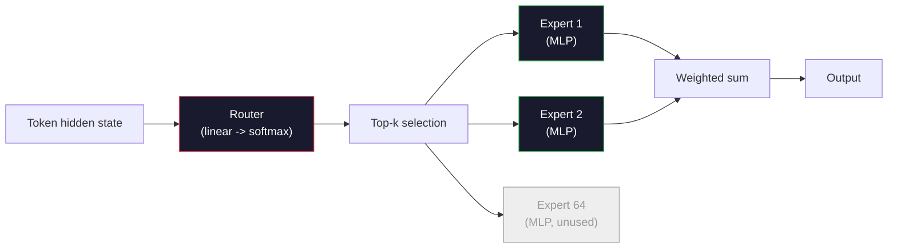

# 开源模型：架构走读

> 你在第 04 课从零构建了 GPT-2 Small。2026 年的前沿开源模型属于同一家族，只有五六处具体改动。用 RMSNorm 取代 LayerNorm，用 SwiGLU 取代 GELU，用 RoPE 取代学习式位置编码，用 GQA 或 MLA 取代完整 MHA，大规模使用混合专家。你已经掌握的数学覆盖了其中 95%。本节课把 Llama 3、DeepSeek-V3、Mixtral、Qwen 和 Gemma 放在一起对照阅读，指出每种架构分岔的确切位置。

**Type:** Learn
**Languages:** Python (stdlib)
**Prerequisites:** Phase 10, Lessons 04, 05, 12 (Pre-training, Scaling, Inference)
**Time:** ~45 minutes

## 学习目标

- 读懂 Llama 3、Mistral、Mixtral、Gemma 2、Qwen 2.5 和 DeepSeek-V3 的 config.json，并能解释每个字段
- 说出每个模型相对 GPT-2 Small 的具体架构改动，并从第一性原理给出理由
- 仅凭 config 计算任意开源模型的参数量、KV cache 大小和激活内存
- 在给定延迟、内存和能力约束下，为部署目标挑选合适的开源模型

## 问题

第 04 课里你写了 350 行 numpy，得到一个 GPT-2 形状的模型。Llama 3 405B 有一份 200 页的技术报告。你的直觉是这两者是不同的物种。并非如此。那 200 页描述的是同一个对象，只是带上了五六处有充分动机的修改，外加一千个关于扩展的实现细节。骨架——embedding、transformer 块、注意力、MLP、norm、head——没有变。

本节课是一份 diff。对每个主要的开源模型家族，我们精确列出相对 GPT-2 改了什么、为什么改、代价是什么。读完你就能拿着一份新的 model card，在脑中把它翻译回 GPT-2 基线。

实际回报在于：当 Meta 发布 Llama 5 或 DeepSeek 发布 V4 时，你不需要新的心智模型。你会看 config，认出哪些熟悉的旋钮被拨动了，并知道下游影响是什么。2026 年的架构是一个有限的工具箱，每个新模型只是挑选其中不同的子集。

## 概念

### 不变的核心

所有自回归开源模型共享：

- token embedding 矩阵（vocab_size × hidden_dim）。
- N 个解码器块的堆叠：norm、自注意力、残差、norm、MLP、残差。
- 最终 norm 和投影到 vocab_size 的线性头（通常与 embedding 权重绑定）。
- 因果掩码，next-token 交叉熵损失。

这就是形状，其余都是旋钮。

### 真正会动的六个旋钮

在 2024-2026 年的每一个前沿开源模型中，同样的六个设计选择被反复挑中：

1. **归一化。** LayerNorm → RMSNorm。
2. **位置编码。** 学习式绝对位置 → RoPE（及其变体：YaRN、NTK）。
3. **激活函数。** GELU → SwiGLU（或 GeGLU）。
4. **注意力头共享。** MHA → GQA → MQA → MLA。
5. **稠密 vs 稀疏 MLP。** 稠密 → 混合专家。
6. **Pre-norm 位置。** Pre-norm 保留，Post-norm 已被淘汰。

其他一切（学习率调度、数据配比、batch size、上下文长度）都在训练配置里，而不在架构里。六个旋钮。

### 旋钮 1：RMSNorm

LayerNorm 减去均值、除以标准差、缩放、平移。RMSNorm 只保留缩放：

```math
\mathop{\mathrm{RMSNorm}}(x) = \frac{x}{\sqrt{\mathop{\mathrm{mean}}(x^2) + \epsilon}} \cdot \gamma
```

不减均值，没有偏置。每个 token 少一次 matmul。Zhang 和 Sennrich（2019）认为它在机器翻译上与 LayerNorm 持平，同时快 10%。所有现代开源模型都在用。

代价：无。收益：小幅吞吐量提升，代码更简单。

### 旋钮 2：RoPE

学习式位置 embedding 在 GPT-2 里是一张 1024 槽的查找表。上下文 1025 就超出了表的末端。模型无法外推到训练长度之外。

旋转位置编码（Rotary Position Embedding，RoPE，Su 等 2021）在注意力点积之前，把每个 Q 和 K 向量成对旋转来注入位置。旋转角度是位置的确定性函数，因此没有任何需要学习的东西，也不会「用完」。配合缩放技巧（NTK-aware 插值、YaRN），一个在 8k 上下文上训练的模型可以在推理时拉伸到 128k，精度损失不大。

```
q_rotated = rotate(q, angle(pos))
k_rotated = rotate(k, angle(pos))
score = q_rotated . k_rotated
```

每一个 Llama、Mistral、Qwen、DeepSeek 和 Gemma 都使用 RoPE。Gemma 2 使用混合方案（多数层用 RoPE，其他层用局部滑动窗口注意力）。

### 旋钮 3：SwiGLU

GPT-2 的 MLP 是 `x -> gelu(xW1 + b1) -> (...)W2 + b2`。SwiGLU（Shazeer 2020）用门控乘积替换激活：

```math
\mathop{\mathrm{SwiGLU}}(x) = (xW_1) \cdot \mathop{\mathrm{sigmoid}}(xW_1) \cdot xV
```

并行两个投影而不是一个，由 Swish 激活门控。在每参数困惑度上经验更强。Llama 2 采用后，所有人都跟进了。MLP 的隐藏维度通常这样设定，使总参数量与原来的稠密 MLP 匹配：如果 GPT-2 用 `ff_dim = 4 * hidden`，SwiGLU 就用 `ff_dim = (2/3) * 4 * hidden = 8/3 * hidden`。

### 旋钮 4：注意力头共享

GPT-2 使用**多头注意力（MHA）**：每个头都有自己的 Q、K、V 投影。

**多查询注意力（MQA，Shazeer 2019）** 让所有头共享一个 K 和一个 V。KV cache 缩小为原来的 1/num_heads，在典型模型上是 12 倍到 32 倍的缩减。在困难基准上精度略有下降。

**分组查询注意力（GQA，Ainslie 等 2023）** 是折中方案：$G$ 组 Q 头共享一个 K 和一个 V。Llama 3 8B 使用 GQA，32 个 Q 头、8 个 KV 头（$G=8$），因此 KV cache 相比完整 MHA 缩小 4 倍。

**多头部潜在注意力（MLA，DeepSeek 2024）** 把 K 和 V 压缩到一个共享的低秩潜在表示中，再按头投影回去。进一步减小 KV cache，同时保留每头的表达能力。DeepSeek-V2 和 V3 依靠它实现长上下文性能。

| 方案 | KV 头数 | KV Cache | 精度 |
|--------|----------|----------|----------|
| MHA    | num_heads | 完整 | 最好 |
| GQA    | num_groups（G < num_heads） | 缩小 num_heads / G 倍 | 接近 MHA |
| MQA    | 1 | 缩小 num_heads 倍 | 小幅下降 |
| MLA    | 潜在表示，按头解压 | 比 MQA 更小 | 接近 MHA |

对于任何超过约 13B 参数的模型，GQA 或 MLA 实际上已是必选项。规模化下的完整 MHA 是 KV cache 灾难。

### 旋钮 5：混合专家

稠密 MLP 对每个 token 激活其全部参数。MoE MLP 每个块有 K 个专家，以及一个按 token 选 top-k 专家（通常是 top-2）的路由器。只有这些专家的权重会为这个 token 做前向传播。

```
router_logits = xW_r
indices, weights = top_k(router_logits, k=2)
output = sum_i weights[i] * expert[indices[i]](x)
```

吸引力在于：你可以有 64 个各 7B 大小的专家（总参数量巨大），而每个 token 只运行其中 2 个（每 token 计算量等同于一个稠密 7B 模型）。Mixtral 8x7B 总参数 47B，但每 token 只激活 13B。DeepSeek-V3 总参数 671B，但每 token 只激活 37B。



优点：同样的计算，更多参数，更强容量。缺点：专家的内存总得放在某处（因此服务时显存需求高于等价的稠密模型），路由器负载均衡很难，对齐阶段微调路由器本身就是一个研究领域。

### 旋钮 6：Pre-norm 保留

原始 Transformer 在每个子层之后应用 layer norm。自 GPT-2 以来，每个开源模型都把它放在每个子层*之前*。Pre-norm 在深层训练上严格更容易。无需争论。

### 逐模型 diff

下面这张表把一切具体化。

| 模型 | 年份 | 总参数 | 激活参数 | 归一化 | 激活 | 位置 | 注意力 | MoE | 上下文 |
|-------|------|-------------|---------------|------|-----------|----------|-----------|-----|---------|
| GPT-2 Small | 2019 | 124M | 124M | LayerNorm | GELU | 学习式 | MHA（12 头） | 否 | 1k |
| Llama 3 8B | 2024 | 8B | 8B | RMSNorm | SwiGLU | RoPE | GQA（32/8） | 否 | 128k |
| Llama 3 70B | 2024 | 70B | 70B | RMSNorm | SwiGLU | RoPE | GQA（64/8） | 否 | 128k |
| Llama 3 405B | 2024 | 405B | 405B | RMSNorm | SwiGLU | RoPE | GQA（128/16） | 否 | 128k |
| Mistral 7B | 2023 | 7.2B | 7.2B | RMSNorm | SwiGLU | RoPE | GQA | 否 | 32k |
| Mixtral 8x7B | 2023 | 47B | 13B | RMSNorm | SwiGLU | RoPE | GQA | 是（8 专家，top-2） | 32k |
| Gemma 2 9B | 2024 | 9B | 9B | RMSNorm（pre+post） | GeGLU | RoPE + 滑动窗口 | GQA | 否 | 8k |
| Qwen 2.5 72B | 2024 | 72B | 72B | RMSNorm | SwiGLU | RoPE（YaRN） | GQA（64/8） | 否 | 128k |
| DeepSeek V2 236B | 2024 | 236B | 21B | RMSNorm | SwiGLU | RoPE | MLA | 是（160 专家，top-6） | 128k |
| DeepSeek V3 | 2024 | 671B | 37B | RMSNorm | SwiGLU | RoPE | MLA | 是（256 专家，top-8） | 128k |
| Spark-X2.5 4B | 2026 | 4.1B | 4.1B | RMSNorm | GeGLU | RoPE + 滑动窗口（3:1） | GQA（16/4），门控输出 | 否 | 1M |

扫描这些列。RMSNorm 是普遍的。SwiGLU 或其表亲 GeGLU 是普遍的。RoPE 是普遍的。7B 以上 GQA 是普遍的，除非被 MLA 取代。MoE 是顶端模型的分水岭。

### 读懂 config.json

Llama 3 8B 的 config：

```
{
  "hidden_size": 4096,
  "intermediate_size": 14336,
  "num_hidden_layers": 32,
  "num_attention_heads": 32,
  "num_key_value_heads": 8,
  "max_position_embeddings": 131072,
  "rope_theta": 500000.0,
  "rms_norm_eps": 1e-5,
  "vocab_size": 128256
}
```

每个字段都对应你已经实现过的东西。较新的 config 会增加几个字段来改变算术，因此计算器会在它们存在时读取：

- `head_dim`：当它不等于 `hidden_size / num_attention_heads` 时才显式设置。Gemma 2 9B 的 hidden 是 3584、16 个头，但 `head_dim` 是 256，所以它的 Q 投影是 3584 × 4096，不是方阵。
- `tie_word_embeddings`：LM head 是否复用 embedding 矩阵。Llama 3 8B 不绑定，如果你只把 embedding 数一遍，会漏掉 525M 参数。
- `layer_types` 和 `sliding_window`：哪些层关注完整上下文，哪些只关注最后 W 个 token。

- `hidden_size`：embedding 维度。
- `intermediate_size`：MLP 隐藏维度（hidden 的 3.5 倍——SwiGLU 的算术）。
- `num_hidden_layers`：堆叠深度。
- `num_attention_heads`：Q 头数。
- `num_key_value_heads`：KV 头数（GQA）。
- `max_position_embeddings`：训练上下文长度。
- `rope_theta`：RoPE 基频。Meta 把它从默认的 10k 放大到 500k，用于长上下文外推。
- `rms_norm_eps`：数值稳定性。
- `vocab_size`：token 数。

仅凭这些你就能算出总参数量、KV cache 和峰值激活内存。精确公式见 `code/main.py`。

### 激活内存预算

在几十亿参数以上，激活值主导训练内存。预训练的经验法则（使用梯度检查点时）：

```
activation_mem ~ batch_size * seq_len * hidden_size * num_layers * bytes_per_element
```

对 Llama 3 8B，batch 1、序列 8192、BF16、32 层、hidden 4096：仅激活值，开检查点约 8 GB，不开约 40 GB。这就是 flash-attention 和 ring-attention 重要的原因——它们重写注意力计算，让激活值放得下。

### KV Cache 预算

最大上下文下的推理：

```
kv_cache = 2 * num_layers * num_kv_heads * head_dim * max_seq_len * bytes_per_element
```

Llama 3 8B 在 128k 上下文、BF16、head_dim = hidden / num_heads = 128 时：
`2 * 32 * 8 * 128 * 131072 * 2 = 17.2 GB`，每条序列。

8B 权重在 BF16 下是 16 GB。单条 128k 序列的 KV cache 比权重还大。正是这种内存压力推动了 GQA、MLA 和 KV cache 量化研究。

该公式假设每一层都缓存整个序列。滑动窗口层永远只需要最后 W 个 token，所以对混合模型要按层求和：

```
kv_cache = 2 * num_kv_heads * head_dim * bytes_per_element
           * (full_layers * max_seq_len + sliding_layers * min(W, max_seq_len))
```

Spark-X2.5 4B 每三个滑动窗口层（$W = 512$）配一个全注意力层：36 层中 9 层全注意力、27 层滑动。在 1M token 上下文下，BF16 每条序列约 38.7 GB（36 GiB）。如果 36 层全缓存完整上下文，会是 154.6 GB（144 GiB）。全注意力层承担了几乎全部成本，因此在长上下文模型上，第一个该看的数字就是全注意力层与滑动层的比例。

### 各模型的适用场景

- **单块 80GB GPU，无 MoE**：Llama 3 8B、Mistral 7B、Gemma 2 9B。易于服务，工具生态广。
- **单节点（8×80GB），大容量**：Llama 3 70B、Qwen 2.5 72B。稠密开源模型中最强的能力。
- **最大开源能力，接受 MoE 复杂度**：DeepSeek V3、Mixtral 8x22B。每个激活 FLOP 的能力最强。
- **长上下文需求**：Llama 3（RoPE 缩放支持 128k）、DeepSeek（MLA 优势）。
- **低延迟服务**：Gemma 2 9B（滑动窗口削减长上下文计算）。
- **小内存预算下的长上下文**：Spark-X2.5 4B 这类混合滑动窗口模型，只有四分之一层为完整上下文付出成本。

```figure
rmsnorm-vs-layernorm
```

## 构建它

本节课的代码是一个计算器。给定任意 config.json，它打印按组件分解的参数量、最大上下文下的 KV cache、SwiGLU MLP 比例，以及一段关于架构（稠密 / GQA / MLA / MoE）的简短结论。

```python
config = {
    "hidden_size": 4096, "intermediate_size": 14336,
    "num_hidden_layers": 32, "num_attention_heads": 32,
    "num_key_value_heads": 8, "vocab_size": 128256,
    "max_position_embeddings": 131072,
}
```

脚本逐字段遍历架构，计算 embedding、注意力（含 GQA 缩减，以及 config 显式设置时的 `head_dim`）、MLP（含 SwiGLU 或 GeGLU 扩张）、layernorm，以及未与 embedding 绑定时 LM head 的参数量。然后按层计算所述上下文长度下的 KV cache（滑动窗口层按窗口封顶），并打印摘要。

对稠密模型，总数与公布的参数量完全吻合：Llama 3 8B 得到 8,030,261,248，Gemma 2 9B 得到 9,241,705,984，Spark-X2.5 4B 得到 4,112,079,360。Qwen 2.5 72B 差 819,200，这正是练习 1。

实现见 `code/main.py`。

## 使用它

对脚本内置的 Llama 3 8B、Mistral 7B、Mixtral 8x7B 和 DeepSeek V3 配置运行计算器。比较参数分解。注意 MoE 模型的总参数量远超稠密模型，但激活参数量往往更小。注意 DeepSeek V3 的 KV cache 比 Llama 3 405B 还小，尽管总参数更多——这就是 MLA 的作用。

然后比较 Gemma 2 9B 和 Spark-X2.5 4B。两者的脚本都会打印实际需要的 KV cache，以及每层都是全注意力时的 KV cache。Gemma 2 在 8k 上下文下按 1:1 交替，节省有限。Spark-X2.5 在 1M 上下文下以 512 token 窗口按 3:1 配置，节省 4 倍。

再插入你本地任意模型的 config，读摘要，判断它能否装进你的 GPU。

## 交付它

本节课产出 `outputs/skill-open-model-picker.md`。给定部署目标（GPU 类型、显存、上下文长度、延迟预算）和任务画像（聊天、代码、推理、长上下文），它推荐一个开源模型、第 11 课中的量化方案，以及第 12 课中的推理栈，并围绕六个架构旋钮给出明确理由。

## 练习

1. 从 HuggingFace 读取 Qwen 2.5 72B 的 config，从零计算总参数。与 HF 报告值比较，找出差异来源（head dim 舍入、KV 共享因子等）。

2. DeepSeek V3 使用 256 个专家、top-8 路由。计算激活专家与总专家之比，并与 Mixtral 8x7B 的 8 选 2 比较。从稀疏（25%）转向更密的稀疏（3%）对每 FLOP 容量意味着什么？

3. 计算 Llama 3 405B 在 128k 上下文下 FP8 和 BF16 的 KV cache。FP8 是 BF16 数字的一半。在单台 8×H100 节点（每块 80GB，共 640GB，减去权重内存）上你能服务多少条并行序列？

4. Gemma 2 交替使用全注意力层和滑动窗口注意力层。写出当一半层使用 4096 token 滑动窗口而非完整上下文时的 KV cache 公式。在 8k 总上下文下能节省多少内存？

5. 找一篇本节课写成之后发布的最新前沿开源模型。识别它选了六个旋钮中的哪些，以及是否引入了第七个旋钮。新架构一发布，课程就会显得过时——目标是更新你的表格，而不必重建心智模型。

## 关键术语

| 术语 | 人们怎么说 | 它实际指什么 |
|------|----------------|----------------------|
| RMSNorm | 「没有均值的 LayerNorm」 | 仅按均方根归一化，带一个学习到的缩放——更便宜，效果与 LayerNorm 相当 |
| RoPE | 「旋转位置」 | 把每个 Q 和 K 向量按 2D 成对、以依赖位置的角度旋转——配合缩放技巧可外推到训练长度之外 |
| SwiGLU | 「新的 MLP 激活」 | 带 Swish 的门控线性单元：`(xW1) * sigmoid(xW1) * xV`——2024 年以后每个开源模型的标准 |
| GQA | 「折中注意力」 | Grouped-Query Attention：G 组 Q 头共享一个 K 和一个 V 头——缩小 KV cache，又没有 MQA 的精度损失 |
| MLA | 「DeepSeek 的注意力」 | Multi-Head Latent Attention：把 K/V 压缩到共享低秩潜在表示，按头解压——大模型中最小的 KV cache |
| MoE | 「稀疏专家」 | Mixture of Experts：每块 N 个 MLP，路由器按 token 选 top-k——总参数巨大，激活参数很小 |
| Top-k 路由 | 「每 token 挑 k 个专家」 | 路由器为每个专家算分并激活最高的 k 个——典型 k 从 2（Mixtral）到 8（DeepSeek） |
| YaRN | 「拉伸 RoPE」 | 另一种 RoPE 扩展——在推理时插值旋转角度，把上下文从 8k 延伸到 128k 以上 |
| 滑动窗口注意力 | 「不要关注一切」 | 每个 token 只关注最后 $W$ 个 token——把每 token 的注意力成本限制在 $O(W)$，用于 Gemma 2 和早期 Mistral |
| 激活参数 | 「每 token 运行什么」 | 对 MoE 模型，指每 token 做一次前向传播的参数量（远小于总参数）——决定每 token 的 FLOPs |

## 延伸阅读

- [Dubey 等，2024——《The Llama 3 Herd of Models》](https://arxiv.org/abs/2407.21783)——稠密 Llama 3 家族的架构与训练参考
- [DeepSeek-AI，2024——《DeepSeek-V3 Technical Report》](https://arxiv.org/abs/2412.19437)——MLA + 无辅助损失负载均衡 + 671B MoE
- [Jiang 等，2024——《Mixtral of Experts》](https://arxiv.org/abs/2401.04088)——MoE 开源模型的经典论文
- [Su 等，2021——《RoFormer: Enhanced Transformer with Rotary Position Embedding》](https://arxiv.org/abs/2104.09864)——RoPE 论文
- [Shazeer，2020——《GLU Variants Improve Transformer》](https://arxiv.org/abs/2002.05202)——SwiGLU、GeGLU 及其同类
- [Ainslie 等，2023——《GQA: Training Generalized Multi-Query Transformer Models》](https://arxiv.org/abs/2305.13245)——GQA 论文
- [Gemma 2 团队，2024——《Gemma 2: Improving Open Language Models at a Practical Size》](https://arxiv.org/abs/2408.00118)——混合全注意力+滑动注意力，pre+post-norm
- [Qwen 团队，2024——《Qwen 2.5 Technical Report》](https://arxiv.org/abs/2412.15115)——YaRN 上下文扩展与长上下文训练配方
