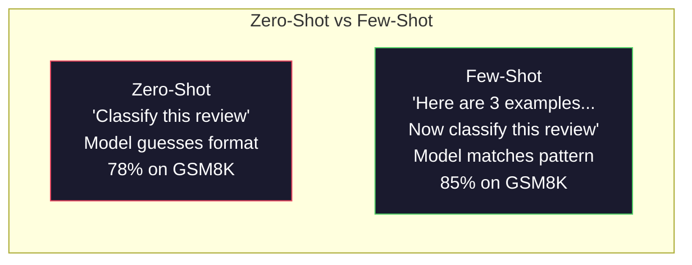
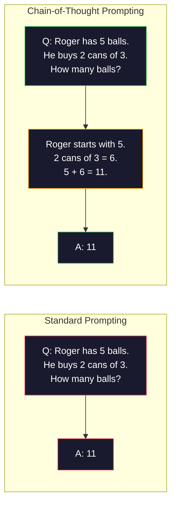
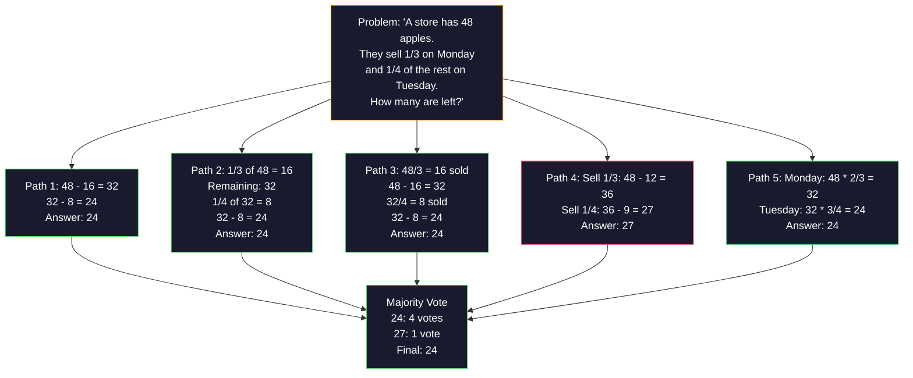
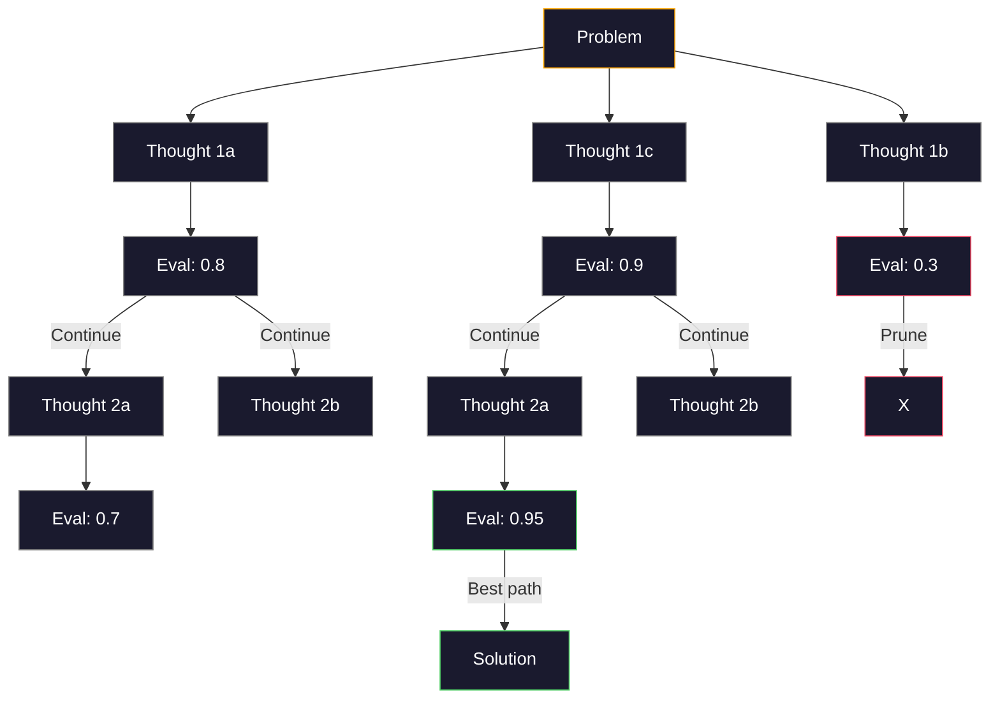

# 少样本、思维链与思维树

> 告诉模型做什么，是 prompting；向它展示如何思考，才是工程。同一个模型、同一个任务、同一份数据，78% 和 91% 的准确率之间的差距，不是来自更好的模型，而是来自更好的推理策略。

**Type:** Build
**Languages:** Python
**Prerequisites:** Lesson 11.01 (Prompt Engineering)
**Time:** ~45 minutes

## 学习目标

- 通过选择并格式化能最大化任务准确率的示例演示，实现 few-shot prompting
- 应用思维链（CoT）推理，提高数学应用题等多步问题的准确率
- 构建一个思维树 prompt，探索多条推理路径并选出最佳路径
- 在标准基准上测量 zero-shot、few-shot 与 CoT 带来的准确率提升

## 问题

你在做一个数学辅导应用。prompt 写的是：「Solve this word problem.」在小学数学的标准基准 GSM8K 上，GPT-5 有 94% 的概率答对。你以为自己已经到顶了。并没有——思维链还能再加 3-4 个百分点。

加上五个词——「Let's think step by step」——准确率就跳到 91%。再加几个带步骤的示例，能达到 95%。同一个模型，同一个温度，同样的 API 成本。唯一的区别是，你给了模型一张草稿纸。

这不是取巧。推理本来就是这样运作的。人类解决多步问题，不会一步在脑中跳完；Transformer 也一样。当你强制模型生成中间 token 时，这些 token 会成为下一个 token 的上下文。每一步推理都喂给下一步。模型是字面意义上「算」出答案的。

但「think step by step」只是起点，不是终点。如果你采样五条推理路径然后多数表决呢？如果你让模型探索一棵可能性之树，逐枝评估并剪枝呢？如果你把推理与工具使用交错起来呢？这些都不是假设。它们是有实测提升的已发表技术，你将在本课把它们全部实现。

## 概念

### zero-shot 与 few-shot：示例何时胜过指令

zero-shot prompting 只给模型一个任务，别的什么都不给。few-shot prompting 则先给示例。

Wei 等人（2022）在 8 个基准上测量了这一点。对于情感分类这样简单的任务，zero-shot 和 few-shot 的差距在 2% 以内。对于多步算术和符号推理这样复杂的任务，few-shot 把准确率提高了 10-25%。

直观理解：示例是压缩后的指令。与其描述输出格式，不如直接展示；与其解释推理过程，不如直接演示。模型对示例做模式匹配，比解释抽象指令更可靠。



**few-shot 胜出的场景**：对格式敏感的任务、分类、结构化抽取、领域术语，以及任何需要模型匹配特定模式的任务。

**zero-shot 胜出的场景**：简单的事实问题；示例会限制创造力的创意任务；以及找到好示例比写好指令更难的场景。

### 示例选择：相似胜过随机

并非所有示例都等价。在分类任务上，选择与目标输入相似的示例，比随机选择高出 5-15%（Liu 等人，2022）。三条原则：

1. **语义相似度**：挑选在 embedding 空间中离输入最近的示例
2. **标签多样性**：示例要覆盖所有输出类别
3. **难度匹配**：匹配目标问题的复杂度水平

对大多数任务而言，最佳示例数是 3-5 个。少于 3 个，模型没有足够信号提取模式。多于 5 个，收益递减，还浪费上下文窗口的 token。标签很多的分类任务，每个标签用一个示例。

### 思维链：给模型一张草稿纸

思维链（Chain-of-Thought，CoT）prompting 由 Google Brain 的 Wei 等人（2022）提出。思路很简单：不要只向模型要答案，先让它展示推理步骤。



这在机制上为什么有效？Transformer 生成的每个 token 都会成为下一个 token 的上下文。没有 CoT 时，模型必须把全部推理压缩进单次前向传播的隐藏状态。有了 CoT，模型把中间计算外化为 token。每个推理 token 都扩展了有效计算深度。

**GSM8K 基准（小学数学，8500 道题）：**

| 模型 | Zero-Shot | Zero-Shot CoT | Few-Shot CoT |
|-------|-----------|---------------|--------------|
| GPT-4o | 78% | 91% | 95% |
| GPT-5 | 94% | 97% | 98% |
| o4-mini（推理） | 97% | — | — |
| Claude Opus 4.7 | 93% | 97% | 98% |
| Gemini 3 Pro | 92% | 96% | 98% |
| Llama 4 70B | 80% | 89% | 94% |
| DeepSeek-V3.1 | 89% | 94% | 96% |

**关于推理模型的说明。** OpenAI o 系列（o3、o4-mini）和 DeepSeek-R1 这类模型会在给出答案前在内部运行思维链。对推理模型加「Let's think step by step」是多余的，有时甚至适得其反——它们已经做过了。

两种 CoT 变体：

**zero-shot CoT**：在 prompt 末尾追加「Let's think step by step」。不需要示例。Kojima 等人（2022）证明，这一句话就能提高算术、常识和符号推理任务的准确率。

**few-shot CoT**：提供包含推理步骤的示例。它比 zero-shot CoT 更有效，因为模型看到了你期望的精确推理格式。

**CoT 何时有害**：简单的事实回忆（「What is the capital of France?」）、单步分类，以及速度比准确率更重要的任务。CoT 每次查询会增加 50-200 token 的推理开销。对高通量、低复杂度的任务来说，这是浪费成本。

### 自洽性：多次采样，一次投票

Wang 等人（2023）提出了自洽性（self-consistency）。洞见在于：单条 CoT 路径可能包含推理错误；但如果你采样 N 条独立的推理路径（temperature > 0），并对最终答案做多数表决，错误会相互抵消。



在最初的 PaLM 540B 实验中，自洽性把 GSM8K 准确率从 56.5%（单条 CoT）提升到 74.4%（N=40）。在 GPT-5 上提升很小（97% 到 98%），因为基础准确率已经饱和。这项技术在基础 CoT 准确率为 60-85% 的模型上最闪光——那是单路径错误频繁但并非系统性的甜点区。对推理模型（o 系列、R1）来说，自洽性已被内置的内部采样所涵盖。

代价是：N 次采样意味着 N 倍的 API 成本和延迟。实践中 N=5 就能拿到大部分收益。N=3 是有意义投票的最低值。N > 10 对大多数任务收益递减。

### 思维树：分支式探索

Yao 等人（2023）提出了思维树（Tree-of-Thought，ToT）。CoT 沿着一条线性的推理路径前进，而 ToT 会探索多个分支，先评估哪些最有希望，再继续深入。



ToT 有三个组成部分：

1. **思维生成**：产生多个候选的下一步
2. **状态评估**：给每个候选打分（可以用 LLM 自己作为评估器）
3. **搜索算法**：在树中做 BFS 或 DFS，剪掉得分低的分支

在 Game of 24 任务上（用 4 个数字通过算术凑出 24），GPT-4 用标准 prompting 能解出 7.3% 的题目。用 CoT 是 4.0%（这里 CoT 反而有害，因为搜索空间很宽）。用 ToT 则是 74%。

ToT 很贵。树中的每个节点都需要一次 LLM 调用。分支因子为 3、深度为 3 的树最多需要 39 次 LLM 调用。只把它用于搜索空间大但可评估的问题——规划、解谜、带约束的创造性问题求解。

### ReAct：思考 + 行动

Yao 等人（2022）把推理轨迹与动作结合起来。模型在思考（生成推理）与行动（调用工具、搜索、计算）之间交替。

```mermaid
graph LR
    Q["Question:\nWhat is the\npopulation of the\ncountry where\nthe Eiffel Tower\nis located?"]
    T1["Thought: I need to\nfind which country\nhas the Eiffel Tower"]
    A1["Action: search\n'Eiffel Tower location'"]
    O1["Observation:\nParis, France"]
    T2["Thought: Now I need\nFrance's population"]
    A2["Action: search\n'France population 2024'"]
    O2["Observation:\n68.4 million"]
    T3["Thought: I have\nthe answer"]
    F["Answer:\n68.4 million"]

    Q --> T1 --> A1 --> O1 --> T2 --> A2 --> O2 --> T3 --> F

    style Q fill:#1a1a2e,stroke:#ffa500,color:#fff
    style T1 fill:#1a1a2e,stroke:#51cf66,color:#fff
    style A1 fill:#1a1a2e,stroke:#e94560,color:#fff
    style O1 fill:#1a1a2e,stroke:#808080,color:#fff
    style T2 fill:#1a1a2e,stroke:#51cf66,color:#fff
    style A2 fill:#1a1a2e,stroke:#e94560,color:#fff
    style O2 fill:#1a1a2e,stroke:#808080,color:#fff
    style T3 fill:#1a1a2e,stroke:#51cf66,color:#fff
    style F fill:#1a1a2e,stroke:#51cf66,color:#fff
```



在知识密集型任务上，ReAct 胜过纯 CoT，因为它能把推理扎根于真实数据。在多跳问答 HotpotQA 上，ReAct 配合 GPT-4 的精确匹配率为 35.1%，而单独 CoT 为 29.4%。真正的威力在于，推理错误会被观察结果纠正——模型可以在执行中途更新计划。

ReAct 是现代 AI 智能体的基础。每个智能体框架（LangChain、CrewAI、AutoGen）都实现了 Thought-Action-Observation 循环的某种变体。你会在第 14 阶段构建完整的智能体。本课只讲 prompting 模式。

### 结构化 prompt：XML 标签、分隔符与标题

prompt 变复杂后，结构能防止模型混淆各个部分。三种做法：

**XML 标签**（对 Claude 效果最好，在所有模型上都不错）：
```
<context>
You are reviewing a pull request.
The codebase uses TypeScript and React.
</context>

<task>
Review the following diff for bugs, security issues, and style violations.
</task>

<diff>
{diff_content}
</diff>

<output_format>
List each issue with: file, line, severity (critical/warning/info), description.
</output_format>
```

**Markdown 标题**（通用）：
```
## Role
Senior security engineer at a fintech company.

## Task
Analyze this API endpoint for vulnerabilities.

## Input
{api_code}

## Rules
- Focus on OWASP Top 10
- Rate each finding: critical, high, medium, low
- Include remediation steps
```

**分隔符**（极简但有效）：
```
---INPUT---
{user_text}
---END INPUT---

---INSTRUCTIONS---
Summarize the above in 3 bullet points.
---END INSTRUCTIONS---
```

### prompt 链：顺序分解

有些任务复杂到单个 prompt 处理不了。prompt 链把它们拆成步骤，前一个 prompt 的输出成为后一个的输入。


链式调用胜过单 prompt 有三个原因：

1. **每一步更简单**：模型只处理一个聚焦的任务，而不是同时应付所有事
2. **中间输出可检查**：你可以在步骤之间验证和纠正
3. **不同步骤可以用不同模型**：用便宜的模型做抽取，用昂贵的模型做推理

### 性能对比

| 技术 | 最适合 | GSM8K 准确率（GPT-5） | API 调用次数 | token 开销 | 复杂度 |
|-----------|----------|------------------------|-----------|----------------|------------|
| zero-shot | 简单任务 | 94% | 1 | 无 | 极低 |
| few-shot | 格式匹配 | 96% | 1 | 200-500 token | 低 |
| zero-shot CoT | 快速提升推理 | 97% | 1 | 50-200 token | 极低 |
| few-shot CoT | 单次调用准确率最大化 | 98% | 1 | 300-600 token | 低 |
| 自洽性（N=5） | 高风险推理 | 98.5% | 5 | 5 倍 token 成本 | 中 |
| 推理模型（o4-mini） | 即插即用的 CoT 替代 | 97% | 1 | 隐藏（内部 2-10 倍） | 极低 |
| 思维树 | 搜索/规划问题 | N/A（Game of 24 上 74%） | 10-40+ | 10-40 倍 token 成本 | 高 |
| ReAct | 知识接地的推理 | N/A（HotpotQA 上 35.1%） | 3-10+ | 不定 | 高 |
| prompt 链 | 复杂多步任务 | 96%（整条 pipeline） | 2-5 | 2-5 倍 token 成本 | 中 |

正确的技术取决于三个因素：准确率要求、延迟预算和成本容忍度。对大多数生产系统来说，few-shot CoT 加上 3 样本的自洽性回退，覆盖了 90% 的使用场景。

```figure
few-shot-curve
```

## 构建它

我们要构建一个数学题求解器，把 few-shot prompting、思维链推理和自洽性投票合并到一条 pipeline 里。然后针对难题加入思维树。

完整实现在 `code/advanced_prompting.py`。以下是关键组件。

### 第 1 步：few-shot 示例库

第一个组件管理 few-shot 示例，并为给定问题挑选最相关的示例。

```python
GSM8K_EXAMPLES = [
    {
        "question": "Janet's ducks lay 16 eggs per day. She eats three for breakfast every morning and bakes muffins for her friends every day with four. She sells every egg at the farmers' market for $2. How much does she make every day at the farmers' market?",
        "reasoning": "Janet's ducks lay 16 eggs per day. She eats 3 and bakes 4, using 3 + 4 = 7 eggs. So she has 16 - 7 = 9 eggs left. She sells each for $2, so she makes 9 * 2 = $18 per day.",
        "answer": "18"
    },
    ...
]
```

每个示例包含三部分：问题、推理链和最终答案。推理链正是把普通 few-shot 示例变成 CoT few-shot 示例的东西。

### 第 2 步：思维链 prompt 构建器

prompt 构建器把 system message、带推理链的 few-shot 示例和目标问题组装成一个 prompt。

```python
def build_cot_prompt(question, examples, num_examples=3):
    system = (
        "You are a math problem solver. "
        "For each problem, show your step-by-step reasoning, "
        "then give the final numerical answer on the last line "
        "in the format: 'The answer is [number]'."
    )

    example_text = ""
    for ex in examples[:num_examples]:
        example_text += f"Q: {ex['question']}\n"
        example_text += f"A: {ex['reasoning']} The answer is {ex['answer']}.\n\n"

    user = f"{example_text}Q: {question}\nA:"
    return system, user
```

格式约束（「The answer is [number]」）至关重要。没有它，自洽性就无法在多个样本之间抽取并比较答案。

### 第 3 步：自洽性投票

采样 N 条推理路径，取多数答案。

```python
def self_consistency_solve(question, examples, client, model, n_samples=5):
    system, user = build_cot_prompt(question, examples)

    answers = []
    reasonings = []
    for _ in range(n_samples):
        response = client.chat.completions.create(
            model=model,
            messages=[
                {"role": "system", "content": system},
                {"role": "user", "content": user}
            ],
            temperature=0.7
        )
        text = response.choices[0].message.content
        reasonings.append(text)
        answer = extract_answer(text)
        if answer is not None:
            answers.append(answer)

    vote_counts = Counter(answers)
    best_answer = vote_counts.most_common(1)[0][0] if vote_counts else None
    confidence = vote_counts[best_answer] / len(answers) if best_answer else 0

    return best_answer, confidence, reasonings, vote_counts
```

temperature 0.7 很重要。在 temperature 0.0 下，N 个样本会完全相同，自洽性就失去意义。你需要足够的随机性来获得多样化的推理路径，但也不能高到让模型胡言乱语。

### 第 4 步：思维树求解器

对于线性推理会失败的问题，ToT 会探索多种思路，并评估哪个方向最有希望。

```python
def tree_of_thought_solve(question, client, model, breadth=3, depth=3):
    thoughts = generate_initial_thoughts(question, client, model, breadth)
    scored = [(t, evaluate_thought(t, question, client, model)) for t in thoughts]
    scored.sort(key=lambda x: x[1], reverse=True)

    for current_depth in range(1, depth):
        next_thoughts = []
        for thought, score in scored[:2]:
            extensions = extend_thought(thought, question, client, model, breadth)
            for ext in extensions:
                ext_score = evaluate_thought(ext, question, client, model)
                next_thoughts.append((ext, ext_score))
        scored = sorted(next_thoughts, key=lambda x: x[1], reverse=True)

    best_thought = scored[0][0] if scored else ""
    return extract_answer(best_thought), best_thought
```

评估器本身也是一次 LLM 调用。你问模型：「On a scale of 0.0 to 1.0, how promising is this reasoning path for solving the problem?」这就是 ToT 的核心洞见——模型评估自己的部分解。

### 第 5 步：完整 pipeline

pipeline 把所有技术组合起来，并配上一套升级策略。

```python
def solve_with_escalation(question, examples, client, model):
    single_answer, _ = few_shot_cot_solve(question, examples, client, model)

    sc_answer, confidence, _, _ = self_consistency_solve(
        question, examples, client, model, n_samples=5
    )

    if confidence >= 0.8 and single_answer == sc_answer:
        return sc_answer, "self_consistency", confidence

    tot_answer, _ = tree_of_thought_solve(question, client, model)
    return tot_answer, "tree_of_thought", None
```

升级逻辑：先试最便宜的（单条 CoT）。单条确定性路径没有投票份额，所以它的质量检查依据是一致性：temperature-0 的答案必须与采样路径的多数答案相同。如果不同，或者自洽性的置信度低于 0.8（5 个样本中不足 4 个一致），就升级到 ToT。这在成本与准确率之间取得平衡——大多数问题用低成本解决，难题获得更多算力。

## 使用它

### 模板驱动的 few-shot prompt

LangChain 内置了 prompt 模板和输出解析支持，可以简化 few-shot 与 CoT 模式：

```python
from langchain_core.prompts import FewShotPromptTemplate, PromptTemplate
from langchain_openai import ChatOpenAI

example_prompt = PromptTemplate(
    input_variables=["question", "reasoning", "answer"],
    template="Q: {question}\nA: {reasoning} The answer is {answer}."
)

few_shot_prompt = FewShotPromptTemplate(
    examples=examples,
    example_prompt=example_prompt,
    suffix="Q: {input}\nA: Let's think step by step.",
    input_variables=["input"]
)

llm = ChatOpenAI(model="gpt-4o", temperature=0.7)
chain = few_shot_prompt | llm
result = chain.invoke({"input": "If a train travels 120 km in 2 hours..."})
```

LangChain 还提供 `ExampleSelector` 类，用于语义相似度选择：

```python
from langchain_core.example_selectors import SemanticSimilarityExampleSelector
from langchain_openai import OpenAIEmbeddings

selector = SemanticSimilarityExampleSelector.from_examples(
    examples,
    OpenAIEmbeddings(),
    k=3
)
```

### 编译式 prompt

DSPy 把 prompting 策略视为可优化的模块。你不必手工打造 CoT prompt，只需声明一个 signature，让 DSPy 优化 prompt：

```python
import dspy

dspy.configure(lm=dspy.LM("openai/gpt-4o", temperature=0.7))

class MathSolver(dspy.Module):
    def __init__(self):
        self.solve = dspy.ChainOfThought("question -> answer")

    def forward(self, question):
        return self.solve(question=question)

solver = MathSolver()
result = solver(question="Janet's ducks lay 16 eggs per day...")
```

DSPy 的 `ChainOfThought` 会自动添加推理轨迹。`dspy.majority` 实现了自洽性：

```python
result = dspy.majority(
    [solver(question=q) for _ in range(5)],
    field="answer"
)
```

### 对比：从零实现 vs 框架

| 特性 | 从零实现（本课） | LangChain | DSPy |
|---------|--------------------------|-----------|------|
| 对 prompt 格式的控制 | 完全 | 基于模板 | 自动 |
| 自洽性 | 手动投票 | 手动 | 内置（`dspy.majority`） |
| 示例选择 | 自定义逻辑 | `ExampleSelector` | `dspy.BootstrapFewShot` |
| 思维树 | 自定义树搜索 | 社区链 | 非内置 |
| prompt 优化 | 手动迭代 | 手动 | 自动编译 |
| 最适合 | 学习、自定义 pipeline | 标准工作流 | 研究、优化 |

## 交付它

本课产生两个成品。

**1. 推理链 prompt**（`outputs/prompt-reasoning-chain.md`）：一个可用于生产的 few-shot CoT + 自洽性 prompt 模板。填入你的示例和问题领域即可。

**2. CoT 模式选择 skill**（`outputs/skill-cot-patterns.md`）：一个决策框架，根据任务类型、准确率要求和成本约束，选择正确的推理技术。

## 练习

1. **测量差距**：取 10 道 GSM8K 题。分别用 zero-shot、few-shot、zero-shot CoT 和 few-shot CoT 求解。记录每种方法的准确率。在你的模型上，哪种技术提升最大？

2. **示例选择实验**：对同样的 10 道题，比较随机选示例与手工挑选相似示例。测量准确率差异。从什么时候开始，示例质量比示例数量更重要？

3. **自洽性成本曲线**：在 20 道 GSM8K 题上，用 N=1、3、5、7、10 运行自洽性。绘制准确率与成本（总 token 数）的关系。你的模型上曲线的拐点在哪里？

4. **构建 ReAct 循环**：为 pipeline 加一个计算器工具。当模型生成数学表达式时，用 Python 的 `eval()`（在沙箱中）执行它，并把结果回传。测量工具接地的推理是否胜过纯 CoT。

5. **用 ToT 做创意任务**：把思维树求解器改造到一个创意写作任务上：「Write a 6-word story that is both funny and sad.」用 LLM 作为评估器。分支探索是否比单次生成产出更好的创意输出？

## 关键术语

| 术语 | 大家怎么说 | 它实际是什么意思 |
|------|----------------|----------------------|
| few-shot prompting | 「给它几个例子」 | 在 prompt 中加入输入-输出演示，以锚定模型的输出格式和行为 |
| Chain-of-Thought | 「让它一步一步思考」 | 引导模型生成中间推理 token，在给出最终答案前扩展其有效计算量 |
| Self-Consistency | 「多跑几次」 | 在 temperature > 0 下采样 N 条多样化推理路径，用多数投票选出最常见的最终答案 |
| Tree-of-Thought | 「让它探索各种选项」 | 在推理分支上做结构化搜索，评估每个部分解，只扩展有希望的路径 |
| ReAct | 「思考 + 工具使用」 | 把推理轨迹与外部动作（搜索、计算、API 调用）交错成 Thought-Action-Observation 循环 |
| prompt 链 | 「拆成几步」 | 把复杂任务分解为一串顺序 prompt，每个输出喂给下一个输入 |
| zero-shot CoT | 「只加一句『一步一步思考』」 | 在没有任何示例的 prompt 末尾追加一句推理触发语，依赖模型潜在的推理能力 |

## 延伸阅读

- [Chain-of-Thought Prompting Elicits Reasoning in Large Language Models](https://arxiv.org/abs/2201.11903) —— Wei 等人，2022。Google Brain 的原始 CoT 论文。核心结果见第 2-3 节。
- [Self-Consistency Improves Chain of Thought Reasoning in Language Models](https://arxiv.org/abs/2203.11171) —— Wang 等人，2023。自洽性论文。表 1 有你需要的数据。
- [Tree of Thoughts: Deliberate Problem Solving with Large Language Models](https://arxiv.org/abs/2305.10601) —— Yao 等人，2023。ToT 论文。第 4 节的 Game of 24 结果最精彩。
- [ReAct: Synergizing Reasoning and Acting in Language Models](https://arxiv.org/abs/2210.03629) —— Yao 等人，2022。现代 AI 智能体的基础。第 3 节解释了 Thought-Action-Observation 循环。
- [Large Language Models are Zero-Shot Reasoners](https://arxiv.org/abs/2205.11916) —— Kojima 等人，2022。「Let's think step by step」论文。方法简单得令人意外，却出奇有效。
- [DSPy: Compiling Declarative Language Model Calls into Self-Improving Pipelines](https://arxiv.org/abs/2310.03714) —— Khattab 等人，2023。把 prompting 当成编译问题。如果你想超越手工 prompt 工程，值得一读。
- [OpenAI — Reasoning models guide](https://platform.openai.com/docs/guides/reasoning) —— 厂商指南：思维链何时变成内部的、按 token 计费的「推理」模式，何时只是 prompt 层面的技巧。
- [Lightman et al., "Let's Verify Step by Step" (2023)](https://arxiv.org/abs/2305.20050) —— 过程奖励模型（PRM）会给链条的每一步打分；这是取代只看结果奖励的推理监督信号。
- [Snell et al., "Scaling LLM Test-Time Compute Optimally" (2024)](https://arxiv.org/abs/2408.03314) —— 系统研究 CoT 长度、自洽性采样与 MCTS；当准确率比延迟更重要时，「think step by step」会走向何方。
