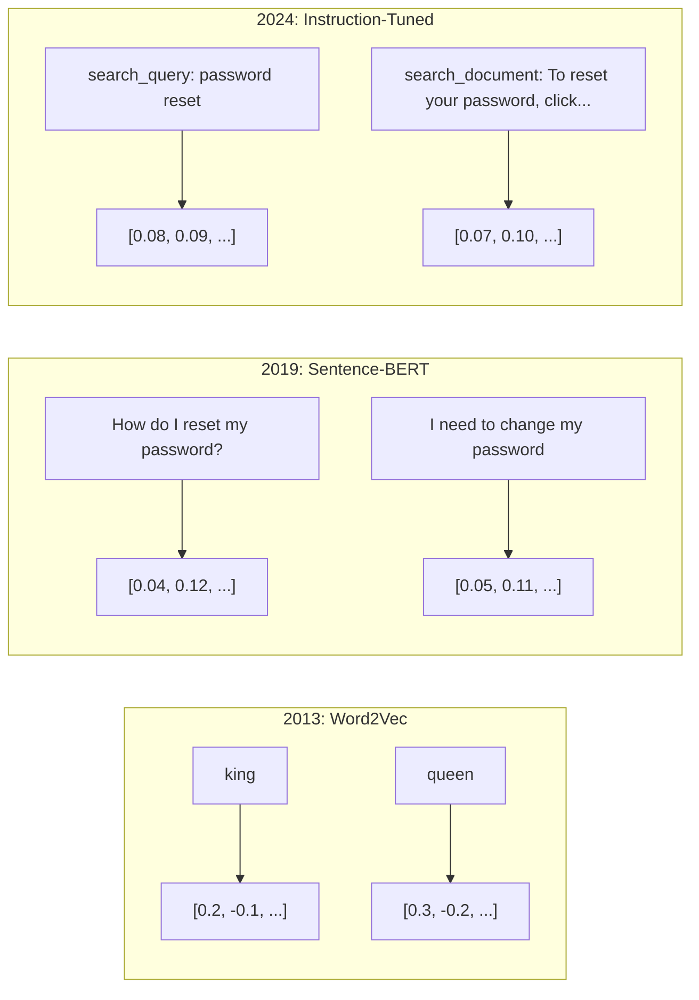
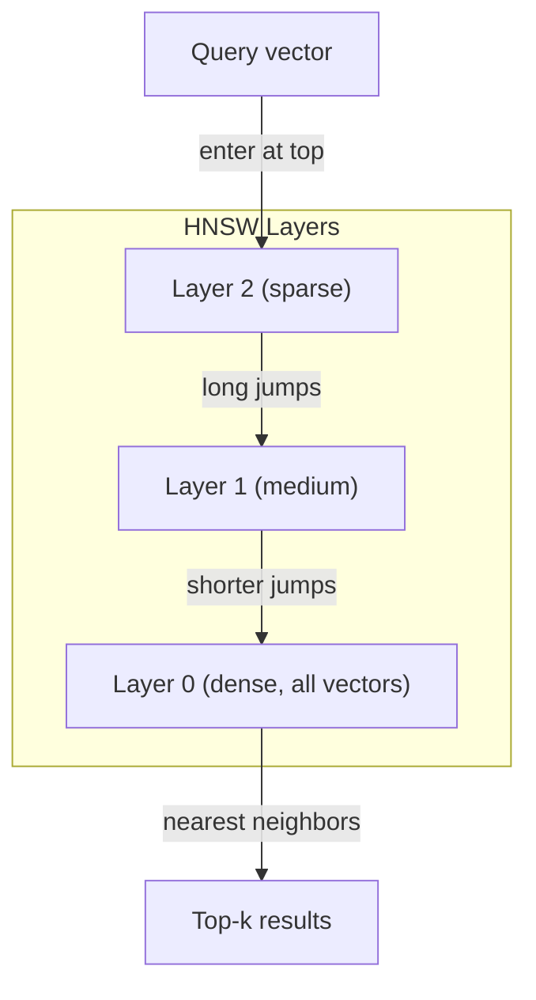

# 嵌入与向量表示

> 文本是离散的，数学是连续的。每当你让 LLM 找「相似」文档、比较语义、或做关键词之外的搜索时，你都在依赖这两个世界之间的一座桥。这座桥就是嵌入（embedding）。不理解嵌入，就不算理解现代 AI——你只是在用它。

**Type:** Build
**Languages:** Python
**Prerequisites:** Phase 11, Lesson 01 (Prompt Engineering)
**Time:** ~75 minutes
**Related:** 阶段 5 · 22（嵌入模型深入解析）涵盖稠密、稀疏与多向量嵌入、Matryoshka 截断，以及按维度轴选择模型。本课聚焦生产 pipeline（向量数据库、HNSW、相似度数学）。选择模型之前请先读阶段 5 · 22。

## 学习目标

- 使用 API 提供商和开源模型生成文本嵌入，并计算它们之间的余弦相似度
- 解释嵌入为什么能解决关键词搜索无法处理的词汇不匹配问题
- 构建语义搜索索引，按语义而不是精确关键词匹配检索文档
- 使用检索基准（precision@k、recall）评估嵌入质量，并为你的任务选择合适的嵌入模型

## 问题

你有 10,000 张客服工单。一位客户写道「my payment didn't go through」。你需要找到类似的历史工单。关键词搜索会找到包含「payment」和「didn't go through」的工单，却会漏掉「transaction failed」「charge was declined」「billing error」。这些工单用完全不同的词描述了同一个问题。

这就是词汇不匹配问题。人类语言表达同一件事有几十种说法。关键词搜索把每个词当作没有含义的独立符号，它无法知道「declined」和「didn't go through」指的是同一个概念。

你需要一种文本表示，让相似度由语义而非拼写决定。你需要把「my payment didn't go through」和「transaction was declined」在某个数学空间中放得很近，同时把「my payment arrived on time」推得很远——尽管它们共享「payment」这个词。

这种表示就是嵌入。

## 概念

### 什么是嵌入？

嵌入是一个由浮点数组成的稠密向量，用来表示文本的语义。「稠密」这个词很关键——每个维度都携带信息；而在稀疏表示（词袋、TF-IDF）中，大多数维度都是零。

「The cat sat on the mat」会变成类似 `[0.023, -0.041, 0.087, ..., 0.012]` 的东西——一列 768 到 3072 个数字，取决于模型。这些数字编码了语义。你从不直接检查它们，你比较它们。

### Word2Vec 的突破

2013 年，Google 的 Tomas Mikolov 及其同事发表了 Word2Vec。核心洞见是：训练一个神经网络，用邻近词预测某个词（或用某个词预测邻近词），隐藏层的权重就会变成有意义的向量表示。

著名的结果：

```
king - man + woman = queen
```

对词嵌入做向量算术可以捕捉语义关系。从「man」到「woman」的方向，与从「king」到「queen」的方向大致相同。这正是该领域意识到几何可以编码语义的时刻。

Word2Vec 产出 300 维向量。每个词只有一个向量，与上下文无关。「river bank」和「bank account」中的「bank」拥有相同的嵌入。这一局限推动了此后十年的研究。

### 从词到句子

词嵌入表示单个 token。生产系统需要嵌入整句、整段甚至整篇文档。出现了四种方法：

**平均法（Averaging）**：取句中所有词向量的均值。便宜、有损，对短文本效果出奇地不错。但它完全丢失词序——「dog bites man」和「man bites dog」会得到相同的嵌入。

**CLS token**：Transformer 模型（BERT，2018）会输出一个特殊的 [CLS] token 嵌入，表示整个输入。它比平均法更好，但 [CLS] token 是为一句话预测任务训练的，而不是相似度。

**对比学习（Contrastive learning）**：显式训练模型，把相似对拉近、不相似对推远。Sentence-BERT（Reimers & Gurevych，2019）采用这种方法，成为现代嵌入模型的基础。给定「How do I reset my password?」和「I need to change my password」，模型学会让它们拥有几乎相同的向量。

**指令微调嵌入（Instruction-tuned embeddings）**：最新方法。E5 和 GTE 等模型接受任务前缀（「search_query:」「search_document:」），告诉模型该产出哪类嵌入。这样一个模型就能服务多种任务。



### 现代嵌入模型

市场已经收敛到少数几个生产级选项（MTEB 分数截至 2026 年初，MTEB v2）：

| 模型 | 提供商 | 维度 | MTEB | 上下文 | 每百万 token 成本 |
|-------|----------|-----------|------|---------|------------------|
| Gemini Embedding 2 | Google | 3072 (Matryoshka) | 67.7（检索） | 8192 | $0.15 |
| embed-v4 | Cohere | 1024 (Matryoshka) | 65.2 | 128K | $0.12 |
| voyage-4 | Voyage AI | 1024/2048 (Matryoshka) | 66.8 | 32K | $0.12 |
| text-embedding-3-large | OpenAI | 3072 (Matryoshka) | 64.6 | 8192 | $0.13 |
| text-embedding-3-small | OpenAI | 1536 (Matryoshka) | 62.3 | 8192 | $0.02 |
| BGE-M3 | BAAI | 1024 (dense+sparse+ColBERT) | 63.0（多语言） | 8192 | 开放权重 |
| Qwen3-Embedding | Alibaba | 4096 (Matryoshka) | 66.9 | 32K | 开放权重 |
| Nomic-embed-v2 | Nomic | 768 (Matryoshka) | 63.1 | 8192 | 开放权重 |

MTEB（Massive Text Embedding Benchmark）v2 覆盖检索、分类、聚类、重排和摘要等 100 多个任务，分数越高越好。到 2026 年，开放权重模型（Qwen3-Embedding、BGE-M3）在大多数维度上已经追平甚至超过闭源托管模型。Gemini Embedding 2 在纯检索上领先；Voyage/Cohere 在特定领域（金融、法律、代码）领先。做最终决定前，一定要在你自己的查询上做基准测试。

### 相似度度量

给定两个嵌入向量，有三种度量相似度的方法：

**余弦相似度（Cosine similarity）**：两个向量夹角的余弦值，范围从 -1（相反）到 1（方向一致）。它忽略向量长度——一个 10 词的句子和一个 500 词的文档，只要方向相同，就可以得到 1.0 分。这是 90% 用例的默认选择。

```math
\mathop{\mathrm{cosine\_sim}}(a, b) = \frac{\mathop{\mathrm{dot}}(a, b)}{\lVert a \rVert \cdot \lVert b \rVert}
```

**点积（Dot product）**：两个向量的原始内积。向量归一化（单位长度）后与余弦相似度等价。计算更快。OpenAI 的嵌入是归一化的，所以点积和余弦给出一致的排序。

```math
\mathop{\mathrm{dot}}(a, b) = \sum_i a_i b_i
```

**欧氏距离（Euclidean，L2）**：向量空间中的直线距离。越小越相似。对长度差异敏感。当你关心空间中的绝对位置而不只是方向时使用。

```math
\mathop{\mathrm{L2}}(a, b) = \sqrt{\sum_i (a_i - b_i)^2}
```

何时用哪种：

| 度量 | 使用时机 | 避免时机 |
|--------|----------|------------|
| 余弦相似度 | 比较长度不同的文本；大多数检索任务 | 向量长度本身携带信息 |
| 点积 | 嵌入已归一化；追求最高速度 | 向量长度不一 |
| 欧氏距离 | 聚类；空间最近邻问题 | 比较长度差异巨大的文档 |

### 向量数据库与 HNSW

暴力相似度搜索会把查询与每个已存向量逐一比较。100 万个 1536 维向量，每次查询就是 15 亿次乘加运算。太慢。

向量数据库用近似最近邻（ANN）算法解决这个问题。主流算法是 HNSW（Hierarchical Navigable Small World，分层可导航小世界）：

1. 构建向量的多层图
2. 顶层稀疏——遥远簇之间的长程连接
3. 底层稠密——邻近向量之间的细粒度连接
4. 搜索从顶层开始，贪心下降逐层细化
5. 以 $O(\log n)$ 而不是 $O(n)$ 的时间返回近似 top-k 结果

HNSW 用很小的精度损失（召回率通常在 95-99%）换取巨大的速度提升。1000 万个向量时，暴力搜索要几秒，HNSW 只要几毫秒。



生产选项：

| 数据库 | 类型 | 最适合 | 最大规模 |
|----------|------|----------|-----------|
| Pinecone | 托管 SaaS | 零运维生产 | 数十亿 |
| Weaviate | 开源 | 自托管、混合搜索 | 1 亿+ |
| Qdrant | 开源 | 高性能、过滤 | 1 亿+ |
| ChromaDB | 嵌入式 | 原型开发、本地开发 | 100 万 |
| pgvector | Postgres 扩展 | 已在用 Postgres | 1000 万 |
| FAISS | 库 | 进程内、研究 | 10 亿+ |

### 分块策略

文档太长，无法作为单个向量嵌入。一份 50 页的 PDF 涵盖几十个主题——它的嵌入变成所有内容的平均，和任何具体主题都不相似。你把文档切成块，逐块嵌入。

**固定长度分块**：每 N 个 token 切一块，块间重叠 M 个 token。简单、可预测。文档没有清晰结构时效果好。512 token 的块、50 token 重叠：第 1 块是 token 0-511，第 2 块是 token 462-973。

**基于句子的分块**：在句子边界切分，累积句子直到达到 token 上限。每块至少是一个完整句子。比固定长度更好，因为你不会把一个想法切成两半。

**递归分块**：先尝试在最大的边界切（章节标题），还是太大就试段落边界，然后句子边界，最后字符上限。这就是 LangChain 的 `RecursiveCharacterTextSplitter`，对混合格式语料效果很好。

**语义分块**：先嵌入每个句子，再把嵌入相似的连续句子分组。当嵌入相似度跌破阈值时，开始新块。代价高（需要逐句嵌入），但产出的块最连贯。

| 策略 | 复杂度 | 质量 | 最适合 |
|----------|-----------|---------|----------|
| 固定长度 | 低 | 尚可 | 非结构化文本、日志 |
| 基于句子 | 低 | 好 | 文章、邮件 |
| 递归 | 中 | 好 | Markdown、HTML、混合文档 |
| 语义 | 高 | 最佳 | 关键检索质量 |

大多数系统的最佳区间：256-512 token 的块，重叠 50 token。

### 双编码器与交叉编码器

双编码器（bi-encoder）独立地嵌入查询和文档，然后比较向量。速度很快——查询只嵌入一次，再与预先计算好的文档嵌入比较。检索用的就是它。

交叉编码器（cross-encoder）把查询和文档作为单个输入，输出相关性分数。它很慢——每一对查询-文档都要过一遍完整模型。但准确得多，因为它可以同时关注查询和文档的 token。

生产模式是：双编码器召回前 100 个候选，交叉编码器把它们重排到前 10。这就是「先检索、后重排」pipeline。


重排模型：Cohere Rerank 3.5（每 1000 次查询 $2）、BGE-reranker-v2（免费、开源）、Jina Reranker v2（免费、开源）。

### Matryoshka 嵌入

传统嵌入是全有或全无的。1536 维向量就用 1536 个浮点数，不重新训练就无法截断到 256 维。

Matryoshka 表示学习（Kusupati 等，2022）解决了这个问题。模型的训练方式让前 N 个维度捕获最重要的信息，就像俄罗斯套娃。把 1536 维的 Matryoshka 嵌入截断到 256 维会损失一些精度，但仍可使用。

OpenAI 的 text-embedding-3-small 和 text-embedding-3-large 通过 `dimensions` 参数支持 Matryoshka 截断。请求 256 维而不是 1536 维，存储减少 6 倍，MTEB 基准上的精度损失约为 3-5%。

### 二值量化

一个以 float32 存储的 1536 维嵌入占用 6,144 字节。乘以 1000 万份文档：仅向量就要 61 GB。

二值量化把每个浮点数转成一位：正值变 1，负值变 0。存储从 6,144 字节降到 192 字节——减少 32 倍。相似度用汉明距离计算（统计不同的位），CPU 一条指令就能完成。

检索召回率大约会掉 5-10%。常见做法是：第一轮在数百万向量上做二值量化搜索，然后用全精度向量对前 1000 个结果重新打分。这样能以 1/32 的内存获得全精度 95% 以上的准确率。

```figure
cosine-similarity
```

## 构建它

我们从零构建一个语义搜索引擎。不用向量数据库，不用外部嵌入 API。纯 Python，数学运算用 numpy。

### 第 1 步：文本分块

```python
def chunk_text(text, chunk_size=200, overlap=50):
    words = text.split()
    chunks = []
    start = 0
    while start < len(words):
        end = start + chunk_size
        chunk = " ".join(words[start:end])
        chunks.append(chunk)
        start += chunk_size - overlap
    return chunks


def chunk_by_sentences(text, max_chunk_tokens=200):
    sentences = text.replace("\n", " ").split(".")
    sentences = [s.strip() + "." for s in sentences if s.strip()]
    chunks = []
    current_chunk = []
    current_length = 0
    for sentence in sentences:
        sentence_length = len(sentence.split())
        if current_length + sentence_length > max_chunk_tokens and current_chunk:
            chunks.append(" ".join(current_chunk))
            current_chunk = []
            current_length = 0
        current_chunk.append(sentence)
        current_length += sentence_length
    if current_chunk:
        chunks.append(" ".join(current_chunk))
    return chunks
```

### 第 2 步：从零构建嵌入

我们用 TF-IDF 加 L2 归一化实现一个简单的稠密嵌入。它不是神经网络嵌入，但遵守同样的契约：输入文本，输出固定长度的向量，相似的文本产生相似的向量。

```python
import math
import numpy as np
from collections import Counter

class SimpleEmbedder:
    def __init__(self):
        self.vocab = []
        self.idf = []
        self.word_to_idx = {}

    def fit(self, documents):
        vocab_set = set()
        for doc in documents:
            vocab_set.update(doc.lower().split())
        self.vocab = sorted(vocab_set)
        self.word_to_idx = {w: i for i, w in enumerate(self.vocab)}
        n = len(documents)
        self.idf = np.zeros(len(self.vocab))
        for i, word in enumerate(self.vocab):
            doc_count = sum(1 for doc in documents if word in doc.lower().split())
            self.idf[i] = math.log((n + 1) / (doc_count + 1)) + 1

    def embed(self, text):
        words = text.lower().split()
        count = Counter(words)
        total = len(words) if words else 1
        vec = np.zeros(len(self.vocab))
        for word, freq in count.items():
            if word in self.word_to_idx:
                tf = freq / total
                vec[self.word_to_idx[word]] = tf * self.idf[self.word_to_idx[word]]
        norm = np.linalg.norm(vec)
        if norm > 0:
            vec = vec / norm
        return vec
```

### 第 3 步：相似度函数

```python
def cosine_similarity(a, b):
    dot = np.dot(a, b)
    norm_a = np.linalg.norm(a)
    norm_b = np.linalg.norm(b)
    if norm_a == 0 or norm_b == 0:
        return 0.0
    return float(dot / (norm_a * norm_b))


def dot_product(a, b):
    return float(np.dot(a, b))


def euclidean_distance(a, b):
    return float(np.linalg.norm(a - b))
```

### 第 4 步：带暴力搜索的向量索引

```python
class VectorIndex:
    def __init__(self):
        self.vectors = []
        self.texts = []
        self.metadata = []

    def add(self, vector, text, meta=None):
        self.vectors.append(vector)
        self.texts.append(text)
        self.metadata.append(meta or {})

    def search(self, query_vector, top_k=5, metric="cosine"):
        scores = []
        for i, vec in enumerate(self.vectors):
            if metric == "cosine":
                score = cosine_similarity(query_vector, vec)
            elif metric == "dot":
                score = dot_product(query_vector, vec)
            elif metric == "euclidean":
                score = -euclidean_distance(query_vector, vec)
            else:
                raise ValueError(f"Unknown metric: {metric}")
            scores.append((i, score))
        scores.sort(key=lambda x: x[1], reverse=True)
        results = []
        for idx, score in scores[:top_k]:
            results.append({
                "text": self.texts[idx],
                "score": score,
                "metadata": self.metadata[idx],
                "index": idx
            })
        return results

    def size(self):
        return len(self.vectors)
```

### 第 5 步：语义搜索引擎

```python
class SemanticSearchEngine:
    def __init__(self, chunk_size=200, overlap=50):
        self.embedder = SimpleEmbedder()
        self.index = VectorIndex()
        self.chunk_size = chunk_size
        self.overlap = overlap

    def index_documents(self, documents, source_names=None):
        all_chunks = []
        all_sources = []
        for i, doc in enumerate(documents):
            chunks = chunk_text(doc, self.chunk_size, self.overlap)
            all_chunks.extend(chunks)
            name = source_names[i] if source_names else f"doc_{i}"
            all_sources.extend([name] * len(chunks))
        self.embedder.fit(all_chunks)
        for chunk, source in zip(all_chunks, all_sources):
            vec = self.embedder.embed(chunk)
            self.index.add(vec, chunk, {"source": source})
        return len(all_chunks)

    def search(self, query, top_k=5, metric="cosine"):
        query_vec = self.embedder.embed(query)
        return self.index.search(query_vec, top_k, metric)

    def search_with_scores(self, query, top_k=5):
        results = self.search(query, top_k)
        return [
            {
                "text": r["text"][:200],
                "source": r["metadata"].get("source", "unknown"),
                "score": round(r["score"], 4)
            }
            for r in results
        ]
```

### 第 6 步：比较相似度度量

```python
def compare_metrics(engine, query, top_k=3):
    results = {}
    for metric in ["cosine", "dot", "euclidean"]:
        hits = engine.search(query, top_k=top_k, metric=metric)
        results[metric] = [
            {"score": round(h["score"], 4), "preview": h["text"][:80]}
            for h in hits
        ]
    return results
```

## 使用它

换成生产级嵌入 API 后，架构完全不变，只替换 embedder：

```python
from openai import OpenAI

client = OpenAI()

def openai_embed(texts, model="text-embedding-3-small", dimensions=None):
    kwargs = {"model": model, "input": texts}
    if dimensions:
        kwargs["dimensions"] = dimensions
    response = client.embeddings.create(**kwargs)
    return [item.embedding for item in response.data]
```

用 OpenAI 做 Matryoshka 截断——同一个模型，更少的维度，更低的存储：

```python
full = openai_embed(["semantic search query"], dimensions=1536)
compact = openai_embed(["semantic search query"], dimensions=256)
```

256 维向量占用的存储少 6 倍。1000 万份文档对应 10 GB 对 61 GB。标准基准上的精度损失约为 3-5%。

用 Cohere 做重排：

```python
import cohere

co = cohere.ClientV2()

results = co.rerank(
    model="rerank-v3.5",
    query="What is the refund policy?",
    documents=["Full refund within 30 days...", "No refunds after 90 days..."],
    top_n=3
)
```

不依赖 API 的本地嵌入：

```python
from sentence_transformers import SentenceTransformer

model = SentenceTransformer("BAAI/bge-small-en-v1.5")
embeddings = model.encode(["semantic search query", "another document"])
```

我们构建的 VectorIndex 类适用于以上任何一种方案。替换嵌入函数，保留搜索逻辑即可。

## 交付它

本课产出：
- `outputs/prompt-embedding-advisor.md` —— 用于为特定用例选择嵌入模型与策略的 prompt
- `outputs/skill-embedding-patterns.md` —— 教智能体如何在生产中有效使用嵌入的 skill

## 练习

1. **度量比较**：用余弦相似度、点积和欧氏距离对样例文档运行同样的 5 个查询，记录每种度量的前 3 个结果。哪些查询上各度量结果不一致？为什么？

2. **块大小实验**：以 50、100、200、500 词的块大小索引样例文档。每种块大小运行 5 个查询，记录 top-1 相似度分数。画出块大小与检索质量的关系。找出更大的块开始产生负面效果的拐点。

3. **Matryoshka 模拟**：构建一个产出 500 维向量的 SimpleEmbedder。分别截断到 50、100、200、500 维。测量每次截断后检索召回率如何下降。这在不需要真正训练技巧的情况下模拟了 Matryoshka 行为。

4. **二值量化**：把搜索引擎中的嵌入转成二值（正值 1，负值 0），实现汉明距离搜索。将前 10 个结果与全精度余弦相似度的结果比较，测量重合百分比。

5. **基于句子的分块**：用 `chunk_by_sentences` 替换固定长度分块。运行同样的查询并比较检索分数。遵守句子边界能改善结果吗？

## 关键术语

| 术语 | 人们怎么说 | 它实际指什么 |
|------|----------------|----------------------|
| 嵌入（Embedding） | 「文本转数字」 | 一种稠密向量，其几何邻近性编码语义相似度 |
| Word2Vec | 「元老级嵌入」 | 2013 年通过预测上下文词学习词向量的模型；证明了向量算术可以编码语义 |
| 余弦相似度 | 「两个向量有多相似」 | 向量夹角的余弦值；1 = 方向相同，0 = 正交，-1 = 相反 |
| HNSW | 「快速向量搜索」 | 分层可导航小世界图——多层结构，实现 $O(\log n)$ 的近似最近邻搜索 |
| 双编码器（Bi-encoder） | 「分别嵌入，快速比较」 | 把查询和文档分别编码成向量；支持预计算和快速检索 |
| 交叉编码器（Cross-encoder） | 「慢但准确的重排器」 | 让查询-文档对联合通过完整模型；精度更高，无法预计算 |
| Matryoshka 嵌入 | 「可截断向量」 | 训练时让前 N 个维度捕获最重要信息的嵌入，支持可变大小存储 |
| 二值量化 | 「1 比特嵌入」 | 把浮点向量转成二值（仅符号位），实现 32 倍存储压缩，并用汉明距离搜索 |
| 分块（Chunking） | 「为嵌入切分文档」 | 把文档切成 256-512 token 的片段，使每段都能独立嵌入和检索 |
| 向量数据库 | 「嵌入的搜索引擎」 | 为存储向量和规模化近似最近邻搜索而优化的数据存储 |
| 对比学习 | 「通过对比训练」 | 把相似对嵌入拉近、不相似对嵌入推远的训练方法 |
| MTEB | 「嵌入基准」 | Massive Text Embedding Benchmark——覆盖 8 类任务的 56 个数据集；比较嵌入模型的标准 |

## 延伸阅读

- Mikolov 等，"Efficient Estimation of Word Representations in Vector Space"（2013）—— 开启嵌入革命的 Word2Vec 论文，提出 king-queen 类比
- Reimers & Gurevych，"Sentence-BERT: Sentence Embeddings using Siamese BERT-Networks"（2019）—— 如何训练用于句子级相似度的双编码器，现代嵌入模型的基础
- Kusupati 等，"Matryoshka Representation Learning"（2022）—— 可变维度嵌入背后的技术，OpenAI 将其用于 text-embedding-3
- Malkov & Yashunin，"Efficient and Robust Approximate Nearest Neighbor using Hierarchical Navigable Small World Graphs"（2018）—— HNSW 论文，大多数生产向量搜索背后的算法
- OpenAI 嵌入指南（platform.openai.com/docs/guides/embeddings）—— text-embedding-3 模型的实用参考，包括 Matryoshka 降维
- MTEB 排行榜（huggingface.co/spaces/mteb/leaderboard）—— 跨任务、跨语言比较所有嵌入模型的实时基准
- [Muennighoff 等，"MTEB: Massive Text Embedding Benchmark"（EACL 2023）](https://arxiv.org/abs/2210.07316) —— 定义了排行榜所报告的 8 类任务（分类、聚类、配对分类、重排、检索、STS、摘要、双文本挖掘）的基准；在相信任何单一 MTEB 分数之前先读它。
- [Sentence Transformers 文档](https://www.sbert.net/) —— 双编码器与交叉编码器、池化策略，以及本课实现的「摄取-切分-嵌入-存储」RAG pipeline 的权威参考。
