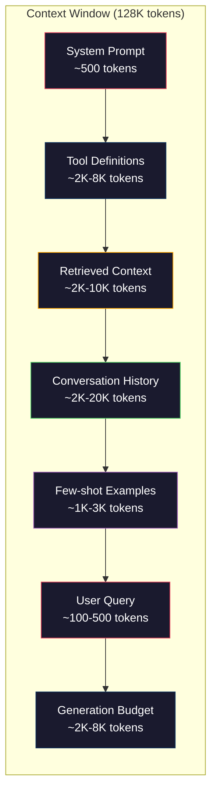
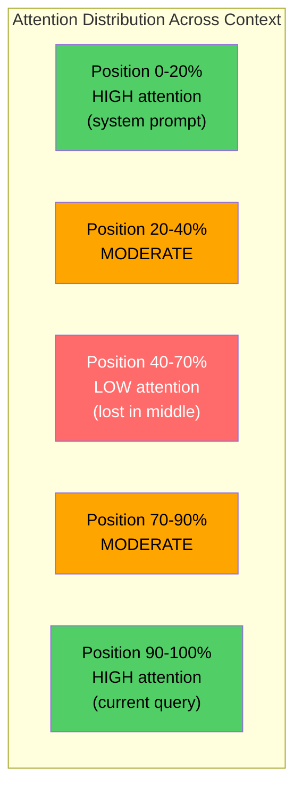
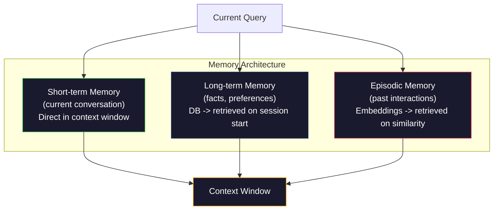

# 上下文工程：窗口、预算、记忆与检索

> 提示工程只是其中一部分。上下文工程才是全局。提示是你键入的一串字符。上下文则是进入模型窗口的一切：系统指令、检索到的文档、工具定义、对话历史、few-shot 示例，以及提示本身。2026 年最优秀的 AI 工程师都是上下文工程师。他们决定什么进入窗口、什么留在外面，以及以什么顺序排列。

**Type:** Build
**Languages:** Python
**Prerequisites:** Phase 10 (LLMs from Scratch), Phase 11 Lesson 01-02
**Time:** ~90 minutes
**Related:** Phase 11 · 15（Prompt Caching）——对缓存友好的布局是上下文工程的延伸。Phase 5 · 28（Long-Context Evaluation）讲述如何用 NIAH/RULER 测量 lost-in-the-middle。

## 学习目标

- 计算上下文窗口所有组成部分的 token 预算（系统提示、工具、历史、检索文档、生成余量）
- 实现上下文窗口管理策略：截断、摘要，以及对话历史的滑动窗口
- 对上下文各组成部分做优先级排序和排列，让模型的注意力集中在最相关的信息上
- 构建上下文组装器，根据查询类型和可用窗口空间动态分配 token

## 问题

Claude Opus 4.7 拥有 200K token 的窗口（beta 版 1M）。GPT-5 有 400K。Gemini 3 Pro 有 2M。Llama 4 声称有 10M。这些数字听起来大得惊人，直到你把它填满。

以下是一个编码助手的真实拆解。系统提示：500 token。50 个工具的定义：8,000 token。检索到的文档：4,000 token。对话历史（10 轮）：6,000 token。当前用户查询：200 token。生成预算（最大输出）：4,000 token。总计：22,700 token。这只是 128K 窗口的 18%。

但注意力并不会随上下文长度线性扩展。拥有 128K token 上下文的模型要付出二次方注意力成本（在原生 Transformer 中是 $O(n^2)$，不过大多数生产模型使用高效的注意力变体）。更重要的是，检索准确率会下降。"大海捞针"（Needle in a Haystack）测试表明，模型很难找到放在长上下文中间的信息。Liu 等人（2023）的研究显示，LLM 对长上下文开头和结尾信息的检索准确率接近完美，但对放在中间（上下文 40%-70% 位置）的信息，准确率会下降 10-20%。这种"中间迷失"（lost-in-the-middle）效应因模型而异，但影响当前所有架构。

实践中的教训是：拥有 200K token 可用，并不意味着用满 200K token 就有效。精心挑选的 10K token 上下文，往往胜过一次倾倒 100K token 的上下文。上下文工程就是在上下文窗口内最大化信噪比的学科。

你放进窗口的每一个 token，都会挤掉一个本来可以携带更多相关信息的 token。每一条无关的工具定义、每一轮过时的对话、每一段回答不了问题的检索文本——每一个都会让模型在任务上表现稍差一点。

## 概念

### 上下文窗口是稀缺资源

把上下文窗口想象成内存（RAM），而不是磁盘。它速度快、可直接访问，但容量有限。你不可能把所有东西都塞进去，必须做出选择。



每个组成部分都在争夺空间。加入更多工具定义，对话历史的空间就变少。加入更多检索上下文，few-shot 示例的空间就变少。上下文工程就是分配这份预算以最大化任务表现的艺术。

### 中间迷失

这是上下文工程中最重要的经验发现。模型对上下文开头和结尾的信息注意得更好，中间的信息获得更低的注意力分数，也更容易被忽略。

Liu 等人（2023）系统地测试了这一点。他们把一份相关文档放在 20 份无关文档中的不同位置，测量回答准确率。当相关文档位于第一或最后时，准确率为 85-90%。当它位于中间（20 份中的第 10 位）时，准确率降至 60-70%。

这对工程实践有直接启示：

- 把最重要的信息放在最前面（系统提示、关键指令）
- 把当前查询和最相关的上下文放在最后（近因偏差有帮助）
- 把上下文中段视为最低优先级区域
- 如果必须在中间放入信息，就在结尾重复关键要点



### 上下文的组成部分

**系统提示**：设定人设、约束和行为规则。它排在最前面，并在各轮之间保持不变。Claude Code 的系统提示连同工具定义和行为指令大约使用 6,000 token。保持精简。系统提示中的每个词，在每次 API 调用时都会重复一遍。

**工具定义**：每个工具会增加 50-200 token（名称、描述、参数 schema）。50 个工具每个 150 token，在任何对话开始之前就是 7,500 token。动态工具选择——只包含与当前查询相关的工具——可以减少 60-80%。

**检索到的上下文**：来自向量数据库的文档、搜索结果、文件内容。检索质量直接决定回答质量。糟糕的检索比不检索更糟——它用噪声填满窗口，并主动误导模型。

**对话历史**：之前每一条用户消息和助手回复。它随对话长度线性增长。50 轮、每轮 200 token 的对话就是 10,000 token 的历史，其中大部分与当前查询无关。

**Few-shot 示例**：演示期望行为的输入/输出对。两三个精选示例对输出质量的提升，往往超过数千 token 的指令。但它们占用空间。

**生成预算**：为模型回复预留的 token。如果你把窗口填满，模型就没有空间作答。至少预留 2,000-4,000 token 用于生成。

### 上下文压缩策略

**历史摘要**：与其逐字保留所有之前的轮次，不如定期对对话做摘要。用 100 token 的"我们讨论了 X，决定了 Y，用户想要 Z"替代耗费 2,000 token 的 10 轮对话。当历史超过阈值（例如 5,000 token）时运行摘要。

**相关性过滤**：对每份检索文档与当前查询打分，丢弃低于阈值的文档。如果你检索到 10 个块但只有 3 个相关，就丢弃另外 7 个。3 个高度相关的块胜过 10 个平庸的块。

**工具裁剪**：对用户查询的意图分类，只包含与该意图相关的工具。代码问题不需要日历工具。日程问题不需要文件系统工具。这可以把工具定义从 8,000 token 降到 1,000。

**递归摘要**：对于非常长的文档，分阶段摘要。先摘要每个小节，再摘要这些摘要。一份 50 页的文档变成 500 token 的要点摘编，抓住关键信息。

### 记忆系统

上下文工程横跨三个时间尺度。

**短期记忆**：当前对话。直接存储在上下文窗口中。随每一轮增长。通过摘要和截断进行管理。

**长期记忆**：跨对话持久存在的事实和偏好。"用户偏好 TypeScript。""项目使用 PostgreSQL。"存储在数据库中，会话开始时检索。Claude Code 把它存放在 CLAUDE.md 文件中。ChatGPT 把它存放在记忆功能中。

**情景记忆**：可能相关的特定过往交互。"上周二，我们调试过认证模块里一个类似的问题。"以 embedding 形式存储，当当前对话与过去情景匹配时检索出来。



### 动态上下文组装

关键洞见：不同的查询需要不同的上下文。静态系统提示 + 静态工具 + 静态历史是一种浪费。最好的系统会按查询动态组装上下文。

1. 对查询意图分类
2. 选择相关工具（不是所有工具）
3. 检索相关文档（不是固定集合）
4. 包含相关的历史轮次（不是全部历史）
5. 加入与任务类型匹配的 few-shot 示例
6. 按重要性排列一切：关键的在最前，重要的在最后，可选的放中间

这就是好的 AI 应用与卓越 AI 应用的分水岭。模型相同，上下文才是差异所在。

```figure
lost-in-the-middle
```

## 构建它

### 第 1 步：Token 计数器

你无法管理你无法度量的东西。构建一个简单的 token 计数器（用空白切分做近似，因为精确计数取决于 tokenizer）。

```python
import json
import numpy as np
from collections import OrderedDict

def count_tokens(text):
    if not text:
        return 0
    return int(len(text.split()) * 1.3)

def count_tokens_json(obj):
    return count_tokens(json.dumps(obj))
```

### 第 2 步：上下文预算管理器

核心抽象。预算管理器跟踪每个组件使用了多少 token，并执行限额。

```python
class ContextBudget:
    def __init__(self, max_tokens=128000, generation_reserve=4000):
        self.max_tokens = max_tokens
        self.generation_reserve = generation_reserve
        self.available = max_tokens - generation_reserve
        self.allocations = OrderedDict()

    def allocate(self, component, content, max_tokens=None):
        tokens = count_tokens(content)
        if max_tokens and tokens > max_tokens:
            words = content.split()
            target_words = int(max_tokens / 1.3)
            content = " ".join(words[:target_words])
            tokens = count_tokens(content)

        used = sum(self.allocations.values())
        if used + tokens > self.available:
            allowed = self.available - used
            if allowed <= 0:
                return None, 0
            words = content.split()
            target_words = int(allowed / 1.3)
            content = " ".join(words[:target_words])
            tokens = count_tokens(content)

        self.allocations[component] = tokens
        return content, tokens

    def remaining(self):
        used = sum(self.allocations.values())
        return self.available - used

    def utilization(self):
        used = sum(self.allocations.values())
        return used / self.max_tokens

    def report(self):
        total_used = sum(self.allocations.values())
        lines = []
        lines.append(f"Context Budget Report ({self.max_tokens:,} token window)")
        lines.append("-" * 50)
        for component, tokens in self.allocations.items():
            pct = tokens / self.max_tokens * 100
            bar = "#" * int(pct / 2)
            lines.append(f"  {component:<25} {tokens:>6} tokens ({pct:>5.1f}%) {bar}")
        lines.append("-" * 50)
        lines.append(f"  {'Used':<25} {total_used:>6} tokens ({total_used/self.max_tokens*100:.1f}%)")
        lines.append(f"  {'Generation reserve':<25} {self.generation_reserve:>6} tokens")
        lines.append(f"  {'Remaining':<25} {self.remaining():>6} tokens")
        return "\n".join(lines)
```

### 第 3 步：中间迷失重排序

实现重排序策略：最重要的条目放在开头和结尾，最不重要的放在中间。

```python
def reorder_lost_in_middle(items, scores):
    paired = sorted(zip(scores, items), reverse=True)
    sorted_items = [item for _, item in paired]

    if len(sorted_items) <= 2:
        return sorted_items

    first_half = sorted_items[::2]
    second_half = sorted_items[1::2]
    second_half.reverse()

    return first_half + second_half

def score_relevance(query, documents):
    query_words = set(query.lower().split())
    scores = []
    for doc in documents:
        doc_words = set(doc.lower().split())
        if not query_words:
            scores.append(0.0)
            continue
        overlap = len(query_words & doc_words) / len(query_words)
        scores.append(round(overlap, 3))
    return scores
```

### 第 4 步：对话历史压缩器

摘要旧的对话轮次，回收 token 预算。

```python
class ConversationManager:
    def __init__(self, max_history_tokens=5000):
        self.turns = []
        self.summaries = []
        self.max_history_tokens = max_history_tokens

    def add_turn(self, role, content):
        self.turns.append({"role": role, "content": content})
        self._compress_if_needed()

    def _compress_if_needed(self):
        total = sum(count_tokens(t["content"]) for t in self.turns)
        if total <= self.max_history_tokens:
            return

        while total > self.max_history_tokens and len(self.turns) > 4:
            old_turns = self.turns[:2]
            summary = self._summarize_turns(old_turns)
            self.summaries.append(summary)
            self.turns = self.turns[2:]
            total = sum(count_tokens(t["content"]) for t in self.turns)

    def _summarize_turns(self, turns):
        parts = []
        for t in turns:
            content = t["content"]
            if len(content) > 100:
                content = content[:100] + "..."
            parts.append(f"{t['role']}: {content}")
        return "Previous: " + " | ".join(parts)

    def get_context(self):
        parts = []
        if self.summaries:
            parts.append("[Conversation Summary]")
            for s in self.summaries:
                parts.append(s)
        parts.append("[Recent Conversation]")
        for t in self.turns:
            parts.append(f"{t['role']}: {t['content']}")
        return "\n".join(parts)

    def token_count(self):
        return count_tokens(self.get_context())
```

### 第 5 步：动态工具选择器

只包含与当前查询相关的工具。先对意图分类，再过滤。

```python
TOOL_REGISTRY = {
    "read_file": {
        "description": "Read contents of a file",
        "tokens": 120,
        "categories": ["code", "files"],
    },
    "write_file": {
        "description": "Write content to a file",
        "tokens": 150,
        "categories": ["code", "files"],
    },
    "search_code": {
        "description": "Search for patterns in codebase",
        "tokens": 130,
        "categories": ["code"],
    },
    "run_command": {
        "description": "Execute a shell command",
        "tokens": 140,
        "categories": ["code", "system"],
    },
    "create_calendar_event": {
        "description": "Create a new calendar event",
        "tokens": 180,
        "categories": ["calendar"],
    },
    "list_emails": {
        "description": "List recent emails",
        "tokens": 160,
        "categories": ["email"],
    },
    "send_email": {
        "description": "Send an email message",
        "tokens": 200,
        "categories": ["email"],
    },
    "web_search": {
        "description": "Search the web for information",
        "tokens": 140,
        "categories": ["research"],
    },
    "query_database": {
        "description": "Run a SQL query on the database",
        "tokens": 170,
        "categories": ["code", "data"],
    },
    "generate_chart": {
        "description": "Generate a chart from data",
        "tokens": 190,
        "categories": ["data", "visualization"],
    },
}

def classify_intent(query):
    query_lower = query.lower()

    intent_keywords = {
        "code": ["code", "function", "bug", "error", "file", "implement", "refactor", "debug", "test"],
        "calendar": ["meeting", "schedule", "calendar", "appointment", "event"],
        "email": ["email", "mail", "send", "inbox", "message"],
        "research": ["search", "find", "what is", "how does", "explain", "look up"],
        "data": ["data", "query", "database", "chart", "graph", "analytics", "sql"],
    }

    scores = {}
    for intent, keywords in intent_keywords.items():
        score = sum(1 for kw in keywords if kw in query_lower)
        if score > 0:
            scores[intent] = score

    if not scores:
        return ["code"]

    max_score = max(scores.values())
    return [intent for intent, score in scores.items() if score >= max_score * 0.5]

def select_tools(query, token_budget=2000):
    intents = classify_intent(query)
    relevant = {}
    total_tokens = 0

    for name, tool in TOOL_REGISTRY.items():
        if any(cat in intents for cat in tool["categories"]):
            if total_tokens + tool["tokens"] <= token_budget:
                relevant[name] = tool
                total_tokens += tool["tokens"]

    return relevant, total_tokens
```

### 第 6 步：完整上下文组装 pipeline

把所有部分连接起来。给定一个查询，动态组装最优上下文。

```python
class ContextEngine:
    def __init__(self, max_tokens=128000, generation_reserve=4000):
        self.budget = ContextBudget(max_tokens, generation_reserve)
        self.conversation = ConversationManager(max_history_tokens=5000)
        self.system_prompt = (
            "You are a helpful AI assistant. You have access to tools for "
            "code editing, file management, web search, and data analysis. "
            "Use the appropriate tools for each task. Be concise and accurate."
        )
        self.knowledge_base = [
            "Python 3.12 introduced type parameter syntax for generic classes using bracket notation.",
            "The project uses PostgreSQL 16 with pgvector for embedding storage.",
            "Authentication is handled by Supabase Auth with JWT tokens.",
            "The frontend is built with Next.js 15 using the App Router.",
            "API rate limits are set to 100 requests per minute per user.",
            "The deployment pipeline uses GitHub Actions with Docker multi-stage builds.",
            "Test coverage must be above 80% for all new modules.",
            "The codebase follows the repository pattern for data access.",
        ]

    def assemble(self, query):
        self.budget = ContextBudget(self.budget.max_tokens, self.budget.generation_reserve)

        system_content, _ = self.budget.allocate("system_prompt", self.system_prompt, max_tokens=1000)

        tools, tool_tokens = select_tools(query, token_budget=2000)
        tool_text = json.dumps(list(tools.keys()))
        tool_content, _ = self.budget.allocate("tools", tool_text, max_tokens=2000)

        relevance = score_relevance(query, self.knowledge_base)
        threshold = 0.1
        relevant_docs = [
            doc for doc, score in zip(self.knowledge_base, relevance)
            if score >= threshold
        ]

        if relevant_docs:
            doc_scores = [s for s in relevance if s >= threshold]
            reordered = reorder_lost_in_middle(relevant_docs, doc_scores)
            doc_text = "\n".join(reordered)
            doc_content, _ = self.budget.allocate("retrieved_context", doc_text, max_tokens=3000)

        history_text = self.conversation.get_context()
        if history_text.strip():
            history_content, _ = self.budget.allocate("conversation_history", history_text, max_tokens=5000)

        query_content, _ = self.budget.allocate("user_query", query, max_tokens=500)

        return self.budget

    def chat(self, query):
        self.conversation.add_turn("user", query)
        budget = self.assemble(query)
        response = f"[Response to: {query[:50]}...]"
        self.conversation.add_turn("assistant", response)
        return budget


def run_demo():
    print("=" * 60)
    print("  Context Engineering Pipeline Demo")
    print("=" * 60)

    engine = ContextEngine(max_tokens=128000, generation_reserve=4000)

    print("\n--- Query 1: Code task ---")
    budget = engine.chat("Fix the bug in the authentication module where JWT tokens expire too early")
    print(budget.report())

    print("\n--- Query 2: Research task ---")
    budget = engine.chat("What is the best approach for implementing vector search in PostgreSQL?")
    print(budget.report())

    print("\n--- Query 3: After conversation history builds up ---")
    for i in range(8):
        engine.conversation.add_turn("user", f"Follow-up question number {i+1} about the implementation details of the system")
        engine.conversation.add_turn("assistant", f"Here is the response to follow-up {i+1} with technical details about the architecture")

    budget = engine.chat("Now implement the changes we discussed")
    print(budget.report())

    print("\n--- Tool Selection Examples ---")
    test_queries = [
        "Fix the bug in auth.py",
        "Schedule a meeting with the team for Tuesday",
        "Show me the database query performance stats",
        "Search for best practices on error handling",
    ]

    for q in test_queries:
        tools, tokens = select_tools(q)
        intents = classify_intent(q)
        print(f"\n  Query: {q}")
        print(f"  Intents: {intents}")
        print(f"  Tools: {list(tools.keys())} ({tokens} tokens)")

    print("\n--- Lost-in-the-Middle Reordering ---")
    docs = ["Doc A (most relevant)", "Doc B (somewhat relevant)", "Doc C (least relevant)",
            "Doc D (relevant)", "Doc E (moderately relevant)"]
    scores = [0.95, 0.60, 0.20, 0.80, 0.50]
    reordered = reorder_lost_in_middle(docs, scores)
    print(f"  Original order: {docs}")
    print(f"  Scores:         {scores}")
    print(f"  Reordered:      {reordered}")
    print(f"  (Most relevant at start and end, least relevant in middle)")
```

## 使用它

### 由 harness 管理的上下文

Claude Code 采用分层方式管理上下文。系统提示包含行为规则和工具定义（约 6K token）。当你打开一个文件，其内容会作为上下文注入。当你搜索时，结果会被加入。旧的对话轮次会被摘要。CLAUDE.md 提供跨会话持久存在的长期记忆。

关键的工程决策：Claude Code 不会把整个代码库倾倒进上下文，而是按需检索相关文件。这就是实践中的上下文工程。

### 动态上下文加载

Cursor 把你整个代码库索引成 embedding。当你输入查询时，它用向量相似度检索最相关的文件和代码块。只有这些片段进入上下文窗口。一个 50 万行的代码库被压缩成最相关的 5-10 个代码块。

这就是模式：全部嵌入，按需检索，只包含重要的内容。

### 助手长期记忆

ChatGPT 把用户偏好和事实存储为长期记忆。每次对话开始时，相关记忆被检索并放入系统提示。"用户偏好 Python"只花 5 token，却省下了跨对话重复指令的数百 token。

### RAG 即上下文工程

检索增强生成（RAG）是形式化的上下文工程。你不必把知识塞进模型权重（训练）或系统提示（静态上下文），而是在查询时检索相关文档并注入上下文窗口。整个 RAG pipeline——分块、embedding、检索、重排序——存在只为解决一个问题：把正确的信息放进上下文窗口。

## 交付它

本课产出 `outputs/prompt-context-optimizer.md`——一个可复用的提示，用于审计上下文组装策略并给出优化建议。把系统提示、工具数量、平均历史长度和检索策略喂给它，它就会找出 token 浪费并建议改进。

它还产出 `outputs/skill-context-engineering.md`——一个决策框架，根据任务类型、上下文窗口大小和延迟预算来设计上下文组装 pipeline。

## 练习

1. 为 ContextBudget 类添加一个"token 浪费检测器"。它应标记使用超过预算 30% 的组件，并针对每类组件建议压缩策略（摘要历史、裁剪工具、重排文档）。

2. 为检索到的上下文实现语义去重。如果两份检索文档相似度超过 80%（按词重叠或其 embedding 的余弦相似度），只保留得分较高的那份。测量这能回收多少 token 预算。

3. 构建一个"上下文重放"工具。给定一段对话记录，通过 ContextEngine 重放，并可视化预算分配如何逐轮变化。绘制各组件 token 用量随时间的变化。找出上下文开始被压缩的那一轮。

4. 实现基于优先级的工具选择器。不要只做二元的包含/排除，而是为每个工具赋予与当前查询的相关性分数。按相关性降序加入工具，直到工具预算耗尽。比较包含 5、10、20 和 50 个工具时的任务表现。

5. 构建多策略上下文压缩器。实现三种压缩策略（截断、摘要、关键句抽取），在 20 份文档的集合上做基准测试。测量压缩比与信息保留之间的权衡（压缩版本是否仍包含查询的答案？）。

## 关键术语

| 术语 | 人们怎么说 | 实际含义 |
|------|----------------|----------------------|
| 上下文窗口 | "模型能读多少" | 模型在一次前向传播中处理的最大 token 数（输入 + 输出）——GPT-5 为 400K，Claude Opus 4.7 为 200K（beta 1M），Gemini 3 Pro 为 2M |
| 上下文工程 | "高级提示工程" | 决定什么进入上下文窗口、以什么顺序、什么优先级的学科——涵盖检索、压缩、工具选择和记忆管理 |
| 中间迷失 | "模型会忘记中间的东西" | 一项经验发现：LLM 对上下文开头和结尾的注意力更好，放在中间的信息准确率会下降 10-20% |
| Token 预算 | "你还剩多少 token" | 对上下文窗口容量在各组件（系统提示、工具、历史、检索、生成）之间的显式分配，并为每个组件设定限额 |
| 动态上下文 | "临时加载东西" | 根据意图分类、相关工具选择和检索结果，为每个查询组装不同的上下文窗口 |
| 历史摘要 | "压缩对话" | 用简洁摘要替代逐字的旧对话轮次，在保留关键信息的同时降低 token 成本 |
| 工具裁剪 | "只包含相关工具" | 对查询意图分类，只包含匹配的工具定义，将工具 token 成本降低 60-80% |
| 长期记忆 | "跨会话记住" | 存储在数据库中、会话开始时检索的事实和偏好——CLAUDE.md、ChatGPT Memory 及类似系统 |
| 情景记忆 | "记住特定的过往事件" | 以 embedding 形式存储的过往交互，在当前查询与过去对话相似时检索出来 |
| 生成预算 | "给答案留的空间" | 为模型输出预留的 token——如果上下文完全填满窗口，模型就没有空间回复 |

## 延伸阅读

- [Liu 等人，2023——"Lost in the Middle: How Language Models Use Long Contexts"](https://arxiv.org/abs/2307.03172)——关于位置相关注意力的权威研究，表明模型难以处理长上下文中间的信息
- [Anthropic 的 Contextual Retrieval 博客文章](https://www.anthropic.com/news/contextual-retrieval)——Anthropic 如何处理上下文感知的块检索，将检索失败率降低 49%
- [Simon Willison 的 "Context Engineering"](https://simonwillison.net/2025/Jun/27/context-engineering/)——为这门学科命名并将其与提示工程区分开来的博客文章
- [LangChain 的 RAG 文档](https://python.langchain.com/docs/tutorials/rag/)——把检索增强生成作为上下文工程模式的实践实现
- [Greg Kamradt 的 Needle in a Haystack 测试](https://github.com/gkamradt/LLMTest_NeedleInAHaystack)——揭示所有主要模型都存在位置相关检索失败的基准
- [Pope 等人，"Efficiently Scaling Transformer Inference"（2022）](https://arxiv.org/abs/2211.05102)——为什么上下文长度会驱动内存和延迟，以及 KV cache、MQA、GQA 如何改变预算计算。
- [Agrawal 等人，"SARATHI: Efficient LLM Inference by Piggybacking Decodes with Chunked Prefills"（2023）](https://arxiv.org/abs/2308.16369)——推理的两个阶段，解释了为什么长提示让 TTFT 昂贵而 TPOT 便宜；上下文打包权衡背后的真相。
- [Ainslie 等人，"GQA: Training Generalized Multi-Query Transformer Models from Multi-Head Checkpoints"（EMNLP 2023）](https://arxiv.org/abs/2305.13245)——分组查询注意力论文，在生产解码器中将 KV 内存削减 8 倍而无质量损失。
