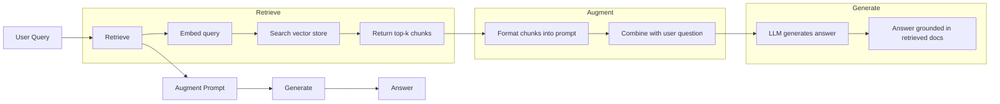
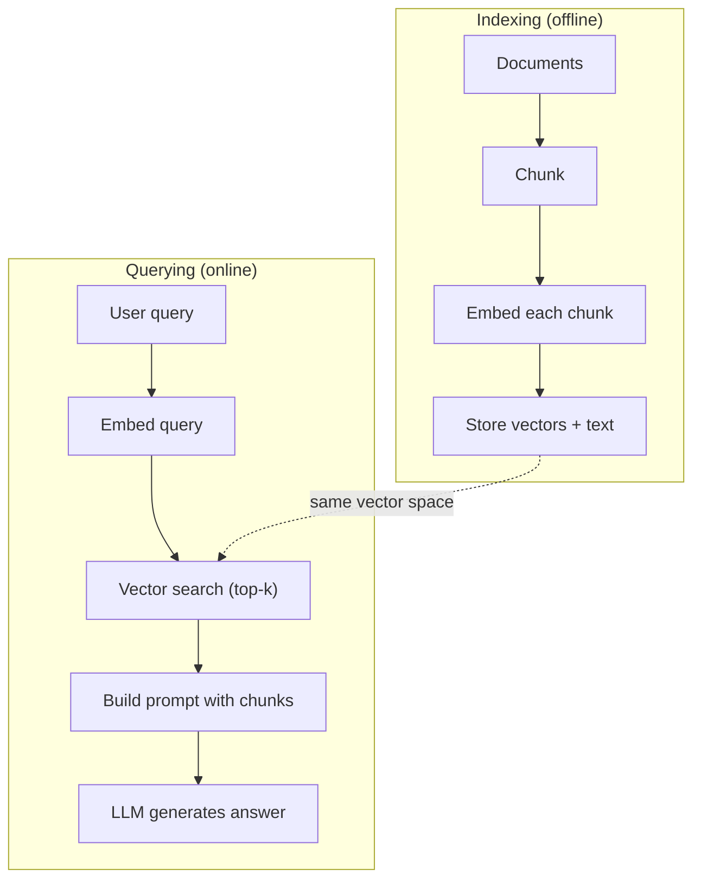

# RAG（检索增强生成）

> 你的 LLM 知道截至训练截止日期的一切，但对你公司的文档、你的代码库或上周的会议记录一无所知。RAG 通过检索相关文档并将其塞进提示来解决这个问题。它是生产 AI 中部署最广的模式。如果从这门课程中只构建一样东西，那就构建一条 RAG 流水线。

**Type:** Build
**Languages:** Python
**Prerequisites:** Phase 10 (LLMs from Scratch), Phase 11 Lessons 01-05
**Time:** ~90 minutes
**Related:** Phase 5 · 23（Chunking Strategies for RAG）讲六种分块算法及各自的适用场景。Phase 5 · 22（Embedding Models Deep Dive）讲如何挑选 embedding 模型。Phase 11 · 07（Advanced RAG）讲混合搜索、重排序和查询变换。

## 学习目标

- 构建完整的 RAG 流水线：文档加载、分块、embedding、向量存储、检索和生成
- 使用向量数据库（ChromaDB、FAISS 或 Pinecone）并建立正确的索引，实现语义搜索
- 解释为什么对于需要知识依据的应用，RAG 优于微调（成本、时效性、可归因性）
- 使用检索指标（精确率、召回率）和生成指标（忠实度、相关性）评估 RAG 质量

## 问题

你为公司构建了一个聊天机器人。客户问："企业版套餐的退款政策是什么？"LLM 给出了一段关于典型 SaaS 退款政策的通用回答。而真正的政策埋在 200 页的内部 wiki 里，写着企业客户享有 60 天窗口期，可按比例退款。LLM 从未见过这份文档。它不可能知道它没有被训练过的东西。

微调是一种解决方案。拿 LLM 在你的内部文档上训练，然后部署更新后的模型。这可行，但有严重问题。微调要花费数千美元的计算成本。文档一变，模型就过时了。你无法知道模型是从哪个来源得出的答案。而如果公司下个月收购了另一条产品线，你又得再微调一次。

RAG 是另一种解决方案。让模型保持原样。当问题到来时，在文档存储中搜索相关段落，把它们粘贴到问题之前的提示里，让模型以这些段落为上下文作答。文档存储可以在几分钟内更新。你能确切看到检索到了哪些文档。模型本身从不改变。这就是 RAG 成为生产环境主导模式的原因：更便宜、更新鲜、更可审计，并且适用于任何 LLM。

## 概念

### RAG 模式

整个模式可以概括为四步：



查询 -> 检索 -> 增强提示 -> 生成。每一个 RAG 系统都遵循这个模式。生产 RAG 系统之间的差异在于每一步的细节：如何分块、如何嵌入、如何搜索，以及如何构造提示。

### 为什么 RAG 胜过微调

| 关注点 | 微调 | RAG |
|---------|------------|-----|
| 成本 | 每次训练运行 $1,000-$100,000+ | 每次查询 $0.01-$0.10（embedding + LLM） |
| 时效性 | 在重新训练之前一直过时 | 重新索引文档即可在几分钟内更新 |
| 可审计性 | 无法把答案追溯到来源 | 可以展示实际检索到的段落 |
| 幻觉 | 仍然会自由地产生幻觉 | 以检索到的文档为依据 |
| 数据隐私 | 训练数据被烘焙进权重 | 文档留在你的向量数据库里 |

微调会永久改变模型的权重。RAG 只临时改变模型的上下文。对大多数应用来说，你想要的正是临时上下文。

微调唯一胜出的场景：当你需要模型采用某种仅靠提示无法实现的风格、语气或推理模式时。对于事实性知识的检索，RAG 每次都赢。

### Embedding 模型

Embedding 模型把文本转换成稠密向量。相似的文本在这个高维空间中生成的向量彼此接近。"How do I reset my password?" 和 "I need to change my password" 尽管共有的词很少，却会生成几乎相同的向量。"The cat sat on the mat" 生成的向量则截然不同。

常见的 embedding 模型（2026 年阵容——完整分析见 Phase 5 · 22）：

| 模型 | 维度 | 提供商 | 说明 |
|-------|-----------|----------|-------|
| text-embedding-3-small | 1536（Matryoshka） | OpenAI | 对大多数用例而言性价比最佳 |
| text-embedding-3-large | 3072（Matryoshka） | OpenAI | 准确率更高，可截断到 256/512/1024 |
| Gemini Embedding 2 | 3072（Matryoshka） | Google | MTEB 检索排名靠前；8K 上下文 |
| voyage-4 | 1024/2048（Matryoshka） | Voyage AI | 领域变体（代码、金融、法律） |
| Cohere embed-v4 | 1024（Matryoshka） | Cohere | 强大的多语言能力，128K 上下文 |
| BGE-M3 | 1024（稠密 + 稀疏 + ColBERT） | BAAI（开放权重） | 一个模型提供三种视图 |
| Qwen3-Embedding | 4096（Matryoshka） | Alibaba（开放权重） | 开放权重检索得分最高 |
| all-MiniLM-L6-v2 | 384 | 开放权重（Sentence Transformers） | 原型开发的基线 |

本课中，我们用 TF-IDF 构建自己的简单 embedding。不是因为生产系统使用 TF-IDF，而是因为它让概念变得具体：文本进去，向量出来，相似的文本产生相似的向量。

### 向量相似度

给定两个向量，如何度量相似度？有三种选择：

**余弦相似度**：两个向量之间夹角的余弦值。范围为 -1（相反）到 1（相同）。忽略向量长度，只关心方向。这是 RAG 的默认选择。

```math
\mathop{\mathrm{cosine\_sim}}(a, b) = \frac{\mathop{\mathrm{dot}}(a, b)}{\lVert a \rVert \cdot \lVert b \rVert}
```

**点积**：原始内积。向量越大，得分越高。当长度本身携带信息时有用（更长的文档可能更相关）。

```math
\mathop{\mathrm{dot}}(a, b) = \sum_i a_i b_i
```

**L2（欧氏）距离**：向量空间中的直线距离。距离越小越相似。对长度差异敏感。

```math
\mathop{\mathrm{L2}}(a, b) = \sqrt{\sum_i (a_i - b_i)^2}
```

余弦相似度是标准做法。它按长度归一化，因此能从容处理不同长度的文档。当人们说"向量搜索"时，几乎总是指余弦相似度。

### 分块策略

文档太长，无法作为单个向量来 embedding。一份 50 页的 PDF 可能因为包含几十个主题而产生糟糕的 embedding。因此，要把文档切成块，再分别对每个块做 embedding。

**固定大小分块**：每 N 个 token 切一刀。简单且可预测。512 token 的块加 50 token 重叠，意味着块 1 是 token 0-511，块 2 是 token 462-973，依此类推。重叠确保你不会在倒霉的边界把一句话切断。

**语义分块**：在自然边界处切分。段落、小节或 markdown 标题。每个块都是一个语义连贯的单元。实现更复杂，但检索效果更好。

**递归分块**：先尝试在最大的边界切分（小节标题）。如果某个小节仍然太大，就在段落边界切分。如果某个段落仍然太大，就在句子边界切分。这就是 LangChain 的 RecursiveCharacterTextSplitter 方法，在实践中效果很好。

块大小的重要性超出人们的想象：

- 太小（64-128 token）：每个块缺乏上下文。"它上季度增长了 15%"在不知道"它"指什么的情况下毫无意义。
- 太大（2048+ token）：每个块涵盖多个主题，稀释了相关性。当你搜索收入数据时，得到的块可能 10% 讲收入、90% 讲员工人数。
- 最佳区间（256-512 token）：上下文足以自包含，焦点也足够集中以保持相关。

大多数生产 RAG 系统使用 256-512 token 的块，重叠 50 token。Anthropic 的 RAG 指南推荐这个范围。

### 向量数据库

有了 embedding，你需要一个地方来存储和搜索它们。选项如下：

| 数据库 | 类型 | 最适合 |
|----------|------|----------|
| FAISS | 库（进程内） | 原型开发、中小型数据集 |
| Chroma | 轻量级数据库 | 本地开发、小型部署 |
| Pinecone | 托管服务 | 无运维负担的生产环境 |
| Weaviate | 开源数据库 | 自托管生产环境 |
| pgvector | Postgres 扩展 | 已经在使用 Postgres |
| Qdrant | 开源数据库 | 高性能自托管 |

本课中，我们构建一个简单的内存向量存储。它把向量存在列表里，做暴力余弦相似度搜索。这等价于带扁平索引的 FAISS。它大概能扩展到 10 万个向量，再大就会变慢。生产系统使用 HNSW 之类的近似最近邻（ANN）算法，在毫秒内搜索数百万个向量。

### 完整流水线



索引阶段对每份文档运行一次（或在文档更新时运行）。查询阶段在每次用户请求时运行。生产中，索引可能要在数小时内处理数百万份文档。查询则必须在 1 秒内响应。

### 真实数字

大多数生产 RAG 系统使用这些参数：

- **k = 5 到 10**：每次查询检索的块数
- **块大小 = 256 到 512 token**，重叠 50 token
- **上下文预算**：每次查询 2,500-5,000 token 的检索内容
- **总提示**：约 8,000-16,000 token（系统提示 + 检索块 + 对话历史 + 用户查询）
- **Embedding 维度**：384-3072，取决于模型
- **索引吞吐量**：使用 API embedding 时每秒 100-1,000 份文档
- **查询延迟**：检索 50-200ms，生成 500-3000ms

```figure
rag-chunking
```

## 构建它

### 第 1 步：文档分块

```python
def chunk_text(text, chunk_size=200, overlap=50):
    words = text.split()
    chunks = []
    start = 0
    while start < len(words):
        end = start + chunk_size
        chunk = " ".join(words[start:end])
        chunks.append(chunk)
        start += chunk_size - overlap
    return chunks
```

### 第 2 步：TF-IDF embedding

我们构建一个简单的 embedding 函数。TF-IDF（词频-逆文档频率）不是神经网络 embedding，但它把文本转换成向量的方式能够捕捉词的重要性。文档中频繁出现的词 TF 更高。整个语料库中罕见的词 IDF 更高。两者相乘得到的向量中，重要而独特的词具有较高的值。

```python
import math
from collections import Counter

def build_vocabulary(documents):
    vocab = set()
    for doc in documents:
        vocab.update(doc.lower().split())
    return sorted(vocab)

def compute_tf(text, vocab):
    words = text.lower().split()
    count = Counter(words)
    total = len(words)
    return [count.get(word, 0) / total for word in vocab]

def compute_idf(documents, vocab):
    n = len(documents)
    idf = []
    for word in vocab:
        doc_count = sum(1 for doc in documents if word in doc.lower().split())
        idf.append(math.log((n + 1) / (doc_count + 1)) + 1)
    return idf

def tfidf_embed(text, vocab, idf):
    tf = compute_tf(text, vocab)
    return [t * i for t, i in zip(tf, idf)]
```

### 第 3 步：余弦相似度搜索

```python
def cosine_similarity(a, b):
    dot = sum(x * y for x, y in zip(a, b))
    norm_a = math.sqrt(sum(x * x for x in a))
    norm_b = math.sqrt(sum(x * x for x in b))
    if norm_a == 0 or norm_b == 0:
        return 0.0
    return dot / (norm_a * norm_b)

def search(query_embedding, stored_embeddings, top_k=5):
    scores = []
    for i, emb in enumerate(stored_embeddings):
        sim = cosine_similarity(query_embedding, emb)
        scores.append((i, sim))
    scores.sort(key=lambda x: x[1], reverse=True)
    return scores[:top_k]
```

### 第 4 步：提示构造

RAG 中"增强"（augmented）的部分就发生在这里。取出检索到的块，把它们格式化成提示，然后要求 LLM 基于提供的上下文作答。

```python
def build_rag_prompt(query, retrieved_chunks):
    context = "\n\n---\n\n".join(
        f"[Source {i+1}]\n{chunk}"
        for i, chunk in enumerate(retrieved_chunks)
    )
    return f"""Answer the question based ONLY on the following context.
If the context doesn't contain enough information, say "I don't have enough information to answer that."

Context:
{context}

Question: {query}

Answer:"""
```

### 第 5 步：完整的 RAG 流水线

```python
class RAGPipeline:
    def __init__(self):
        self.chunks = []
        self.embeddings = []
        self.vocab = []
        self.idf = []

    def index(self, documents):
        all_chunks = []
        for doc in documents:
            all_chunks.extend(chunk_text(doc))
        self.chunks = all_chunks
        self.vocab = build_vocabulary(all_chunks)
        self.idf = compute_idf(all_chunks, self.vocab)
        self.embeddings = [
            tfidf_embed(chunk, self.vocab, self.idf)
            for chunk in all_chunks
        ]

    def query(self, question, top_k=5):
        query_emb = tfidf_embed(question, self.vocab, self.idf)
        results = search(query_emb, self.embeddings, top_k)
        retrieved = [(self.chunks[i], score) for i, score in results]
        prompt = build_rag_prompt(
            question, [chunk for chunk, _ in retrieved]
        )
        return prompt, retrieved
```

### 第 6 步：生成（模拟）

生产环境中，这里就是调用 LLM API 的地方。本课中，我们通过从检索到的上下文中提取最相关的句子来模拟生成。

```python
def simple_generate(prompt, retrieved_chunks):
    query_words = set(prompt.lower().split("question:")[-1].split())
    best_sentence = ""
    best_score = 0
    for chunk in retrieved_chunks:
        for sentence in chunk.split("."):
            sentence = sentence.strip()
            if not sentence:
                continue
            words = set(sentence.lower().split())
            overlap = len(query_words & words)
            if overlap > best_score:
                best_score = overlap
                best_sentence = sentence
    return best_sentence if best_sentence else "I don't have enough information."
```

## 使用它

换成真实的 embedding 模型和 LLM，代码几乎不用改：

```python
from openai import OpenAI

client = OpenAI()

def embed(text):
    response = client.embeddings.create(
        model="text-embedding-3-small",
        input=text
    )
    return response.data[0].embedding

def generate(prompt):
    response = client.chat.completions.create(
        model="gpt-4o-mini",
        messages=[{"role": "user", "content": prompt}],
        temperature=0
    )
    return response.choices[0].message.content
```

或者使用 Anthropic：

```python
import anthropic

client = anthropic.Anthropic()

def generate(prompt):
    response = client.messages.create(
        model="claude-sonnet-5",
        max_tokens=1024,
        messages=[{"role": "user", "content": prompt}]
    )
    return response.content[0].text
```

流水线是一样的。替换 embedding 函数，替换生成函数。检索逻辑、分块、提示构造——无论使用哪种模型，全都相同。

要在规模上做向量存储，就把暴力搜索换成合适的向量数据库：

```python
import chromadb

client = chromadb.Client()
collection = client.create_collection("my_docs")

collection.add(
    documents=chunks,
    ids=[f"chunk_{i}" for i in range(len(chunks))]
)

results = collection.query(
    query_texts=["What is the refund policy?"],
    n_results=5
)
```

Chroma 在内部处理 embedding（默认使用 all-MiniLM-L6-v2），并把向量存储在本地数据库中。模式相同，管道不同。

## 交付它

本课产出：
- `outputs/prompt-rag-architect.md`——一个为特定用例设计 RAG 系统的提示
- `outputs/skill-rag-pipeline.md`——一个教智能体构建和调试 RAG 流水线的技能

## 练习

1. 把 TF-IDF embedding 替换为简单的词袋方法（二值：词出现为 1，不出现为 0）。在示例文档上比较检索质量。TF-IDF 应该胜出，因为它给罕见词更高的权重。

2. 试验不同的块大小：在同一组文档上尝试 50、100、200 和 500 个词。对每种大小运行相同的 5 个查询，统计有多少个查询在前 3 名中返回了相关的块。找出检索质量达到峰值的最佳区间。

3. 为每个块添加元数据（来源文档名、块位置）。修改提示模板以包含来源标注，让 LLM 引用它的来源。

4. 实现一个简单的评估：给定 10 组问答对，让每个问题跑一遍 RAG 流水线，测量检索到的块中包含答案的比例。这就是 k 处的检索召回率。

5. 构建一个对话感知的 RAG 流水线：维护最近 3 轮交换的历史，并把它们与检索到的块一起放入提示。在询问定价之后用"What about enterprise?"之类的追问进行测试。

## 关键术语

| 术语 | 人们怎么说 | 实际含义 |
|------|----------------|----------------------|
| RAG | "会读你文档的 AI" | 检索相关文档，把它们粘贴进提示，并生成以这些文档为依据的答案 |
| Embedding | "把文本转成数字" | 文本的稠密向量表示，相似的含义产生相似的向量 |
| 向量数据库 | "AI 的搜索引擎" | 为存储向量并按相似度查找最近邻而优化的数据存储 |
| 分块（chunking） | "把文档切成碎片" | 把文档拆成更小的片段（通常 256-512 token），使每个片段都能被独立 embedding 和检索 |
| 余弦相似度 | "两个向量有多相似" | 两个向量之间夹角的余弦值；1 = 方向相同，0 = 正交，-1 = 相反 |
| Top-k 检索 | "取 k 个最佳匹配" | 从向量存储中返回与查询最相似的 k 个块 |
| 上下文窗口 | "LLM 能看到多少文本" | LLM 在单次请求中能处理的最大 token 数；检索到的块必须能放进去 |
| 增强生成 | "用给定的上下文作答" | 以检索到的文档为上下文生成回复，而不是仅依赖训练知识 |
| TF-IDF | "词重要性评分" | 词频乘以逆文档频率；按词在语料库中的独特性来加权 |
| 索引 | "为搜索准备文档" | 离线地对文档进行分块、embedding 和存储，以便在查询时搜索 |

## 延伸阅读

- Lewis 等人，"Retrieval-Augmented Generation for Knowledge-Intensive NLP Tasks"（2020）——来自 Facebook AI Research 的原始 RAG 论文，形式化了"先检索再生成"的模式
- Anthropic 的 RAG 文档（docs.anthropic.com）——关于块大小、提示构造和评估的实用指南
- Pinecone Learning Center，"What is RAG?"——用清晰的图示解释 RAG 流水线及生产环境注意事项
- Sentence-BERT: Reimers & Gurevych（2019）——all-MiniLM embedding 模型背后的论文，展示了如何训练双编码器实现语义相似度
- [Karpukhin 等人，"Dense Passage Retrieval for Open-Domain Question Answering"（EMNLP 2020）](https://arxiv.org/abs/2004.04906)——DPR 论文，证明稠密双编码器检索在开放域问答上优于 BM25，并为现代 RAG 检索器奠定了模式。
- [LlamaIndex High-Level Concepts](https://docs.llamaindex.ai/en/stable/getting_started/concepts.html)——构建 RAG 流水线时需要了解的主要概念：数据加载器、节点解析器、索引、检索器、响应合成器。
- [LangChain RAG tutorial](https://python.langchain.com/docs/tutorials/rag/)——另一种风格的编排器；以"可运行链"（chain-of-runnables）的视角看同一个"先检索再生成"模式。
