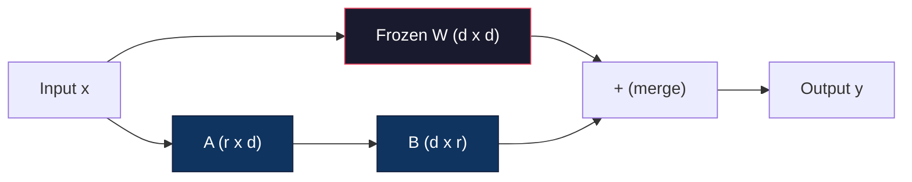
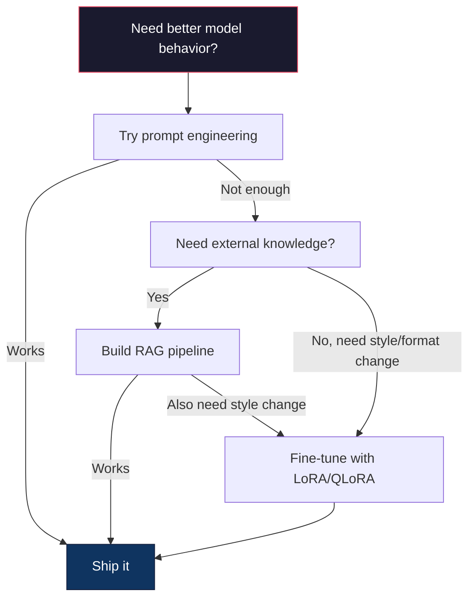

# 使用 LoRA 与 QLoRA 进行微调

> 对一个 7B 模型做全量微调需要 56GB 显存。你没有这么多，大多数公司也没有。LoRA 让你只训练不到 1% 的参数，就能在 6GB 显存里微调同一个模型。这不是妥协——在大多数任务上它都能达到全量微调的质量。整个开源微调生态都建立在这一个技巧之上。

**Type:** Build
**Languages:** Python
**Prerequisites:** Phase 10, Lesson 06 (Instruction Tuning / SFT)
**Time:** ~75 minutes
**Related:** Phase 10 从零实现了 SFT/DPO 循环。本课把它们接入 2026 年的 PEFT 工具链（PEFT、TRL、Unsloth、Axolotl、LLaMA-Factory）。

## 学习目标

- 通过向预训练模型的注意力层注入低秩适配矩阵（A 和 B）来实现 LoRA
- 计算 LoRA 相对全量微调的参数节省：在 $d_{\text{model}}$ 维度下使用秩 $r$，训练的是 $2 \cdot r \cdot d$ 个参数，而不是 $d^2$ 个
- 使用 QLoRA（4-bit 量化基座 + LoRA 适配器）微调模型，让它能装进消费级 GPU 的显存
- 把 LoRA 权重合并回基座模型用于部署，并比较有无适配器时的推理速度

## 问题

你有一个基座模型。Llama 3 8B。你想让它用公司的口吻回答客户支持工单。SFT 是答案。但 SFT 有成本问题。

全量微调会更新模型中的每一个参数。Llama 3 8B 有 80 亿参数。在 fp16 下每个参数占 2 字节，光加载权重就要 16GB。训练时你还需要梯度（16GB）、Adam 的优化器状态（动量 + 方差共 32GB）以及激活值。合计：单个 8B 模型大约需要 56GB 显存。

一块 A100 80GB 勉强装得下。两块 A100 在云厂商那里每小时 3-4 美元。在 5 万条样本上训练 3 个 epoch 要 6-10 小时。一次实验就是 30-40 美元。跑 10 次实验把超参数调对，你在部署任何东西之前就已经花掉 400 美元。

扩展到 Llama 3 70B，数字就荒谬了。光权重就要 140GB。你需要一个集群。一次实验 100 美元以上。

还有一个更深层的问题。全量微调会改动模型里的每一个权重。如果你用客户支持数据微调，可能会削弱模型的通用能力。这叫做灾难性遗忘（catastrophic forgetting）。模型在你的任务上变强了，在其他所有事情上都变差了。

你需要一种训练参数更少、占用内存更小，又不会破坏模型已有知识的方法。

## 概念

### LoRA：低秩适配

Edward Hu 和微软的同事们在 2021 年 6 月发表了 LoRA。论文的洞见是：微调期间的权重更新具有很低的内在秩（intrinsic rank）。你不需要更新一个 4096x4096 权重矩阵里的全部 1677 万个参数。更新中有用的信息可以用一个秩为 16 或 32 的矩阵来捕获。

数学是这样的。标准线性层计算：

```math
y = Wx
```

其中 $W$ 是一个 $d_{\text{out}} \times d_{\text{in}}$ 矩阵。对于一个 4096x4096 的注意力投影，那就是 16,777,216 个参数。

LoRA 冻结 $W$，并加入一个低秩分解：

```math
y = Wx + BAx
```

其中 $B$ 是 $(d_{\text{out}} \times r)$，$A$ 是 $(r \times d_{\text{in}})$。秩 $r$ 远小于 $d$——通常是 8、16 或 32。

对于 4096x4096 层上的 $r=16$：

- 原始参数：4096 x 4096 = 16,777,216
- LoRA 参数：(4096 x 16) + (16 x 4096) = 65,536 + 65,536 = 131,072
- 缩减比例：131,072 / 16,777,216 = 0.78%

你训练 0.78% 的参数，得到 95-100% 的质量。



A 用随机的正态分布初始化，B 初始化为零。这意味着 LoRA 的贡献从零开始——模型从它原本的行为开始训练，逐渐学会适配。

### 缩放因子：Alpha

LoRA 引入一个缩放因子 $\alpha$，用来控制低秩更新对输出的影响程度：

```math
y = Wx + \frac{\alpha}{r} \cdot BAx
```

当 $\alpha = r$ 时，缩放为 1x。当 $\alpha = 2r$（常见的默认值）时，缩放为 2x。这个超参数独立于基础学习率，控制 LoRA 路径的学习率。

实践建议：

- $\alpha = 2 \cdot \text{rank}$ 是社区里常见的约定（原论文在大多数实验中用的是 $\alpha = \text{rank}$）
- $\alpha = \text{rank}$ 给出 1x 缩放，保守但稳定
- 更高的 $\alpha$ 意味着每步更新更大，可能加速收敛，也可能导致不稳定

### LoRA 加在哪里

一个 Transformer 有很多线性层。你不需要给所有层都加 LoRA。原论文测试了不同的组合：

| 目标层 | 可训练参数（7B） | 质量 |
|--------------|----------------------|---------|
| 仅 q_proj | 4.7M | 好 |
| q_proj + v_proj | 9.4M | 更好 |
| q_proj + k_proj + v_proj + o_proj | 18.9M | 注意力层最佳 |
| 全部线性层（注意力 + MLP） | 37.7M | 增益有限，参数翻倍 |

对大多数任务的最佳选择是 q_proj + v_proj。这瞄准的是自注意力中的 query 和 value 投影，它们控制模型关注什么、提取什么信息。加入 MLP 层对代码生成这类复杂任务有帮助，但参数翻倍，在简单任务上收益递减。

### 秩的选择

秩 $r$ 控制适配的表达能力：

| 秩 | 可训练参数（每层） | 适合场景 |
|------|---------------------------|----------|
| 4 | 32,768 | 简单分类、情感分析 |
| 8 | 65,536 | 单领域问答、摘要 |
| 16 | 131,072 | 多领域任务、指令遵循 |
| 32 | 262,144 | 复杂推理、代码生成 |
| 64 | 524,288 | 对大多数任务收益递减 |
| 128 | 1,048,576 | 很少有理由用到 |

Hu 等人表明，对于简单任务，$r=4$ 已经能捕获大部分适配。实践中 $r=8$ 和 $r=16$ 最常见。超过 $r=64$ 很少能提升质量，还会开始丢掉 LoRA 的内存优势。

### QLoRA：4-bit 量化 + LoRA

Tim Dettmers 和华盛顿大学的同事们在 2023 年 5 月发表了 QLoRA。思路是：把冻结的基座模型量化到 4-bit 精度，然后在上面挂 fp16 的 LoRA 适配器。

这彻底改写了显存账本：

| 方法 | 权重显存（7B） | 训练显存（7B） | 所需 GPU |
|--------|-------------------|---------------------|-------------|
| 全量微调（fp16） | 14GB | ~56GB | 1x A100 80GB |
| LoRA（fp16 基座） | 14GB | ~18GB | 1x A100 40GB |
| QLoRA（4-bit 基座） | 3.5GB | ~6GB | 1x RTX 3090 24GB |

QLoRA 有三项技术贡献：

**NF4（Normal Float 4-bit）**：一种专为神经网络权重量身设计的新数据类型。神经网络权重近似服从正态分布。NF4 把它的 16 个量化级别放在标准正态分布的分位数上。对于正态分布的数据，这在信息论上是最优的。它比均匀的 4-bit 量化（INT4）或标准 Float4 丢失的信息更少。

**双重量化（double quantization）**：量化常数本身也占内存。每 64 个权重一块需要一个 fp32 缩放因子（4 字节）。对 7B 模型来说，这是额外的 0.4GB。双重量化把这些常数也量化到 fp8，把开销降到 0.1GB。不多，但积少成多。

**分页优化器（paged optimizers）**：训练时，优化器状态（Adam 的动量和方差）在长序列上可能超出 GPU 显存。分页优化器利用 NVIDIA 的统一内存，在显存耗尽时自动把优化器状态换页到 CPU 内存，需要时再换回来。这以一定的吞吐量为代价，避免 OOM 崩溃。

### 质量问题

减少参数或者量化基座，会损害质量吗？多篇论文的结果如下：

| 方法 | MMLU（5-shot） | MT-Bench | HumanEval |
|--------|--------------|----------|-----------|
| 全量微调（Llama 2 7B） | 48.3 | 6.72 | 14.6 |
| LoRA r=16 | 47.9 | 6.68 | 14.0 |
| QLoRA r=16（NF4） | 47.5 | 6.61 | 13.4 |
| QLoRA r=64（NF4） | 48.1 | 6.70 | 14.2 |

$r=16$ 的 LoRA 在大多数基准上与全量微调的差距在 1% 以内。$r=16$ 的 QLoRA 再损失不到一个百分点。$r=64$ 的 QLoRA 基本追平全量微调，而内存占用少了 90%。

### 真实成本

在 5 万条样本上微调 Llama 3 8B（3 个 epoch）：

| 方法 | GPU | 时间 | 成本 |
|--------|-----|------|------|
| 全量微调 | 2x A100 80GB | 8 小时 | ~$32 |
| LoRA r=16 | 1x A100 40GB | 4 小时 | ~$8 |
| QLoRA r=16 | 1x RTX 4090 24GB | 6 小时 | ~$5 |
| QLoRA r=16（Unsloth） | 1x RTX 4090 24GB | 2.5 小时 | ~$2 |
| QLoRA r=16 | 1x T4 16GB | 12 小时 | ~$4 |

在一块消费级 GPU 上跑 QLoRA，成本比一顿午饭还低。这就是为什么开源权重微调社区在 2023 年爆发，也是为什么下面每个训练框架在 2026 年都默认提供 QLoRA。

### 2026 年的 PEFT 栈

| 框架 | 是什么 | 什么时候选它 |
|-----------|-----------|-----------|
| **Hugging Face PEFT** | 权威的 LoRA/QLoRA/DoRA/IA3 库 | 你想要底层控制，并且训练循环已经跑在 `transformers.Trainer` 上 |
| **TRL** | HF 的基于反馈的强化学习训练器（SFT、DPO、GRPO、PPO、ORPO） | 你在 SFT 之后需要 DPO/GRPO；它构建在 PEFT 之上 |
| **Unsloth** | 用 Triton kernel 重写前向/反向传播 | 你想要 2-5 倍加速和一半显存且不掉精度；Llama/Mistral/Qwen 系列 |
| **Axolotl** | PEFT + TRL + DeepSpeed + Unsloth 之上的 YAML 配置封装 | 你想要可复现、受版本控制的训练运行 |
| **LLaMA-Factory** | PEFT + TRL 之上的 GUI/CLI/API | 你想要零代码微调；支持 100+ 模型系列 |
| **torchtune** | 原生 PyTorch recipe，不依赖 `transformers` | 你想要最少的依赖，而且组织已经统一用 PyTorch |

经验法则：研究用途或一次性实验 → PEFT。可重复的生产流水线 → 开启 Unsloth kernel 的 Axolotl。用完即弃的原型 → LLaMA-Factory。

### 合并适配器

训练之后你手上有两样东西：冻结的基座模型，和一个小小的 LoRA 适配器（通常 10-100MB）。你可以：

1. **分开保留**：加载基座模型，在上面加载适配器。为不同任务切换不同的适配器。这就是用一个基座模型服务多个微调变体的方式。

2. **永久合并**：计算 $W' = W + (\alpha/r) \cdot BA$，把结果保存成一个新的完整模型。合并后的模型与原模型同样大。没有推理开销，也不用管理适配器。

如果要用一个模型服务多个任务（客服适配器、代码适配器、翻译适配器），就分开保留。如果只部署一个专用模型，就合并。

组合多个适配器的高级合并技术：

- **TIES-Merging**（Yadav 等，2023）：裁剪小幅度的参数，解决符号冲突，然后合并。减少适配器之间的干扰。
- **DARE**（Yu 等，2023）：合并前随机丢弃一部分适配器参数，再对剩下的重新缩放。在组合能力方面效果好得出人意料。
- **任务算术（task arithmetic）**：直接加减适配器权重。加一个「代码」适配器和一个「数学」适配器，往往能得到两者都擅长的模型。

### 什么时候不该微调

微调是第三选择，不是第一选择。

**第一：提示工程。** 写一个更好的系统提示。加 few-shot 示例。用思维链。这几乎不花成本，几分钟就能完成。如果提示能把事情做到 80%，你大概不需要微调。

**第二：RAG。** 如果模型需要了解你的特定数据（文档、知识库、产品目录），检索比把它烤进权重更便宜，也更好维护。见第 06 课。

**第三：微调。** 当你需要模型采用某种无法通过提示实现的风格、格式或推理模式时用它。当你需要一致的结构化输出时用它。当你要把大模型蒸馏到小模型时用它。当延迟很重要、承担不起 few-shot 提示带来的额外 token 时用它。



```figure
lora-params
```

## 构建它

我们用纯 PyTorch 从零实现 LoRA。不用库，没有魔法。你会构建 LoRA 层、把它注入模型、训练它，再把权重合并回去。

### 第 1 步：LoRA 层

```python
import torch
import torch.nn as nn
import math

class LoRALayer(nn.Module):
    def __init__(self, in_features, out_features, rank=8, alpha=16):
        super().__init__()
        self.rank = rank
        self.alpha = alpha
        self.scaling = alpha / rank

        self.A = nn.Parameter(torch.randn(in_features, rank) * (1 / math.sqrt(rank)))
        self.B = nn.Parameter(torch.zeros(rank, out_features))

    def forward(self, x):
        return (x @ self.A @ self.B) * self.scaling
```

A 用缩放后的随机值初始化，B 初始化为零。乘积 BA 从零开始，所以模型以原本的行为开始。

### 第 2 步：带 LoRA 的线性层

```python
class LinearWithLoRA(nn.Module):
    def __init__(self, linear, rank=8, alpha=16):
        super().__init__()
        self.linear = linear
        self.lora = LoRALayer(
            linear.in_features, linear.out_features, rank, alpha
        )

        for param in self.linear.parameters():
            param.requires_grad = False

    def forward(self, x):
        return self.linear(x) + self.lora(x)
```

原始的线性层被冻结。只有 LoRA 参数（A 和 B）可训练。

### 第 3 步：把 LoRA 注入模型

```python
def inject_lora(model, target_modules, rank=8, alpha=16):
    for param in model.parameters():
        param.requires_grad = False

    lora_layers = {}
    for name, module in model.named_modules():
        if isinstance(module, nn.Linear):
            if any(t in name for t in target_modules):
                parent_name = ".".join(name.split(".")[:-1])
                child_name = name.split(".")[-1]
                parent = dict(model.named_modules())[parent_name]
                lora_linear = LinearWithLoRA(module, rank, alpha)
                setattr(parent, child_name, lora_linear)
                lora_layers[name] = lora_linear
    return lora_layers
```

首先冻结模型中的所有参数。然后遍历模型树，找到匹配目标名称的线性层，把它们替换成 LoRA 包装版本。整个模型里，LoRA 的 A、B 矩阵是唯一可训练的参数。

### 第 4 步：统计参数

```python
def count_parameters(model):
    total = sum(p.numel() for p in model.parameters())
    trainable = sum(p.numel() for p in model.parameters() if p.requires_grad)
    frozen = total - trainable
    return {
        "total": total,
        "trainable": trainable,
        "frozen": frozen,
        "trainable_pct": 100 * trainable / total if total > 0 else 0
    }
```

### 第 5 步：把权重合并回去

```python
def merge_lora_weights(model):
    for name, module in model.named_modules():
        if isinstance(module, LinearWithLoRA):
            with torch.no_grad():
                merged = (
                    module.lora.A @ module.lora.B
                ) * module.lora.scaling
                module.linear.weight.data += merged.T
            parent_name = ".".join(name.split(".")[:-1])
            child_name = name.split(".")[-1]
            if parent_name:
                parent = dict(model.named_modules())[parent_name]
            else:
                parent = model
            setattr(parent, child_name, module.linear)
```

合并之后，LoRA 层就消失了。模型和原始大小一样，适配被烤进了权重里。没有推理开销。

### 第 6 步：模拟 QLoRA 量化

```python
def quantize_to_nf4(tensor, block_size=64):
    blocks = tensor.reshape(-1, block_size)
    scales = blocks.abs().max(dim=1, keepdim=True).values / 7.0
    scales = torch.clamp(scales, min=1e-8)
    quantized = torch.round(blocks / scales).clamp(-8, 7).to(torch.int8)
    return quantized, scales

def dequantize_from_nf4(quantized, scales, original_shape):
    dequantized = quantized.float() * scales
    return dequantized.reshape(original_shape)
```

这段代码通过把权重映射到每 64 个一块的 16 个离散级别来模拟 4-bit 量化。生产环境的 QLoRA 用 bitsandbytes 库在 GPU 上做真正的 NF4。

### 第 7 步：训练循环

```python
def train_lora(model, data, epochs=5, lr=1e-3, batch_size=4):
    optimizer = torch.optim.AdamW(
        [p for p in model.parameters() if p.requires_grad], lr=lr
    )
    criterion = nn.MSELoss()

    losses = []
    for epoch in range(epochs):
        epoch_loss = 0.0
        n_batches = 0
        indices = torch.randperm(len(data["inputs"]))

        for i in range(0, len(indices), batch_size):
            batch_idx = indices[i:i + batch_size]
            x = data["inputs"][batch_idx]
            y = data["targets"][batch_idx]

            output = model(x)
            loss = criterion(output, y)

            optimizer.zero_grad()
            loss.backward()
            optimizer.step()

            epoch_loss += loss.item()
            n_batches += 1

        avg_loss = epoch_loss / n_batches
        losses.append(avg_loss)

    return losses
```

### 第 8 步：完整演示

```python
def demo():
    torch.manual_seed(42)
    d_model = 256
    n_classes = 10

    model = nn.Sequential(
        nn.Linear(d_model, 512),
        nn.ReLU(),
        nn.Linear(512, 512),
        nn.ReLU(),
        nn.Linear(512, n_classes),
    )

    n_samples = 500
    x = torch.randn(n_samples, d_model)
    y = torch.randint(0, n_classes, (n_samples,))
    y_onehot = torch.zeros(n_samples, n_classes).scatter_(1, y.unsqueeze(1), 1.0)

    data = {"inputs": x, "targets": y_onehot}

    params_before = count_parameters(model)

    lora_layers = inject_lora(
        model, target_modules=["0", "2"], rank=8, alpha=16
    )

    params_after = count_parameters(model)

    losses = train_lora(model, data, epochs=20, lr=1e-3)

    merge_lora_weights(model)
    params_merged = count_parameters(model)

    return {
        "params_before": params_before,
        "params_after": params_after,
        "params_merged": params_merged,
        "losses": losses,
    }
```

这个演示创建一个小模型，往两层里注入 LoRA，训练它，再把权重合并回去。可训练参数在 LoRA 训练期间从全量降到约 1%，合并之后又回到原始架构。

## 使用它

借助 Hugging Face 生态，在真实模型上做 LoRA 大约 20 行代码：

```python
from transformers import AutoModelForCausalLM, AutoTokenizer
from peft import LoraConfig, get_peft_model, TaskType

model = AutoModelForCausalLM.from_pretrained("meta-llama/Llama-3.1-8B")
tokenizer = AutoTokenizer.from_pretrained("meta-llama/Llama-3.1-8B")

lora_config = LoraConfig(
    task_type=TaskType.CAUSAL_LM,
    r=16,
    lora_alpha=32,
    lora_dropout=0.05,
    target_modules=["q_proj", "v_proj"],
)

model = get_peft_model(model, lora_config)
model.print_trainable_parameters()
```

要上 QLoRA，加上 bitsandbytes 量化：

```python
from transformers import BitsAndBytesConfig

bnb_config = BitsAndBytesConfig(
    load_in_4bit=True,
    bnb_4bit_quant_type="nf4",
    bnb_4bit_compute_dtype=torch.bfloat16,
    bnb_4bit_use_double_quant=True,
)

model = AutoModelForCausalLM.from_pretrained(
    "meta-llama/Llama-3.1-8B",
    quantization_config=bnb_config,
    device_map="auto",
)

model = get_peft_model(model, lora_config)
```

就这样。同样的训练循环，同样的数据流水线。基座模型现在以 4-bit 存放，LoRA 适配器以 fp16 训练，整套东西装进 6GB。

用 Hugging Face Trainer 训练：

```python
from transformers import TrainingArguments, Trainer
from datasets import load_dataset

dataset = load_dataset("tatsu-lab/alpaca", split="train[:5000]")

training_args = TrainingArguments(
    output_dir="./lora-llama",
    num_train_epochs=3,
    per_device_train_batch_size=4,
    gradient_accumulation_steps=4,
    learning_rate=2e-4,
    fp16=True,
    logging_steps=10,
    save_strategy="epoch",
    optim="paged_adamw_8bit",
)

trainer = Trainer(
    model=model,
    args=training_args,
    train_dataset=dataset,
)

trainer.train()

model.save_pretrained("./lora-adapter")
```

保存下来的适配器是 10-100MB。基座模型保持原样。你可以把适配器分享到 Hugging Face Hub，而不用分发整个模型。

## 交付它

本课产出：

- `outputs/prompt-lora-advisor.md` —— 一个提示，帮你为特定任务决定 LoRA 的秩、目标模块和超参数
- `outputs/skill-fine-tuning-guide.md` —— 一个 skill，教智能体判断何时以及如何微调的决策树

## 练习

1. **秩消融实验。** 用 2、4、8、16、32、64 的秩跑这个演示。画出最终损失随秩变化的曲线。找出收益递减的点——秩翻倍不再让损失减半的位置。对于 256 维特征的简单分类任务，这个点大约在 r=8-16。

2. **目标模块对比。** 修改 inject_lora，分别只作用于层 "0"、只作用于层 "2"、只作用于层 "4"，以及三者都作用。每个变体训练 20 个 epoch。比较收敛速度和最终损失。这对应现实中选 q_proj、v_proj 还是全部线性层的决策。

3. **量化误差分析。** 取训练后模型的权重矩阵，比较 quantize_to_nf4 / dequantize_from_nf4 前后的结果。计算均方误差、最大绝对误差，以及原始权重与重建权重之间的相关性。试试 block_size 取 32、64、128、256。

4. **多适配器服务。** 在数据的不同子集（偶数索引 vs 奇数索引）上训练两个 LoRA 适配器。把两个都保存。加载一次基座模型，然后切换适配器，验证它们对同一输入产生不同输出。生产系统就是这样用一个基座服务多个微调模型。

5. **合并与未合并推理。** 在同样的 100 个输入上，比较 merge_lora_weights 前后 LoRA 模型的输出。验证输出一致（浮点容差 1e-5 以内）。然后对两者做推理速度基准——合并后的应该略快，因为是一次矩阵乘法而不是两次。

## 关键术语

| 术语 | 大家怎么说 | 实际含义 |
|------|----------------|----------------------|
| LoRA | 「高效微调」 | Low-Rank Adaptation（低秩适配）：冻结基座权重，只训练两个小矩阵 A 和 B，让它们的乘积逼近完整的权重更新 |
| QLoRA | 「在笔记本上微调」 | Quantized LoRA：用 4-bit NF4 加载基座模型，在上面以 fp16 训练 LoRA 适配器，让 7B 微调在 6GB 显存内完成 |
| 秩（r） | 「模型能学多少」 | A 和 B 矩阵的内维度；控制表达能力与参数量的权衡 |
| Alpha | 「LoRA 的学习率」 | 作用于 LoRA 输出的缩放因子；$\alpha/r$ 缩放适配对最终输出的贡献 |
| NF4 | 「4-bit 量化」 | Normal Float 4：量化级别位于正态分布分位数上的 4-bit 数据类型，对神经网络权重最优 |
| 适配器 | 「训练出来的那一小部分」 | 保存为单独文件的 LoRA A、B 矩阵（10-100MB），可以加载到基座模型的任意副本之上 |
| 目标模块 | 「给哪些层加 LoRA」 | LoRA 适配器注入的具体线性层（q_proj、v_proj 等） |
| 合并 | 「烤进去」 | 计算 $W + (\alpha/r) \cdot BA$ 并替换原权重，消除推理时的适配器开销 |
| 分页优化器 | 「训练时别 OOM」 | 在 GPU 显存耗尽时把优化器状态（Adam 动量、方差）卸载到 CPU |
| 灾难性遗忘 | 「微调把别的能力搞坏了」 | 更新所有权重导致模型丢失先前学到的能力 |

## 延伸阅读

- Hu 等，"LoRA: Low-Rank Adaptation of Large Language Models"（2021）——提出低秩分解方法的原始论文，在 GPT-3 175B 上测试，秩低至 4
- Dettmers 等，"QLoRA: Efficient Finetuning of Quantized Language Models"（2023）——提出 NF4、双重量化和分页优化器，让 65B 模型能在单块 48GB GPU 上微调
- PEFT 库文档（huggingface.co/docs/peft）——Hugging Face 生态中 LoRA、QLoRA 及其他参数高效方法的标准库
- Yadav 等，"TIES-Merging: Resolving Interference When Merging Models"（2023）——在不损失质量的前提下组合多个 LoRA 适配器的技术
- [Rafailov et al., "Direct Preference Optimization: Your Language Model is Secretly a Reward Model" (NeurIPS 2023)](https://arxiv.org/abs/2305.18290) —— DPO 推导；SFT 之后的偏好微调阶段，不需要奖励模型。
- [TRL 文档](https://huggingface.co/docs/trl/) —— `SFTTrainer`、`DPOTrainer`、`KTOTrainer` 的官方参考，以及与 PEFT/bitsandbytes/Unsloth 的集成接口。
- [Unsloth 文档](https://docs.unsloth.ai/) —— 让微调吞吐翻倍、内存减半的融合 kernel；TRL 底下的性能层。
- [Axolotl 文档](https://axolotl-ai-cloud.github.io/axolotl/) —— YAML 配置的多 GPU SFT/DPO/QLoRA 训练器；手写脚本的 config-as-code 替代品。
