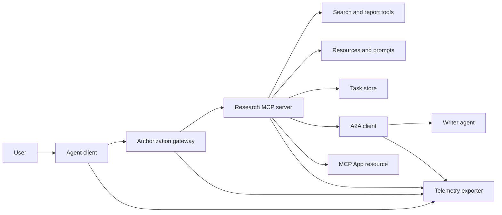
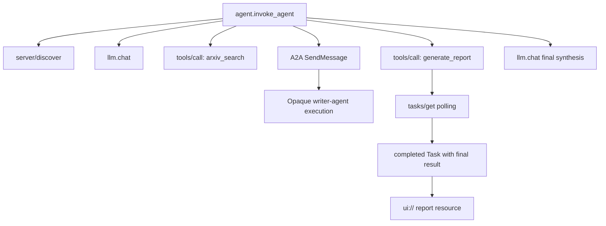
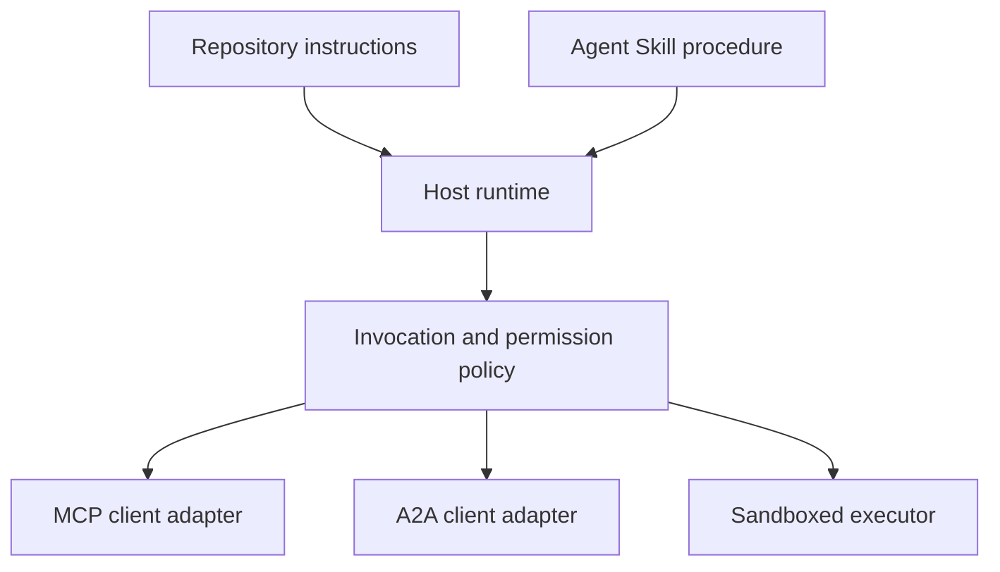

# 项目：无状态工具生态系统

> 生产级 Agent 系统是一组边界，而不是一堆功能。这个项目把一个可读的进程内模拟，与真实部署仍然需要的协议客户端、授权服务器、沙箱和遥测导出器区分开来。

**Type:** Build
**Languages:** Python (stdlib, in-process simulation)
**Prerequisites:** Phase 13 · 01 through 22, using MCP revision `2026-07-28`
**Time:** ~120 minutes

## 学习目标

- 将 tool call、任务形态的结果、委派工作、UI 资源、授权策略和 trace 记录组合成一条流程。
- 在每个 MCP 请求上携带协议版本、客户端身份和能力，而不是依赖连接会话来维持状态。
- 在使用服务器之前先发现它，并通过官方 Tasks 扩展驱动长时间工作。
- 区分协议形态的模拟与 MCP、A2A、OAuth 或 OpenTelemetry 实现。
- 把每个模拟边界映射到必须替换它的生产组件。
- 让 `AGENTS.md`、Agent Skill、运行时适配器、工具和安全策略各司其职。
- 说明哪些主张可以从本地输出验证，哪些需要实时集成测试。

## 问题

设计一个研究与报告系统。用户想要关于 Agent 协议的论文。系统搜索论文目录，委派摘要工作，生成报告，返回一个 UI 资源，并记录经过系统的路径。

这句话隐藏着若干个彼此独立的契约：

- 面向模型的工具 schema；
- 无状态请求信封和服务器发现契约；
- 针对 actor、scope 和工具身份的网关决策；
- 长时间运行操作契约；
- 委派协议；
- 宿主到应用的桥接；
- trace 传播与导出；
- 可复用的操作流程。

`code/main.py` 用普通 Python 函数和字典让这些边界保持可见。它不打开传输连接、不联系 arXiv、不执行 OAuth、不调用 A2A 服务器、不渲染 MCP App，也不导出遥测。这样控制流易于检查，同时不会把模拟当成合规服务来呈现。

## 概念

### 目标架构



该架构是公开协议模式的概念性组合。它并不是关于任何产品私有内部实现的声明。

### 目标调用链



在真实实现中，每一跳都会传播 trace 上下文。span 名称和属性必须遵循所选 instrumentation 版本支持的 OpenTelemetry 语义约定。仅有一个共享的 trace 标识符，并不能证明父子关系、导出或后端摄入是正确的。

### 当前协议表面

使用当前协议定义的方法名，而不是凭记忆写下的旧草案名称：

| 边界 | 当前表面 | 项目模拟的内容 |
|---|---|---|
| MCP 发现 | 强制的 `server/discover` | 一个直接返回版本、能力与服务器身份的函数 |
| MCP 请求上下文 | 每个 `params._meta` 中的版本、能力和客户端身份 | 传给每次模拟调用的新鲜请求元数据 |
| MCP tool call | `tools/call` | 直接的 Python 函数分发 |
| MCP 任务轮询 | `io.modelcontextprotocol/tasks` 与 `tasks/get` | 一个可用的句柄，随后是携带最终结果的已完成任务 |
| A2A 委派 | gRPC 和 JSON-RPC 中的 `SendMessage`；HTTP+JSON 中的 `POST /message:send` | 一个嵌套 span，没有远程调用或人为延迟 |
| 调用服务器工具的 MCP App | `app.callServerTool({ name, arguments })` | 一段没有实时桥接的 HTML 字符串 |
| OAuth 授权 | 授权服务器、受保护资源元数据、audience 和 scope 校验 | 静态 token 查找和 scope 成员检查 |
| OpenTelemetry | SDK、propagator、exporter 以及 collector 或后端 | 内存中的 span 字典 |

协议名称只是第一层。生产测试必须在真实线路上检验序列化、认证失败、取消、超时、重试和版本兼容性。

### 无状态 MCP 改变了集成边界

修订版 `2026-07-28` 移除了协议会话以及 `initialize` / `notifications/initialized` 握手。它还移除了 `Mcp-Session-Id`。每个请求都携带以下带命名空间的 `_meta` 字段：

```json
{
  "io.modelcontextprotocol/protocolVersion": "2026-07-28",
  "io.modelcontextprotocol/clientCapabilities": {
    "extensions": {
      "io.modelcontextprotocol/tasks": {}
    }
  },
  "io.modelcontextprotocol/clientInfo": {
    "name": "capstone-client",
    "version": "1.0.0"
  }
}
```

服务器必须实现 `server/discover`。普通结果使用 `resultType: "complete"`；任务句柄使用 `resultType: "task"`。每个结果应在 `_meta.io.modelcontextprotocol/serverInfo` 中标明服务器身份。

任务扩展包含 `tasks/get`、`tasks/update` 和 `tasks/cancel`。工具可以首先返回 `resultType: "task"`；`tasks/get` 本身返回 `resultType: "complete"`，已完成的 `Task` 包含最终结果。旧的 `tasks/result` 和 `tasks/list` 方法不属于当前扩展。客户端必须在可能收到任务句柄的同一个请求中声明 `io.modelcontextprotocol/tasks`。如果没有声明，服务器返回 `-32021`，其中 `requiredCapabilities` 形如缺失的客户端能力对象，包含 `extensions.io.modelcontextprotocol/tasks`。

### 安全态势

目标部署采用纵深防御：

- 在客户端类型需要时使用带 PKCE 的 OAuth 授权；
- 为签发的访问 token 绑定 resource 和 audience；
- 网关 RBAC 检查所请求的工具和作用域；
- 上游凭证保存在模型可见上下文之外；
- 固定或经过审查的工具描述清单；
- 针对不可信输入、敏感数据和有后果操作的 Rule of Two 审查；
- 一个执行沙箱，其文件系统、进程、网络、凭证和资源限制在技能之外强制执行。

演示只实现了静态 token、作用域检查和描述哈希。它适用于展示策略流转，不能用于安全验证。

### 技能是流程，不是传输

Agent Skill 可以告诉运行时如何执行研究流程、应预期哪些工具契约、保存哪些证据以及何时停止。它不能凭空让 MCP 服务器存在、建立 A2A 兼容性、授予作用域或创建沙箱。



当流程引用配套文件时，要交付完整的技能目录。这个较早的项目中的扁平产物是一份课程蓝图，并不能证明宿主会保留可移植包。第 24 到 27 课构建并测试完整的包生命周期。

### 课程产物元数据是本地适配器

课程目录和安装器识别名为 `skill-*.md` 的扁平文件，但这是仓库约定，而不是可移植的 Agent Skills 包契约。它们的最小 frontmatter 解析器只读取顶层键。因此本课把可移植身份字段和课程目录字段放在同一层级：

```yaml
---
name: ecosystem-blueprint
description: Produce a full Phase 13 ecosystem architecture for a product need.
version: "1.0.0"
phase: "13"
lesson: "23"
tags: [mcp, capstone, ecosystem, architecture, a2a, otel]
---
```

`name` 和 `description` 是可移植身份字段。`version`、`phase`、`lesson` 和 `tags` 是课程特定的目录扩展。课程解析器要求 `tags` 是内联列表，以便 `--tag capstone` 能匹配它。

可移植的目录技能可以使用可选的 `metadata` 映射承载字符串值的扩展数据。这并不意味着 `metadata` 与本仓库的目录 schema 可以互换。如果这个扁平文件把 `version` 或 `tags` 嵌套在 `metadata` 之下，最小解析器会跳过这些缩进键，目录会记录空版本，标签过滤也找不到该产物。生产宿主应使用安全的 YAML 解析器，并校验其自身文档化的 schema。

### 模拟与生产

| 层 | `code/main.py` | 生产替换 | 所需证据 |
|---|---|---|---|
| 发现 | `server_discover()` 加静态 `TOOLS` | `server/discover` 后跟缓存感知的 `tools/list` | 线路记录、确定性顺序和 schema 校验 |
| 认证 | 以 token 为键的字典 | OAuth 授权与资源服务器校验 | issuer、audience、scope、过期和失败测试 |
| 授权 | 作用域成员检查 | 绑定到 actor、工具、目标和租户的网关策略 | 允许与拒绝的审计案例 |
| 搜索 | 静态论文夹具 | 搜索 API 或 MCP 服务器 | 来源溯源、排序和错误测试 |
| 任务 | 本地句柄加立即 `tasks/get` | 持久化的 `io.modelcontextprotocol/tasks` 存储，支持 `tasks/get`、`tasks/update`、`tasks/cancel` 和 TTL | 状态转换、输入、取消和恢复测试 |
| 委派 | sleep 加嵌套 span | A2A 客户端和远程 Agent Card | 契约、超时、重试和不透明性测试 |
| 应用 | HTML 字符串和 URI | MCP Apps 资源与 `App` 桥接 | CSP、权限、tool call 和浏览器测试 |
| 遥测 | 内存列表 | OTel SDK 与 exporter | collector 接收和 trace 父级断言 |
| 沙箱 | 无 | 宿主强制隔离的执行器 | 逃逸、出网、密钥和资源限制测试 |

这张表就是交接边界。本地运行通过只能验证模拟。

### Phase 13 全景

| 课程 | 贡献 |
|---|---|
| 01-05 | 工具接口、调用、schema、结构化结果和确定性校验 |
| 06-14 | 无状态 MCP 请求信封、发现、传输、资源、prompts、扩展和 Apps |
| 15-18 | 投毒防御、OAuth、网关、注册表和生产认证 |
| 19 | A2A 消息与任务委派 |
| 20 | OpenTelemetry GenAI trace 设计 |
| 21 | 模型提供商路由 |
| 22 | 可移植技能契约与运行时边界 |

```figure
t3-capstone-chain
```

## 构建它

运行进程内实验框架：

```bash
cd phases/13-tools-and-protocols/23-capstone-tool-ecosystem
python3 code/main.py
```

检查以下几项：

1. `server/discover` 声明修订版 `2026-07-28` 和 Tasks 扩展。
2. Alice 可以读取并生成报告，而 Bob 的写作用域调用被拒绝。
3. 一次编排器运行中的每个本地 span 共享同一个 trace 标识符，并记录父 span 标识符。
4. 报告首先是一个任务句柄。`tasks/get` 返回已完成的任务，其最终结果包含文本和一个 `ui://` 引用。
5. 被委派的 writer 保持不透明，因为编排器只记录边界 span。
6. 输出不声称发生了网络连接、OAuth 交换、collector 导出、浏览器渲染或沙箱执行。

脚本运行两次，因此产生两条根 trace。审计条目是进程本地的，下一次运行时会重置。

## 使用它

一次提升一层：

1. 用真实的 `server/discover` 和 `tools/list` 调用替换 `server_discover()` 与静态工具列表。在每个请求中发送版本、身份和能力。
2. 用授权服务器和受保护资源校验替换静态 token。
3. 实现 `io.modelcontextprotocol/tasks` 扩展，并测试 `tasks/get`、`tasks/update`、`tasks/cancel`、超时、TTL 和重启恢复。不要添加 `tasks/result` 或 `tasks/list`。
4. 用一个能解析 Agent Card 并发送消息的 A2A 客户端替换委派桩。
5. 用官方 SDK 构建 App，并通过 `app.callServerTool` 调用服务器工具。
6. 将 span 导出到测试 collector，并在接收端断言父子关系。
7. 在第 26 课的沙箱契约内运行工具和脚本执行。
8. 将流程打包成完整的目录包，并通过第 27 课的发布门禁。

每次提升都需要一个跨越新边界的集成测试。当线路变成真实实现后，不要删除底层策略测试。

## 交付它

本课产出 `outputs/skill-ecosystem-blueprint.md`，一个传统的单文件课程产物。它要求给出一页架构，覆盖原语、安全、委派、遥测、打包以及最严峻的运营风险。它的顶层目录字段会由仓库真实的目录与安装器解析器检验。

由于它不是目录包，因此无法携带引用、脚本、资源或评估夹具。在本课程之外发布可复用技能时，请使用第 22 课以及第 24 到 27 课中的包格式。

## 练习

1. 运行 `code/main.py`。把输出证明的事实，与仍需集成证据的生产主张区分开。
2. 添加第二个静态后端，并定义两个同名工具冲突时的规则。然后用真实的 `tools/list` 调用替换两个列表。
3. 用 A2A 测试服务器替换 writer 桩。记录 Agent Card、消息请求、超时路径和返回的产物。
4. 添加一个能在进程重启后存活的 task store。证明客户端可以通过 `tasks/get` 恢复、遵守 `pollIntervalMs`，并在不使用 `tasks/result` 的情况下读取已完成任务的最终结果。
5. 构建一个最小 MCP App，并在带有严格 CSP 和显式权限的浏览器中验证 `app.callServerTool`。
6. 通过 OTel SDK 把模拟的 span 导出到本地 collector。断言接收、trace 标识符、父子关系和错误状态。
7. 为仓库级维护规则编写 `AGENTS.md`，并为可复用研究流程编写独立的技能包。解释为什么这两个文件都不授予工具权限。

## 关键术语

| 术语 | 人们怎么说 | 实际含义 |
|---|---|---|
| 项目 | 「把所有东西接在一起」 | 一个分阶段集成，其中模拟边界与真实边界保持明确 |
| 协议形态的模拟 | 「基本就是 MCP」 | 看起来像某种协议、但未实现其线路契约的本地数据和调用 |
| Tasks 扩展 | 「长时间工具调用」 | 可选的 `io.modelcontextprotocol/tasks` 生命周期，具有持久身份、轮询、客户端输入、最终结果和取消语义 |
| 不透明边界 | 「另一个 Agent 处理它」 | 调用方只能看到声明的接口和产物，看不到私有推理或内部状态 |
| 运行时适配器 | 「技能集成」 | 把可移植流程映射到发现、调用、工具、策略和上下文的宿主代码 |
| 集成证据 | 「它通过了」 | 证明真实边界已被跨越的记录、产物或接收端观察 |

## 延伸阅读

- [MCP 规范 2026-07-28](https://modelcontextprotocol.io/specification/2026-07-28)，了解无状态请求、发现、工具、授权和传输行为。
- [MCP 2026-07-28 关键变更](https://modelcontextprotocol.io/specification/2026-07-28/changelog)，了解会话移除、按请求元数据、MRTR、扩展和弃用项。
- [MCP Tasks 扩展](https://tasks.extensions.modelcontextprotocol.io/specification/draft/tasks)，了解 `tasks/get`、`tasks/update`、`tasks/cancel` 以及由终态任务携带的最终结果。
- [MCP Apps SDK](https://github.com/modelcontextprotocol/ext-apps/blob/main/docs/overview.md)，了解 `App` 和 `app.callServerTool`。
- [A2A 协议](https://a2a-protocol.org/latest/)，了解 Agent Card、消息投递、任务、产物和传输绑定。
- [OpenTelemetry GenAI 语义约定](https://opentelemetry.io/docs/specs/semconv/gen-ai/)，了解 trace 与属性约定。
- [Agent Skills 规范](https://agentskills.io/specification)，了解流程层使用的可移植包契约。
