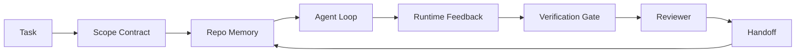

# 智能体工作台工程：为什么有能力的模型仍然会失败

> 仅仅有能力的模型还不够。可靠的智能体需要一套工作台：指令、状态、范围、反馈、验证、评审与交接。把这些拿掉，即便是前沿模型，产出的工作也不足以安全交付。

**Type:** Learn + Build
**Languages:** Python (stdlib)
**Prerequisites:** Phase 14 · 01 (Agent Loop), Phase 14 · 26 (Failure Modes)
**Time:** ~45 minutes

## 学习目标

- 区分模型能力与执行可靠性。
- 说出决定智能体能否交付的七个工作面。
- 在一个小型仓库任务上，比较仅靠 prompt 的运行与由工作台引导的运行。
- 产出一份失败模式报告，把每个缺失的工作面映射到它造成的症状。

## 问题

你把一个前沿模型放进真实仓库，让它添加输入校验。它打开四个文件，写出看似合理的代码，宣称成功，然后停下。你运行测试，两个失败。第三个被改动的文件与校验毫无关系。没有记录说明智能体假设了什么、先尝试了什么、还剩什么没做。

模型对 Python 的理解没有错，它错在对工作的理解。它不知道什么算完成，不知道自己被允许写到哪里，不知道哪些测试具有权威性，也不知道下一个会话该如何接续。

这不是模型 bug，而是工作台 bug。智能体周围的工作面缺少了那些把一次性生成变成可靠、可恢复工程的部件。

## 概念

工作台是任务期间包裹模型的操作环境。它有七个工作面：

| 工作面 | 承载什么 | 缺失时的故障 |
|---------|-----------------|----------------------|
| 指令 | 启动规则、禁止操作、完成定义 | 智能体只能猜测“可交付”是什么意思 |
| 状态 | 当前任务、已触及文件、阻塞项、下一步操作 | 每个会话都从零开始 |
| 范围 | 允许的文件、禁止的文件、验收标准 | 改动泄漏到无关代码 |
| 反馈 | 把真实命令输出采集进循环 | 智能体在收到 400 响应时仍宣称成功 |
| 验证 | 测试、lint、冒烟运行、范围检查 | “看起来没问题”的改动进入 main |
| 评审 | 由不同角色进行第二轮检查 | 构建者自己批改自己的作业 |
| 交接 | 改了什么、为什么、还剩什么 | 下个会话重新发现一切 |

工作台与模型相互独立。你可以更换模型而保留工作面；但不能更换工作面还指望可靠性不变。



这个循环闭合在状态文件上，而不是聊天历史上。聊天是易失的，仓库才是权威记录系统。

### 工作台与 prompt 工程

Prompt 告诉模型这一轮你想要什么。工作台告诉模型如何跨轮次、跨会话地做事。多数智能体失败故事，本质上都是工作台失败，只是披着 prompt 工程的外衣。

### 工作台与框架

框架（LangGraph、AutoGen、Agents SDK）提供运行时。工作台为智能体提供运行时中的工作场所。两者都需要。这个迷你系列讲的是后者。

### 从原语出发，而不是从厂商分类法出发

当下关于“harness 工程”的文章很多。Addy Osmani、OpenAI、Anthropic、LangChain、Martin Fowler、MongoDB、HumanLayer、Augment Code、Thoughtworks、walkinglabs 的 awesome 列表，以及一波接一波的 Medium 和 Hacker News 文章都在讨论它。它们对 harness 的边界、范围以及该用哪套词汇各执一词。我们无需选边。七个工作面属于 UX 层；每个工作台底下，都是同一组支撑可靠后端的分布式系统原语。

暂时去掉“智能体”这个标签。一次智能体运行，是跨越时间、进程和机器进行的计算。要让它可靠，就需要任何生产系统都需要的同一组原语。

| 原语 | 是什么 | 为智能体承载什么 |
|-----------|------------|------------------------------|
| 函数 | 有类型签名的处理函数。尽可能保持纯函数。负责自己的输入与输出。 | 一次工具调用、一次规则检查、一个验证步骤、一次模型调用 |
| worker | 长期存活、拥有一个或多个函数及生命周期的进程 | 构建者、评审者、验证者、MCP 服务器 |
| 触发器 | 用于调用函数的事件源 | 智能体循环 tick、HTTP 请求、队列消息、cron、文件变更、钩子 |
| 运行时 | 决定什么在何处运行、使用何种超时与资源的边界 | Claude Code 的进程、LangGraph 的运行时、worker 容器 |
| HTTP / RPC | 调用方与 worker 之间的传输线 | 工具调用协议、MCP 请求、模型 API |
| 队列 | 触发器与 worker 之间的持久缓冲区；背压、重试、幂等 | 任务板、反馈日志、评审收件箱 |
| 会话持久化 | 在崩溃、重启、模型替换后仍存活的状态 | `agent_state.json`、checkpoint、KV 存储、仓库本身 |
| 授权策略 | 谁可以以什么范围调用哪个函数 | 允许/禁止的文件、审批边界、MCP 能力列表 |

现在把七个工作台面映射到这些原语上。

- **指令** — 策略 + 函数元数据。规则就是检查（函数）。路由器（`AGENTS.md`）是附着在运行时启动流程上的策略。
- **状态** — 会话持久化。运行时在每一步读取的键值存储。文件、KV 或数据库皆可；关键是持久化语义，而不是存储后端。
- **范围** — 每个任务的授权策略。允许/禁止的 glob 就是一组 ACL。需要审批的事项构成一张权限格（permission lattice）。
- **反馈** — 写入队列的调用日志。每次 shell 调用都是一条记录，持久、可重放。
- **验证** — 一个函数。对输入具有确定性。在任务关闭时触发。失败即关闭（fails closed）。
- **评审** — 一个独立的 worker，对构建者的产物只有只读授权，对评审报告只有只写授权。
- **交接** — 由会话结束触发器发出的持久记录。下一会话的启动触发器会读取它。

智能体循环本身就是一个 worker：消费事件（用户消息、工具结果、定时器 tick），调用函数（模型，以及模型选择的工具），写入记录（状态、反馈），并发出触发器（验证、评审、交接）。没有神秘之处；与作业处理器是同一种形态。

### 流通中的模式，翻译成原语

当下流行的每一种 harness 模式，都能归约为这八种原语。对照表如下。

| 厂商或社区模式 | 它实际上是什么 |
|------------------------------|--------------------|
| Ralph Loop（Claude Code、Codex、agentic_harness 一书）——当智能体试图提前停止时，把原始意图重新注入一个全新的上下文窗口 | 一个触发器，用干净的上下文重新入队任务；会话持久化把目标向前传递 |
| 计划 / 执行 / 验证（PEV） | 三个 worker，每个角色一个，通过状态和阶段之间的队列通信 |
| Harness-compute separation（OpenAI Agents SDK，2026 年 4 月）——将控制平面与执行平面分离 | 实质上是在重述控制平面/数据平面。这个概念比“智能体”标签早了几十年 |
| Open Agent Passport（OAP，2026 年 3 月）——在执行前，依据声明式策略对每次工具调用签名并审计 | 由前置操作 worker 强制执行的授权策略，外加签名审计队列 |
| Guides and Sensors（Birgitta Böckeler / Thoughtworks）——前馈规则 + 反馈可观测性 | 授权策略 + 验证函数 + 可观测性 trace |
| 五阶段渐进式压缩（Claude Code 逆向工程，2026 年 4 月） | 一个状态管理 worker，像 cron 一样在会话持久化之上运行，使其保持在预算内 |
| 钩子 / 中间件（LangChain、Claude Code）——拦截模型和工具调用 | 触发器 + 包裹在运行时调用路径上的函数 |
| 技能即 Markdown，带渐进披露（Anthropic、Flue） | 函数注册表，其中函数元数据按需加载到上下文 |
| 沙箱智能体（Codex、Sandcastle、Vercel Sandbox） | 计算平面：具有隔离文件系统、网络和生命周期的运行时 |
| MCP 服务器 | worker，通过稳定的 RPC 暴露函数，并用能力列表做授权 |

这张表里的每一条，都是智能体社区重新抵达某个分布式系统中早已有名字的原语，然后给它起了个新名字。对营销有用，作为工程词汇没有用。

### 这些实证数据说明了什么

“harness 比模型更重要”这一主张，现在已经有数字支撑。值得了解，因为这也是反对“再等一个更聪明的模型”的唯一诚实论据。

- Terminal Bench 2.0——同一模型，仅改变 harness，就把一个编码智能体从 30 名开外提升到第 5 名（LangChain，*Anatomy of an Agent Harness*）。
- Vercel——删掉了其智能体 80% 的工具；成功率从 80% 跃升到 100%（MongoDB）。
- Harvey——仅靠 harness 优化，法律智能体的准确率就提高了一倍以上（MongoDB）。
- 88% 的企业 AI 智能体项目没能进入生产。失败集中在运行时，而不是推理（preprints.org，*Harness Engineering for Language Agents*，2026 年 3 月）。
- 一项 2025 年的基准研究覆盖三个流行开源框架，报告的约 50% 任务完成率；长上下文 WebAgent 在长上下文条件下从 40–50% 跌到 10% 以下，主要原因是无限循环和目标丢失（2026 年初的多篇文章都有讨论）。

结论并不是“harness 永远赢”。模型确实会随着时间吸收 harness 的技巧。结论是：今天，承重的工程在模型周围，而不在模型内部；而承重的原语，正是每个生产系统一直都需要的东西。

### 厂商文章止步于何处

这一部分，你不需要客气。

- LangChain 的 *Anatomy of an Agent Harness* 列举了十一个组件——prompts、工具、钩子、沙箱、编排、记忆、技能、子智能体，以及一个运行时的“笨循环”。它没有点名队列、作为部署单元的 worker、触发器语义、作为独立关注点的会话持久化，也没有授权策略。它把 harness 当作一个可配置的对象，而不是一个需要部署的系统。
- Addy Osmani 的 *Agent Harness Engineering* 给出了 `Agent = Model + Harness` 的框架和棘轮模式，但没有说明 harness 由什么构成。它读起来像一种立场，而不是一份规格。
- Anthropic 和 OpenAI 对工作面的讨论最深，但都局限在自己的运行时内。2026 年 4 月 Agents SDK 发布的“harness-compute separation”是第一个明确支持控制平面/数据平面分离的厂商材料。那是一个原语级想法，并不新。
- agentic_harness 一书把 harness 当作配置对象（Jaymin West 的 *Agentic Engineering*，第 6 章），书中最有力的一句话是“harness 是智能体系统中的主要安全边界”。这仍然只是授权策略的重新表述。
- Hacker News 上的讨论也总落到同一个地方。2026 年 4 月的帖子 *The agent harness belongs outside the sandbox* 主张，harness 应该“更像一个位于一切之外、根据上下文和用户来授权访问的 hypervisor”。这再次说明，这就是把授权策略作为独立平面。

你不需要反对这些文章中的任何一篇，也能注意到这个缺口。它们写的是一个已经存在的系统的 UX 描述。我们写的是这个系统本身。系统构建正确时，七个工作面会从原语中自然产生；构建错误时，再多的 `AGENTS.md` 打磨也补不上缺失的队列。

所以，当你在别处听到“harness 工程”时，把它翻译成原语。Prompt 和规则是策略与函数。脚手架（scaffolding）是运行时。防护栏是授权 + 验证。钩子是触发器。记忆是会话持久化。Ralph Loop 是重新入队。子智能体是 worker。沙箱是计算平面。词汇在变，工程不变。工作台是面向智能体的 UX；而 harness——在这个词经历下一次厂商重构后仍能成立的意义上——是被正确连接起来的函数、worker、触发器、运行时、队列、持久化和策略。

```figure
wb-seven-surfaces
```

## 构建它

`code/main.py` 会把一个很小的仓库任务跑两遍。第一遍只用 prompt，第二遍接入七个工作面。同一个模型，同一个任务。脚本会统计失败运行中缺失了哪些工作面，并打印一份失败模式报告。

仓库任务故意设计得很小：给一个单文件的 FastAPI 风格处理器加上输入校验，并写一个能通过的测试。

运行方式：

```
python3 code/main.py
```

输出：两次运行的并排日志、一份总结纯 prompt 运行的 `failure_modes.json`，以及一行针对工作台运行的判定。

这个智能体只是一个很小的基于规则的 stub；重点在工作面，不在模型。在本迷你系列的后续课程中，你会把每个工作面重建为真实、可复用的产物。

## 使用它

工作台面已经在现实中出现的三个地方，即使没人这么称呼它们：

- **Claude Code、Codex、Cursor。** `AGENTS.md` 和 `CLAUDE.md` 是指令工作面。斜杠命令是范围。钩子是验证。
- **LangGraph、OpenAI Agents SDK。** checkpoint 和会话存储是状态工作面。handoff 是交接工作面。
- **真实仓库上的 CI。** 测试、lint 和类型检查是验证。PR 模板是交接。CODEOWNERS 是评审。

工作台工程，就是把那些工作面显式化、可复用化的学科，而不是让每个团队重新发现它们。

## 交付它

`outputs/skill-workbench-audit.md` 是一个可移植技能，用来审计现有仓库的七个工作面，并报告哪些缺失、哪些不完整、哪些健康。把它放到任何智能体配置旁边；它会告诉你先修什么。

## 练习

1. 选一个你已经在上面运行智能体的仓库。给七个工作面按 0（缺失）到 2（健康）打分。你最弱的工作面是哪一个？
2. 扩展 `main.py`，让纯 prompt 运行也产生一个假的“成功”声明。验证验证门本可以抓住它。
3. 为你的产品增加第八个工作面。论证为什么它不能归并进现有七个之一。
4. 换一个会虚构额外文件写入的 stub 智能体重新运行脚本。哪个工作面最先抓住它？
5. 把第 14 阶段 · 26 中五个行业反复出现的失败模式映射到七个工作面。每个工作台面被设计来吸收哪种模式？

## 关键术语

| 术语 | 常见说法 | 实际含义 |
|------|----------------|------------------------|
| 工作台（Workbench） | “那套配置” | 围绕模型、经工程化设计、让工作可靠的工作面 |
| 工作面（Surface） | “一份文档”或“一个脚本” | 智能体每轮都会读取或写入的、有名称且机器可读的输入 |
| 记录系统（System of record） | “那些笔记” | 聊天历史消失后，智能体视为事实的文件 |
| 完成定义（Definition of done） | “验收” | 一份客观、以文件为凭、智能体无法造假的检查清单 |
| 工作台审计（Workbench audit） | “仓库就绪检查” | 在工作开始前遍历七个工作面并标出缺失项 |

## 延伸阅读

把这些材料当作数据点，而不是权威。每一份都是不完整的分类法。在决定是否采纳某个概念之前，先把它翻译回原语（函数、worker、触发器、运行时、HTTP/RPC、队列、持久化、策略）。

厂商框架：

- [Addy Osmani, Agent Harness Engineering](https://addyosmani.com/blog/agent-harness-engineering/)——`Agent = Model + Harness` 与棘轮模式；基础设施部分较薄
- [LangChain, The Anatomy of an Agent Harness](https://blog.langchain.com/the-anatomy-of-an-agent-harness/)——十一个组件：prompts、工具、钩子、编排、沙箱、记忆、技能、子智能体、运行时；省略了队列、部署、授权
- [OpenAI, Harness engineering: leveraging Codex in an agent-first world](https://openai.com/index/harness-engineering/)——Codex 团队对其运行时周围工作面的观点
- [OpenAI, Unrolling the Codex agent loop](https://openai.com/index/unrolling-the-codex-agent-loop/)——把智能体循环化简为函数调用之上的一个 `while`
- [Anthropic, Effective harnesses for long-running agents](https://www.anthropic.com/engineering/effective-harnesses-for-long-running-agents)——特定运行时内部的长时程工作面
- [Anthropic, Harness design for long-running application development](https://www.anthropic.com/engineering/harness-design-long-running-apps)——应用设计笔记
- [LangChain Deep Agents harness capabilities](https://docs.langchain.com/oss/python/deepagents/harness)——运行时配置工作面

有可用细节的实践者文章：

- [Martin Fowler / Birgitta Böckeler, Harness engineering for coding agent users](https://martinfowler.com/articles/harness-engineering.html)——指南（前馈）+ 传感器（反馈）；最清晰的控制论式框架
- [HumanLayer, Skill Issue: Harness Engineering for Coding Agents](https://www.humanlayer.dev/blog/skill-issue-harness-engineering-for-coding-agents)——“这不是模型问题，是配置问题”
- [MongoDB, The Agent Harness: Why the LLM Is the Smallest Part of Your Agent System](https://www.mongodb.com/company/blog/technical/agent-harness-why-llm-is-smallest-part-of-your-agent-system)——实证：Vercel 从 80% 到 100%，Harvey 准确率翻倍，Terminal Bench 从 30 名开外到前 5
- [Augment Code, Harness Engineering for AI Coding Agents](https://www.augmentcode.com/guides/harness-engineering-ai-coding-agents)——约束优先的实操指南
- [Sequoia podcast, Harrison Chase on Context Engineering Long-Horizon Agents](https://sequoiacap.com/podcast/context-engineering-our-way-to-long-horizon-agents-langchains-harrison-chase/)——关注运行时问题，而非模型问题

书籍、论文与参考实现：

- [Jaymin West, Agentic Engineering — Chapter 6: Harnesses](https://www.jayminwest.com/agentic-engineering-book/6-harnesses)——以一本书的篇幅讨论，把 harness 视为主要安全边界
- [preprints.org, Harness Engineering for Language Agents (March 2026)](https://www.preprints.org/manuscript/202603.1756)——从控制 / 能动性 / 运行时角度构建的学术框架
- [walkinglabs/awesome-harness-engineering](https://github.com/walkinglabs/awesome-harness-engineering)——横跨上下文、评估、可观测性、编排的精选阅读列表
- [ai-boost/awesome-harness-engineering](https://github.com/ai-boost/awesome-harness-engineering)——另一份精选列表（工具、评估、记忆、MCP、权限）
- [HKUDS/OpenHarness](https://github.com/HKUDS/OpenHarness)——开源智能体 harness，内置个人智能体

值得为了看分歧、而不是看共识而阅读的 Hacker News 帖子：

- [HN：长时运行智能体的有效 harness](https://news.ycombinator.com/item?id=46081704)
- [HN：一个下午提升 15 个 LLM 的编码能力，只改了 harness](https://news.ycombinator.com/item?id=46988596)
- [HN：智能体 harness 应位于沙箱之外](https://news.ycombinator.com/item?id=47990675)——主张把授权作为独立平面

本课程内部的交叉引用：

- 第 14 阶段 · 23——OpenTelemetry GenAI 约定：传感器文献指向的可观测性层
- 第 14 阶段 · 26——七个工作面被设计来吸收的失败模式目录
- 第 14 阶段 · 27——位于授权策略原语上的提示注入防护
- 第 14 阶段 · 29——生产运行时（队列、事件、cron）：本课中的原语在部署中的落点
