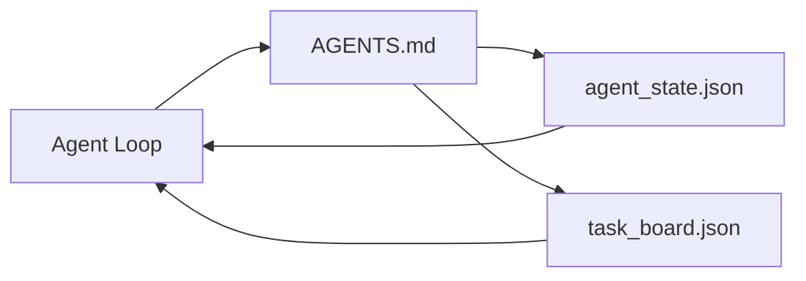

# 最小 Agent 工作台

> 最小的可用工作台只有三个文件：根指令路由器、状态文件和任务板。其余一切都叠加在它们之上。如果一个仓库连这三样都承载不了，再强的模型也救不了它。

**Type:** Build
**Languages:** Python (stdlib)
**Prerequisites:** Phase 14 · 31 (Why Capable Models Still Fail)
**Time:** ~45 minutes

## 学习目标

- 定义构成最小可行工作台的三个文件。
- 解释为什么一个简短的根路由器优于冗长的单体 `AGENTS.md`。
- 构建一个 Agent 每轮都能读取、结束时能写入的状态文件。
- 构建一个不依赖聊天历史、能支撑多会话工作的任务板。

## 问题

多数团队一提到工作台，就写一个 3000 行的 `AGENTS.md`，然后当作完成。模型加载它，忽略无法概括的部分，最后仍然在原来那些工作面上失败。

你需要的是相反做法。一个极小的根文件，只在相关时把 Agent 路由到更深的文件。持久状态，Agent 行动前读取，行动后写入。一个任务板，说明什么在进行、什么被阻塞、下一步是什么。

三个文件。每个都有明确职责。每个都足够机器可读，以后能演化为真正的系统。

## 概念



### AGENTS.md 是路由器，不是手册

一个好的 `AGENTS.md` 应该很短。它把 Agent 指向：

- 状态文件（你在哪里）。
- 任务板（还剩什么）。
- 更深的规则（位于 `docs/agent-rules.md`）。
- 验证命令（如何知道它能工作）。

更长的内容放进更深的文档，只在需要时加载。长手册会被忽略，短路由器会被遵循。

### agent_state.json 是权威记录系统

状态承载：活动任务 id、已触及文件、做出的假设、阻塞项和下一步操作。Agent 每轮读取它。下一个会话读取它，而不是重放聊天。

状态放在文件里，因为聊天历史不可靠。会话会结束，对话会被裁剪，文件不会。

### task_board.json 是队列

任务板承载所有任务，状态为 `todo | in_progress | done | blocked`。当状态为空时，Agent 从中拉取任务；当你想知道 Agent 是否在轨时，你读的也是这个队列。

任务板上的任务有 id、目标、负责人（`builder`、`reviewer` 或 `human`）和验收标准。任务板故意保持很小：当它超过一屏时，你面对的是规划问题，不是任务板问题。

### 三个文件是下限，不是上限

后续课程会增加范围契约、反馈运行器、验证门、评审清单和交接包。这里的三个文件是它们共同假设的基础。

```figure
wb-three-files
```

## 构建它

`code/main.py` 会把最小工作台写入一个空仓库，并演示一次 Agent 回合：

1. 读取 `agent_state.json`。
2. 如果状态为空，从 `task_board.json` 拉取下一个任务。
3. 在范围内修改一个文件。
4. 写回更新后的状态。

运行方式：

```
python3 code/main.py
```

脚本在自身旁边创建 `workdir/`，写入三个文件，运行一个回合，并打印 diff。再次运行它，观察第二个回合如何从第一个回合结束的地方接续。

## 使用它

在生产 Agent 产品中，同样三个文件会以不同名字出现：

- **Claude Code：** `AGENTS.md` 或 `CLAUDE.md` 充当路由器，`.claude/state.json` 这类存储充当状态，钩子充当任务板。
- **Codex / Cursor：** 工作区规则充当路由器，会话记忆充当状态，聊天侧栏中的排队任务充当任务板。
- **自定义 Python Agent：** 就是你刚写的这几个文件。

名字会变，形态不变。

## 生产环境中的模式

最小工作台要在真实 monorepo 中立足，需要在其上叠加三种模式。它们彼此独立；按仓库的实际需要选择。

**嵌套 `AGENTS.md`，就近优先。** OpenAI 在主仓库中分发 88 个 `AGENTS.md`，每个子组件一个。Codex、Cursor、Claude Code 和 Copilot 都会从当前工作文件向仓库根目录逐层查找，并拼接沿途找到的每个 `AGENTS.md`。子目录文件扩展根文件。Codex 增加 `AGENTS.override.md` 来替换而非扩展；这个覆盖机制是 Codex 特有的，跨工具协作时应避免使用。Augment Code 的测量才是关键那句：最好的 `AGENTS.md` 带来的质量提升，相当于从 Haiku 升级到 Opus；最差的则让输出比完全没有文件还差。

**即便看起来像覆盖，也要拒绝的反模式。** 相互冲突的指令会悄悄把 Agent 从交互模式降到贪婪模式（ICLR 2026 AMBIG-SWE：解决率从 48.8% 降到 28%）；应该给优先级编号，而不是平铺堆叠。无法验证的风格规则（“遵循 Google Python 风格指南”）如果没有执行命令，会让 Agent 自行发明合规做法；每条风格规则都要配上确切的 lint 命令。以风格开头、而不是以命令开头，会埋没验证路径；先命令，后风格。为人类写作而不是为 Agent 写作，会浪费上下文预算；简洁本身就是特性。

**跨工具符号链接。** 用一个根文件加符号链接（`ln -s AGENTS.md CLAUDE.md`、`ln -s AGENTS.md .github/copilot-instructions.md`、`ln -s AGENTS.md .cursorrules`），让每个编码 Agent 共享同一事实源。Nx 的 `nx ai-setup` 可以从单一配置出发，在 Claude Code、Cursor、Copilot、Gemini、Codex 和 OpenCode 之间自动完成这件事。

## 交付它

`outputs/skill-minimal-workbench.md` 能为任何新仓库生成三文件工作台：一个针对项目调校的 `AGENTS.md` 路由器、一个键名正确的 `agent_state.json`，以及一个以当前待办事项初始化的 `task_board.json`。

## 练习

1. 给 `agent_state.json` 增加 `last_run` 时间戳。如果文件超过 24 小时，除非操作员确认，否则拒绝运行。
2. 给任务板增加 `priority` 字段，并修改拉取逻辑，始终选择优先级最高的 `todo`。
3. 把 `task_board.json` 迁移为 JSON Lines，让每个任务占一行，版本控制中的 diff 更干净。
4. 写一个 `lint_workbench.py`，当 `AGENTS.md` 超过 80 行或引用不存在的文件时失败。
5. 判断三个文件里失去哪一个伤害最大，并给出理由。

## 关键术语

| 术语 | 常见说法 | 实际含义 |
|------|----------------|------------------------|
| 路由器（Router） | `AGENTS.md` | 指向更深文档和文件的简短根文件 |
| 状态文件（State file） | “那些笔记” | 记录 Agent 当前所处位置的机器可读文件，每轮写入 |
| 任务板（Task board） | “待办列表” | 带状态、负责人、验收标准的 JSON 工作队列 |
| 记录系统（System of record） | “事实源” | 聊天消失后，工作台视为权威的文件 |

## 延伸阅读

- [agents.md——开放规范](https://agents.md/)——已被 Cursor、Codex、Claude Code、Copilot、Gemini、OpenCode 采用
- [Augment Code, A good AGENTS.md is a model upgrade. A bad one is worse than no docs at all](https://www.augmentcode.com/blog/how-to-write-good-agents-dot-md-files)——经过测量的质量跃升
- [Blake Crosley, AGENTS.md Patterns: What Actually Changes Agent Behavior](https://blakecrosley.com/blog/agents-md-patterns)——哪些做法经实验有效，哪些无效
- [Datadog Frontend, Steering AI Agents in Monorepos with AGENTS.md](https://dev.to/datadog-frontend-dev/steering-ai-agents-in-monorepos-with-agentsmd-13g0)——嵌套优先级的实践
- [Nx Blog, Teach Your AI Agent How to Work in a Monorepo](https://nx.dev/blog/nx-ai-agent-skills)——跨六种工具的单源生成
- [The Prompt Shelf, AGENTS.md Best Practices: Structure, Scope, and Real Examples](https://thepromptshelf.dev/blog/agents-md-best-practices/)——经得起评审的章节排序
- [Anthropic, Claude Code subagents](https://code.claude.com/docs/en/sub-agents)
- 第 14 阶段 · 31——这个最小工作台所吸收的失败模式
- 第 14 阶段 · 34——本课预览的持久状态 schema
