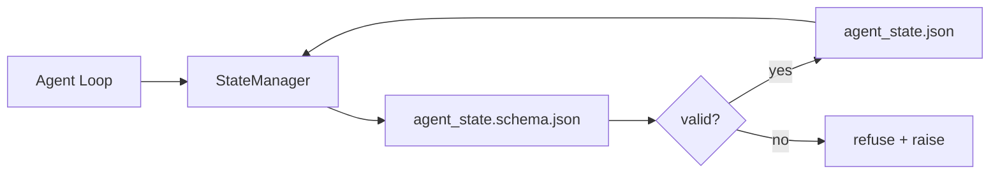

# 仓库记忆与持久状态

> 聊天历史是易失的，仓库是持久的。工作台把智能体状态存进带版本控制的文件，让下一个会话、下一个智能体和下一个评审者都读取同一事实源。

**Type:** Build
**Languages:** Python (stdlib + `jsonschema` optional)
**Prerequisites:** Phase 14 · 32 (Minimal Workbench)
**Time:** ~60 minutes

## 学习目标

- 界定哪些内容应放进仓库记忆，哪些应留在聊天历史中。
- 为 `agent_state.json` 和 `task_board.json` 编写 JSON Schema。
- 构建一个状态管理器，能够以原子方式加载、校验、修改并持久化状态。
- 利用 schema 在坏写入污染工作台之前拒绝它们。

## 问题

智能体结束一次会话，聊天关闭。下一个会话打开，问从哪里开始。模型说“我看看文件”，读到过时的笔记，然后把已经完成的工作又做一遍。更糟的是，它可能重写一个已完成的文件，因为没人告诉它这个文件已完成。

工作台的解决办法是仓库记忆：状态以 JSON 文件形式存放在仓库中，按 schema 写入，以原子方式持久化，在代码评审中 diff 友好。聊天是瞬态信息流；仓库是权威记录系统。

## 概念



### 哪些内容属于仓库记忆

| 应当放入 | 不应放入 |
|---------|-----------------|
| 活动任务 id | 原始聊天记录 |
| 本会话触及的文件 | token 级推理轨迹 |
| 智能体做出的假设 | “用户看起来有些沮丧” |
| 未解决的阻塞项 | 采样得到的补全 |
| 下一步操作 | 厂商特定的模型 id |

判断标准是持久性：三个月后重跑 CI 时，这个信息还有用吗？有用，放仓库；没用，放遥测。

### Schema 优先的状态

JSON Schema 是契约。没有它，每个智能体都会发明新字段，每个评审者都要学一种新形态，每个 CI 脚本都得为历史版本写特例。有了它，坏写入就是被拒绝的写入。

schema 覆盖：

- 必需键。
- 允许的 `status` 值。
- 禁止的值（例如数组的值为 `null`）。
- 模式约束（任务 id 匹配 `T-\d{3,}`）。
- 用于迁移的版本字段。

### 原子写入

状态写入必须能承受部分失败：写入临时文件、fsync、再重命名覆盖目标。状态文件是事实源；写了一半的文件比没有文件更糟。

### 迁移

schema 变化时，在 schema 升级旁边附上迁移脚本。状态文件携带 `schema_version` 字段；管理器拒绝加载无法迁移的版本。

```figure
wb-state-persist
```

## 构建它

`code/main.py` 实现：

- `agent_state.schema.json` 和 `task_board.schema.json`。
- 一个仅用标准库的校验器（JSON Schema 的子集：required、type、enum、pattern、items）。
- `StateManager.load`、`StateManager.update`、`StateManager.commit`，使用原子临时文件加重命名的写入方式。
- 一个演示：修改状态、持久化、重新加载，并证明往返一致。

运行方式：

```
python3 code/main.py
```

脚本写出 `workdir/agent_state.json` 和 `workdir/task_board.json`，跨两个回合修改它们，并在每一步打印校验后的状态。

## 生产环境中的模式

以下四种模式，把本课的最小实现变成多智能体 monorepo 也能存活的东西。

**原子“先临时后重命名”不是可选项。** 2026 年 3 月的一份 Hive 项目 bug 报告清楚地记录了这个失败模式：`state.json` 通过 `write_text()` 写入，异常被捕获后静默吞掉。部分写入让会话在损坏的状态上继续恢复，却没有任何信号。修复方式始终是：在目标文件同一目录使用 `tempfile.mkstemp`，写入，`fsync`，`os.replace`（在 POSIX 和 Windows 上都是原子重命名）。本课的 `atomic_write` 正是这样做的。

**每个非幂等工具调用都带幂等键。** 如果智能体调用工具后、在将结果写入 checkpoint 之前崩溃，恢复时会重试该工具调用。对读取安全；对发邮件、数据库插入、文件上传很危险。模式是：在执行前把每次工具调用的 ID 记入 `pending_calls.jsonl`。重试时检查该 ID；若存在，跳过调用并使用缓存结果。Anthropic 和 LangChain 在 2026 年的指南中都强调了这一点；LangGraph 的 checkpointer 出于同样原因持久化待处理的写入。

**把大型产物与状态分开。** 不要把 CSV、长对话记录或生成文件塞进 `agent_state.json`。把产物保存为独立文件（或上传到对象存储），状态里只保留路径。checkpoint 保持小而快；产物独立增长。

**审计用事件溯源，恢复用快照。** 每次变更都追加到事件日志（`state.events.jsonl`）；定期快照到 `state.json`。恢复时读取快照，然后重放快照时间戳之后的所有事件。这会多占磁盘，但能逐字重放智能体的决策——调试长时运行时至关重要。这与 Postgres 内部使用 WAL 的形态相同。

**要么做 schema 迁移，要么拒绝加载。** `schema_version` 整数就是契约。管理器加载未知版本的文件时，拒绝读取。schema 升级时附上迁移脚本；`tools/migrate_state.py` 在每次启动时幂等运行。

## 使用它

生产环境：

- **LangGraph checkpointers。** 同样的思路，不同的存储。checkpointer 把图状态持久化到 SQLite、Postgres 或自定义后端。本课讲授的 schema，正是当 checkpointer 失效、你需要手工读取状态时会用到的东西。
- **Letta memory blocks。** 带结构化 schema 的持久块（第 14 阶段 · 08）。同样的纪律，范围限定在长期运行的人格上。
- **OpenAI Agents SDK session store。** 可插拔后端，感知 schema。本课的状态文件就是本地文件后端。

## 交付它

`outputs/skill-state-schema.md` 会生成项目专用的 JSON Schema 对（状态 + 任务板）、一个接好原子写入的 Python `StateManager`，以及迁移脚手架，使下一次 schema 升级不会弄坏工作台。

## 练习

1. 增加 `last_human_touch` 时间戳。人类编辑后五秒内拒绝任何智能体写入。
2. 扩展校验器以支持 `oneOf`，让任务可以是构建任务或评审任务，各自有不同的必填字段。
3. 增加 `schema_version` 字段，并编写从 v1 到 v2 的迁移（把 `blockers` 重命名为 `risks`）。
4. 把存储后端从本地文件改为 SQLite。保持 `StateManager` API 完全不变。
5. 让两个智能体以 50 毫秒的写入竞争访问同一个状态文件。会出什么问题，原子重命名又如何挽救？

## 关键术语

| 术语 | 常见说法 | 实际含义 |
|------|----------------|------------------------|
| 仓库记忆（Repo memory） | “笔记文件” | 存放在仓库受跟踪文件中的状态，受 schema 约束 |
| Schema 优先（Schema-first） | “校验输入” | 在写入器之前定义契约，拒绝偏移 |
| 原子写入（Atomic write） | “重命名一下就行” | 写临时文件、fsync、重命名，使部分失败无法损坏状态 |
| 迁移（Migration） | “升级 schema” | 把 vN 状态转换为 v(N+1) 状态的脚本 |
| 记录系统（System of record） | “事实源” | 工作台视为权威的产物 |

## 延伸阅读

- [JSON Schema specification](https://json-schema.org/specification.html)
- [LangGraph checkpointers](https://langchain-ai.github.io/langgraph/concepts/persistence/)
- [Letta memory blocks](https://docs.letta.com/v1-sdk/memory/memory-blocks)
- [Fast.io, AI Agent State Checkpointing: A Practical Guide](https://fast.io/resources/ai-agent-state-checkpointing/)——带幂等性的 schema 优先 checkpoint
- [Fast.io, AI Agent Workflow State Persistence: Best Practices 2026](https://fast.io/resources/ai-agent-workflow-state-persistence/)——并发控制、TTL、事件溯源
- [Hive Issue #6263 — non-atomic state.json writes silently ignored](https://github.com/aden-hive/hive/issues/6263)——真实项目中的失败模式
- [eunomia, Checkpoint/Restore Systems: Evolution, Techniques, Applications](https://eunomia.dev/blog/2025/05/11/checkpointrestore-systems-evolution-techniques-and-applications-in-ai-agents/)——把操作系统历史中的 CR 原语应用到智能体
- [Indium, 7 State Persistence Strategies for Long-Running AI Agents in 2026](https://www.indium.tech/blog/7-state-persistence-strategies-ai-agents-2026/)
- [Microsoft Agent Framework, Compaction](https://learn.microsoft.com/en-us/agent-framework/agents/conversations/compaction)——厂商提供的 checkpoint 管理器
- 第 14 阶段 · 08——记忆块与睡眠期计算
- 第 14 阶段 · 32——本课将其 schema 化的三文件最小方案
- 第 14 阶段 · 40——从同一 schema 读取的交接包
