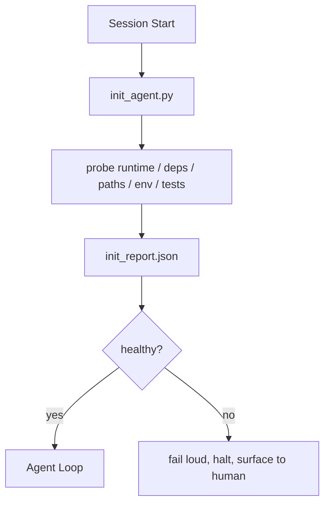

# Agent 的初始化脚本

> 每个冷启动的会话都要交一笔税。Agent 读同样的文件，重试同样的探测，重新发现同样的路径。初始化脚本只交一次税，并把答案写进状态。

**Type:** Build
**Languages:** Python (stdlib)
**Prerequisites:** Phase 14 · 32 (Minimal Workbench), Phase 14 · 34 (Repo Memory)
**Time:** ~45 minutes

## 学习目标

- 找出 Agent 绝不应该在每个会话重复做的工作。
- 构建一个确定性的初始化脚本，探测运行时、依赖和仓库健康状态。
- 持久化探测结果，让 Agent 读取结果，而不是重跑检查。
- 初始化失败时，要显式、快速，并让排查集中在一个地方。

## 问题

打开一个会话。Agent 猜 Python 版本，猜测试命令，把仓库根目录列了五遍才找到入口，尝试导入未安装的包，问用户配置文件在哪里。等它真正做出改动时，一万个 token 已经花在了本该由一个脚本完成的准备工作上。

解决办法是一个初始化脚本：在 Agent 做任何事之前运行，并写出 `init_report.json` 供 Agent 启动时读取。

## 概念



### 初始化脚本探测什么

| 探测 | 为什么重要 |
|-------|----------------|
| 运行时版本 | 错误的 Python 或 Node 版本意味着悄无声息的版本不匹配 bug |
| 依赖可用性 | 一个缺失的包留到后面处理，代价是现在发现的十倍 |
| 测试命令 | Agent 必须知道如何验证；命令缺失意味着工作台已坏 |
| 仓库路径 | 硬编码路径会漂移；解析一次并固定下来 |
| 环境变量 | 缺少 `OPENAI_API_KEY` 是一个失败工作面，不是运行时谜团 |
| 状态 + 任务板新鲜度 | 崩溃会话留下的过期状态是个陷阱 |
| 最近已知良好提交 | 会话结束时交接 diff 的锚点 |

### 显式失败、快速失败、失败点集中

探测失败意味着中止并向人类暴露。不要“Agent 会自己想办法”。初始化的全部意义，就是在工作台损坏时拒绝启动。

### 幂等

连续运行两次。第二次除了时间戳刷新之外应当是空操作（no-op）。幂等性让你可以把脚本接入 CI、钩子或任务前斜杠命令。

### 初始化与启动规则

规则（第 14 阶段 · 33）描述行动前必须为真的事情。初始化是确立“这些规则可以被检查”的脚本。没有初始化的规则会变成“要小心”；没有规则的初始化会变成精致的失败。

```figure
wb-init-probes
```

## 构建它

`code/main.py` 实现 `init_agent.py`：

- 五项探测：Python 版本、通过 `importlib.util.find_spec` 列出依赖、测试命令是否可解析、必需环境变量、状态文件新鲜度。
- 每个探测返回 `(name, status, detail)`。
- 脚本写出包含全部探测结果的 `init_report.json`，如果有任何 block 级探测失败，则以非零状态退出。

运行方式：

```
python3 code/main.py
```

脚本打印探测表，写出 `init_report.json`；在顺利路径上以零退出，否则以非零退出并列出失败的探测。

## 生产环境中的模式

以下三种模式，把有用的初始化脚本和纯粹的仪式区分开来。

**最近已知良好提交锚定。** 用上次成功合并时写入的 `LKG` 文件来探测当前提交。如果 diff 超出预算（默认 50 个文件），拒绝启动，并要求人类批准新的基线。Cloudflare 的 AI Code Review 就是用这种方式限定评审 Agent 的范围：每次评审会话都锚定同一个最近已知良好状态，绝不会让偏移跨会话累积。

**带 TTL 的锁文件。** 首次成功探测通过后写 `prereqs.lock`。后续运行在 N 小时内（默认 24 小时）信任该锁，跳过昂贵的探测。初始化脚本先读锁；如果锁是新鲜的，并且依赖清单哈希匹配，就短路返回。这与 Docker 层缓存使用的模式相同：幂等探测 + 内容哈希 = 跳过。

**热路径中不联网、不调用 LLM、不出意外。** 初始化探测是确定性的基础设施管线。调用 LLM 来分类失败，或访问外部服务检查许可证的“探测”，不是探测，而是工作流。如果某个探测在 dry run 中超过三秒，视为工作台异味，把它移出初始化或缓存结果。

## 使用它

生产环境：

- **Claude Code 钩子。** `pre-task` 钩子调用初始化脚本；失败则拒绝启动 Agent。
- **GitHub Actions。** 一个 `setup-agent` job 运行初始化脚本；Agent job 依赖它。
- **Docker entrypoint。** Agent 容器在 exec Agent 运行时之前运行初始化脚本；失败时日志会暴露。

初始化脚本可移植，因为它不调用任何特定框架。Bash、Make 或 tasks 文件都能包装它。

## 交付它

`outputs/skill-init-script.md` 会访谈项目，把其设置工作归类为探测项，并生成项目专用的 `init_agent.py` 加一个在任何 Agent 步骤之前运行它的 CI 工作流。

## 练习

1. 增加一个探测：比较当前提交与最近已知良好提交，如果超过 50 个文件发生变化就拒绝启动。
2. 让脚本写出 `prereqs.lock` 文件，并在锁超过七天时拒绝启动。
3. 增加 `--fix` 标志，自动安装缺失的开发依赖，但未经批准绝不修改运行时依赖。
4. 把探测从硬编码函数迁移到 YAML 注册表。论证这一取舍。
5. 为每个探测增加时间预算。运行超过三秒的探测是工作台异味。

## 关键术语

| 术语 | 常见说法 | 实际含义 |
|------|----------------|------------------------|
| 探测（Probe） | “一个检查” | 返回 `(name, status, detail)` 的确定性函数 |
| 初始化报告（Init report） | “设置输出” | 与状态放在一起、包含探测结果的 JSON |
| 幂等（Idempotent） | “可以放心重跑” | 连续两次运行产生除时间戳外完全相同的报告 |
| 显式失败（Fail loud） | “别把错误吞掉” | 中止并向人类暴露；没有静默回退 |
| 初始化税（Setup tax） | “启动成本” | Agent 每个会话花在重新发现显而易见之事上的 token |

## 延伸阅读

- [Anthropic, Effective harnesses for long-running agents](https://www.anthropic.com/engineering/effective-harnesses-for-long-running-agents)
- [GitHub Actions, composite actions for setup](https://docs.github.com/en/actions/sharing-automations/creating-actions/creating-a-composite-action)
- [microservices.io, GenAI dev platform: guardrails](https://microservices.io/post/architecture/2026/03/09/genai-development-platform-part-1-development-guardrails.html)——把 pre-commit + CI 检查当作初始化
- [Augment Code, How to Build Your AGENTS.md (2026)](https://www.augmentcode.com/guides/how-to-build-agents-md)——初始化的预期
- [Codex Blog, Codex CLI Context Compaction](https://codex.danielvaughan.com/2026/03/31/codex-cli-context-compaction-architecture/)——把会话开始当作感知压缩的初始化
- 第 14 阶段 · 33——本脚本所支撑的规则集
- 第 14 阶段 · 34——本脚本播种的状态文件
- 第 14 阶段 · 38——初始化脚本所供给的验证门
- 第 14 阶段 · 40——消费初始化报告中最近已知良好提交的交接
