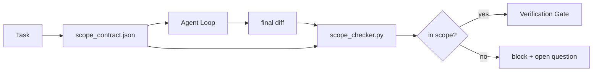

# 范围契约与任务边界

> 模型不知道工作到哪里结束。范围契约是每任务一份的文件，说明工作从哪里开始、到哪里结束，以及越界时如何回滚。契约把“保持在范围内”从愿望变成检查。

**Type:** Build
**Languages:** Python (stdlib)
**Prerequisites:** Phase 14 · 32 (Minimal Workbench), Phase 14 · 33 (Rules as Constraints)
**Time:** ~50 minutes

## 学习目标

- 编写一份范围契约，Agent 在任务开始时读取，验证器在任务结束时读取。
- 规定允许的文件、禁止的文件、验收标准、回滚方案和审批边界。
- 实现一个范围检查器，把 diff 与契约比较并标记违规。
- 让范围蔓延变得可见、自动且可评审。

## 问题

Agent 会越界。任务是“修复登录 bug”。diff 却动了登录路由、邮件辅助函数、数据库驱动、README 和发布脚本。每一次改动在当时都有看似合理的理由。合在一起，它已经不是当初评审的那个变更。

范围蔓延是 Agent 工作中最缺乏监控的失败模式，因为 Agent 是在善意地叙述每一步。解决办法不是更严格的 prompt，而是磁盘上的一份契约，说明承诺了什么，以及一个把结果与承诺比较的检查。

## 概念



### 范围契约包含什么

| 字段 | 用途 |
|-------|---------|
| `task_id` | 链接到任务板上的任务 |
| `goal` | 评审者可以验证的一句话 |
| `allowed_files` | Agent 可以写入的 glob |
| `forbidden_files` | Agent 绝不能触碰（即使意外也不行）的 glob |
| `acceptance_criteria` | 证明完成的测试命令或断言行 |
| `rollback_plan` | 操作员在需要中止时可执行的一段回滚说明 |
| `approvals_required` | 范围之外、需要明确人类批准的操作 |

缺少 `forbidden_files` 的契约是不完整的。否定空间占契约的一半。

### 使用 glob，而不是原始路径

真实仓库会移动文件。把契约绑定到 glob（`app/**/*.py`、`tests/test_signup*.py`），这样会话之间的重构不会使契约失效。

### 回滚也是范围的一部分

列出如何回滚，会迫使契约作者思考可能出现的问题。一份无法回滚的契约，就是不该被批准的契约。

### 范围检查就是 diff 检查

Agent 写出 diff。检查器读取 diff、允许的 glob、禁止的 glob，以及运行过的验收命令列表。每个违规都是一条带标签的发现，验证门可以据此拒绝。

### 范围的两个高度：功能列表与任务契约

范围契约约束一个任务，但不约束整个项目。Agent 可以完美地待在登录修复的契约内，却在下一轮决定项目还需要一个设置页、一个深色模式开关，以及重写路由器。契约从未被问过“项目范围内有哪些工作”，只被问过“任务范围内有哪些文件”。

第二个高度需要自己的原语：一个 `feature_list.json`，Agent 在会话开始时读取。它是项目待办事项的机器可读、有序版本。Agent 只选择一个 `status` 为 `todo` 的功能，把它的 `id` 写进活动范围契约，并且同一会话内被禁止启动第二个功能。“一次只做一个功能”不再是 prompt 中一句 Agent 可以自我合理化的话，而变成它从磁盘读取的值，以及门禁执行的检查。

```json
{
  "project": "knowledge-base",
  "active": "import-pdf",
  "features": [
    { "id": "import-pdf",   "status": "in_progress", "goal": "import a PDF into the library",        "done_when": "pytest tests/test_import.py && a sample PDF appears in the library view" },
    { "id": "full-text-search", "status": "todo",     "goal": "search document text and rank hits",   "done_when": "query returns ranked results with snippets" },
    { "id": "cite-answers", "status": "todo",         "goal": "answers carry source citations",        "done_when": "every answer renders at least one clickable citation" }
  ]
}
```

| 字段 | 用途 |
|-------|---------|
| `active` | 当前会话唯一可以触碰的功能；为空表示需要选择一个并设置它 |
| `features[].id` | 稳定 slug，范围契约的 `task_id` 指向它 |
| `features[].status` | `todo`、`in_progress`、`done`、`blocked`；同一时间只能有一个 `in_progress` |
| `features[].goal` | 评审者可以验证的一句话 |
| `features[].done_when` | 把 `in_progress` 翻转为 `done` 的验收行 |

有两条规则让这个列表真正承重，而不是装饰。第一，“最多一个 `in_progress`”这一不变量本身就是启动检查（第 14 阶段 · 33）：如果列表中出现两个，会话拒绝启动，直到人类解决。第二，功能列表是文件，不是聊天消息，因为聊天会滚出上下文，而文件会跨会话、跨 Agent 持久存在。交接（第 14 阶段 · 40）会把已完成功能的状态写回 `done`，让下一个会话打开时看到准确的任务板，而不是重新推导还剩什么。

契约与列表按最小权限组合，合并方式与下文相同：任务契约的 `allowed_files` 必须位于活动功能所触及的范围内，绝不能超出。

```figure
wb-scope-bounce
```

## 构建它

`code/main.py` 实现：

- `scope_contract.json` schema（JSON Schema 的子集，glob 数组）。
- 一个 diff 解析器，把触及文件列表和运行命令列表转换为 `RunSummary`。
- 一个 `scope_check`，针对契约返回 `(violations, in_scope, off_scope)`。
- 两次演示运行：一次保持在范围内，一次发生蔓延。检查器会指出蔓延，并给出确切文件和原因。

运行方式：

```
python3 code/main.py
```

输出：契约、两次运行、每次运行的判定，以及保存下来的 `scope_report.json`。

## 生产环境中的模式

一位实践者采用“specsmaxxing”（在调用 Agent 前先写好 YAML 范围契约）后报告，在不更换 Agent 的情况下，三周内“钻牛角尖率”（rabbit-hole rate）从 52% 降到 21%。起作用的是契约，不是模型。三种模式让这一收益持续。

**违规预算，而非二元失败。** `agent-guardrails`（一个 OSS 合并门禁，Claude Code、Cursor、Windsurf、Codex 通过 MCP 使用）为每个任务提供 `violationBudget`：预算内的轻微范围滑移以警告形式呈现；只有超出预算时，合并门禁才拒绝。配合 `violationSeverity: "error" | "warning"` 使用。预算决定了一个门禁是能顺利上线，还是会被讨厌它的团队关掉。

**按路径族设置严重度不对称。** 对 `docs/**` 的越界写入通常是 `warn`；对 `scripts/**`、`migrations/**`、`config/prod/**` 的越界写入始终是 `block`。这种不对称必须放在契约里，而不是运行时里，因为它因项目而异、因任务而变。

**在文件预算之外，加上时间和网络预算。** `time_budget_minutes` 字段限制墙上时钟；运行时超过后未经重新批准就拒绝继续。`network_egress` 对主机名的允许列表，防止 Agent 悄悄访问不属于任务的外部 API。这些也是范围维度；文件 glob 是必要条件，不是充分条件。

**多契约合并语义（最小权限）。** 当两份范围契约同时适用时（例如一份项目级契约加一份任务级契约），合并方式是：对 `allowed_files` 取**交集**（两份契约都必须允许该路径），对 `forbidden_files` 取**并集**（任一份都可以禁止），`time_budget_minutes` 取最严格者（最小值），`approvals_required` 累积。`network_egress` 的 `None` 表示不强制，`[]` 表示全部拒绝，`[...]` 表示允许列表；合并时，`None` 让位于另一方，两个列表取交集，deny-all 保持 deny-all。把这一点写进契约 schema，让合并机械可执行、可评审。

## 使用它

生产模式：

- **Claude Code 斜杠命令。** 一个 `/scope` 命令写入契约，并把它固定为会话上下文。子 Agent 在行动前读取契约。
- **GitHub PR。** 把契约作为 JSON 文件放进 PR 正文，或作为签入的产物。CI 针对合并 diff 运行范围检查器。
- **LangGraph interrupts。** 范围违规触发中断；处理器询问人类，是契约需要扩大，还是 Agent 需要退让。

契约随任务流转。任务关闭时，契约归档到 `outputs/scope/closed/`。

## 交付它

`outputs/skill-scope-contract.md` 会根据任务描述生成范围契约，并生成一个能识别 glob 的检查器，在 CI 中针对每个 Agent diff 运行。

## 练习

1. 增加 `network_egress` 字段，列出允许访问的外部主机。拒绝访问其他主机的运行。
2. 扩展检查器，对 `docs/**` 软失败，对 `scripts/**` 硬失败。论证这种不对称。
3. 让契约通过一组静态规则（不使用 LLM）从 `goal` 字段推导 `allowed_files`。第一个边界情况会出什么问题？
4. 增加 `time_budget_minutes`，超过墙上时钟后拒绝继续。
5. 对同一个 diff 运行两份契约。两份都适用时，正确的合并语义是什么？

## 关键术语

| 术语 | 常见说法 | 实际含义 |
|------|----------------|------------------------|
| 范围契约（Scope contract） | “任务简报” | 每任务的 JSON，列出允许/禁止文件、验收、回滚 |
| 范围蔓延（Scope creep） | “它还动了……” | 同一任务中契约之外的文件被修改 |
| 回滚方案（Rollback plan） | “我们可以回滚” | 操作员用于中止任务的一段式运行手册 |
| 审批边界（Approval boundary） | “需要签字批准” | 契约中列为需要人类明确批准的操作 |
| diff 检查（Diff check） | “路径审计” | 把触及的文件与契约 glob 比较 |

## 延伸阅读

- [LangGraph human-in-the-loop interrupts](https://langchain-ai.github.io/langgraph/concepts/human_in_the_loop/)
- [OpenAI Agents SDK tool approval policies](https://platform.openai.com/docs/guides/agents-sdk)
- [logi-cmd/agent-guardrails — merge gates and scope validation](https://github.com/logi-cmd/agent-guardrails)——违规预算、严重度分层
- [Dev|Journal, Preventing AI Agent Configuration Drift with Agent Contract Testing](https://earezki.com/ai-news/2026-05-05-i-built-a-tiny-ci-tool-to-keep-ai-agent-configs-from-drifting-in-my-repo/)——无外部依赖的 `--strict` 模式
- [Agentic Coding Is Not a Trap (production logs)](https://dev.to/jtorchia/agentic-coding-is-not-a-trap-i-answered-the-viral-hn-post-with-my-own-production-logs-33d9)——specsmaxxing 实证：52% → 21%
- [OpenCode permission globs](https://opencode.ai/docs/agents/)——按权限细粒度划分范围
- [Knostic, AI Coding Agent Security: Threat Models and Protection Strategies](https://www.knostic.ai/blog/ai-coding-agent-security)——把范围作为最小权限的一部分
- [Augment Code, AI Spec Template](https://www.augmentcode.com/guides/ai-spec-template)——三层边界系统（must/ask/never）
- 第 14 阶段 · 27——与范围锁定配合的提示注入防护
- 第 14 阶段 · 33——本契约按任务特化的规则集
- 第 14 阶段 · 38——检查器向其报告的验证门
