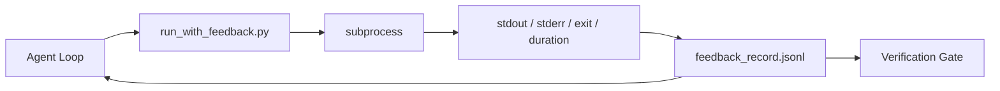

# 运行时反馈回路

> 看不到真实命令输出的 Agent 只能靠猜。反馈运行器（feedback runner）捕获 stdout、stderr、退出码和耗时，整理成结构化记录供下一轮读取。于是 Agent 依据事实行动，而不是依据自己对事实的预测。

**Type:** Build
**Languages:** Python (stdlib)
**Prerequisites:** Phase 14 · 32 (Minimal Workbench), Phase 14 · 35 (Init Script)
**Time:** ~50 minutes

## 学习目标

- 区分运行时反馈与可观测性遥测。
- 构建一个反馈运行器，包装 shell 命令并持久化结构化记录。
- 确定性地截断大体积输出，让回路保持在 token 预算内。
- 缺少反馈时，拒绝推进回路的下一步。

## 问题

Agent 说「现在运行测试」。下一条消息说「所有测试通过」。现实是没有任何测试运行过。Agent 想象了输出，或者它运行了命令却从未读取结果，又或者它读了结果，却悄悄截掉了失败的那一行。

反馈运行器消除这个缺口。每条命令都经过运行器。每条记录都包含命令、捕获的 stdout 与 stderr、退出码、实际耗时（wall-clock duration），以及一行 Agent 备注。Agent 在下一轮读取记录。验证门在任务结束时读取这些记录。

## 概念



### 反馈记录包含什么

| 字段 | 为什么重要 |
|-------|----------------|
| `command` | 精确的 argv，不受 shell 展开的意外影响 |
| `stdout_tail` | 最后 N 行，确定性截断 |
| `stderr_tail` | 最后 N 行，与 stdout 分开 |
| `exit_code` | 明确无歧义的成功信号 |
| `duration_ms` | 暴露缓慢的探测和失控的进程 |
| `started_at` | 用于重放的时间戳 |
| `agent_note` | Agent 写下的一行预期说明 |

### 截断是确定性的

一条 50 MB 的日志会毁掉整个回路。运行器用 `...truncated N lines...` 标记截取头部和尾部，过程是确定性的：同样的输出总是产生同样的记录。不做采样；Agent 需要看到的部分（最终错误、最终汇总）都位于尾部。

### 反馈与遥测的区别

遥测（第 14 阶段 · 23，OTel GenAI 约定）面向随时间审阅多次运行的人类操作员。反馈面向本次运行的下一轮。两者共享字段，但存放在不同的文件中，保留策略也不同。

### 没有反馈就不要推进

如果运行器在捕获退出码之前出错，记录会带上 `exit_code: null` 和 `error: <reason>`。Agent 回路必须拒绝在 `null` 退出码上宣称成功。没有退出码，就没有进展。

```figure
wb-feedback-loop
```

## 构建它

`code/main.py` 实现了：

- `run_with_feedback(command, agent_note)`：包装 `subprocess.run`，捕获 stdout/stderr/退出码/耗时，做确定性截断，并追加写入 `feedback_record.jsonl`。
- 一个小型加载器，把 JSONL 流式读入 Python 列表。
- 一个演示，运行三条命令（成功、失败、缓慢），并打印每条命令的最后一条记录。

运行：

```
python3 code/main.py
```

输出：三条反馈记录追加到 `feedback_record.jsonl`，每条命令的最后一条记录内联打印。跨多次重跑 tail 这个文件，可以看到回路不断累积。

## 生产环境中的模式

有三种模式能把运行器加固到足以投产。

**在写入时脱敏，而不是在读取时。** 任何涉及 stdout 或 stderr 的记录都可能泄露机密。运行器在追加 JSONL 之前执行一遍脱敏：剔除匹配 `^Bearer `、`password=`、`api[_-]?key=`、`AKIA[0-9A-Z]{16}`（AWS）、`xox[baprs]-`（Slack）的行。在读取时脱敏是个陷阱；磁盘上的文件才是攻击者能触及的东西。每季度对照生产运行时观测到的机密格式，审计一次脱敏模式。

**使用轮转策略，而不是单一文件。** 把 `feedback_record.jsonl` 限制为每文件 1 MB；溢出时轮转到 `.1`、`.2`，丢弃 `.5`。Agent 回路只读当前文件，因此运行时开销有界。CI 制品存储保留完整的轮转集合。没有轮转，这个文件会在每次加载器调用时成为瓶颈。

**为重试链记录父命令 id。** 每条记录都有 `command_id`；重试携带 `parent_command_id`，指向上一次尝试。审查者的「失败尝试」列表（第 14 阶段 · 40）与验证门的审计都会沿着这条链追溯。没有这个链接，重试看起来像彼此独立的成功，审计会掩盖失败历史。

## 使用它

生产模式：

- **Claude Code Bash 工具。** 该工具本身已经捕获 stdout、stderr、退出码和耗时。本课中的运行器是与框架无关的等价物，适用于任何 Agent 产品。
- **LangGraph 节点。** 把任意 shell 节点包进运行器，记录就能持久化在图状态之外。
- **CI 日志。** 把 JSONL 管道到 CI 制品存储；审查者可以重放任何命令，而无需重跑会话。

运行器是一个薄包装。它拥有记录的形态，因此能在每一次框架迁移中存活下来。

## 交付它

`outputs/skill-feedback-runner.md` 生成一份项目专属的 `run_with_feedback.py`：包含合适的截断预算、接入工作台的 JSONL 写入器，以及 Agent 每轮都会读取的加载器。

## 练习

1. 为每条记录添加 `cwd` 字段，让同一命令在不同目录下的运行也能区分。
2. 添加一个 `redaction` 步骤，剔除匹配 `^Bearer ` 或 `password=` 的行。在 fixture 记录上测试。
3. 通过轮转到 `.1`、`.2` 文件，把 `feedback_record.jsonl` 的总大小限制在 1 MB。为这个轮转策略辩护。
4. 添加 `parent_command_id`，让重试链可见：哪条命令产生了下一条命令所消费的输入。
5. 把 JSONL 管道到一个微型 TUI，高亮最近一次非零退出码。列出这个 TUI 要想在评审中有用必须展示的八项关键特性。

## 关键术语

| 术语 | 人们怎么说 | 它实际指什么 |
|------|----------------|------------------------|
| Feedback record | 「Run log」 | 包含命令、输出、退出码、耗时的结构化 JSONL 条目 |
| Tail truncation | 「Trim the log」 | 确定性的头+尾捕获，让记录能放进 token 预算 |
| Refuse-on-null | 「Block on missing data」 | `exit_code` 为 null 时，回路不得推进 |
| Agent note | 「Expectation tag」 | Agent 在读取结果前写下的一行预测 |
| Telemetry split | 「Two log files」 | 反馈给下一轮，遥测给操作员 |

## 延伸阅读

- [OpenTelemetry GenAI semantic conventions](https://opentelemetry.io/docs/specs/semconv/gen-ai/)
- [Anthropic, Effective harnesses for long-running agents](https://www.anthropic.com/engineering/effective-harnesses-for-long-running-agents)
- [Guardrails AI x MLflow — deterministic safety, PII, quality validators](https://guardrailsai.com/blog/guardrails-mlflow) —— 把脱敏模式当作回归测试
- [Aport.io, Best AI Agent Guardrails 2026: Pre-Action Authorization Compared](https://aport.io/blog/best-ai-agent-guardrails-2026-pre-action-authorization-compared/) —— tool call 前后的捕获
- [Andrii Furmanets, AI Agents in 2026: Practical Architecture for Tools, Memory, Evals, Guardrails](https://andriifurmanets.com/blogs/ai-agents-2026-practical-architecture-tools-memory-evals-guardrails) —— 可观测性表面
- 第 14 阶段 · 23——遥测侧的 OTel GenAI 约定
- 第 14 阶段 · 24——Agent 可观测性平台（Langfuse、Phoenix、Opik）
- 第 14 阶段 · 33——要求在宣布完成前提供反馈的规则
- 第 14 阶段 · 38——读取 JSONL 的验证门
