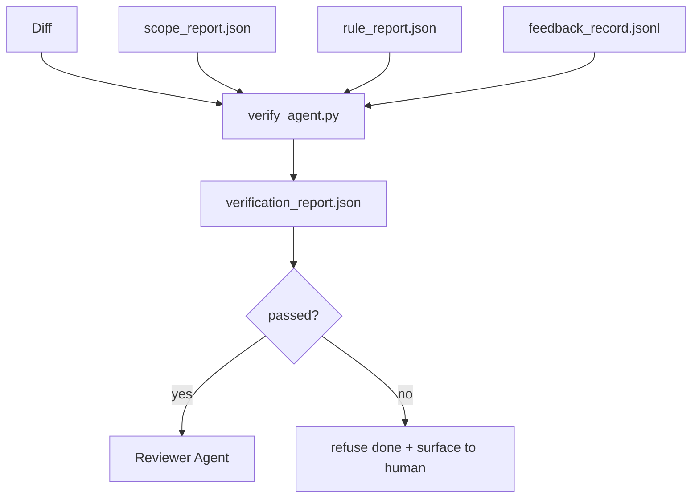

# 验证门

> Agent 无权把自己的工作标记为完成。验证门读取范围合同、反馈日志、规则报告和 diff，只回答一个问题：这个任务真的完成了吗？如果门说没有，任务就没有完成，聊天窗口里说什么都没用。

**Type:** Build
**Languages:** Python (stdlib)
**Prerequisites:** Phase 14 · 33 (Rules), Phase 14 · 36 (Scope), Phase 14 · 37 (Feedback)
**Time:** ~55 minutes

## 学习目标

- 把验证门定义为对工作台制品进行计算的确定性函数。
- 将规则报告、范围报告、反馈记录和 diff 合并成一个判定。
- 输出 `verification_report.json`，供审查 Agent 和 CI 共同读取。
- 任何 block 严重级别的失败都拒绝推进任务，没有例外。

## 问题

Agent 太容易宣布成功。有三种失败形态占主导：

- 「看起来不错。」模型读了自己的 diff，就认定它正确。
- 「测试通过了。」说得信心十足。却没有任何测试实际运行的记录。
- 「验收达标了。」验收标准被解释得足够宽松，以至于「任何像完成的东西」都算数。

工作台的解法是一道单一的验证门：读取 Agent 已经产出的制品，然后做出裁决。门是确定性的。门在版本控制中。门接入了 CI。Agent 贿赂不了它。

## 概念



### 门检查什么

| 检查 | 来源制品 | 严重级别 |
|-------|-----------------|----------|
| 所有验收命令都运行过 | `feedback_record.jsonl` | block |
| 所有验收命令都以零退出 | `feedback_record.jsonl` | block |
| 范围检查没有禁止的写入 | `scope_report.json` | block |
| 范围检查没有越界写入 | `scope_report.json` | block 或 warn |
| 所有 block 严重级别的规则都通过 | `rule_report.json` | block |
| 反馈中没有 `null` 退出码 | `feedback_record.jsonl` | block |
| 触碰的文件匹配 `scope.allowed_files` | 两者 | warn |

`warn` 级别的发现会为判定添加注释；`block` 级别的发现会阻止 `passed: true`。

### 确定性，而非概率性

对同一组制品，门每次都必须产出相同的判定。不使用 LLM 裁判。LLM 裁判属于审查端（第 14 阶段 · 39），那里的目标是定性评估，而不是状态判定。

### 一份报告，一条路径

门在每次任务结项时输出一份 `verification_report.json`，写在 `outputs/verification/<task_id>.json` 下。CI 消费同一路径。使用不同路径的多个门会分裂事实来源。

### 拒绝，没有例外

Block 严重级别的发现不能被 Agent 推翻。只能由人类推翻，并记录 `override_reason` 和 `overridden_by` 用户 id。覆盖是一项带签名的变更，不是 Agent 的决定。

```figure
wb-gate-sequence
```

## 构建它

`code/main.py` 实现了：

- 每个输入制品各有一个加载器，全部在本地打桩，使课程自包含。
- 一个纯函数 `verify(task_id, artifacts) -> VerdictReport`。
- 一个打印器，显示逐项检查结果和最终的通过/失败。
- 一个包含三个任务场景的演示：干净通过、范围蔓延、缺少验收。

运行：

```
python3 code/main.py
```

输出：三份判定报告，各自保存在脚本旁边。

## 生产环境中的模式

有四种模式把门从「又一个 lint 任务」提升为「决定性的一关」。

**纵深防御，而不是单一的门。** pre-commit 钩子 → CI 状态检查 → pre-tool 授权钩子 → pre-merge 门。每一层都是确定性的，因此某一层失败会被下一层捕获。microservices.io 的 2026 年 3 月手册说得明确：pre-commit 钩子不可绕过，因为与模型侧的 skill 不同，它不依赖 Agent 遵守指令。验证门位于 CI / pre-merge 层。

**用确定性检查防御，让模型裁判只处理细微之处。** Anthropic 2026 年的混合规范配对：可验证的奖励（单元测试、schema 检查、退出码）回答「代码解决了问题吗？」——LLM 评分标准回答「代码是否可读、安全、符合风格？」门运行第一类；审查者（第 14 阶段 · 39）运行第二类。把两者混在一起会腐蚀信号。

**带签名的覆盖日志，而不是 Slack 线程。** 每次覆盖都在 `outputs/verification/overrides.jsonl` 中输出一行：时间戳、发现代码、原因、签名用户、当前 HEAD 提交。运行时拒绝任何缺少签名的覆盖；审计轨迹由 git 跟踪。这就是覆盖政策与覆盖作秀之间的分界线。

**把覆盖率下限作为一等检查。** `coverage_report.json` 输入一个 `coverage_floor` 检查（默认 80%）。如果测得覆盖率低于下限，或比上一次合并时的下限低超过 1 个百分点，门就失败。没有这项检查，Agent 会悄悄删掉失败的测试，而验证报告依然一片绿。

**`--strict` 模式把警告提升为阻断。** 对于发布分支、阻塞发布的 PR 或事故后分诊，`--strict` 让每个警告都变成硬失败。该标志按分支选择性启用，而不是全局默认，因为对所有东西都严格会腐蚀日常流程。

## 使用它

生产模式：

- **CI 步骤。** 一个 `verify_agent` 作业对 Agent 的最终制品运行门。合并保护在没有 `passed: true` 时拒绝。
- **交接前钩子。** Agent 运行时在生成交接文档前调用门。没有绿色判定，就没有交接。
- **人工分诊。** 当 Agent 宣称成功而人类起疑时，操作员阅读报告。

门是工作台流程中的决定性一关。其他所有表面都位于它的上游。

## 交付它

`outputs/skill-verification-gate.md` 把门接入具体项目：哪些验收命令喂给它、哪些规则是 block 级别、容忍哪些越界写入、覆盖审计日志如何存储。

## 练习

1. 添加一个 `coverage_floor` 检查：测试命令必须产出覆盖率至少 80% 的报告。决定哪个制品承载这个下限。
2. 支持 `--strict` 模式，把每个 `warn` 提升为 `block`。记录哪些场景下严格模式是合适的默认值。
3. 让门在 JSON 之外再产出一份 Markdown 摘要。为摘要中应包含哪些字段辩护。
4. 添加一个 `time_since_last_human_touch` 检查：任何在人类按键后 60 秒内编辑的文件，豁免于越界标记。
5. 在你产品的真实 Agent diff 上运行门。有多少发现是真实的，多少是噪声？门需要在哪些方面成长？

## 关键术语

| 术语 | 人们怎么说 | 它实际指什么 |
|------|----------------|------------------------|
| Verification gate | 「The check that stops things」 | 对工作台制品计算的确定性函数，产出通过/失败判定 |
| Block severity | 「Hard fail」 | 阻止 `passed: true`、需要签名覆盖的发现 |
| Override log | 「Why we let it through」 | 带原因和用户 id 的签名条目，由审查审计 |
| Acceptance command | 「The proof」 | 一条 shell 命令，其零退出码就是 `done` 的含义 |
| One report path | 「Source of truth」 | `outputs/verification/<task_id>.json`，CI 与人类共同消费 |

## 延伸阅读

- [Anthropic, Harness design for long-running application development](https://www.anthropic.com/engineering/harness-design-long-running-apps)
- [OpenAI Agents SDK guardrails](https://openai.github.io/openai-agents-python/guardrails/)
- [microservices.io, GenAI dev platform: guardrails](https://microservices.io/post/architecture/2026/03/09/genai-development-platform-part-1-development-guardrails.html) —— pre-commit 与 CI 之间的纵深防御
- [ICMD, The 2026 Playbook for Agentic AI Ops](https://icmd.app/article/the-2026-playbook-for-agentic-ai-ops-guardrails-costs-and-reliability-at-scale-1776661990431) —— 审批门阶梯（草稿 → 审批 → 阈值内自动）
- [Type-Checked Compliance: Deterministic Guardrails (arXiv 2604.01483)](https://arxiv.org/pdf/2604.01483) —— 以 Lean 4 作为确定性门控的上界
- [logi-cmd/agent-guardrails — merge gate spec](https://github.com/logi-cmd/agent-guardrails) —— 范围 + 变异测试门
- [Guardrails AI x MLflow](https://guardrailsai.com/blog/guardrails-mlflow) —— 把确定性验证器当作 CI 评分器
- 第 14 阶段 · 27——提示注入防御（门的对抗性配对）
- 第 14 阶段 · 36——本门所执行的范围合同
- 第 14 阶段 · 37——本门所评分的反馈日志
- 第 14 阶段 · 39——本门移交给的审查 Agent
