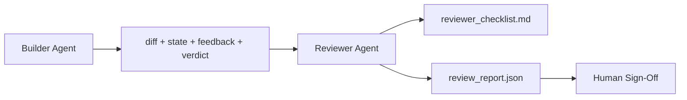

# 审查智能体：让构建者与评分者分离

> 写代码的智能体不能给自己的代码打分。审查者是第二个回路，拥有不同的系统提示、不同的目标，以及对构建者产出的所有东西的只读访问权。构建者与审查者之间的差距，正是大部分可靠性所在。

**Type:** Build
**Languages:** Python (stdlib)
**Prerequisites:** Phase 14 · 38 (Verification Gate)
**Time:** ~55 minutes

## 学习目标

- 说明为什么同一个智能体无法可靠地审查自己的工作。
- 构建一个审查智能体回路，消费构建者制品并输出结构化审查报告。
- 编写一份审查评分标准，对具体维度打分，而不是凭感觉。
- 把审查者接入工作台，使人工审查从真实制品开始。

## 问题

你让智能体修一个 bug。它改了四个文件，跑了测试，报告完成。验证门（第 14 阶段 · 38）确认验收跑过、范围守住。门说 `passed: true`。你合并了。两天后你发现，这个修复只解决了 bug 错误的那一半。

验收是必要的，但不充分。审查者要问验收问不出的问题：这是否解决了正确的问题？是否在未标记的情况下扩大了范围？是否记录下本应被质疑的假设？是否把工作台留在下一个会话能接手的状态？

## 概念



### 审查评分标准

五个维度，每个 0 到 2 分。

| 维度 | 问题 |
|-----------|----------|
| 问题契合度 | 变更是否解决了所述任务，而不是一个相近任务？ |
| 范围纪律 | 编辑是被限制在合同内，还是合同被有意扩展了？ |
| 假设 | 所有隐藏假设是否写在了可供审查的地方？ |
| 验证质量 | 验收命令是真的证明了目标，还是只证明了它的弱化版本？ |
| 交接就绪度 | 下一个会话能否从当前状态干净地接手？ |

总分 10 分。低于 7 分为软失败；低于 5 分为硬失败。

### 审查者是独立角色，而非独立模型

你可以用与构建者相同的模型来运行审查者。纪律在于角色分离：不同的系统提示、不同的输入、对 diff 没有写权限。姿态的改变就是信号的改变。

### 审查者不能编辑 diff

审查者读取 diff、状态、反馈、判定。它写报告。它不修补 diff。如果报告说「修这个」，下一个构建者轮次执行修复；审查者回到审查状态。混合角色会破坏这个差距。

### 审查评分标准与验证门

门（第 14 阶段 · 38）检查确定性事实：验收是否运行、规则是否通过、范围是否守住。审查者做定性判断：这是不是正确的工作、是否有文档、交接是否可用。两者都必需。

```figure
wb-builder-marker
```

## 构建它

`code/main.py` 实现了：

- 一个 `ReviewerInputs` dataclass，打包审查者读取的制品。
- 一个评分标准打分器，每个维度一个函数。每个函数都是确定性的，在本课中为桩实现；真实实现会调用 LLM。
- 一个 `review_report.json` 写入器，包含五个分数、总分和判定（`pass`、`soft_fail`、`hard_fail`）。
- 两个演示用例：一个干净的变更，和一个「测试正确、问题错误」的变更。

运行：

```
python3 code/main.py
```

输出：两份审查报告写入磁盘，以及一张控制台维度分数表。

## 生产环境中的模式

实例：Cloudflare 2026 年 4 月的 AI 代码审查系统，在 30 天内覆盖 5,169 个仓库的 48,095 个合并请求，运行了 131,246 次审查。审查完成时间中位数为 3 分 39 秒。最多七名专家审查者（安全、性能、代码质量、文档、发布管理、合规、Engineering Codex）在 Review Coordinator 之下并行运行，由协调者去重发现并判定严重级别。顶级模型专用于协调者；专家运行在更便宜的层级上。

有四种模式让这套做法在规模化下成立。

**专家池，而不是一个大审查者。** 一个带 5 维评分标准的审查者适用于个人仓库。一旦代码库出现安全关键、性能关键和文档表面，就拆成提示更小的专家。协调者负责去重；专家从不运行完整评分标准。模型层级分离随之而来：便宜的专家、昂贵的协调者。

**把偏差缓解当作设计要求，而不是优化。** LLM 裁判表现出四种可靠的偏差（Adnan Masood，2026 年 4 月）：位置偏差（GPT-4 在 (A,B) 与 (B,A) 顺序上约 40% 不一致）、冗长偏差（在更长输出上约 15% 的分数膨胀）、自我偏好（裁判偏爱同模型系的输出）、权威偏差（裁判高估对知名作者的引用）。缓解方法：评估两种顺序，只计入一致的胜出；使用明确奖励简洁的 1-4 分制；在不同模型系之间轮换裁判；打分前去掉作者姓名。

**校准集，而不是感觉。** 一个 10-20 个任务的历史集合，带有已知的正确判定。每次修改提示后都在上面运行审查者。如果与历史记录的一致率低于 80%，评分标准需要修订后才能发布审查者。每个团队最终都会重新发现这一点；不如一开始就做。

**与门配合的混合规范。** 验证门（第 14 阶段 · 38）处理确定性检查（验收是否运行、测试是否通过、范围是否守住）。审查者处理语义检查（这是不是正确的工作、假设是否有文档、交接是否可用）。Anthropic 2026 年的指导明确指出了这一分工：不要让审查者重做门已经证明的事。

## 使用它

生产模式：

- **Claude Code 子智能体。** 构建者关闭任务后运行一个审查子智能体。它在 PR 上发布带评分分数的评论。
- **OpenAI Agents SDK 交接。** 构建者在任务完成时交接给审查者。审查者可以带着发现清单交回，或上交给人类。
- **双模型配对。** 构建者运行在更快、更便宜的模型上。审查者运行在更强、上下文更小、专注于判断的模型上。

审查者是当人类无法亲自完成每一次审查时，工作台长出的第二双眼睛。

## 交付它

`outputs/skill-reviewer-agent.md` 生成一份项目专属的审查评分标准、一个接入构建者制品的审查智能体桩，以及与验证门的集成，使人工审查从一份写好的报告开始，而不是从一张白纸开始。

## 练习

1. 添加一个针对你产品领域的第六维度。为其不能被现有五维吸收而辩护。
2. 用两种不同的系统提示（简洁、冗长）运行审查者。哪一种产出的报告人类更可能读？
3. 为每个维度添加 `confidence` 字段。当最低维度的置信度低于 0.6 时，拒绝发布报告。
4. 构建一个校准集：10 个历史任务结项，带有已知的正确判定。在上面运行审查者。它在哪些地方与历史记录不一致？
5. 添加「请求更多证据」的能力：审查者可以在打分前向构建者索要一次特定的测试运行。合适的退避策略是什么，才能避免陷入循环？

## 关键术语

| 术语 | 人们怎么说 | 它实际指什么 |
|------|----------------|------------------------|
| Reviewer rubric | 「Checklist」 | 五维度 0-2 打分，每个维度附一个书面问题 |
| Soft fail | 「Needs revisions」 | 总分低于 7；构建者拿到待处理的发现 |
| Hard fail | 「Reject」 | 总分低于 5 或任一维度为 0；停止并上报人类 |
| Role separation | 「Different prompt」 | 同一模型可扮演两种角色；纪律在于输入与姿态 |
| Confidence floor | 「Don't ship low-signal reports」 | 评分标准不确定时拒绝输出判定 |

## 延伸阅读

- [OpenAI Agents SDK handoffs](https://openai.github.io/openai-agents-python/handoffs/)
- [Anthropic Claude Code subagents](https://code.claude.com/docs/en/sub-agents)
- [Cloudflare, Orchestrating AI Code Review at Scale](https://blog.cloudflare.com/ai-code-review/) —— 7 名专家 + 协调者架构，30 天 13.1 万次运行
- [Agent-as-a-Judge: Evaluating Agents with Agents (OpenReview / ICLR)](https://openreview.net/forum?id=DeVm3YUnpj) —— DevAI 基准，366 条分层解决方案需求
- [Adnan Masood, Rubric-Based Evaluations and LLM-as-a-Judge: Methodologies, Biases, Empirical Validation](https://medium.com/@adnanmasood/rubric-based-evals-llm-as-a-judge-methodologies-and-empirical-validation-in-domain-context-71936b989e80) —— 四种偏差及其缓解
- [MLflow, LLM-as-a-Judge Evaluation](https://mlflow.org/llm-as-a-judge) —— 分离构建者/评估器的生产工具
- [LangChain, How to Calibrate LLM-as-a-Judge with Human Corrections](https://www.langchain.com/articles/llm-as-a-judge) —— 校准集工作流
- [Evidently AI, LLM-as-a-judge: a complete guide](https://www.evidentlyai.com/llm-guide/llm-as-a-judge)
- [Arize, LLM as a Judge — Primer and Pre-Built Evaluators](https://arize.com/llm-as-a-judge/)
- 第 14 阶段 · 05——Self-Refine 与 CRITIC（单智能体自审基线）
- 第 14 阶段 · 30——评估驱动的智能体开发（校准集生成器）
- 第 14 阶段 · 38——审查者所读取的验证门
- 第 14 阶段 · 40——审查报告所喂给的交接包
