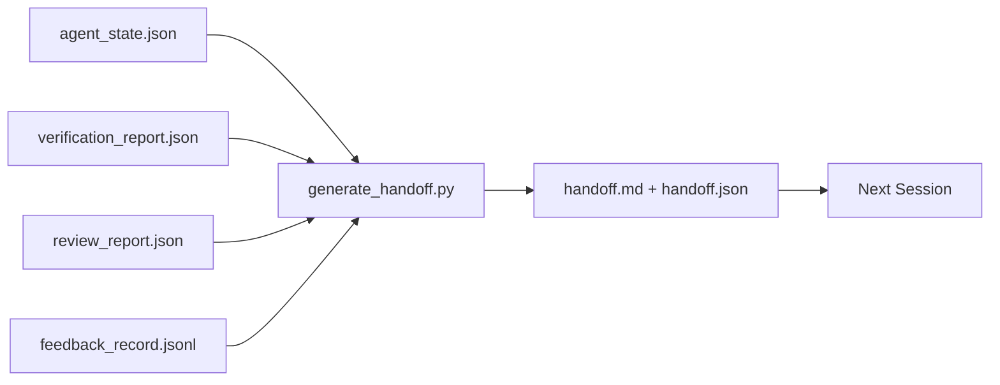

# 多会话交接

> 会话终将结束，工作不会。交接包（handoff packet）是把「智能体干了一小时」变成「下一个会话第一分钟就高效产出」的制品。要有意构建它，而不是事后补。

**Type:** Build
**Languages:** Python (stdlib)
**Prerequisites:** Phase 14 · 34 (Repo Memory), Phase 14 · 38 (Verification), Phase 14 · 39 (Reviewer)
**Time:** ~50 minutes

## 学习目标

- 识别每个交接包都需要的七个字段。
- 从工作台制品生成交接，无需手写散文。
- 把庞大的反馈日志裁剪成交接规模的摘要。
- 让下一个会话的第一个动作是确定性的。

## 问题

会话结束了。智能体说「很好，我们取得了进展」。下一个会话打开。新智能体问「我们上次停在哪里？」前一个智能体的回答已经没了。新智能体重新发现、重跑同样的命令、再问人类同样的问题，花三十分钟才恢复到上一个会话最后三十秒的状态。

糟糕交接的成本，会在任务生命周期的每个会话中反复支付。解法是在会话结束时自动生成一个包：改了什么、为什么、试过什么、什么失败了、还剩什么、下次先做什么。

## 概念



### 每个交接都携带的七个字段

| 字段 | 它回答的问题 |
|-------|---------------------|
| `summary` | 一段话说明做了什么 |
| `changed_files` | 一眼看清 diff |
| `commands_run` | 实际执行了什么 |
| `failed_attempts` | 试过什么，为什么没成功 |
| `open_risks` | 下个会话可能被什么咬到，含严重级别 |
| `next_action` | 下个会话采取的第一个具体步骤 |
| `verdict_pointer` | 指向验证 + 审查报告的路径 |

`next_action` 字段是承重的那一个。除 `next_action` 之外什么都有，那是状态报告，不是交接。

### 交接是生成的，不是写的

手写的交接，是在艰难的一天会被跳过的那种交接。生成器读取工作台制品并输出包。智能体的工作是让工作台处于生成器能总结的状态，而不是去写总结。

### 两种形态：人类可读与机器可读

`handoff.md` 是给人读的。`handoff.json` 是给下一个智能体加载的。两者都来自同一批源制品。如果两者出现分歧，以 JSON 为准。

### 反馈日志裁剪

完整的 `feedback_record.jsonl` 可能有数百条。交接只携带最后 K 条，加上所有非零退出码的条目。下一个会话如有需要可以加载完整日志，但包保持小。

### 留下干净的状态

交接描述工作。干净的状态让工作可恢复。它们不是同一回事。如果下一个会话打开时面对的是半应用的 diff、智能体忘记的临时文件、游离分支，以及还没运行就报错的测试，那么完美的 `handoff.md` 也毫无价值。新智能体于是把前十分钟花在替上一个收拾残局上，而不是构建，而且这个成本会在任务生命周期的每个会话中复利累积。

所以，会话不是在功能可用时结束，而是在工作台处于生成器可总结、下个会话可信任的状态时结束。清理是独立阶段，在交接之前运行。它是一个检查，而不是习惯，因为习惯正是艰难的一天会被跳过的东西。

| 检查 | 干净意味着 | 脏会阻断，因为 |
|-------|-------------|----------------------|
| 工作树 | 每个变更都已提交，或明确暂存并附注 | 半应用的 diff 在下一个智能体看来像有意的工作 |
| 临时制品 | 没有遗留的 `*.tmp`、scratch 目录、调试打印或注释掉的代码块 | 游离文件污染 diff 和下一个智能体的心智模型 |
| 测试 | 绿色；如果是红色，失败已在 `open_risks` 中命名 | 悄悄变红的测试是下一个会话踩进去的陷阱 |
| 特性面板 | `feature_list.json` 状态反映现实（第 14 阶段 · 36） | 过期的面板会把下一个会话派去做已经完成的工作 |
| 分支 | 在预期分支上，无 detached HEAD，无孤儿分支 | 错误分支意味着下一个会话的第一个提交落在错误的位置 |

清理阶段输出一个 `clean_state.json` 列出阻断问题；空列表是交接生成器在写包之前断言的先决条件。建立在脏树上的交接不是交接，而是转发的烂摊子。两件制品配对使用：清理证明工作台可以安全离开，交接证明下个会话知道从哪里开始。

```figure
wb-handoff-packet
```

## 构建它

`code/main.py` 实现了：

- 一个加载器，把状态、判定、审查和反馈收集进单个 `WorkbenchSnapshot`。
- 一个 `generate_handoff(snapshot) -> (markdown, payload)` 函数。
- 一个过滤器，挑出最后 K 条反馈条目以及所有非零退出码。
- 一个演示运行，把 `handoff.md` 和 `handoff.json` 写到脚本旁边。

运行：

```
python3 code/main.py
```

输出：打印出的交接正文，以及磁盘上的两个文件。

## 生产环境中的模式

Codex CLI、Claude Code 和 OpenCode 各自提供不同的压缩（compaction）方案；结构化交接包位于三者之上。

**压缩策略各不相同；包的 schema 不变。** Codex CLI 的 POST /v1/responses/compact 是服务端不透明的 AES blob（OpenAI 模型的快速路径）；回退方案是本地「交接摘要」，作为 `_summary` 用户角色消息追加。Claude Code 在上下文达到 95% 时运行五阶段渐进式压缩。OpenCode 做基于时间戳的消息隐藏，外加 5 标题的 LLM 摘要。三种不同机制，同一个需求：把压缩后幸存下来的内容序列化为可移植制品。包就是这个制品。

**全新会话交接不是压缩。** 压缩延长一个会话；交接收尾一个会话并干净地开启下一个。Hermes Issue #20372 的框架（2026 年 4 月）是对的：当原地压缩开始退化时，智能体应写一份紧凑交接、结束会话，并在全新上下文中恢复。包让这个过渡变得廉价。错误做法是一直压缩到质量崩溃；正确做法是为尽早、干净的交接做预算。

**每个分支和主题只有一个活跃交接。** 多智能体协作在过期交接上崩溃的次数，多于在糟糕模型输出上崩溃的次数。始终包含 `branch`、`last_known_good_commit`，以及取值为 `active | superseded | archived` 的 `status`。过期的交接归档；只有活跃的那份驱动下一个会话。这就是「交接即笔记」与「交接即状态」的区别。

**在上下文 50-75% 之前收尾，而不是撞墙才收。** 手写模式手册（CLAUDE.md + HANDOVER.md）报告的最佳结果，是在上下文预算 50-75% 时结束会话，而不是 95%。包的生成器在压缩制品污染源状态之前能干净地运行。上下文完好时写起来便宜；模型已经找不到北时写起来昂贵。

## 使用它

生产模式：

- **会话结束钩子。** 用户关闭聊天时，运行时触发生成器。包写入 `outputs/handoff/<session_id>/`。
- **PR 模板。** 生成器的 markdown 也可作为 PR 正文。审查者无需打开另外五个文件即可阅读。
- **跨智能体交接。** 用一个产品（Claude Code）构建，用另一个（Codex）继续。包是通用语言（lingua franca）。

包小、规整、生成成本低。节省的成本随每个会话复利累积。

## 交付它

`outputs/skill-handoff-generator.md` 生成一个按项目制品路径调校的生成器、一个在会话结束时运行它的钩子，以及一个下一个智能体在启动时读取的 `handoff.json` schema。

## 练习

1. 添加 `assumptions_to_validate` 字段，呈现构建者记录过、但审查者评分不超过 1 的每个假设。
2. 对失败的运行和通过的运行采用不同的反馈摘要裁剪方式。为这种不对称辩护。
3. 加入一个「给人类的问题」列表。一个问题进入包、而不是进入聊天消息的阈值是什么？
4. 让生成器幂等：运行两次产生相同的包。为此需要哪些东西保持稳定？
5. 添加「下个会话前置条件」一节，精确列出下个会话在行动前必须加载的制品。

## 关键术语

| 术语 | 人们怎么说 | 它实际指什么 |
|------|----------------|------------------------|
| Handoff packet | 「Session summary」 | 携带七个字段的生成制品，同时提供 markdown 与 JSON |
| Next action | 「What to do first」 | 开启下一个会话的那一个具体步骤 |
| Feedback trim | 「Log summary」 | 最后 K 条记录加上所有非零退出码 |
| Status report | 「What we did」 | 缺少 `next_action` 的文档；有用，但不是交接 |
| Verdict pointer | 「Receipt」 | 指向验证 + 审查报告的路径，用于可追溯性 |

## 延伸阅读

- [Anthropic, Effective harnesses for long-running agents](https://www.anthropic.com/engineering/effective-harnesses-for-long-running-agents)
- [OpenAI Agents SDK handoffs](https://openai.github.io/openai-agents-python/handoffs/)
- [Codex Blog, Codex CLI Context Compaction: Architecture, Configuration, Managing Long Sessions](https://codex.danielvaughan.com/2026/03/31/codex-cli-context-compaction-architecture/) —— POST /v1/responses/compact 与本地回退
- [Justin3go, Shedding Heavy Memories: Context Compaction in Codex, Claude Code, OpenCode](https://justin3go.com/en/posts/2026/04/09/context-compaction-in-codex-claude-code-and-opencode) —— 三家厂商的压缩方案对比
- [JD Hodges, Claude Handoff Prompt: How to Keep Context Across Sessions (2026)](https://www.jdhodges.com/blog/ai-session-handoffs-keep-context-across-conversations/) —— CLAUDE.md + HANDOVER.md，50-75% 上下文预算
- [Mervin Praison, Managing Handoffs in Multi-Agent Coding Sessions: Fresh Context Without Losing Continuity](https://mer.vin/2026/04/managing-handoffs-in-multi-agent-coding-sessions-fresh-context-without-losing-continuity/) —— 分布式系统视角
- [Hermes Issue #20372 — automatic fresh-session handoff when compression becomes risky](https://github.com/NousResearch/hermes-agent/issues/20372)
- [Hermes Issue #499 — Context Compaction Quality Overhaul](https://github.com/NousResearch/hermes-agent/issues/499) —— Codex CLI 中面向交接的提示
- [Microsoft Agent Framework, Compaction](https://learn.microsoft.com/en-us/agent-framework/agents/conversations/compaction)
- [OpenCode, Context Management and Compaction](https://deepwiki.com/sst/opencode/2.4-context-management-and-compaction)
- [LangChain, Context Engineering for Agents](https://www.langchain.com/blog/context-engineering-for-agents)
- 第 14 阶段 · 34——生成器读取的状态文件
- 第 14 阶段 · 38——包所指向的验证判定
- 第 14 阶段 · 39——打包进包的审查报告
