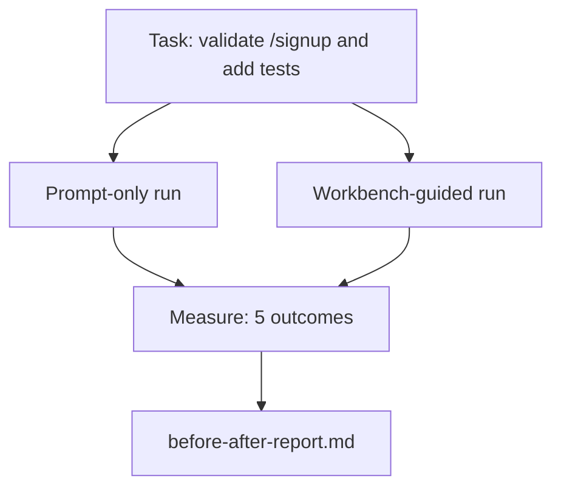

# 真实仓库上的工作台

> 十一个课程的表面，如果在与真实代码库接触时无法存活，就一文不值。本课在一个小型示例应用上把同一任务跑两遍：仅 prompt vs 工作台引导。让数字来说话。

**Type:** Build
**Languages:** Python (stdlib)
**Prerequisites:** Phases 14 · 32 to 14 · 40
**Time:** ~60 minutes

## 学习目标

- 在一个小型应用上把七个工作台表面结合起来。
- 把同一任务跑两遍（仅 prompt 与工作台引导），测量五项结果。
- 阅读前后对比报告，判断哪些表面带来了最大的杠杆。
- 面对「我的模型已经够好」的反驳，为工作台辩护。

## 问题

玩具任务上的演示说服不了任何人。当真实感的任务落在真实感的仓库上、进入生产时失败更少、回滚更少、并产出下个会话可用的包时，工作台的论证才成立。

本课交付那个真实感的仓库，并让同一任务穿过两条 pipeline。结果是一份可以拿给怀疑论者看的前后对比报告。

## 概念



### 示例应用

`sample_app/` 中一个极简的 FastAPI 风格处理器：

- `app.py`，带有 `/signup`（尚无校验）。
- `test_app.py`，带一个 happy path 测试。
- `README.md` 和 `scripts/release.sh`，作为禁区诱饵。

### 任务

> 为 `/signup` 添加输入校验：拒绝短于 8 个字符的密码，返回 422 和带类型的错误信封。添加一个证明新行为的测试。

### 两条 pipeline

仅 prompt：

1. 读 README。
2. 读 `app.py`。
3. 编辑文件。
4. 宣称完成。

工作台引导：

1. 运行 init 脚本（第 35 课）。
2. 读取范围合同（第 36 课）。
3. 读取状态（第 34 课）。
4. 只编辑允许的文件。
5. 通过反馈运行器运行验收命令（第 37 课）。
6. 运行验证门（第 38 课）。
7. 运行审查者（第 39 课）。
8. 生成交接（第 40 课）。

### 测量的五项结果

| 结果 | 为什么重要 |
|---------|----------------|
| `tests_actually_run` | 大多数「测试通过」的声明无法验证 |
| `acceptance_met` | 证明目标的测试必须是实际运行的那个测试 |
| `files_outside_scope` | 范围蔓延是占主导地位的静默失败 |
| `handoff_quality` | 下一个会话为此付出代价或从中受益 |
| `reviewer_total` | 在门之上的定性判断 |

```figure
wb-ab-runs
```

## 构建它

`code/main.py` 在同一个示例应用 fixture 上编排两条 pipeline。两条 pipeline 都是脚本化的（回路中没有 LLM），因此测量可复现。脚本把对比写入 `before-after-report.md` 和 `comparison.json`。

运行：

```
python3 code/main.py
```

输出：一张按 pipeline 展示结果的控制台表格，markdown 报告保存在脚本旁边，以及供需要作图的人使用的 JSON。

## 生产环境中的模式

怀疑者的问题是「工作台到底帮了多少忙？」2026 年的数字比解释更有说服力。

**同一模型在 Terminal Bench 上从 Top-30 到 Top-5。** LangChain 的《Anatomy of an Agent Harness》（2026 年 4 月）：一个编码 Agent 在 Terminal Bench 2.0 上，仅通过更换 harness，就从 30 名开外跃升到第五名。同一个模型。不同的表面。二十五个名次的差异。

**Vercel 通过删除工具从 80% 到 100%。** Vercel 报告称，删除其 Agent 80% 的工具后，成功率从 80% 提升到 100%。更小的工具表面、更锐利的范围、更少的失败方式。负空间取胜。

**Harvey 仅靠 harness 实现 2 倍准确率。** 法律 Agent 通过 harness 优化，准确率翻了一倍多，模型未变。

**88% 的企业 AI Agent 项目未能进入生产。** preprints.org 的《Harness Engineering for Language Agents》论文（2026 年 3 月）把失败追溯到运行时，而不是推理：陈旧状态、脆弱的重试、疯长的上下文、对中间错误的糟糕恢复。

**长上下文崩溃。** WebAgent 基线 40-50% 的成功率，在长上下文条件下下降到 10% 以下，主要来自无限循环和目标丢失。Ralph Loop 和交接包的存在就是为了吸收这一点。

**假阴性依然存在。** 单步事实任务、一行 lint、格式化器运行、任何模型逐字记住的东西——这些在仅 prompt 下更快。基准应当诚实地列举它们，以免工作台被框定为过度杀伤。

要点不是「harness 永远赢」。模型确实会随时间吸收 harness 技巧。要点是：在今天，工程负载落在七个表面上，而数字证明了这一点。

## 使用它

本课就是你在以下场合引用的案卷：

- 有人问为什么每个 PR 都带 `agent-rules.md` 和范围合同。
- 团队想「就这个 sprint」放弃验证门。
- 新的 Agent 产品发布，你需要一个可移植的基准来判断它是否真的省时间。

数字比解释传播得更远。

## 交付它

`outputs/skill-workbench-benchmark.md` 是一个可移植的评估 harness：让任何 Agent 产品穿过两条 pipeline、跑在项目自己的示例应用上，并报告五项结果。

## 练习

1. 添加第六项结果：首次有意义编辑的时间。如何干净地测量它？
2. 在你代码库中一个真实的第二天任务上跑对比。工作台的数字在哪里下滑？
3. 加入「假阴性」阶段：仅 prompt 本来更快、而工作台开销是真实成本的任务。为仍然保留工作台辩护。
4. 把脚本化的「Agent」换成真实的 LLM 调用。哪些结果变得更嘈杂？
5. 撰写一页面向非工程师的摘要。哪些内容在删减中幸存？

## 关键术语

| 术语 | 人们怎么说 | 它实际指什么 |
|------|----------------|------------------------|
| Sample app | 「Toy repo」 | 小，但足够真实，能锻炼全部七个表面 |
| Pipeline | 「Workflow」 | Agent 遵循的表面读写有序序列 |
| Before/after report | 「The receipts」 | 你拿给怀疑论者看的制品 |
| False negative | 「Workbench overkill」 | 仅 prompt 更快的任务；诚实列举它们很有用 |
| Workbench benchmark | 「Reliability score」 | 在你的代码库上运行对比的可移植 harness |

## 延伸阅读

- [LangChain, The Anatomy of an Agent Harness](https://blog.langchain.com/the-anatomy-of-an-agent-harness/) —— Terminal Bench 从 Top-30 到 Top-5 的实证
- [MongoDB, The Agent Harness: Why the LLM Is the Smallest Part of Your Agent System](https://www.mongodb.com/company/blog/technical/agent-harness-why-llm-is-smallest-part-of-your-agent-system) —— Vercel 与 Harvey 的数字
- [preprints.org, Harness Engineering for Language Agents](https://www.preprints.org/manuscript/202603.1756) —— 88% 的企业失败率，运行时的根本原因
- [HN: Improving 15 LLMs at Coding in One Afternoon. Only the Harness Changed](https://news.ycombinator.com/item?id=46988596) —— 在 15 个模型上复现
- [Cloudflare, Orchestrating AI Code Review at Scale](https://blog.cloudflare.com/ai-code-review/) —— 生产环境 30 天 13.1 万次审查运行
- [Anthropic, Building Effective Agents](https://www.anthropic.com/research/building-effective-agents)
- 第 14 阶段 · 32 至 14 · 40——本课端到端演练的各个表面
- 第 14 阶段 · 19——SWE-bench、GAIA、AgentBench，本课所补充的宏观基准
- 第 14 阶段 · 30——同一 harness 可接入的评估驱动 Agent 开发
