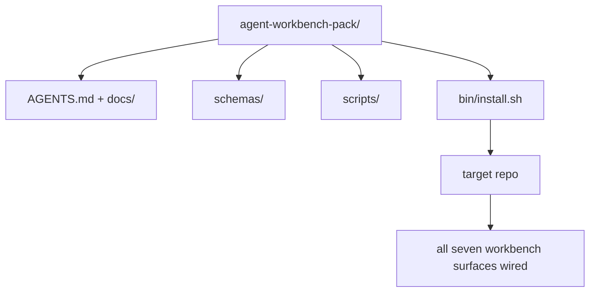

# 项目：交付可复用的智能体工作台包

> 迷你轨道以一个可放入任何仓库的包收尾。十一个课程的表面被压缩成一个目录：`cp -r` 复制过去，第二天早上智能体就能可靠工作。这个项目是本课程体系所倚仗的制品。

**Type:** Build
**Languages:** Python (stdlib)
**Prerequisites:** Phases 14 · 31 to 14 · 41
**Time:** ~75 minutes

## 学习目标

- 把七个工作台表面打包成一个即插即用目录。
- 固定 schema、脚本和模板，让新仓库获得已知良好的基线。
- 添加一个安装脚本，以幂等方式铺开包。
- 决定哪些留在包里、哪些留在包外，并为每个取舍辩护。
- 用审查者可复现的证据，演示一次智能体辅助的仓库变更。

## 问题

一个散落在 Google Doc、聊天记录和三个只记得一半的脚本里的工作台，是一个每季度都要重建的工作台。解药是一个带版本的包：包含各表面、schema、脚本和一键安装器的仓库或目录。

本课结束时，你将得到落盘交付的 `outputs/agent-workbench-pack/`，以及一个能把它放进任何目标仓库的 `bin/install.sh`。

## 概念



### 包的布局

```
outputs/agent-workbench-pack/
├── AGENTS.md
├── docs/
│   ├── agent-rules.md
│   ├── reliability-policy.md
│   ├── handoff-protocol.md
│   └── reviewer-rubric.md
├── schemas/
│   ├── agent_state.schema.json
│   ├── task_board.schema.json
│   └── scope_contract.schema.json
├── scripts/
│   ├── init_agent.py
│   ├── run_with_feedback.py
│   ├── verify_agent.py
│   └── generate_handoff.py
├── bin/
│   └── install.sh
└── README.md
```

### 留什么，去什么

保留：

- 表面 schema。它们是合同。
- 上面四个脚本。它们是运行时。
- 四份文档。它们是规则和评分标准。

去掉：

- 项目专属任务。任务属于目标仓库的面板，不属于包。
- 厂商 SDK 调用。包与框架无关。
- 入职散文。包与团队既有的入职材料并排，而不是放在里面。

### 安装器

一个简短的 `bin/install.sh`（或 `bin/install.py`）：

1. 没有 `--force` 时拒绝覆盖已存在的包。
2. 把包复制进目标仓库。
3. 如果存在 `.github/workflows/`，接好 CI。
4. 打印后续步骤：填写面板、设置验收命令、运行 init 脚本。

### 版本化

包携带一个 `VERSION` 文件。需要迁移的 schema 升级和脚本变更提升主版本。仅文档变更提升补丁版本。目标仓库的 `agent_state.json` 记录它是基于哪个包版本初始化的。

```figure
wb-pack-install
```

## 构建它

`code/main.py` 把包装配到课程旁边的 `outputs/agent-workbench-pack/`，并用迷你轨道前面课程中的 schema、脚本，以及你已写好的文档作为种子。

运行：

```
python3 code/main.py
```

脚本复制并固定各个表面，写入 README，打印包目录树，并以零退出。重复运行是幂等的。

## 生产环境中的模式

包只有在经受住分叉、更新和不友好的上游时才有价值。有四种模式让这成立。

**`VERSION` 是合同，不是营销。** 主版本提升需要状态迁移。次版本提升需要重跑检查器。补丁提升仅限文档。安装器每次安装都把 `.workbench-version` 写入目标仓库；如果目标仓库的锁与包的 `VERSION` 不一致，`lint_pack.py` 拒绝交付。这就是 `npm`、`Cargo` 和 `pyproject.toml` 在十年变迁中存活的方式；智能体的出现不会改变这些规则。

**跨工具分发的单一来源。** Nx 发布一个 `nx ai-setup`，从单一配置铺开 `AGENTS.md`、`CLAUDE.md`、`.cursor/rules/`、`.github/copilot-instructions.md` 和一个 MCP 服务器。包也应如此；安装器输出符号链接（`ln -s AGENTS.md CLAUDE.md`），让单一事实来源扇出到每个编码智能体。为了支持一个工具而分叉包，是一种失败模式。

**在不平凡状态上拒绝执行的 `uninstall.sh`。** 卸载包不得删除用户的 `agent_state.json`、`task_board.json` 或 `outputs/`。卸载器移除 schema、脚本、文档和 `AGENTS.md`（可用 `--keep-agents-md` 选择保留），并在状态文件有任何未提交变更时拒绝继续。状态属于用户；包不拥有它。

**Skill 即可发布，SkillKit 风格的分发。** 包以 SkillKit skill 形式发布：`skillkit install agent-workbench-pack` 从单一来源将其铺到 32 个 AI 智能体上。包仓库是事实来源；SkillKit 是分发渠道。厂商锁定瓦解；七个表面保持不变。

## 使用它

包发布的三个位置：

- **作为放入仓库的目录。** `cp -r outputs/agent-workbench-pack /path/to/repo`。
- **作为公共模板仓库。** 分叉并定制，由 `VERSION` 控制漂移。
- **作为 SkillKit skill。** 接入你的智能体产品，一条命令即可铺开。

包是菜谱。每次安装是一份出品。

## 交付它

`outputs/skill-workbench-pack.md` 生成一份按项目调校的包：规则按团队历史磨利，范围 glob 与仓库匹配，评分标准维度扩展一个领域专属条目。

## 练习

1. 决定第五份可选文档中哪一份值得晋升进标准包。为取舍辩护。
2. 用 Python 重写安装器，带 `--dry-run` 标志。与 bash 比较使用体验。
3. 添加 `bin/uninstall.sh`，安全移除包，并在状态文件有不平凡历史时拒绝执行。什么算不平凡？
4. 添加 `lint_pack.py`，当包与 `VERSION` 漂移时失败。把它接入包自身仓库的 CI。
5. 撰写从手搓工作台迁移到本包的运维手册。什么操作顺序能最小化停机时间？

## 职业实践：证明一次仓库变更

打包演示证明装配器能运行并产出文件。它不证明你的智能体能完成新任务，不证明生成的检查能证明那个任务，也不证明部署的系统可用。请把这些主张分开。

在你拥有或有权限修改的仓库中选择一个小而真实的任务。使用一个你已有访问权的编码智能体。修一个 bug、做一个有界功能，或一项运维改进，就足够了；安装多个智能体不属于本练习。

在打包实验之外，另安排一个独立的工作会话。把下面链接的证据模板复制到你自己的 `learning-artifacts/` 目录。保留签入的模板和包作为参考资料。

### 1. 框定任务并选择自主级别

使用第 43 课的任务框架和第 44 课的证据计划。记录起始修订版本、可观察目标、非目标、允许路径和验收证据。识别需要该行为的真实用户或操作员。

选择一种工作模式：引导式步骤、带检查点的实现，或有界自主运行。解释为什么不确定性、后果和可逆性支持这一选择。小规模本地重构可能比修改访问控制需要更少的检查点。

设置挂钟时间预算，以及智能体暴露的 token 或成本上限。诚实记录不可用的度量。为重复失败、新权限、预算耗尽或未解决的合同决定定义停止条件；指明谁能解决它。

### 2. 准备最小可用环境

检索相关的实现、调用方、测试和本地指令。记录每个来源为什么属于上下文，以及哪些当前证据会覆盖过时笔记。不要默认加载整个仓库。

为每个相关扩展做出明确选择：skill 提供可复用流程；MCP 工具提供访问；hook 运行确定性检查；plugin 打包能力。只在任务需要时保留扩展，并使用能让它工作的最小权限。

记录你拒绝的一项提议增加的上下文或维护成本。重新检查一条过时的记忆或指令，然后在证据支持该决定时，在学习者自有的设置中弃用或替换它。重跑受影响的检查，确认移除没有丢失必要的约束。

### 3. 捕获基线并实现

编辑之前，运行最接近的现有检查，并演示所请求行为当前的状态。保留命令、修订版本、结果和证据位置。尚不存在的功能仍有基线：记录观察到的响应或不支持的操作。

让智能体在合同内实现。保留一份干预日志，记录每次纠正、权限变更或计划修订的原因。委派是可选的；如有帮助，在增加另一个工作者之前，应用第 45 课的所有权与集成合同。

### 4. 挑战证据

选择能观察变更表面的证明。对于 UI，重新构建并在相关宽度下检查实际提供的用户旅程。对于 API，检查请求和序列化响应。对于 CLI，运行构建出的命令，检查其退出码和输出。选择你的任务需要的检查，并解释它们的局限。

独立于智能体的实现，从任务合同写出一个预期结果。在一个一次性副本中，引入一个特定的错误结果，例如接受无效值或丢弃必需的响应字段。运行同一个验收检查：它必须因为这个原因而失败。

如果它仍然保持绿色，先加强断言或观察，再信任它。恢复正确的实现并重新运行成功。保留两份凭证。语法错误或测试环境损坏不算检测到回归。

对照原始目标和允许路径，审查最终 diff（包括变更的测试）。请一位同事或独立的审查会话在不编辑实现的前提下挑战最弱的证明。最终判断仍然由你负责；另一个智能体的同意不是执行证据。

### 5. 演练运行与恢复

在一个一次性的本地或 staging 环境中运行变更后的制品。为每个观察标注 `local`、`staging` 或 `live`，并附上精确的修订版本或制品标识。本地演练支持本地主张；本练习不要求生产部署。

选择一个与任务相关的失败信号、一个阈值、一个观察窗口和一个负责人。解释阈值被触发时的响应。在演练中安全地触发该信号，并保留观察到的日志、指标或响应。

演练回滚到已知良好的制品，并检查先前行为是否恢复。在适用时考虑持久化数据；仅替换二进制文件可能无法逆转一次数据变更。记录任何你无法验证的恢复步骤。

### 6. 改进下一次运行并交接

把结果与基线比较，包括耗时、可用的使用数据和人工干预次数。一个任务只展示该任务上发生了什么；它不能证明智能体普遍更快或更可靠。

使用第 46 课，把一次观察到的纠正提升为一个测试、一个更小的权限边界、一项自动化，或一个更清晰的示例。重跑受影响的检查。移除临时变更，并为下一个会话明确留下最终分支、变更文件、未决风险和下一步动作。

### 人工审查评分标准

让审查者检查证据文件，并至少复现最弱的验收检查。每一行使用 `demonstrated`、`needs revision` 或 `unverified`，并附上证据指针和理由。填满的字段和通过的打包脚本不能替代这些观察。

| 维度 | 审查者应挑战的证据 |
|---|---|
| 任务与自主性 | 起始行为、有界目标、经辩护的权限、预算，以及可用的停止规则 |
| 上下文与环境 | 相关来源、经辩护的工具访问，以及重新检查过的弃用决定 |
| 验证 | 实际的修改前后行为，以及同一检查会拒绝的、刻意引入的错误结果 |
| 审查与运行 | 检查过的 diff、独立挑战、带标签的运行时观察，以及演练过的恢复 |
| 迭代与交接 | 一项经验证的改进、诚实的局限、干净的最终状态，以及可复现的下一步动作 |

在宣称任务完成之前，解决 `needs revision` 的发现。将不可用的证据留为 `unverified`，并相应收窄主张。作品集展示你在一个有界任务上的工程判断力；它不是招聘或部署的保证。

## 已交付制品

保留可复用的包，以及你完成的 [career-agent-evidence.md](https://github.com/rohitg00/ai-engineering-from-scratch/blob/main/phases/14-agent-engineering/42-agent-workbench-capstone/outputs/career-agent-evidence.md) 副本。该模板把任务框架、执行计划、运行时凭证、审查、恢复演练和交接连接成一个可审查的案例研究。

## 关键术语

| 术语 | 人们怎么说 | 它实际指什么 |
|------|----------------|------------------------|
| Workbench pack | 「The starter kit」 | 携带全部七个表面的带版本目录 |
| Installer | 「Setup script」 | 幂等铺开包的 `bin/install.sh` |
| Pack version | 「VERSION」 | schema/脚本变更提升主版本，仅文档变更提升补丁 |
| Drop-in pack | 「cp -r and go」 | 第一天无需按仓库定制即可工作的包 |
| Forkable template | 「GitHub template」 | 可用 GitHub「Use this template」克隆的公共仓库 |

## 延伸阅读

- 第 14 阶段 · 31 至 14 · 41——本包捆绑的每一个表面
- [SkillKit](https://github.com/rohitg00/skillkit) —— 把这个 skill 安装到 32 个 AI 智能体上
- [Nx Blog, Teach Your AI Agent How to Work in a Monorepo](https://nx.dev/blog/nx-ai-agent-skills) —— 跨六个工具的单一来源生成器
- [agents.md — the open spec](https://agents.md/) —— 你的包路由器必须实现的规范
- [HKUDS/OpenHarness](https://github.com/HKUDS/OpenHarness) —— 等价于包的参考实现
- [Augment Code, A good AGENTS.md is a model upgrade](https://www.augmentcode.com/blog/how-to-write-good-agents-dot-md-files) —— 包文档的质量标准
- [Anthropic, Effective harnesses for long-running agents](https://www.anthropic.com/engineering/effective-harnesses-for-long-running-agents)
- [Anthropic, Harness design for long-running application development](https://www.anthropic.com/engineering/harness-design-long-running-apps)
- 第 14 阶段 · 30——消费包验证门的评估驱动智能体开发
- 第 14 阶段 · 41——本包所改进的前后对比基准
