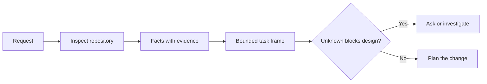

# 在智能体写代码之前先框定任务

> 编码智能体能快速实现一个清晰的任务，也能同样快速地实现一个不清晰的任务。速度一样，代价不一样。

**Type:** Learn + Build
**Languages:** Python (stdlib)
**Prerequisites:** Phase 14 lessons 31 and 36
**Time:** ~60 minutes

## 学习目标

- 在动手编辑之前，把请求转化为一个有边界的任务框架。
- 把仓库事实与假设、开放问题区分开。
- 明确允许的路径、禁止的路径和验收证据。
- 判断侦察到什么程度才足以开始工作。

## 代价高昂的失败

「为重复邮箱添加保护」听起来很具体，其实并不具体。唯一性该由 API、领域服务还是数据库负责？比较是否区分大小写？已经公开的错误结构是哪种？是否允许做数据迁移？哪个测试能证明行为正确？

一个能力强的智能体会用看似合理的选择填补这些空缺。这才是危险的情形：实现可以干净、测试齐全，却仍然与系统不兼容。

因此，编码智能体工作的第一个单元不是一次编辑，而是一个由仓库证据支撑的任务框架。

## 任务框架

有用的框架包含六个字段：

| 字段 | 问题 |
|---|---|
| 目标 | 哪种可观察的行为必须改变？ |
| 仓库事实 | 你在代码、测试、配置或历史记录中核实了什么？ |
| 允许的路径 | 改动可以落在哪里？ |
| 禁止的路径 | 哪些地方必须保持不动？ |
| 验收证据 | 哪些命令或观察能证明目标达成？ |
| 未知项 | 哪些决定仍需要证据或人的判断？ |

事实需要凭据。「API 对重复项返回 409」在你能够指出已有的测试或处理程序之前，不算事实。给出文件路径和行号就够了。如果行为是关键，命令的输出结果更好。



## 侦察是寻找约束

不要通读整个仓库。去寻找那些约束本次改动的表面：

1. 当前行为及其调用方。
2. 最接近的现有测试。
3. 公开契约或序列化结构。
4. 管辖该路径的项目说明。
5. 构建与验证命令。
6. 能揭示本地模式的类似已完成改动。

当计划中的每个决定都已有证据支撑、被明确授权，或被列为未知项时，就停下来。此后的继续阅读往往是一种回避。

## 未知不等于失败

未知项是一个受控的缺口，假设则是对这个缺口的失控答案。

对每个未知项分类：

- **可发现**：仓库或运行中的系统能回答它。
- **可决定**：任务契约授予智能体选择权。
- **需人工**：该选择会改变产品行为、成本、风险或公开兼容性。
- **延后**：该选择不在本次切片范围内，应归入非目标。

智能体应继续处理可发现和已授权的未知项；遇到需人工的未知项时，应在该选择被埋进代码之前暂停。

## 先定验收，再写实现

先写证明，再写补丁。证明可以是：

- 一条聚焦的单元测试或集成测试命令；
- 一段浏览器旅程，指明视口与预期状态；
- 一个线上请求与精确的响应契约；
- 一项带阈值的性能测量；
- 一项范围检查，确认没有无关文件被改动。

「测试通过」不是证明方案。要指名权威测试，以及它支撑的断言。

## 构建它

本实验会创建一个 `TaskFrame`，校验其边界与证据，并写出 `outputs/task-frame.md`。

在本课目录下运行：

```bash
python3 code/main.py
python3 -m unittest discover code/tests -v
```

用四种方式破坏示例：删除目标、删除事实凭据、让允许路径与禁止路径重叠、删除验收命令。校验器应当以不同的理由拒绝每一种框架。

## 在真实仓库中使用

在让智能体动手编辑之前：

1. 把目标写成一种行为，而不是一次文件改动。
2. 记录两到三个事实，并附上确切证据。
3. 指名最小的允许路径集合。
4. 明确写出负空间，即不允许触碰的部分。
5. 写出能收束任务的命令或观察。
6. 列出你尚未赢得依据的决定。

框架应当能在一屏内写完。如果做不到，这个任务可能包含多个可独立验证的改动。

## 练习

1. 从你的某个仓库中挑一个真实的 bug 进行框架化，不要提出解决方案。
2. 找出框架中一条实际上是假设的断言，用证据替换它。
3. 添加一个需人工的未知项，其答案会改变公开契约。
4. 把一个宽泛的允许路径拆成最小的安全集合。
5. 在验收证据中加入一条范围凭据。

## 延伸阅读

- [Nuseibeh and Easterbrook, Requirements Engineering: A Roadmap](https://www.cs.toronto.edu/~sme/papers/2000/ICSE2000.pdf)，论述如何把实现锚定在真实目标与不断演化的约束上。
- [Yang et al., SWE-agent: Agent-Computer Interfaces Enable Automated Software Engineering](https://arxiv.org/abs/2405.15793)，提供证据说明编码智能体周围的接口设计会改变其有效性。

## 你保留什么

保留 `outputs/task-frame.md`。它是下一课的输入，在那里这个框架会变成一个由证据支撑的执行计划。
