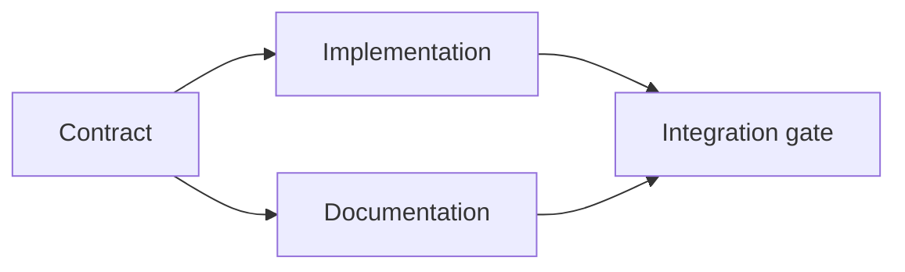

# 构建有证据支撑的执行计划

> 计划不是更漂亮的待办清单，而是一张依赖图：每个改动都有理由，每个终端节点都有证明。

**Type:** Learn + Build
**Languages:** Python (stdlib)
**Prerequisites:** Phase 14 lesson 43
**Time:** ~65 minutes

## 学习目标

- 把任务框架转换为带证据和证明的工作项。
- 用依赖关系而非散文式顺序来建模先后。
- 在编辑之前发现缺失的事实、未知的依赖和环。
- 区分可以并行执行的步骤与必须等待的步骤。

## 为什么 Agent 的计划会失败

薄弱的计划只是用将来时重复请求：

1. 更新 API。
2. 添加测试。
3. 更新文档。

这份清单没有说明发现了什么、为什么是这些文件、哪个契约先变、哪些部分可以并发。Agent 可以逐步照做，却仍然制造返工。

强有力的计划会为每个工作项做出五项承诺：

| 承诺 | 用途 |
|---|---|
| 标识符 | 供依赖和交接使用的稳定引用 |
| 改动 | 最小的行为或契约变化 |
| 证据 | 为改动提供依据的仓库事实 |
| 依赖 | 必须先成立的工作 |
| 证明 | 关闭该项的确切检查 |

## 先规划契约，再规划实现

当多个表面依赖同一行为时，先定义这个行为。这样测试、实现、文档和集成可以共享一份契约，而不是各自发明四个版本。



这张图揭示了安全的并发点：契约确定之后，实现与文档可以并行推进；集成则要等待两者完成。

## 证据会改变计划

仓库证据不是装饰，它应当有能力改变工作内容：

- 一个已有的辅助函数会取消计划中的新抽象。
- 一个兼容性测试会迫使加入迁移步骤。
- 一个部署约束会把 schema 变更移到另一个任务。
- 一个公开响应类型会改变实现与文档的先后顺序。

如果证据无法改变计划，它很可能并不是该决定的证据。

## 为中断而设计

编码 Agent 的会话会意外结束。可恢复的计划把工作项切得足够小，使另一个会话能够判断：

- 哪一项已完成；
- 跑了哪个证明；
- 哪些产物发生了变化；
- 哪些依赖现已解除阻塞；
- 下一个安全的项是什么。

不要把状态只编码在聊天里的勾选框中。把计划存放在工作旁边。

## 计划校验

出现以下情况时，在执行前拒绝该计划：

- 标识符重复；
- 某个工作项没有证据；
- 某个工作项没有证明；
- 某个依赖指向未知的工作项；
- 图中存在环；
- 第一个不可逆操作发生在相关不确定性解决之前。

前五项检查是机械性的；最后一项需要判断，应当被明确标出。

## 构建它

`code/main.py` 对工作项建模，校验它们的凭据，用拓扑排序计算执行波次，并写出 `outputs/evidence-plan.json`。

运行：

```bash
python3 code/main.py
python3 -m unittest discover code/tests -v
```

示例产生三个波次：契约定义先运行；实现与文档一起运行；集成门最后运行。

## 与编码 Agent 配合使用

让 Agent 在改动文件之前先产出计划。审查计划时关注三件事：

1. 每条路径和行为断言都有仓库凭据。
2. 每个工作项都有一个清晰的完成证明。
3. 图会把昂贵或不可逆的工作推迟到它所依赖的不确定性解决之后。

批准的是计划，而不是一句「我会小心的」模糊承诺。

## 练习

1. 添加一个需要人工明确批准的迁移项。
2. 制造一个环，并解释其背后隐藏的产品分歧。
3. 拆分一个需要两条证明命令的工作项。
4. 添加一个能在第二波次运行、且不触碰现有两个分支的工作项。
5. 把计划渲染为 Markdown，同时让 JSON 保持为唯一事实来源。

## 延伸阅读

- [Nuseibeh and Easterbrook, Requirements Engineering: A Roadmap](https://www.cs.toronto.edu/~sme/papers/2000/ICSE2000.pdf)，论述目标、规格、共识与演化之间的迭代关系。
- [Barry Boehm, A Spiral Model of Software Development and Enhancement](https://dl.acm.org/doi/10.1145/12944.12948)，论述如何围绕风险消解来安排开发顺序，而非固守线性序列。

## 你保留什么

保留 `outputs/evidence-plan.json`。它会在下一课成为委派契约。
