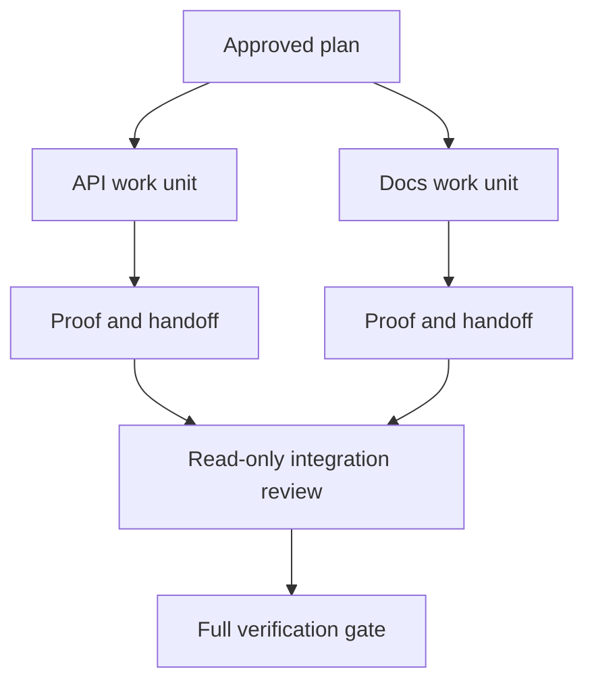

# 用隔离与合并契约委派 Agent 工作

> 只有当工作彼此独立时，并行 Agent 才能节省墙钟时间。否则，它们只是把一个清晰的任务变成协调问题，而且失败率更高。

**Type:** Learn + Build
**Languages:** Python (stdlib)
**Prerequisites:** Phase 14 lessons 39 and 44
**Time:** ~70 minutes

## 学习目标

- 依据真实的独立性判断委派是否合理。
- 给每个 worker 独占的文件所有权和明确的证明。
- 依据依赖关系计算执行波次。
- 设计合并契约，安全地组合 Agent 的工作。

## 并行性测试

不要因为手头有更多 Agent 就委派。只有当以下至少一条成立时才委派：

- 两项调查能独立地回答不同的未知项；
- 两个实现拥有互不相交的文件和契约；
- 审查者可以检查已完成的产物而不改动它；
- 缓慢的外部检查可以在本地工作继续的同时运行。

当多个 Agent 需要相同的文件、同一个未决决定或同一个可变环境时，就让工作串行。

## 工作单元就是契约

每个委派单元需要：

| 字段 | 含义 |
|---|---|
| 目标 | 一个可观察的结果 |
| 负责人 | 一个承担责任的 worker |
| 路径 | 独占的写所有权 |
| 依赖 | 开始前必须完成的单元 |
| 证明 | 返回给集成者的确切证据 |
| 交接 | 改动的文件、做出的决定、剩余风险 |

「把后端处理一下」不是一个工作单元。「在 `app/accounts.py` 中实现重复检查，并用聚焦的账户测试证明它」才是。

## 隔离有三层

1. **文件系统隔离**：独立的工作树或沙箱防止意外的共享编辑。
2. **所有权隔离**：契约防止两个 worker 有意编辑同一路径。
3. **状态隔离**：独立的日志与输出防止一个 worker 覆盖另一个 worker 的证据。

文件系统隔离解决不了所有权问题。两个干净的工作树仍可能产出冲突的设计。合并契约必须在工作开始前确定共享接口。



## 集成者不重做工作

集成者应当：

1. 确认每次交接与其被分配的范围一致；
2. 阅读证明输出，而不只是 worker 的总结；
3. 按依赖顺序合并改动；
4. 运行完整的跨单元门禁；
5. 拒绝隐藏的范围扩张；
6. 把冲突记录为新决定，而不是悄悄修改。

如果集成时需要重写 worker 结果的大部分，那最初的分解就是错的。

## 人与 Agent 的角色

委派并不会移除人的判断。凡是会改变公开行为、风险、权限或不可逆成本的选择，仍由人负责；Agent 可以负责有边界的调查、实现、验证与审查。

这就是校准过的自主性（calibrated autonomy）：在证据充分、可回滚的地方给予自由，在后果严重的地方要求 checkpoint。

## 构建它

本实验检查路径重叠、校验依赖、计算安全的执行波次，并写出 `outputs/delegation-plan.json`。

运行：

```bash
python3 code/main.py
python3 -m unittest discover code/tests -v
```

把 docs 单元改为拥有 `app/`。计划应当被阻止，因为这个父路径与 API 单元重叠。

## 练习

1. 把一个真实改动分解为两个独立工作单元和一个集成者。
2. 找出一个只是看起来独立的并行切分方案，说明其中的共享决定。
3. 添加一个只读的研究 worker，其输出是一张事实表。
4. 添加一个合并门禁，用所有单元契约核对最终改动文件集合。
5. 为一个依赖失效的 worker 定义取消规则。

## 延伸阅读

- [Reid Smith, The Contract Net Protocol](https://doi.org/10.1109/TC.1980.1675516)，分布式任务分配与结果汇报的早期形式化论述。
- [Eric Horvitz, Principles of Mixed-Initiative User Interfaces](https://dl.acm.org/doi/10.1145/302979.303030)，关于何时让自动化行动、何时把控制权交还给人的判断。

## 你保留什么

保留 `outputs/delegation-plan.json`。它记录了切分为何安全、每条路径归谁所有，以及集成时必须收到哪些证明。
