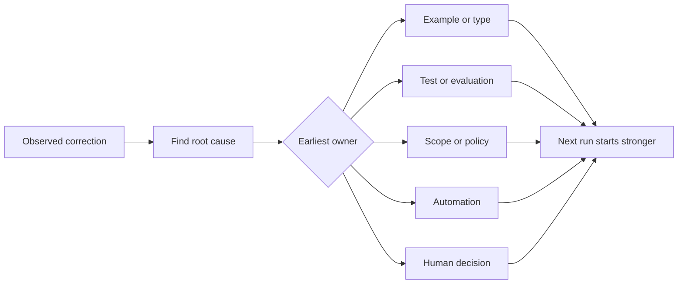

# 把每一次 Agent 纠正转化为系统改进

> 只留在聊天里的纠正只能修好一次运行；被提升为测试、边界、示例或工具的纠正会改善之后的每一次运行。

**Type:** Learn + Build
**Languages:** Python (stdlib)
**Prerequisites:** Phase 14 lessons 37 to 41
**Time:** ~65 minutes

## 学习目标

- 把 Agent 纠正转化为持久的控制措施。
- 把每项控制放在能防止复发的最早一层。
- 用稳定的指纹对重复的经验去重。
- 淘汰不再防护真实风险的控制。

## 纠正是证据

当你对 Agent 说「不要编辑那个文件」时，你学到的是范围边界本身不可执行。当你说「这个输出结构不对」时，你学到的是缺少示例或测试。当环境搭建再次失败时，你学到的是环境知识应写进自动化。

把纠正看作关于工作系统的一次观察，而不是一次 prompt 写作失败。

## 提升到最早的有效层

按以下顺序：

| 反复出现的失败 | 持久的归宿 |
|---|---|
| 结果错误或回归 | 测试或评估 |
| 越界或不安全操作 | 范围或权限策略 |
| 反复的环境搭建或命令错误 | 自动化或工具 |
| 反复的输出格式错误 | 规范示例加校验器 |
| 含糊的本地约定 | 带场景检查的说明 |
| 产品分歧 | 人工决策记录 |

越靠前的控制成本越低。能阻止非法状态的类型，强过事后才捕获它的评审意见；一条聚焦的测试，强过一段要求 Agent 记住的说明文字。



## 棘轮记录

记录以下内容：

- 症状；
- 根因；
- 后果；
- 复发次数；
- 选用的控制措施；
- 该控制措施的验证方式；
- 负责人；
- 复查或淘汰的日期。

不要提升每一个一次性的偏好。只有当复发或后果足以证成为永久复杂度买单时，才提升一条纠正。

## 区分原因与症状

「Agent 改了 README」是症状，可能的原因包括：

- 任务允许了仓库根目录；
- 文档被默认为安全区域；
- 计划把实现与文档捆在一起；
- 两个 worker 的所有权重叠。

每种原因对应不同的控制措施。仅仅复述症状的规则，在下一次略有不同的情形中就会失效。

## 控制措施也会腐化

旧的控制措施会互相冲突、撑大上下文，并编码一个已不存在的系统。每条被提升的规则都需要淘汰检查。出现以下情况时删除或重写它：

- 底层架构已经改变；
- 有更强的可执行控制取代了它；
- 在足够长的窗口内该失败没有复发；
- 该控制带来的摩擦超过它所防范的风险。

目标不是写出最长的指令文件，而是用最小的系统保住来之不易的判断力。

## 构建它

本实验对纠正进行分类，把它们提升为控制措施，为重复项生成指纹，并写出 `outputs/feedback-ratchet.json`。

运行：

```bash
python3 code/main.py
python3 -m unittest discover code/tests -v
```

添加两条措辞不同但原因相同的纠正。改进归一化处理，直到它们合并为一条控制措施，同时不会把无关的失败也合并掉。

## 练习

1. 从最近一次编码会话中取五条纠正，分类它们的真正归属层。
2. 用一条可执行测试替换一条散文式规则。
3. 加入后果权重，使严重的首次出现可以立即被提升。
4. 在实验输出中加入负责人和淘汰日期。
5. 审查一条现有的 Agent 指令，只有在证明存在更强控制之后才删除它。

## 延伸阅读

- [Basili, Caldiera, and Rombach, The Goal Question Metric Approach](https://www.cs.toronto.edu/~sme/CSC444F/handouts/GQM-paper.pdf)，论述如何把目标转化为问题与可操作的度量。
- [Shinn et al., Reflexion](https://arxiv.org/abs/2303.11366)，论述如何利用反馈轨迹在不改变模型权重的情况下改善后续决策。
- [Madaan et al., Self-Refine](https://arxiv.org/abs/2303.17651)，论述任务循环内的迭代反馈与修订。

## 你保留什么

保留 `outputs/feedback-ratchet.json`。它是 Agent 辅助工程路径的持久产出，也是未来 workbench 改动的输入。
