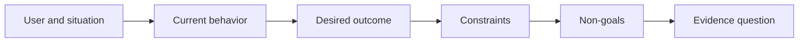

# 先定义结果，再选择产出

> 实现速度越快，选错问题的代价就越高。先把结果塑造清楚，速度才会指向正确的方向。

**Type:** Learn + Build
**Languages:** Python (stdlib)
**Prerequisites:** None
**Time:** ~60 minutes

## 学习目标

- 在不确定解决方案的前提下写出结果框架。
- 识别用户、情境、当前行为和期望的改变。
- 明确写出约束与非目标。
- 在方案泄漏固化为范围之前发现它。

## 产出不等于结果

「做一个事故助手」指名的是一种产出。它没有说明谁需要它、什么会变好、什么必须保持安全。

结果框架会这样写：

> 当生产告警到来时，值班工程师能在两分钟内识别出故障服务和一个安全的下一步操作，同时诊断过程保持只读、可审计。

这句话可以由软件、运行手册、数据修复，或一次更小的接口改用来满足。它让团队紧扣结果，而不是某个人最先想象出的产物。

## 六部分框架

| 部分 | 问题 |
|---|---|
| 用户 | 谁直接经历这个问题？ |
| 情境 | 它在何时何地发生？ |
| 当前行为 | 今天会发生什么，包括有哪些绕行办法？ |
| 期望结果 | 哪种可观察的状态应当改善？ |
| 约束 | 哪些安全、政策、成本或兼容性限制是固定的？ |
| 非目标 | 哪些诱人的相邻工作被排除在外？ |



## 找出方案泄漏

当结果陈述中包含尚未被证据证成的产品形态、接口、模型选择、框架或架构时，它就在泄漏方案。

- 「用户每周收到一份 AI 摘要」泄漏了摘要形式和频率。
- 「用户在批准之前了解账户变更」陈述的是结果。
- 「部署一个向量数据库」泄漏了基础设施。
- 「评审时可获取相关的政策证据」陈述的是一种能力。

当兼容性确实固定了某项技术时，约束可以指名该技术。要记录它为何被固定。

## 约束保护结果

约束不是实现细节，它们是真实目标的一部分：

- 诊断期间不对生产环境写入；
- 响应落在事故的时间预算之内；
- 现有审计事件保持权威；
- 不引入新的运行时依赖；
- 无障碍行为保持完好。

通过违反约束而达成结果的做法，并没有真正达成结果。

## 非目标划出边界

非目标防止一个有用的切片膨胀成平台。好的非目标足够具体，能够用来拒绝工作：

- 不做自动修复；
- 不新建告警路由系统；
- 不替代事故指挥官；
- 本切片不包含历史分析。

## 构建它

本实验校验一个 `OutcomeFrame`，并写出 `outputs/outcome-frame.json`。

```bash
python3 code/main.py
python3 -m unittest discover code/tests -v
```

把期望结果替换为「使用事故助手」。校验器应当指出这个提议的产出泄漏进了结果。

## 练习

1. 把待办列表中的一个功能请求改写为结果框架。
2. 添加一条会改变可选解决方案范围的约束。
3. 添加两个让首个切片保持小的非目标。
4. 找出最早能证伪期望结果的观察。
5. 写出三种能满足同一结果的不同产出。

## 延伸阅读

- [Nuseibeh and Easterbrook, Requirements Engineering: A Roadmap](https://www.cs.toronto.edu/~sme/papers/2000/ICSE2000.pdf)，论述把真实目标作为软件工作锚点的观点。
- [Dardenne, van Lamsweerde, and Fickas, Goal-Directed Requirements Acquisition](https://doi.org/10.1016/0167-6423(93)90021-G)，论述如何把高层目标细化为约束与可操作的需求。

## 你保留什么

保留 `outputs/outcome-frame.json`。下一课会用它对照人们实际执行的工作流进行检验。
