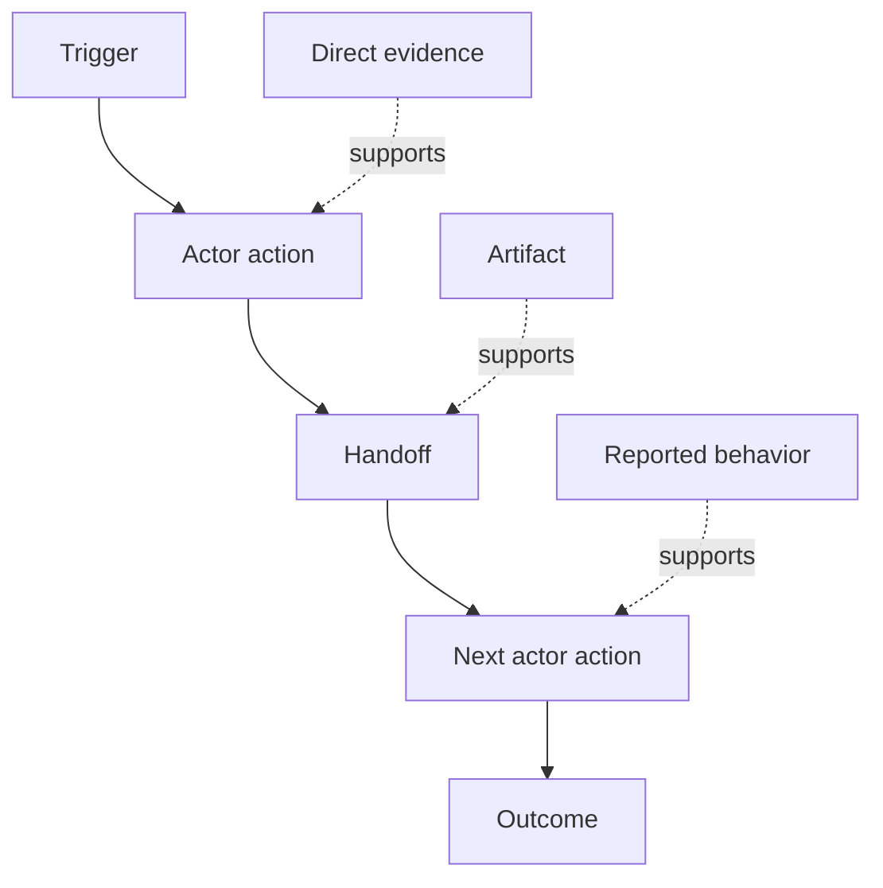

# 发现人们实际执行的工作流

> 需求不会在会议里等着被收集。它们散落在行动、绕行办法、记录与分歧之中。

**Type:** Learn + Build
**Languages:** Python (stdlib)
**Prerequisites:** Phase 14 lesson 47
**Time:** ~70 minutes

## 学习目标

- 把当前工作流建模为带证据的有序动作。
- 把直接观察与转述或推断的行为区分开。
- 定位摩擦、交接、权限和隐藏状态。
- 让不确定的断言保持可见，而不是直接变成需求。

## 从现有系统开始

不要从「人们想要什么功能」开始，而从重构「现在发生了什么」开始。

为每个步骤记录：

| 字段 | 示例 |
|---|---|
| 参与者 | 值班工程师 |
| 触发 | 生产告警到达 |
| 动作 | 打开告警，然后搜索仪表盘 |
| 输入 | 告警负载和部署记录 |
| 输出 | 候选服务及其负责人 |
| 摩擦 | 在三个工具之间切换上下文 |
| 权限 | 事故指挥官批准写入 |
| 证据 | 屏幕录制、事故日志、运行手册 |

工作流比屏幕上的界面更大。它包括等待、复制粘贴、旁路渠道、审批、错误恢复，以及人们已经不再注意的步骤。

## 证据有强弱

使用一个简单的证据阶梯：

1. **直接行为**：观察、trace、录制或系统事件。
2. **产物**：工单、运行手册、日志、表单或已完成的输出。
3. **转述行为**：有人描述自己做了什么。
4. **推断**：团队得出的「大概是这样」的结论。

四者都可能有用，但只有前两者能直接证明当前行为。给其余证据贴上标签，避免置信度悄悄膨胀。



## 寻找四样东西

- **摩擦**：重复投入、延迟、重新录入或恢复。
- **隐藏状态**：只存在于记忆、聊天或个人笔记中的事实。
- **权限**：被允许做出重大改变的人或系统。
- **例外**：正常流程不再正常的那些情形。

AI 功能常常在交接和例外处失败，因为只有顺利路径（happy path）被塑造过。

## 不要把分歧平均掉

两位用户可能出于合理的原因采用不同的工作流。先保留这些变体，直到你弄清它们代表的是：

- 不同角色；
- 不同风险等级；
- 遗留流程与当前流程；
- 专业程度差异；
- 真正的政策分歧。

被平均后的工作流可能不描述任何人。

## 构建它

本实验为每个工作流步骤保存证据，校验顺序与置信度，计算直接证据比例，并写出 `outputs/workflow-evidence.json`。

```bash
python3 code/main.py
python3 -m unittest discover code/tests -v
```

添加一条部署记录缺失的例外路径。保持主顺序不变，并记录分支从何处开始。

## 练习

1. 不采访任何人，仅凭日志重构一个工作流。
2. 采访一位用户，并标出每一条仍缺少直接证据的断言。
3. 添加一个权限边界和一个失败恢复步骤。
4. 为两个工作流变体建模，但不合并它们。
5. 找出一个去掉了可见步骤、却没有触及隐藏工作的功能提案。

## 延伸阅读

- [Nuseibeh and Easterbrook, Requirements Engineering: A Roadmap](https://www.cs.toronto.edu/~sme/papers/2000/ICSE2000.pdf)，特别是它把需求获取视为解释、建模和验证，而非简单采集的论述。
- [Gotel and Finkelstein, An Analysis of the Requirements Traceability Problem](https://doi.org/10.1109/ICRE.1994.292398)，论述维持需求与其来源之间关系的困难。

## 你保留什么

保留 `outputs/workflow-evidence.json`。下一课会用它把观察到的摩擦与不确定性转化为一张假设地图。
